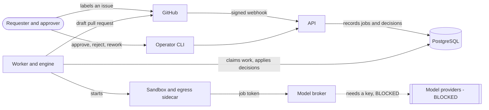

# The universal agentic software factory

This repository holds the control plane of a software factory. It takes one authorized GitHub issue and turns it into a reviewed draft pull request with an evidence trail. A person approves the result. The factory never merges and never deploys.

## What the factory is

The factory is a deterministic shell around probabilistic specialist agents. The shell is Rust code. It decides every step: which stage runs, which gate must pass, who may approve and what is stored. The agents only propose. A gate checks each proposal with code. A person has the last word.

A job moves through 13 stages, in this order: intake, repository intelligence, specification, domain discovery, architecture, task planning, implementation, validation, review, documenting, documentation review, delivery and approval. The [state machine](docs/architecture/state-machine.md) lists the rules for moving between them, including the routes back for rework.

GitHub Spec Kit writes the specification and does nothing else. The [Spec Kit guide](docs/guides/spec-kit.md) says where that line is.

## What is proven and what is not

Read this before you trust anything else in this repository.

**Built and checked in test mode.** The workflow engine, the PostgreSQL store with row-level security, the HTTP API, the operator command line, the worker, the sandbox, the egress sidecar and the GitHub adapter exist as code with tests. One test, `apps/api/tests/full_run.rs`, runs a `word-count` job from a signed webhook to `COMPLETED`. It uses the real handler of every stage, a real PostgreSQL and the real API server. An approver decides twice through the API: once on the specification draft and once on the pull request. The file holds 10 tests, and all 10 passed on 2026-10-29.

**What "test mode" means.** The agents are a script, the sandbox and the GitHub host are labelled fakes, and no model is called. Every recording and report says so. The [walkthrough](docs/walkthroughs/test-mode-run.md) follows one such run.

**Not proven.** The factory has never run against a real model, a real GitHub App or a protected repository. The acceptance scenarios that need them, E1 and E2, are BLOCKED, and BLOCKED is never a pass. The worker program starts, runs its checks, prints one `BLOCKED:` line for each adapter or input that does not exist yet, and exits with code 3. It claims no job. The agent image has not been rebuilt for the latest hardening. Tests that need Docker could not run on the machine used to write these documents, because the Docker daemon did not answer.

The [acceptance report](docs/reports/slice-1-acceptance.md) and the [findings](docs/reports/slice-1-findings.md) hold the full numbers, including the scenarios that failed. The [production guide](docs/guides/production.md) lists what a person must supply before a live run.

## How the parts fit

The API records what people ask for and never runs work. The worker holds the engine, the sandbox supervisor and the credentials, and it applies each decision once. The two share only the database. The dotted line is the part that does not exist yet.

## Where to read next

| You want to | Read |
|---|---|
| Run a job in test mode on your machine | [Quickstart](docs/guides/quickstart.md) |
| Prepare an existing project and send it tickets | [Onboarding guide](docs/guides/onboarding.md) |
| Give a repository the manifest that the gates need, and know what the gates can check today | [Prepare a repository](docs/guides/prepare-a-repository.md) |
| Design a new solution with the Elephant-Goldfish Model (EGM) before the factory builds it | [Design guide](docs/guides/design-with-egm.md) |
| Show the issues on a GitHub Projects board, new or already there | [Board guide](docs/guides/project-board.md) |
| Use Claude Code, Codex or both for the design path | [Claude Code and Codex side by side](docs/guides/claude-and-codex.md) |
| See what one job looks like from the webhook to the approval | [Walkthrough of a test-mode run](docs/walkthroughs/test-mode-run.md) |
| Look up a setting, a command or an endpoint | [Configuration](docs/reference/configuration.md), [Commands](docs/reference/commands.md) |
| Know what each policy file controls | [Policies](docs/reference/policies.md) |
| Know what the factory stores as evidence | [Artifacts](docs/reference/artifacts.md) |
| Fix a job that is stuck | [Runbooks](docs/runbooks/README.md) |
| Prepare for a live run | [Production guide](docs/guides/production.md) |
| Understand the design | [Architecture overview](docs/architecture/overview.md) and the [decision records](docs/adr/README.md) |
| Read what independent reviewers found | [Reviews](docs/reviews/) and the [threat model](docs/security/threat-model.md) |

## Checking the documents

`scripts/docs-check.sh` checks these documents the way the factory checks the documents of others: links, runnable examples, command names, configuration keys, walkthrough citations and readability. The [documentation policy](docs/reference/documentation-policy.md) holds the rules, and [documentation checks](docs/reference/documentation-checks.md) says what each check reads.

## Working in this repository

The toolchain is pinned in `rust-toolchain.toml`. `scripts/ci.sh` runs every check, on a laptop and in CI alike. The master prompt, `universal_agentic_software_factory_master_prompt.md`, is the source of the requirements.
