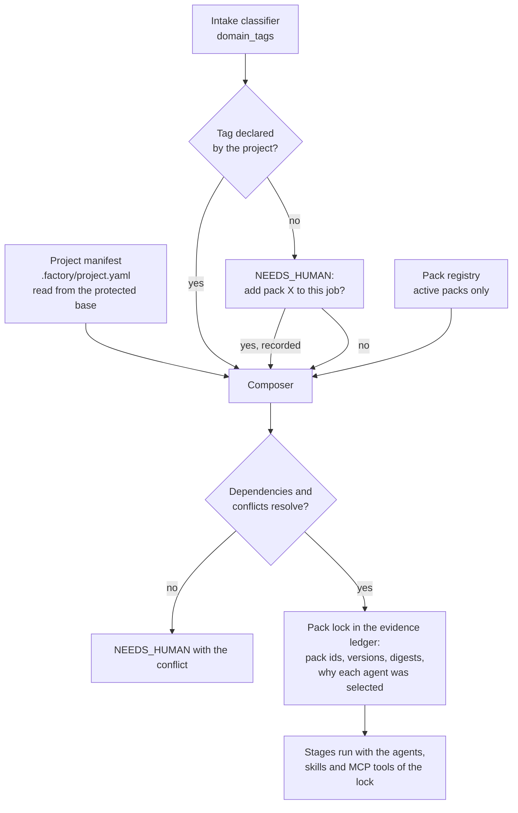
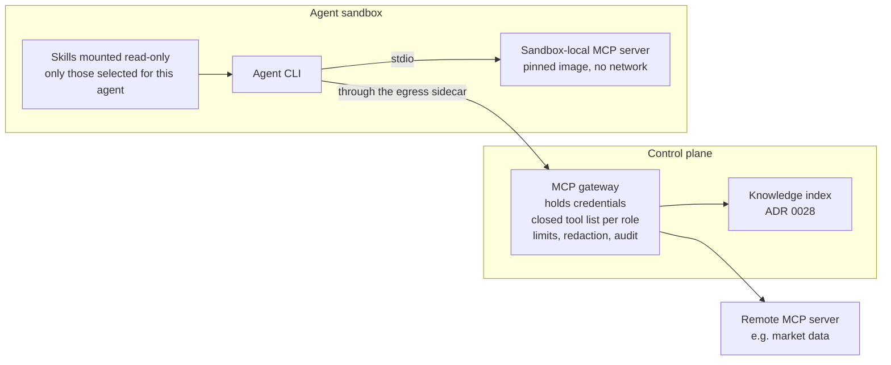

# Capability packs

- Status: decided by the owner on 2026-11-20. Nothing is built. The decisions and the options weighed are in [ADR 0027](../adr/0027-capability-packs.md).
- Form: design. Read this for what a pack is and how a job gets one, and the ADR for why. The guide for writing a pack is written when the loader exists, so that it never describes commands the factory does not have. The practices the packs follow are in [agentic-practices.md](../reference/agentic-practices.md).

## Purpose

The factory must build any kind of software: a web product, a game, a finance system, and kinds nobody has named yet. Each kind needs its own experts, its own know-how, its own tools and its own checks. A web product needs a frontend engineer and an accessibility reviewer; a game needs deterministic simulation tests; a finance system needs exact money arithmetic and a reviewer who checks every calculation.

A **capability pack** is how the factory gains a kind of software without changing its engine. A pack is one versioned folder that bundles everything a domain needs. A project declares the packs it uses, and each job gets exactly the agents, skills and tools of those packs, recorded in the job's evidence.

## What a pack holds

| Part | What it is | Existing contract it reuses |
|---|---|---|
| Profile | The domain's tools, gates, evidence and forbidden actions. | `schemas/domain-capability-profile.schema.json` |
| Agents | Specialist agents: a manifest, a versioned prompt, schemas and fixtures each. | `schemas/agent-manifest.schema.json`, the layout of `agents/` |
| Skills | Domain know-how in the Agent Skills format: a `SKILL.md` with a name and a description, and optional `references/` and `scripts/`. | The pinned-skill mount of the Spec Kit skills (ADR 0006, ADR 0019) |
| MCP servers | The servers the pack may use, their class, their pin and the tools each role may call. | The MCP gateway (troubleshooter record, see ADR 0027 "Dependencies") |
| Gates | Deterministic checks for the validation stage, as argument vectors. | The gates of `schemas/project-manifest.schema.json` |
| Evaluation cases | Tasks with known good answers, used to promote the pack and to compare models. | `evaluation_suite` of the agent manifest |
| Documentation requirements | The documents a change in this domain must carry. | The documentation policy |

The pack's human documentation is `docs/packs/<pack-id>.md` in this repository, so all documents stay under `docs/`.

## Layout

```text
packs/<pack-id>/
  pack.yaml                 the pack manifest (below)
  profile.json              the domain capability profile
  agents/<agent-id>/        manifest.json, prompt.md, fixtures/valid, fixtures/invalid
  skills/<skill-id>/        SKILL.md, references/, scripts/
  mcp/servers.yaml          the MCP servers and their tool lists
  evals/<suite-id>/         evaluation cases and their expected results
```

The ten agents of `agents/` and the profile `profiles/general-software` form the **core pack**. They stay where they are; the loader reads those directories as the pack `core`, which every job has.

## The pack manifest

```yaml
schema_version: 1
id: web-product
version: 1.0.0
title: Web products
description: Websites, web applications and their user interfaces.
status: draft                     # draft, reviewed, active; only active packs drive production jobs
matches: [web, frontend, saas, landing-page]
requires: [{ pack: core, version: "^1" }]
conflicts: []
profile: profile.json

agents:
  - path: agents/frontend-engineer
    base_role: builder            # a role that exists in the tool table of policies/security.yaml
    extension_point: implementation.specialist
    specialist_role: frontend_engineer
    when: { owned_paths_match: ["**/*.tsx", "**/*.css", "src/ui/**"] }
  - path: agents/accessibility-reviewer
    base_role: ux_reviewer
    extension_point: review.reviewer
    when: { touched_paths_match: ["**/*.tsx", "**/*.html"] }

skills:
  - id: accessible-ui
    path: skills/accessible-ui
    sha256: { SKILL.md: "sha256:...", references/wcag-checklist.md: "sha256:..." }
    for_agents: [frontend-engineer, accessibility-reviewer]
    source: { kind: first-party }

mcp_servers:
  - id: browser
    class: sandbox_local          # stdio inside the sandbox, no credential, no network
    image: "ghcr.io/...@sha256:..."
    tools:
      - { name: browser_navigate, access: read, roles: [accessibility-reviewer] }
      - { name: browser_snapshot, access: read, roles: [accessibility-reviewer] }

gates:
  - { id: e2e-browser, title: Browser end-to-end tests, argv: [npx, playwright, test], timeout_seconds: 900, mandatory: true }
  - { id: accessibility, title: Automated accessibility audit, argv: [npx, axe, dist/], timeout_seconds: 300, mandatory: true }

evaluation_suites:
  - { id: web-product-tasks, version: 1.0.0, min_pass_rate: 0.9 }

forbidden_autonomous_actions: [deploy, publish-package]   # added to the core list; never removes from it
```

Rules the loader enforces:

1. Every agent names a `base_role` that exists in the tool table of `policies/security.yaml`. Its tools and paths must be a subset of what that role may hold. A pack cannot create a role or widen a grant.
2. Every skill file and every bundled script is pinned by SHA-256. A changed byte blocks the worker, as a changed Spec Kit skill does.
3. Every MCP tool is listed by name, with its access and the agents that may call it. A tool the server offers but the pack does not list is never shown to an agent.
4. `forbidden_autonomous_actions` and `never_grantable` only grow when packs combine.
5. A pack with `status: active` has passed its evaluation suites at `min_pass_rate` and carries a review block, like a profile.

## Extension points

A pack contributes only at these points. The stages of the engine do not change.

| Extension point | Stage | What the pack adds | How it is triggered |
|---|---|---|---|
| `specification.checklist` | Specification | Domain checklist items for requirement quality (for finance: rounding rule, currency, as-of date). | The pack is active for the job. |
| `architecture.advisor` | Architecture | A domain advisor whose notes the architect receives. | The pack is active. |
| `architecture.critic` | Architecture | A domain critic, independent of the architect's model. | The risk tier or the pack's `when`. |
| `implementation.specialist` | Implementation | A builder variant the planner may assign through `required_specialist` in the task plan. | The planner names the specialist role; the composer checks that an active pack offers it. |
| `review.reviewer` | Review | An independent reviewer that runs in parallel with the code reviewer. | The pack's `when` (touched paths, task kind, risk tier). |
| `validation.gate` | Validation | Deterministic gate commands in the `verify` sandbox. | Mandatory or conditional, as in the profile. |
| `documentation.requirement` | Documentation | Documents a change must carry (for games: controls and asset licences). | The pack is active. |
| `delivery.evidence` | Delivery | Sections of the pull request body filled from measured evidence, so a person can judge the change without reading every line: screenshots for a user interface, frame time and load size for a game, reconciliation results for finance, with the risk the change carries. | The pack is active and the evidence exists. A section with no evidence says so; it is never left out silently. |

## How a job gets its packs



The composer is code, not an agent. It picks the **minimum sufficient team**: an agent of a pack runs only when its trigger matches the task. A frontend reviewer does not run on a change to a database migration.

## How skills and MCP tools reach an agent



- A **skill** is mounted read-only into the host's user skill root for that run only. The model sees each skill's name and description and reads the body when it needs it. A script in a skill runs only through the agent's own `exec.run` grant.
- A **sandbox-local** MCP server has no credential and no network. It starts over stdio from a pinned image.
- A **gateway** MCP server is reached only through the gateway, which holds its credential. A write tool is off unless the security policy grants it to that role. Money, accounts and production actions stay never grantable.

## The first three packs

These are proposals for the owner's three examples. Every outside tool named here is a **candidate**: it is used only after an import has read it, pinned it and recorded its licence.

### `web-product`

- Agents: `frontend-engineer` (base role `builder`, owns UI paths), `accessibility-reviewer` (base role `ux_reviewer`), `web-performance-reviewer` (base role `reliability_reviewer`, conditional on budgets).
- Skills: accessible UI (WCAG 2.2 level AA), component and state design, web performance budgets, search metadata for public sites.
- MCP: a browser automation server, sandbox-local, in the `verify` sandbox and for the accessibility reviewer.
- Gates: browser end-to-end tests, automated accessibility audit, screenshot comparison with stated tolerances, performance budgets where practical.
- Documentation: user flows, supported browsers, accessibility statement.

### `game`

- Agents: `gameplay-engineer` (base role `builder`), `game-qa-reviewer` (base role `qa`), one engine specialist per engine the project uses (Godot, Bevy, Unity), each a separate agent so a Godot project never loads Unity know-how.
- Skills: deterministic simulation and fixed time steps, engine-specific project layout and headless testing, asset pipeline and licence tracking, frame and memory budgets.
- MCP: an engine running headless, sandbox-local, where the engine allows it.
- Gates: headless engine build, deterministic game-state tests, physics invariants, frame budget, asset licence check. Playtesting stays a human approval: no test certifies that a game is fun.
- Documentation: controls, gameplay systems, asset conventions and licences, supported hardware.

### `finance`

- Agents: `financial-engineer` (base role `builder`), `financial-correctness-reviewer` (base role `code_reviewer`, always on a different model from the builder), `quant-researcher` for backtesting work (base role `builder`, conditional on task kind).
- Skills: exact money arithmetic (decimal or integer minor units, never floating point; stated units, rounding rule and valid range for every calculation), accounting reconciliation, backtesting without look-ahead or survivorship bias, regulatory record keeping.
- MCP: market or reference data through the gateway, read-only, with fixed as-of dates for tests.
- Gates: property tests on money arithmetic at zero, one, the maximum, negative input and the rounding edge; reconciliation against fixed reference cases; leakage checks for research code.
- Forbidden: placing orders, moving money, touching real accounts. These are never grantable, whatever a pack says.
- Documentation: formulas with units, sources and as-of dates, assumptions and limitations.

## What is not built

Everything in this document. The order of work is in ADR 0027: the pack schema and loader with the core pack, the composer and the pack lock, the skill mount for every stage, the generalised MCP gateway (which needs the troubleshooter branch merged first), then the three packs, each with its evaluation suite.
