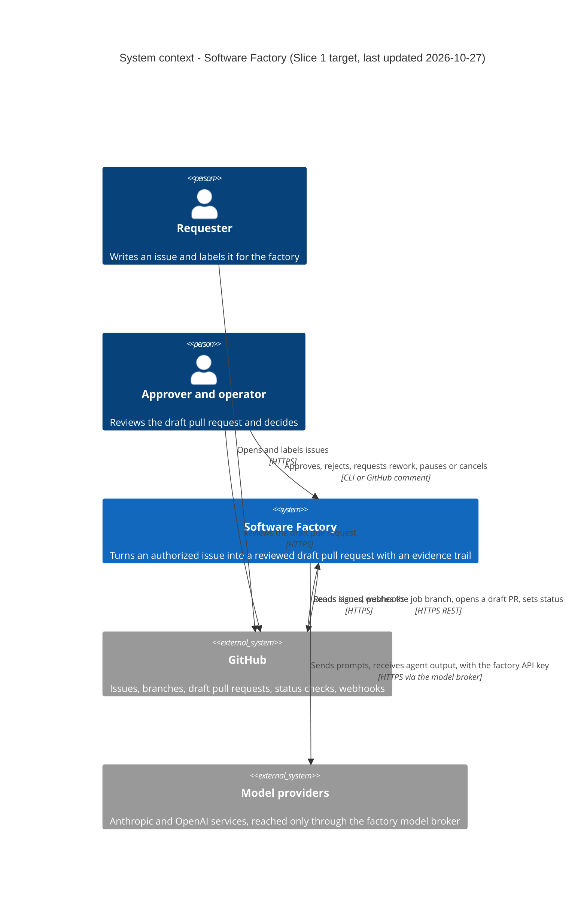
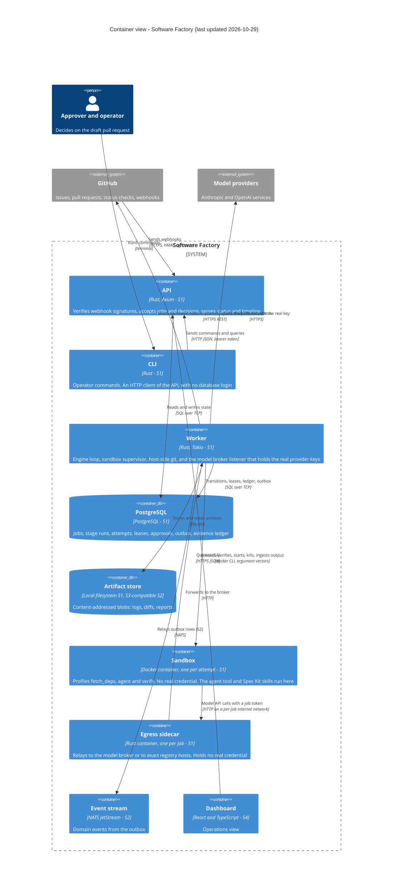
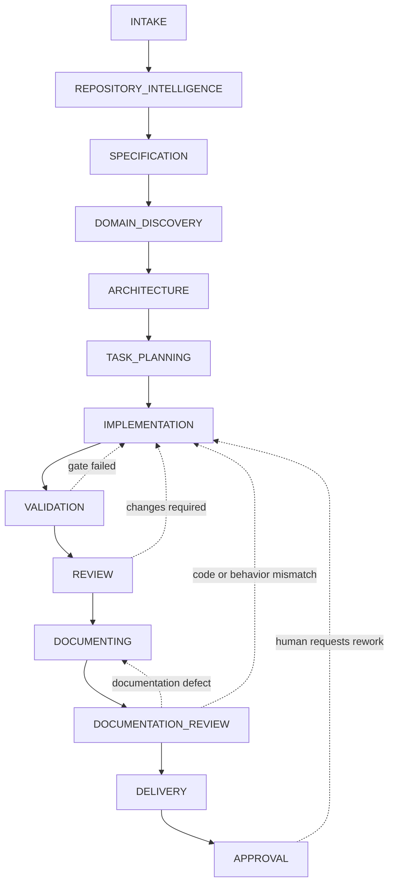
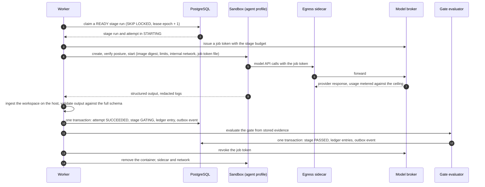
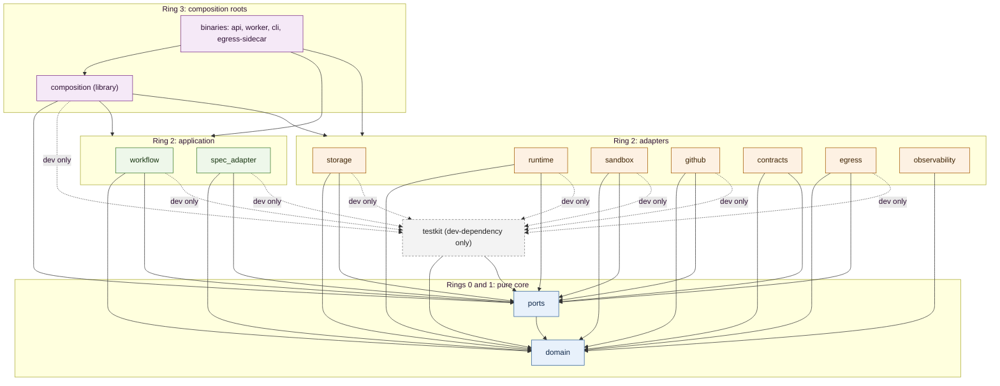
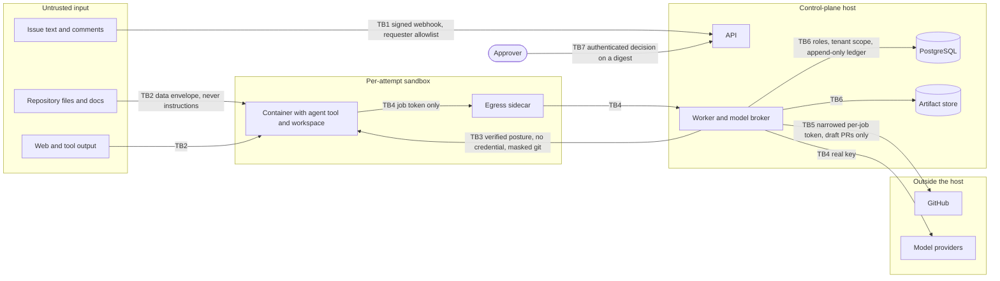

# Architecture overview

- Status: Slice 0 baseline, brought up to date on 2026-10-29. The boxes tagged S1 are built: the crates and binaries in the table below exist and are tested in test mode. The boxes tagged S2 and S4 (the event stream, the S3-compatible store, the dashboard) are plans. The factory has not run against a real model, a real GitHub App or a protected repository: see the [production guide](../guides/production.md).
- Date: 2026-10-27, revised 2026-10-29
- Author: software_architect
- Decisions behind this document: [ADR index](../adr/README.md)
- Companion documents: [state machines](state-machine.md), [slice plan](slice-plan.md), [the project's rules for agents](project-rules.md), [ports v1.1](ports-v1.1.md), [ports v1.2](ports-v1.2.md), [ports v1.3](ports-v1.3.md), [contract schemas](../../schemas/README.md). The detailed threat model is written by the security specialist under `docs/security/` and is not duplicated here.

Diagrams are Mermaid, kept as text so they change in the same pull request as the code. Every diagram in this file is parsed by Mermaid's own parser in the check described at the end.

## What the system does

The factory turns an authorized request into a reviewed draft pull request with an evidence trail. The workflow engine decides every step. Agents propose, gates verify, and a human approves. Spec Kit writes the specification and nothing else.

Slice 1 proves this on one fixture repository, end to end, with real components. The pipeline stages and their order are in [state-machine.md](state-machine.md).

## System context (C4 level 1)

Not in the picture on purpose: **Temporal is not integrated** ([ADR 0001](../adr/0001-orchestration-engine.md)). Merge and deployment are outside the factory in Slice 1: a human merges.

## Containers (C4 level 2)

Tags: **S1** is built in Slice 1, **S2** in Slice 2, **S4** in Slice 4. Solid arrows are synchronous calls. The event stream and the dashboard are drawn because the architecture leaves room for them, not because they exist.

Process boundaries to keep in mind. The worker is the only process that starts containers, runs git, writes artifacts, holds the provider keys and pushes to GitHub. Agent command line tools, Spec Kit skills and the builder's commands run inside the sandbox container and never on the host. The API never executes work. The CLI is an HTTP client of the API and holds no database login; only its `probe` command runs checks in process. Spec Kit is not drawn as a container: it is a set of files and scripts that the agent runs inside the sandbox.

## Pipeline

Details, guards and rework routes are in [state-machine.md](state-machine.md). This is the shape.

## One stage execution

## Crate layout

Generated from [`crate-dependency-rules.json`](crate-dependency-rules.json) by `docs/architecture/tools/check_crate_rules.py`. Reasons and alternatives are in [ADR 0002](../adr/0002-workspace-layout-and-dependency-rule.md).

<!-- GENERATED:begin rings -->
| Ring | Name | Rule |
|---|---|---|
| 0 | Domain | Pure model, state machines and contract types. No I/O, no clock, no randomness, no async runtime. |
| 1 | Ports | Trait definitions the inner code needs from the outside. Depends on domain only. No I/O. |
| 2 | Application and adapters | Application crates hold use cases and depend on domain and ports. Adapter crates implement ports and depend on domain and ports. Neither kind depends on the other, and no crate in this ring depends on a peer. |
| 3 | Composition roots | Binaries, and the one composition library they share (ADR 0015). The only place where adapters are chosen and wired to use cases. The library has no main and only binaries may depend on it. |
<!-- GENERATED:end rings -->

<!-- GENERATED:begin crate-graph -->

<!-- GENERATED:end crate-graph -->

<!-- GENERATED:begin crate-table -->
| Crate | Package | Ring | Layer | May depend on | Dev only | Slice | Responsibility |
|---|---|---|---|---|---|---|---|
| `domain` | `factory-domain` | 0 | domain | none | none | 0 | Identifiers, value objects, the Job, StageRun, Attempt and TaskNode state machines, guards, contract types that mirror schemas/, the ledger chain hash, policy evaluation (the 'policy crate' in docs/security is this module until its extraction trigger fires), secret redaction, assurance-level derivation. |
| `ports` | `factory-ports` | 1 | ports | domain | none | 0 | Outbound traits and their closed error enums: Clock, IdGenerator, CancelSignal, Store with SystemTx and Tx and their parts, ArtifactStore, SandboxProvider, SandboxSession, WorkspaceProvider, Workspace, JobRepo, AgentRuntime, ModelRouter, ModelBroker, AgentRegistry, OutputValidator, SpecificationProvider, IssueSource, ChangeHost, IssueStatusWriter (v1.2), WebhookVerifier and ProcessRunner. Also the pure checks that every adapter and fake must share: the sandbox spec validation and posture comparison, the path rules, and the protection preflight. |
| `workflow` | `factory-workflow` | 2 | application | domain, ports | testkit | 1 | The durable engine and all stage handlers: admission, scheduling, leases, retries, gate evaluation, rework routing, human decisions, plus the modules listed under deferred crates. |
| `spec_adapter` | `factory-spec_adapter` | 2 | application | domain, ports | testkit | 1 | Anti-corruption layer for GitHub Spec Kit. Drives the four allowed skills, reads the produced files, and returns a SpecificationContract. The only crate that knows Spec Kit's file layout. |
| `storage` | `factory-storage` | 2 | adapter | domain, ports | testkit | 1 | PostgreSQL implementation of Store (Diesel, async), outbox writes, evidence ledger with hash chain, lease compare-and-swap, local-filesystem content-addressed ArtifactStore. |
| `runtime` | `factory-runtime` | 2 | adapter | domain, ports | testkit | 1 | AgentRuntime adapters for the Claude Code and Codex command line tools. Builds argument vectors from a closed allow list (bypass flags only for a verified sandbox target), probes capabilities, starts the tool inside the sandbox through SandboxSession, parses output, maps failures to a closed error set, and supports a later host tool bridge as a hardening option. |
| `sandbox` | `factory-sandbox` | 2 | adapter | domain, ports | testkit | 1 | SandboxProvider and WorkspaceProvider over the Docker command line and host-side git. Three network profiles (fetch_deps, agent behind a per-job egress sidecar, verify with no network), the posture verifier that inspects a created container before it starts, the supervisor that enforces wall-clock and disk limits, redacted log streaming, the janitor, and the workspace side: mirror, sparse worktree, masked .git, host-side git with a fixed environment, the no-follow audit walk and the tree diff. The only crate that starts containers or runs git. |
| `github` | `factory-github` | 2 | adapter | domain, ports | testkit | 1 | IssueSource, ChangeHost and IssueStatusWriter against the GitHub REST API as a GitHub App: signs the App JWT, mints per-job, per-stage installation tokens narrowed to one repository (and a separate issues-write token for the status label and comment), revokes them, verifies webhook signatures, deduplicates deliveries, checks the repository protection preflight, writes only sanitized text. Merging is not implemented. |
| `contracts` | `factory-contracts` | 2 | adapter | domain, ports | none | 0 | Embeds schemas/, implements OutputValidator, loads and validates agent manifests, domain capability profiles and policy files. |
| `egress` | `factory-egress` | 2 | adapter | domain, ports | testkit | 1 | The model broker and the egress relay. The broker holds the real provider keys, issues and revokes per-job tokens, forwards only allowed API paths, and meters usage against the job ceiling. The relay is the per-job sidecar: exact-host allowlist, rejection of private and metadata address ranges after resolution, pinned connections and a byte quota. Implements ModelBroker. |
| `observability` | `factory-observability` | 2 | adapter | domain | none | 0 | Initializes tracing and OpenTelemetry for the binaries and owns span and attribute naming. |
| `composition` | `factory-composition` | 3 | composition | domain, ports, workflow, spec_adapter, storage, runtime, sandbox, github, contracts, egress, observability | testkit | 1 | The shared composition core, as a library (ADR 0015): the typed configuration, the profiles, the registry of ports with require_permitted, the start-up checks, the redactor and the registry of secret values, health reporting, the seams over the store, the sandbox output and workspace patch indexing wrappers, the telemetry configuration helper, and the providers assembled by profile. The only library that wires more than one adapter. It has no main, no HTTP routes, no handling of process arguments and no loop: those belong to the binary that uses it (the grammar of an approval decision is pure text and is in the library). |
| `testkit` | `factory-testkit` | 2 | test-support | domain, ports | none | 0 | Labelled fakes: FakeClock, InMemoryStore, FakeSandbox, FakeAgentRuntime, FakeModelBroker, FakeChangeHost, FakeWorkspaceProvider, FakeJobRepo, FakeSpecificationProvider, ScriptedProcessRunner and FakeWebhookVerifier, with FakeRemote shared by the workspace and change host fakes. Every fake reports fidelity fake. Also the shared contract suites and the register that shows every check can fail. May appear only in dev-dependencies. |
| `api` | `factory-api` | 3 | binary | all library crates it wires | none | 1 | HTTP API: GitHub webhook endpoint with signature verification, job submission, decisions, status and timeline queries, health endpoints. |
| `worker` | `factory-worker` | 3 | binary | all library crates it wires | none | 1 | Runs the engine loop in one process: claim, execute stage handlers, sweep leases and deadlines, supervise sandboxes, and host the model broker listener in Slice 1. Single concurrency in Slice 1. |
| `cli` | `factory-cli` | 3 | binary | all library crates it wires | none | 1 | Operator command line and HTTP client of the API: health, submit, status, timeline, approve, reject, rework, answer, pause, resume, cancel, approve-dependency, approve-build-code, probe. Holds no database login: every command but probe goes to the API over HTTP, and probe runs the start-up checks that need no credential. |
| `egress-sidecar` | `factory-egress-sidecar` | 3 | binary | all library crates it wires | none | 1 | The per-job relay binary, shipped as a container image next to the sandbox image. Holds no real credential. |
<!-- GENERATED:end crate-table -->

### Dependency rules and their enforcement

<!-- GENERATED:begin dependency-rules -->
| Rule | Statement | Enforced by |
|---|---|---|
| DEP-01 | A library crate depends only on workspace crates listed in its depends_on. Any other workspace edge fails the build. | xtask check-architecture, from cargo metadata |
| DEP-02 | No crate depends on a crate in the same or a higher ring, except that ports depends on domain. | xtask check-architecture |
| DEP-03 | Only dev-dependencies may name testkit. | xtask check-architecture, from the dependency kind in cargo metadata |
| DEP-04 | Rings 0 and 1 and the application crates use only the external crates in external_allow. Adding one needs an architect-reviewed change to this file. | xtask check-architecture |
| DEP-05 | domain, ports, workflow and spec_adapter contain no call to the clock, the filesystem, the network or process spawning. The clock comes from the Clock port. | clippy disallowed-methods and disallowed-types in each crate's clippy.toml, verified with cargo clippy -D warnings |
| DEP-06 | No crate uses unsafe code. | workspace lint unsafe_code = forbid |
| DEP-07 | Third-party licenses and advisories pass policy. | cargo deny check |
| DEP-08 | Binaries and the composition library are the only crates that depend on more than one adapter. | xtask check-architecture |
| DEP-09 | Store::begin_system is called only from the workflow crate, and ChangeHost has no method whose name starts with merge. The sources of the Spec Kit layout (.specify, speckit) appear only in spec_adapter, its fixtures and documentation. | xtask check-architecture, by source scan |
| DEP-10 | Only the sandbox crate spawns docker or git. Only the runtime crate spawns an agent command line tool. No crate spawns a shell. The set of allowed spawned binaries is docker and git. | xtask check-architecture by source scan, plus the process spawn recorder in the end-to-end tests (negative test ST-03 and FX-SPAWN) |
| DEP-11 | The composition library (layer composition, ring 3, ADR 0015) may be depended on by binaries in apps/ only; no crate in rings 0 to 2 may depend on it. It has no binary target and defines no function named main. | xtask check-architecture, from cargo metadata (the edge and the targets) and by source scan (main) |
<!-- GENERATED:end dependency-rules -->

### Crates from the master prompt that are not created yet

The master prompt suggests more crates. Each one below has a place to live until its trigger fires.

<!-- GENERATED:begin deferred-crates -->
| Not created yet | Planned slice | Lives in meanwhile | Extract when | Why it is not needed now |
|---|---|---|---|---|
| `repository_intel` | 3 | module workflow::stages::repo_intel | A syntax-tree or symbol-graph index brings heavy parser dependencies, or a second consumer outside workflow needs it. | Slice 1 needs language detection, build and test command discovery, CODEOWNERS, protected paths and an ADR and docs inventory. That is a few hundred lines over the bounded repository reader, with no heavy dependency. |
| `planner` | 3 | module workflow::stages::{architecture, planning} | Incremental replanning, the critic loop and the Team Composer arrive, or the DAG validator gains a second consumer. | Slice 1 has one planner call and one pure DAG validator. Both depend on the same ports as every other stage handler. |
| `quality` | 3 | module workflow::gates | The gate catalog needs tool-specific dependencies (static analysis, mutation, fuzzing) or domain-pack gates. | Slice 1 gates are commands run in the sandbox from trusted definitions plus pure evaluators of their reports. |
| `documentation` | 4 | modules workflow::stages::{documenting, documentation_review} and workflow::gates::docs | Domain documentation packs and the documentation DAG are built. | The stage exists as first-class stage kinds in the state machine from Slice 1. Its code does not need its own crate yet. |
| `policy` | 4 | module domain::policy for pure evaluation, loaders in contracts | The policy language needs its own parser or engine, or a consumer outside workflow appears. | Policy evaluation is a pure function of typed facts. The YAML files are owned elsewhere and loaded by contracts. |
| `events` | 2 | outbox rows written by storage in Slice 1; no relay | Slice 2 adds the outbox relay to NATS JetStream and idempotent consumers. | Slice 1 has no event consumer. The outbox table is written from day one so nothing needs retrofitting. |
| `evals` | 4 | none | The evaluation harness is built. | Nothing to evaluate before a real end-to-end run exists. |
| domain_registry, capabilities, team_composer, toolchain_registry, research, experiment_tracking, artifact_catalog, validation_profiles, worker_capabilities | 3 | contracts loaders and domain::capability types | Dynamic team composition and open-world domain discovery are implemented. | Slice 1 resolves one static profile (general-software). The schemas exist so the registries can be added without changing orchestration code. |
| `apps/dashboard` | 4 | CLI timeline and status commands | Slice 4. | Not part of the end-to-end proof. |
| `apps/scheduler` | 2 | the engine loop inside apps/worker | Slice 2 separates scheduling from execution and adds multiple workers. The model broker listener may move to its own binary at the same time. | One process is enough to prove the end-to-end path. Leases and fencing are built in Slice 1 so the split is a deployment change. |
<!-- GENERATED:end deferred-crates -->

## Trust boundaries

This is the high-level map. The security specialist owns the threat model, severity rubric and mitigations in `docs/security/`. The controls listed here are design intent from the ADRs, not verified protections, except where an ADR says it was checked.

| Boundary | What crosses | Main design controls | Source |
|---|---|---|---|
| TB1 Internet to API | Webhooks, API calls, issue text | HMAC signature check on the raw body, delivery deduplication, token authentication, tenant scoping, payload limits, a requester who is on the named allowlist (ADR 0009) | Master prompt sections 1 and 3 |
| TB2 Untrusted content to agents | Issue text, repository files, documentation, tool output | A typed data envelope and never the instruction channel, default-deny tools, the container as the boundary, schema validation of every output, the prompt-injection catalog | Section 2, principle 14, `policies/security.yaml` section 14 |
| TB3 Control plane to sandbox | Container spec, workspace files, ingested output | Posture check before start, three network profiles, no real credential, masked `.git`, host-side git with a fixed environment, no-follow ingestion, supervisor-enforced wall clock and disk limits | [ADR 0003](../adr/0003-sandbox-strategy.md), `docs/security/sandbox-policy.md` |
| TB4 Sandbox to model provider | Prompts containing repository content, model output | Job token only in the container, per-job internal network, sidecar relay, broker holds the key and the ceiling, provider terms reviewed by a human | [ADR 0005](../adr/0005-agent-runtime-adapter-boundary.md), ADR 0009 |
| TB5 Control plane to GitHub | Branch pushes, draft PRs, status, comments | GitHub App installation tokens narrowed to one repository and the permissions of one stage, revoked at job end, no merge permission, repository ruleset preflight (otherwise level L0) | Section 11, `docs/security/secrets-and-credentials.md` section 3 |
| TB6 Control plane to PostgreSQL and artifact store | State, evidence, blobs | Separate writer and reader roles, tenant keys and scope type, append-only ledger, no secrets stored | [ADR 0007](../adr/0007-persistence-access-and-tenancy.md), [ADR 0008](../adr/0008-artifact-store-and-evidence-ledger.md) |
| TB7 Human to approval | Approve, reject, rework, cancel | Authenticated principal with the required role, approval bound to the evidence digest the human saw (guard `G_APPROVER_AUTHORIZED`) | [state-machine.md](state-machine.md) |
| TB8 Installed tool set to the factory | Spec Kit skills present in the repository | Four-operation allowlist in `spec_adapter`, closed `skills_invoked` list in the contract | [ADR 0006](../adr/0006-spec-kit-boundary.md) |

## Quality attribute scenarios

Targets, not measurements. Nothing has been built or measured yet. Each row names the mechanism and the check that will prove it.

| ID | Quality | Stimulus and environment | Required response | Measure (target) | Mechanism | Verified by |
|---|---|---|---|---|---|---|
| QA-1 | Integrity | Any caller sends a command whose (state, event) is not in the tables, or with a stale version | Rejected with a typed error, stored state unchanged, rejection audited | 100% of 10,000 generated command sequences end in table-legal states | Pure transition functions, compare-and-swap | Conformance and property tests (Slice 0) |
| QA-2 | Durability | A worker is killed mid-attempt | The lease expires, the attempt becomes `LEASE_LOST`, a new attempt starts after back-off, the dead worker's writes are fenced, no external effect is repeated | Stage resumes within lease time to live plus one sweep (60 s + 5 s with the proposed defaults); zero lost transitions | Lease epoch, sweeper, idempotency keys | Fault-injection suite (Slice 2) |
| QA-3 | Isolation | Generated code tries to reach the network, write outside the workspace, fork without bound, run a binary from scratch space, or read a credential | Each attempt fails or is contained | 0 successful network connections in `verify`; the `agent` profile reaches only the broker; 0 real credentials visible in the container; 0 writes outside allowed paths; container gone within 30 s of attempt end | Posture-verified container profile, supervisor kill, job token only | Negative tests NT-SBX-01 to NT-SBX-14. The basic cases were run by hand on 2026-10-27 ([ADR 0003](../adr/0003-sandbox-strategy.md)) |
| QA-4 | Evidence | Any stage reports success | A stage is `PASSED` only with a persisted gate decision and ledger entries | 0 `PASSED` runs without at least one ledger entry per acceptance criterion; ledger chain verifies | Gate evaluator, hash-chained ledger | End-to-end SQL assertions and chain verifier (Slice 1) |
| QA-5 | Testability | A developer changes the state machine | Feedback without I/O | `cargo test` for `domain` finishes in under 5 s on a laptop, with no network or file access | No I/O in inner rings, clippy bans | Clippy rule (verified in a scratch crate), timing check in CI (Slice 0) |
| QA-6 | Honesty | A fake adapter is configured in a production-mode job | The job refuses to start, or the evidence is rejected | 0 ledger entries with fidelity `fake` in production-mode jobs | Schema rules, engine check, labelled `testkit` | Schema examples (verified today), engine test (Slice 0) |
| QA-7 | Observability | An end-to-end run completes | Every job, stage run and attempt has a span, linked by correlation id | 100% of attempts have a span with the stage run span as parent | OpenTelemetry in `observability` | Trace assertion in the end-to-end test (Slice 1) |
| QA-8 | Recoverability | All processes restart while a job waits for a human | The job resumes when the decision arrives | State and the pending question are intact after restart | State in PostgreSQL only | Restart test (Slice 1) |

## Checks that already run

| Check | Command | Result on 2026-10-27 |
|---|---|---|
| State machine file is valid and the doc is in sync | `python3 -I docs/architecture/tools/render_state_machine.py --check` | passes |
| Crate rules file is valid and the doc is in sync | `python3 -I docs/architecture/tools/check_crate_rules.py --check` | passes |
| Contract schemas and examples | `schemas/validate.sh` | passes |
| Work packages: ownership disjoint, graph acyclic, ports consistent, every P0 negative test mapped | `python3 -I docs/architecture/tools/check_work_packages.py --check` | see the Slice 0 report |
| Every Mermaid block in the architecture documents parses | `docs/architecture/tools/check-mermaid.sh docs/architecture/overview.md docs/architecture/state-machine.md docs/architecture/slice-plan.md` | see the Slice 0 report |
| The Python tools type-check | `pyright docs/architecture/tools/*.py` | 0 errors |

The checks that were designed but not built when this table was written now run: the `xtask` architecture check (`cargo xtask check-architecture`), the clippy ban list (`cargo xtask clippy-toml`), `cargo deny` and the workspace tests. `scripts/ci.sh --list` names every step.

## Environment facts

Observed on the development machine on 2026-10-27. Work packages should not assume anything beyond this table.

| Tool | Version | Notes |
|---|---|---|
| Rust | cargo and rustc 1.98.0 | `clippy`, `rustfmt`, `cargo-deny`, `cargo-nextest`, `cargo-audit`, `cargo-llvm-cov`, `cargo-machete` and the `diesel` CLI 2.3.11 are installed. `cargo-mutants` is not |
| Docker | 29.9.2, Docker Desktop, `runc`, aarch64 | No gVisor or Kata runtime registered |
| PostgreSQL | `psql` 18.6 client only | No local server. Use a container. `postgres:17-alpine` is cached locally and `postgres:18` exists on Docker Hub |
| NATS | `nats-server` 2.15.1 | Not used before Slice 2 |
| Spec Kit | `specify` 1.1.2 | Skills are invoked as `/speckit-specify` with the Claude integration |
| Claude Code | 2.1.311 | Logged in through claude.ai (subscription). Since ADR 0020 (2026-11-12) the factory runs on the owner's subscription by default, through a long-lived token from `claude setup-token` held by the broker, not through this interactive login. No API key variable was checked |
| Codex | 0.163.0 | Logged in with a ChatGPT account. Same limit as above |
| GitHub CLI | 2.102.0 | |
| Node, Python, uv | 26.12.0, 3.15.0, 0.13.1 | `check-jsonschema` runs through `uvx` |
| Temporal | not installed | Not integrated, see ADR 0001 |
| Mermaid command line, markdownlint, lychee, typos | not installed | The Mermaid check here uses the `mermaid` npm package with `jsdom` instead |

## Glossary

- **Job**: one request handled from admission to a terminal state.
- **Stage run**: one execution of one stage kind for a job. Rework makes a new one.
- **Attempt**: one try at a stage run, held by one worker through one lease.
- **Gate**: the deterministic check or independent evaluator that decides whether a stage run passed.
- **Evidence ledger**: the append-only, hash-chained record of claims and their evidence.
- **Assurance level**: a claim about how far the work was verified, such as `VERIFIED_IN_SANDBOX`. Not a job state.
- **Fidelity**: whether an adapter was `real` or a labelled `fake`.
- **Tenant**: an organization whose data is isolated from every other.
