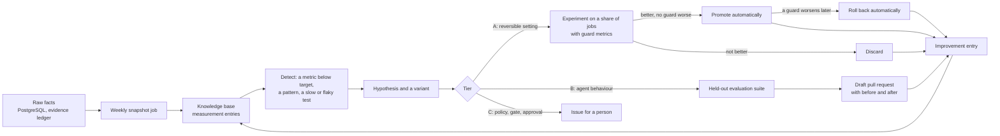

# Process metrics and the improvement loop

- Status: decided by the owner on 2026-11-20. The pure rules (arithmetic, catalogue, entries, experiments) are built in the `metrics` module of `crates/domain`. Nothing reads the database or changes a running job yet: see "What is built and what is not". The decisions and the options weighed are in [ADR 0029](../adr/0029-process-metrics-and-improvement-loop.md).
- Form: design.

## Purpose

The factory should get faster and better with every job, and it should be able to prove it. This document says which numbers the factory keeps, how each is computed, where they are written, and how a number becomes an improvement: automatically where the change is safe and reversible, through a person where it is not.

## The loop



## The metric catalogue

Each metric is an entry of kind `metric` in the knowledge base, with the fields of the table and a tested formula. Units follow [ADR 0029](../adr/0029-process-metrics-and-improvement-loop.md) Decision 2: integers in the computation, rounding at display only.

### Speed

| Metric | Unit | Formula | Cut by |
|---|---|---|---|
| Lead time to pull request | ms | Pull request opened minus job accepted, per job; median and 90th percentile | project, pack, risk tier |
| Stage duration | ms | Stage run end minus start | stage, outcome |
| Human wait time | ms | Sum of the time a job waited in `NEEDS_HUMAN` or for an approval | project, reason |
| Time to first failing test | ms | First failing test result minus start of the verify run | project |
| Test run time | ms | Verify run duration; share spent in the slowest 10 tests | project |

### Quality

| Metric | Unit | Formula | Cut by |
|---|---|---|---|
| First-pass gate success | ratio | Tasks whose first attempt passed every gate / tasks | agent, pack, model |
| Rework rounds | count | Rework rounds per phase per job (ADR 0023) | phase, agent |
| Review precision | ratio | Findings a person or a later fix confirmed / findings raised | reviewer agent, model |
| Escaped defects | count | Bugs linked to a merged factory pull request within 30 days of the merge | project, pack |
| Flaky tests | count | Tests whose result changed with no code change, in the window | project |
| Human rejection rate | ratio | Pull requests closed without merge / pull requests opened | project, pack |

### Cost

| Metric | Unit | Formula | Cut by |
|---|---|---|---|
| Cost per accepted pull request | micro-USD | Broker-metered spend of the job / merged pull requests | project, pack |
| Tokens per task | count | Input plus output tokens of all attempts of a task | agent, model |
| Escalations to the larger model | ratio | Tasks that needed the larger model / tasks | agent |

### Knowledge

| Metric | Unit | Formula | Cut by |
|---|---|---|---|
| Knowledge coverage | ratio | Active business rules with at least one enforcing test / active business rules | project |
| Knowledge drift | count | Active entries whose code changed without confirmation (gate findings) | project |
| Knowledge use | ratio | Tasks whose agents read at least one relevant entry / tasks | agent |

### Delivery (read only, where the project deploys through its own pipeline)

Lead time for changes, deployment frequency, change failure rate, time to restore service. The factory never deploys; it only reads these from the project's own pipeline when the project grants that read.

### Identifiers, direction and where the facts come from

Each metric has a fixed identifier (`MT` for metric, never reused), a short name, the direction in which it gets better, and the statistics a snapshot shows for it. The last column says whether the facts it needs are stored today. The typed catalogue in the `metrics` module of `crates/domain` holds exactly these rows, and a test compares the two.

| Identifier | Name | Unit | Better | Shown as | Facts |
|---|---|---|---|---|---|
| MT-0001 | lead-time-to-pull-request | ms | lower | median, 90th percentile | stored |
| MT-0002 | stage-duration | ms | lower | median, 90th percentile | stored |
| MT-0003 | human-wait-time | ms | lower | median, 90th percentile | stored |
| MT-0004 | time-to-first-failing-test | ms | lower | median | not stored: needs test results with times |
| MT-0005 | test-run-time | ms | lower | median, 90th percentile | not stored: needs test results with times |
| MT-0006 | first-pass-gate-success | ratio | higher | rate | stored |
| MT-0007 | rework-rounds | count | lower | total | stored |
| MT-0008 | review-precision | ratio | higher | rate | not stored: needs the fate of each finding |
| MT-0009 | escaped-defects | count | lower | total | not stored: needs bugs linked to pull requests |
| MT-0010 | flaky-tests | count | lower | total | not stored: needs test results by commit |
| MT-0011 | human-rejection-rate | ratio | lower | rate | not stored: needs the fate of each pull request (merged or closed) |
| MT-0012 | cost-per-accepted-pull-request | micro-USD | lower | amount per item | not stored: needs the fate of each pull request (merged or closed) |
| MT-0013 | tokens-per-task | count | lower | median | not stored: needs the tokens of each task in the database |
| MT-0014 | escalations-to-the-larger-model | ratio | lower | rate | not stored: needs the model tier of each task in the database |
| MT-0015 | knowledge-coverage | ratio | higher | rate | not stored: needs the knowledge base (ADR 0028) |
| MT-0016 | knowledge-drift | count | lower | total | not stored: needs the knowledge base (ADR 0028) |
| MT-0017 | knowledge-use | ratio | higher | rate | not stored: needs the knowledge base (ADR 0028) |
| MT-0018 | lead-time-for-changes | ms | lower | median | not stored: read from the project's pipeline |
| MT-0019 | deployment-frequency | count | higher | total | not stored: read from the project's pipeline |
| MT-0020 | change-failure-rate | ratio | lower | rate | not stored: read from the project's pipeline |
| MT-0021 | time-to-restore-service | ms | lower | median | not stored: read from the project's pipeline |

A snapshot shows a metric whose facts are not stored as "not measured yet". It never shows zero for it.

The column was checked against the migrations and the code on 2026-11-21. Five metrics have their facts in PostgreSQL today: the two times of a job and of a stage run, the status changes with their times (the outbox holds one event for each transition), the gate outcome of each stage run, and the retries of each task. The time a pull request is opened is taken as the end of the delivery stage run that opened it, because the factory opens the pull request in that stage and stores no other time for it. What is missing for the others: whether a pull request was merged or closed (read live from GitHub, never stored), the tokens and the model of each task (kept only in artifact files and in the broker's log), and the spend as a column (it is in the payload of the outbox events).

In the knowledge base a definition is the file `docs/knowledge/metrics/<identifier>-<name>.md`, of kind `metric`. The module renders it from the catalogue, so the file and the code cannot say different things.

## How each number is computed

This section is the contract for the `metrics` module of `crates/domain`. The module is pure: it reads no clock, no file and no database, and every function gives the same answer for the same input. Each rule below has tests at zero, one, the largest value, a negative value where the type allows one, and the rounding edge.

### Units and sums

| Quantity | Type | Unit | Valid range |
|---|---|---|---|
| Duration | `Milliseconds` | milliseconds, unsigned | 0 to 2^53 - 1 |
| Money | `MicroUsd` | millionths of a United States dollar, signed (a refund is negative) | -(2^53 - 1) to 2^53 - 1 |
| Count | `u64` | things counted | 0 to 2^53 - 1 when written to a ledger entry |

A duration and an amount of money are different types, so one cannot be added to the other. A sum that leaves the valid range is refused with an error. It never wraps and never saturates, because a saturated total would look like a real number.

### Division and rounding

Every division that is shown or stored rounds half to even: a result exactly halfway between two integers goes to the even one. So 5 / 2 gives 2, 7 / 2 gives 4, and -5 / 2 gives -2. A division by zero is refused.

### Rates

A rate is a `Proportion`: a numerator and a denominator, both counts, with the numerator never above the denominator and the denominator never zero. It is divided only for display, as a percentage with one decimal place, rounded half to even. Examples: 14 of 23 is shown as 60.9 %, 1 of 2000 (0.05 %) is shown as 0.0 %, and 3 of 2000 (0.15 %) is shown as 0.2 %.

### Percentiles and the median

A percentile is taken by nearest rank over the exact samples of the window. With `n` samples sorted from the smallest and a percentile `p`, the rank is `p × n / 100` rounded up, and the value is the sample at that rank, counting from 1. The result is always one of the samples, so it needs no rounding. The median is the 50th percentile by this rule; with an even number of samples it is the lower of the two middle ones. Percentiles are given in hundredths of a percent, so that 2.5 percent can be written exactly. No samples give an error, not zero.

### Too few samples

A metric computed from fewer samples than its minimum (20 unless its definition says otherwise) has no value. The result says "too few samples" and carries the number of samples that were there.

### Comparing a rate before and after

1. Each rate gets a Wilson score interval at 95 percent, with the conventional value 1.96 (exactly 49 / 25) for the normal quantile. The two bounds are found by an exact integer search for the roots of the Wilson equation on a grid of millionths; no square root and no floating point is involved. The lower bound is rounded down and the upper bound up, so the interval is never narrower than the exact one.
2. The interval of the difference (after minus before) is built from the two Wilson intervals by Newcombe's hybrid score method. ADR 0029 asks for "a Wilson score interval" and for an interval that "excludes zero"; an interval of a difference is needed for that, and this is the standard one built from Wilson intervals. Its one square root is an integer square root rounded outward.
3. All results are in millionths (one millionth is 0.0001 of a percentage point). Every rounding goes outward, so the interval of the difference contains the exact one and is at most 7 millionths wider on each side. A rate of more than 2^32 trials is refused.

Options weighed for step 1: the closed formula with an integer square root was rejected, because with very few samples the rounding of the square root moves the bound by thousands of millionths; floating point was rejected by ADR 0029. The exact search costs about forty comparisons per interval.

### Comparing a duration or a cost before and after

The point value is the median after minus the median before. Its interval is a percentile bootstrap:

1. Draw, with replacement, as many values from the "before" samples as there are, and the same for "after". Take the difference of the two medians.
2. Repeat 2000 times (the number can be set between 1000 and 100 000).
3. The interval runs from the 2.5th to the 97.5th percentile of those differences, by nearest rank. If the measured difference lies outside those two values, the interval is widened to hold it.

The draws come from a fixed, documented generator (SplitMix64) started from a seed that is part of the input, and each index is drawn without bias (by rejection). The same samples and the same seed always give the same interval, on every machine. The default seed is 29. A separate script, `crates/domain/tests/oracle/median_bootstrap_oracle.py`, implements the same procedure, and a test holds the two to the same numbers.

### The decision

Each metric states its direction: lower is better (durations, costs, defects) or higher is better (success rates). A change is an **improvement** only when the whole interval of the difference lies on the good side of zero, a **worsening** only when the whole interval lies on the bad side, and **no clear change** otherwise. An interval that touches zero is no clear change.

## A measurement entry

A snapshot is the file `docs/knowledge/measurements/<identifier>.md`, of kind `measurement`. The module renders it from the computed numbers.

```markdown
---
id: M-2026-W47
kind: measurement
title: Process numbers, week 47 of 2026
window: { from: 2026-11-16T00:00:00Z, to: 2026-11-23T00:00:00Z }
query_version: 3
computed_at_commit: 3f2a9c1d5e7b9a1c3e5f7a9b1c3d5e7f9a1b3c5d
---

| Metric | Value | Samples | Previous |
|---|---|---|---|
| MT-0001 lead-time-to-pull-request, median | 41 min 12 s | 23 | 55 min 3 s |
| MT-0002 stage-duration, 90th percentile | 12.345 s | 88 | 15.020 s |
| MT-0006 first-pass-gate-success | 60.9 % (14 of 23) | 23 | 52.4 % (11 of 21) |
| MT-0007 rework-rounds | too few samples | 3 | too few samples |
| MT-0012 cost-per-accepted-pull-request | not measured yet | | not measured yet |

## What stands out
...
```

Rules of the entry:

- **The window** starts at `from` and ends before `to`; `to` must be after `from`.
- **The identifier.** A window of exactly seven days that starts on a Monday at 00:00 UTC is a week: `M-<year>-W<week>`, with the year and the week of ISO 8601 (the week belongs to the year that holds its Thursday). Any other window is `M-<from date>-to-<to date>`.
- **A duration** is shown as `850 ms` below one second, as `12.345 s` below one minute, and above that in hours, minutes and whole seconds (`41 min 12 s`, `2 h 0 min 5 s`), the seconds rounded half to even. The computation keeps the whole milliseconds; only this text rounds.
- **A count** is shown as the number. **A rate** and **an amount of money** are shown as the section "How each number is computed" says.
- **Samples** is the number of samples behind the value. With fewer than the metric's minimum, the value is "too few samples" and the samples are still shown.
- **Previous** is the same statistic over the window before, or `n/a` when there is none.
- The entry has one row for each statistic of each metric of the catalogue, in the order of the catalogue. A metric is never left out: without facts it says "not measured yet".
- The section "What stands out" has one line for each metric whose comparison with the window before shows an improvement or a worsening by the rules of "The decision". A rate is compared by the interval of its difference, a duration and a count shown as a median by the bootstrap of the medians. A total and an amount per item have no interval in this design, so they never stand out; a person reads them from the two columns. With too few samples in either window, or no window before, nothing stands out.
- The snapshot is a pure function of the facts of the two windows, the query version, the commit and the seed: the same input gives the same entry, byte for byte.

## The snapshot job

The snapshot job reads the facts of a tenant from the store, through the listing operations the `Store` port already has (the jobs, the stage runs of a job, the task nodes of a stage run and the events of a job). It needs no new port and no new query in the storage crate. Options weighed: a dedicated read port with aggregate queries in SQL was rejected for now, because it would add a second place that defines each metric, and the numbers of one tenant in one week are small; it becomes the right choice when the full read of a tenant's jobs gets slow, and the facts of this section are the contract such a port would have to keep. The code is `process_metrics` in `crates/workflow`.

### Query version 1

`from` and `to` are the bounds of the window; an instant is in the window when it is at or after `from` and before `to`. A duration is the difference of two stored instants in whole milliseconds; a part of a millisecond is dropped. An end before its start is a fault in the facts and stops the snapshot with an error that names the row: a wrong number is worse than no number.

| Metric | Samples | Value of one sample |
|---|---|---|
| MT-0001 lead-time-to-pull-request | The jobs whose first delivery stage run with status `PASSED` finished in the window | The end of that stage run minus the creation of the job |
| MT-0002 stage-duration | The stage runs that a worker started and that finished in the window, of any status | The time from the run's first event `stage_run.started` to its last event. It includes the time the run waited for a person, and leaves out the time it waited for a worker. The creation of the row is not used: the engine creates the rows of every stage run when it admits the job |
| MT-0003 human-wait-time | The jobs that reached a terminal status in the window | The sum of the job's waits. A wait starts at an event `stage_run.waiting_for_human` and ends at the next event of the same stage run; a wait with no later event of its stage run ends at the last event of the job. A job that never waited counts as zero |
| MT-0006 first-pass-gate-success | The task nodes with status `SUCCEEDED` or `FAILED` of the stage runs that finished in the window and are the first run of their stage (run number 1) | The part is the nodes that succeeded with no retry in a stage run that passed its gate (`gate_outcome` `PASSED`, status `PASSED`). A task whose stage was sent back had not passed every gate at once, whatever its own result |
| MT-0007 rework-rounds | The jobs that reached a terminal status in the window | The total is the rework rounds of those jobs on every count, read from their stage runs by the engine's own rule (the same one that enforces the limits of ADR 0023) |

The time of an event is the engine's clock; the times of rows are the database's clock. No value of this version subtracts one from the other: the lead time uses two times of rows, and the stage duration and the wait use two times of events. Which window a sample belongs to is always decided by a time of a row.

The job reads every job of the tenant, so its cost grows with the tenant's history. That is accepted for a weekly run.

### What the job hands back

The `measurement` entry as text and its path. Writing it into the project's repository belongs to the knowledge base (ADR 0028) and is not built; until then the operator's command prints the entry.

### How a person asks for a snapshot

`factory-cli metrics snapshot --api URL --token-file FILE --from 2026-11-16T00:00:00Z --to 2026-11-23T00:00:00Z` prints the entry. It calls `GET /v1/process-metrics/snapshot` of the API, which runs the snapshot job for the caller's tenant and stores nothing. Anyone on the allowlist of the tenant may ask: the answer holds only totals and medians of that tenant, less than the list of jobs the same person can already read.

- The window is compared with the window of the same length right before it.
- A window may be at most 366 days long. The cost of a snapshot grows with the tenant's history, not with the window, and the request runs under the API's ordinary deadline and rate limit.
- A snapshot names the commit of the factory that computed it. The build sets it at compile time in the environment variable `FACTORY_BUILD_COMMIT` (a full Git object id). To build such a binary by hand: `FACTORY_BUILD_COMMIT=$(git rev-parse HEAD) cargo build --release -p factory-api`. A build without it answers `503`: an entry that cannot say which code computed it cannot be computed again, so it is not handed out. Options weighed: a commit sent by the caller was rejected, because the caller could name any commit; a value in the configuration file was rejected, because it can drift from the binary that runs.

## Tier A settings

A setting can be changed automatically only if it is declared here with its safe range. The first candidates:

| Setting | Safe range | Guard metrics |
|---|---|---|
| Test order (targeted tests first) | on or off; the full suite always runs | escaped defects, gate failure rate |
| Parallel tasks per job | 1 to the policy's limit | gate failure rate, cost per accepted pull request |
| Starting model tier for a task kind | only tiers that passed the evaluation for that agent | first-pass gate success, escaped defects |
| Order of independent reviewers | any order; all still run | review precision |

A setting outside this table is tier B or C.

## Experiments

A tier A variant runs on a share of jobs (10 percent by default) and is judged by the comparison of ADR 0029 Decision 2. The rules below are the contract of `metrics::experiment` in `crates/domain`.

### Which jobs get the variant

The choice is a pure function of the experiment and the job, so it can be recomputed at any time:

1. Take the SHA-256 of the text `experiment:<experiment identifier>:job:<job identifier>`.
2. Read its first eight bytes as an unsigned integer, most significant byte first, and take the remainder of the division by 10 000.
3. The job gets the variant when the remainder is below the share, which is given in hundredths of a percent (1000 is 10 percent). The share may be from 1 to 5000: an experiment never takes more than half of the jobs.

The experiment's identifier is part of the hash. Options weighed: hashing the job identifier alone, as a first reading of "a hash of the job identifier" suggests, was rejected, because the same tenth of the jobs would then carry every experiment at once and the effects could not be told apart.

### Promotion

After each window the experiment compares the jobs with the variant against the jobs without it, on its target metric and on each guard metric:

| What the comparison shows | Decision |
|---|---|
| A guard metric is a worsening | Discard |
| The target metric is a worsening | Discard |
| The target is an improvement, and every guard has enough samples and is not a worsening | Promote |
| Anything else (too few samples, or no clear change), and windows remain | Keep running |
| Anything else, and the last window has passed | Discard |

A guard with too few samples blocks a promotion: the variant has not shown that it is safe. An experiment runs for at most 4 windows unless its declaration says otherwise (from 1 to 12).

### Rollback

After a promotion each guard metric of the next window is compared with the window before the promotion. One worsening rolls the setting back to its earlier value. Too few samples or no clear change keeps it.

### What may be an experiment at all

Only a setting of the table "Tier A settings", with a value inside its safe range. Each value is checked when the experiment is declared:

- test order: on or off;
- parallel tasks per job: from 1 to the policy's limit;
- starting model tier: one of the tiers that passed the evaluation for that agent;
- order of reviewers: a reordering of the same reviewers, none added, none removed, none twice.

A change to a prompt, a skill, an evaluation case or a default model is tier B. A change to a policy, a gate, a security rule or an approval is tier C, and the module refuses to build an experiment for either.

### The improvement entry

Every decision is the file `docs/knowledge/improvements/<identifier>-<name>.md`, of kind `improvement` (`IM` for improvement), with the hypothesis, the setting and its two values, the measured difference of the target and of each guard with its interval, and the decision. The module renders it.

## What is built and what is not

| Part | State |
|---|---|
| The arithmetic of "How each number is computed" | Built: `crates/domain/src/metrics/`, with its tests |
| The metric catalogue as typed definitions, and the `metric` entry | Built: `metrics::catalogue` |
| The `measurement` entry: its identifier, its rows and its text | Built: `metrics::measurement` |
| The snapshot built from the facts of two windows, with "What stands out" | Built: `metrics::snapshot` |
| Tier A settings, the choice of jobs, promotion, rollback and the `improvement` entry | Built as pure rules: `metrics::experiment`. Nothing applies a setting to a running job yet |
| The snapshot job that reads the facts of query version 1 from the store | Built: `process_metrics` in `crates/workflow` |
| The operator's command and the API route behind it | Built: `factory-cli metrics snapshot`, `GET /v1/process-metrics/snapshot` |
| Passing `FACTORY_BUILD_COMMIT` to the build of the service images (`infra/service-images/build.sh`) | Not built. Until then the API of those images answers `503` on the snapshot route; a binary built by hand with the variable set answers |
| A schedule for the snapshot job | Not built |
| Writing the entries into a project's knowledge base by pull request | Not built. It needs the knowledge base of [ADR 0028](../adr/0028-project-knowledge-base.md) |
| The retrospective agent and the scheduled sweeps | Not built |
