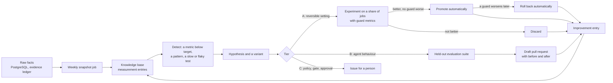

# Process metrics and the improvement loop

- Status: decided by the owner on 2026-11-20. The pure rules (arithmetic, catalogue, entries, experiments) are built in the `metrics` module of `crates/domain`, and a snapshot job reads the facts of nine metrics from the database. Nothing changes a running job yet: see "What is built and what is not". The decisions and the options weighed are in [ADR 0029](../adr/0029-process-metrics-and-improvement-loop.md).
- Form: design.

## Purpose

The factory should get faster and better with every job, and it should be able to prove it. This document says which numbers the factory keeps, how each is computed, where they are written, and how a number becomes an improvement: automatically where the change is safe and reversible, through a person where it is not.

## The loop



## The metric catalogue

Each metric is an entry of kind `metric` in the knowledge base, with the fields of the table and a tested formula. Units follow [ADR 0029](../adr/0029-process-metrics-and-improvement-loop.md) Decision 2: integers in the computation, rounding at display only.

### Speed

| Metric | Unit | Formula | Cut by |
|---|---|---|---|
| Lead time to pull request | ms | Pull request opened minus job accepted, per job; median and 90th percentile | project, pack, risk tier |
| Stage duration | ms | Stage run end minus start | stage, outcome |
| Human wait time | ms | Sum of the time a job waited in `NEEDS_HUMAN` or for an approval | project, reason |
| Time to first failing test | ms | First failing test result minus start of the verify run | project |
| Test run time | ms | Verify run duration; share spent in the slowest 10 tests | project |

### Quality

| Metric | Unit | Formula | Cut by |
|---|---|---|---|
| First-pass gate success | ratio | Tasks whose first attempt passed every gate / tasks | agent, pack, model |
| Rework rounds | count | Rework rounds per phase per job (ADR 0023) | phase, agent |
| Review precision | ratio | Findings a person or a later fix confirmed / findings raised | reviewer agent, model |
| Escaped defects | count | Bugs linked to a merged factory pull request within 30 days of the merge | project, pack |
| Flaky tests | count | Tests whose result changed with no code change, in the window | project |
| Human rejection rate | ratio | Pull requests closed without merge / pull requests a person decided about (merged or closed) | project, pack |

### Cost

| Metric | Unit | Formula | Cut by |
|---|---|---|---|
| Cost per accepted pull request | micro-USD | Broker-metered spend of every attempt of every job / merged pull requests | project, pack |
| Tokens per task | count | Input plus output tokens of all the runs of the builder on a task | agent, model |
| Escalations to the larger model | ratio | Tasks with a run on a higher model tier than their first run / tasks that were run | agent |

### Knowledge

| Metric | Unit | Formula | Cut by |
|---|---|---|---|
| Knowledge coverage | ratio | Active business rules with at least one enforcing test / active business rules | project |
| Knowledge drift | count | Active entries whose code changed without confirmation (gate findings) | project |
| Knowledge use | ratio | Tasks whose agents read at least one relevant entry / tasks | agent |

### Delivery (read only, where the project deploys through its own pipeline)

Lead time for changes, deployment frequency, change failure rate, time to restore service. The factory never deploys; it only reads these from the project's own pipeline when the project grants that read.

### Identifiers, direction and where the facts come from

Each metric has a fixed identifier (`MT` for metric, never reused), a short name, the direction in which it gets better, and the statistics a snapshot shows for it. The last column says whether the facts it needs are stored today. The typed catalogue in the `metrics` module of `crates/domain` holds exactly these rows, and a test compares the two.

| Identifier | Name | Unit | Better | Shown as | Facts |
|---|---|---|---|---|---|
| MT-0001 | lead-time-to-pull-request | ms | lower | median, 90th percentile | stored |
| MT-0002 | stage-duration | ms | lower | median, 90th percentile | stored |
| MT-0003 | human-wait-time | ms | lower | median, 90th percentile | stored |
| MT-0004 | time-to-first-failing-test | ms | lower | median | not stored: needs test results with times |
| MT-0005 | test-run-time | ms | lower | median, 90th percentile | not stored: needs test results with times |
| MT-0006 | first-pass-gate-success | ratio | higher | rate | stored |
| MT-0007 | rework-rounds | count | lower | total | stored |
| MT-0008 | review-precision | ratio | higher | rate | not stored: needs the fate of each finding |
| MT-0009 | escaped-defects | count | lower | total | not stored: needs bugs linked to pull requests |
| MT-0010 | flaky-tests | count | lower | total | not stored: needs test results by commit |
| MT-0011 | human-rejection-rate | ratio | lower | rate | stored |
| MT-0012 | cost-per-accepted-pull-request | micro-USD | lower | amount per item | stored |
| MT-0013 | tokens-per-task | count | lower | median | stored |
| MT-0014 | escalations-to-the-larger-model | ratio | lower | rate | stored |
| MT-0015 | knowledge-coverage | ratio | higher | rate | not stored: needs the knowledge base (ADR 0028) |
| MT-0016 | knowledge-drift | count | lower | total | not stored: needs the knowledge base (ADR 0028) |
| MT-0017 | knowledge-use | ratio | higher | rate | not stored: needs the knowledge base (ADR 0028) |
| MT-0018 | lead-time-for-changes | ms | lower | median | not stored: read from the project's pipeline |
| MT-0019 | deployment-frequency | count | higher | total | not stored: read from the project's pipeline |
| MT-0020 | change-failure-rate | ratio | lower | rate | not stored: read from the project's pipeline |
| MT-0021 | time-to-restore-service | ms | lower | median | not stored: read from the project's pipeline |

A snapshot shows a metric whose facts are not stored as "not measured yet". It never shows zero for it.

The column was checked against the migrations and the code on 2026-11-21. Nine metrics have their facts in PostgreSQL today.

- Five have had them since the first schema: the two times of a job and of a stage run, the status changes with their times (the outbox holds one event for each transition), the gate outcome of each stage run, and the retries of each task. The time a pull request is opened is taken as the end of the delivery stage run that opened it for MT-0001, because that is the moment the job handed its work over.
- Four have them since migration `2026-11-21-003200_process_metric_facts`: the fate of each pull request the factory opened (table `pull_requests`), what the broker metered for each attempt (four columns of `attempts`), and the model, the tier and the metered use of each run of a task (table `task_runs`). The section "Where the facts of query version 2 are stored" says why they are stored there.

In the knowledge base a definition is the file `docs/knowledge/metrics/<identifier>-<name>.md`, of kind `metric`. The module renders it from the catalogue, so the file and the code cannot say different things.

## How each number is computed

This section is the contract for the `metrics` module of `crates/domain`. The module is pure: it reads no clock, no file and no database, and every function gives the same answer for the same input. Each rule below has tests at zero, one, the largest value, a negative value where the type allows one, and the rounding edge.

### Units and sums

| Quantity | Type | Unit | Valid range |
|---|---|---|---|
| Duration | `Milliseconds` | milliseconds, unsigned | 0 to 2^53 - 1 |
| Money | `MicroUsd` | millionths of a United States dollar, signed (a refund is negative) | -(2^53 - 1) to 2^53 - 1 |
| Count | `u64` | things counted | 0 to 2^53 - 1 when written to a ledger entry |

A duration and an amount of money are different types, so one cannot be added to the other. A sum that leaves the valid range is refused with an error. It never wraps and never saturates, because a saturated total would look like a real number.

### Division and rounding

Every division that is shown or stored rounds half to even: a result exactly halfway between two integers goes to the even one. So 5 / 2 gives 2, 7 / 2 gives 4, and -5 / 2 gives -2. A division by zero is refused.

### Rates

A rate is a `Proportion`: a numerator and a denominator, both counts, with the numerator never above the denominator and the denominator never zero. It is divided only for display, as a percentage with one decimal place, rounded half to even. Examples: 14 of 23 is shown as 60.9 %, 1 of 2000 (0.05 %) is shown as 0.0 %, and 3 of 2000 (0.15 %) is shown as 0.2 %.

### Percentiles and the median

A percentile is taken by nearest rank over the exact samples of the window. With `n` samples sorted from the smallest and a percentile `p`, the rank is `p × n / 100` rounded up, and the value is the sample at that rank, counting from 1. The result is always one of the samples, so it needs no rounding. The median is the 50th percentile by this rule; with an even number of samples it is the lower of the two middle ones. Percentiles are given in hundredths of a percent, so that 2.5 percent can be written exactly. No samples give an error, not zero.

### Too few samples

A metric computed from fewer samples than its minimum (20 unless its definition says otherwise) has no value. The result says "too few samples" and carries the number of samples that were there.

### Comparing a rate before and after

1. Each rate gets a Wilson score interval at 95 percent, with the conventional value 1.96 (exactly 49 / 25) for the normal quantile. The two bounds are found by an exact integer search for the roots of the Wilson equation on a grid of millionths; no square root and no floating point is involved. The lower bound is rounded down and the upper bound up, so the interval is never narrower than the exact one.
2. The interval of the difference (after minus before) is built from the two Wilson intervals by Newcombe's hybrid score method. ADR 0029 asks for "a Wilson score interval" and for an interval that "excludes zero"; an interval of a difference is needed for that, and this is the standard one built from Wilson intervals. Its one square root is an integer square root rounded outward.
3. All results are in millionths (one millionth is 0.0001 of a percentage point). Every rounding goes outward, so the interval of the difference contains the exact one and is at most 7 millionths wider on each side. A rate of more than 2^32 trials is refused.

Options weighed for step 1: the closed formula with an integer square root was rejected, because with very few samples the rounding of the square root moves the bound by thousands of millionths; floating point was rejected by ADR 0029. The exact search costs about forty comparisons per interval.

### Comparing a duration or a cost before and after

The point value is the median after minus the median before. Its interval is a percentile bootstrap:

1. Draw, with replacement, as many values from the "before" samples as there are, and the same for "after". Take the difference of the two medians.
2. Repeat 2000 times (the number can be set between 1000 and 100 000).
3. The interval runs from the 2.5th to the 97.5th percentile of those differences, by nearest rank. If the measured difference lies outside those two values, the interval is widened to hold it.

The draws come from a fixed, documented generator (SplitMix64) started from a seed that is part of the input, and each index is drawn without bias (by rejection). The same samples and the same seed always give the same interval, on every machine. The default seed is 29. A separate script, `crates/domain/tests/oracle/median_bootstrap_oracle.py`, implements the same procedure, and a test holds the two to the same numbers.

### The decision

Each metric states its direction: lower is better (durations, costs, defects) or higher is better (success rates). A change is an **improvement** only when the whole interval of the difference lies on the good side of zero, a **worsening** only when the whole interval lies on the bad side, and **no clear change** otherwise. An interval that touches zero is no clear change.

## A measurement entry

A snapshot is the file `docs/knowledge/measurements/<identifier>.md`, of kind `measurement`. The module renders it from the computed numbers.

```markdown
---
id: M-2026-W47
kind: measurement
title: Process numbers, week 47 of 2026
window: { from: "2026-11-16T00:00:00Z", to: "2026-11-23T00:00:00Z" }
query_version: 3
computed_at_commit: "3f2a9c1d5e7b9a1c3e5f7a9b1c3d5e7f9a1b3c5d"
---

| Metric | Value | Samples | Previous |
|---|---|---|---|
| MT-0001 lead-time-to-pull-request, median | 41 min 12 s | 23 | 55 min 3 s |
| MT-0002 stage-duration, 90th percentile | 12.345 s | 88 | 15.020 s |
| MT-0006 first-pass-gate-success | 60.9 % (14 of 23) | 23 | 52.4 % (11 of 21) |
| MT-0007 rework-rounds | too few samples | 3 | too few samples |
| MT-0009 escaped-defects | not measured yet | | not measured yet |

## What stands out
...
```

Rules of the entry:

- **The header is read back by the factory's own YAML reader** (the one of the policy files), so the instants and the commit id are written in quotes: unquoted, readers disagree on what they are, and that reader refuses them.

- **The window** starts at `from` and ends before `to`; `to` must be after `from`.
- **The identifier.** A window of exactly seven days that starts on a Monday at 00:00 UTC is a week: `M-<year>-W<week>`, with the year and the week of ISO 8601 (the week belongs to the year that holds its Thursday). Any other window is `M-<from date>-to-<to date>`.
- **A duration** is shown as `850 ms` below one second, as `12.345 s` below one minute, and above that in hours, minutes and whole seconds (`41 min 12 s`, `2 h 0 min 5 s`), the seconds rounded half to even. The computation keeps the whole milliseconds; only this text rounds.
- **A count** is shown as the number. **A rate** and **an amount of money** are shown as the section "How each number is computed" says.
- **Samples** is the number of samples behind the value. With fewer than the metric's minimum, the value is "too few samples" and the samples are still shown.
- **Previous** is the same statistic over the window before, or `n/a` when there is none.
- The entry has one row for each statistic of each metric of the catalogue, in the order of the catalogue. A metric is never left out: without facts it says "not measured yet".
- The section "What stands out" has one line for each metric whose comparison with the window before shows an improvement or a worsening by the rules of "The decision". A rate is compared by the interval of its difference, a duration and a count shown as a median by the bootstrap of the medians. A total and an amount per item have no interval in this design, so they never stand out; a person reads them from the two columns. With too few samples in either window, or no window before, nothing stands out.
- The snapshot is a pure function of the facts of the two windows, the query version, the commit and the seed: the same input gives the same entry, byte for byte.

## Where the facts of query version 2 are stored

Four metrics could not be measured because the database did not hold their facts. This section says where each fact is kept now, who writes it, and which other places were weighed. The tables and columns are those of migration `2026-11-21-003200_process_metric_facts`; the operations are in [ports v1.5](ports-v1.5.md).

### The fate of a pull request

The factory opens a draft pull request and never merges it. A person merges it or closes it, often days after the job ended. So the fate is a fact about the world outside the factory, and the factory has to go and read it.

**Where it is kept: the table `pull_requests`.** One row for each pull request a delivery stage opened: the job, the repository, the number, when the factory recorded that it was opened, the fate (`open`, `merged` or `closed`), the time GitHub gives for the merge or the close, the time the factory recorded the fate, and the time of the last look.

| Option | Verdict | Why |
|---|---|---|
| A table of its own, `pull_requests` | **Chosen** | The fate arrives after the job is terminal, so it does not belong to the row of the job or of a stage run. A job can open a second pull request when a person closed the first and the work was sent back, so the key is the repository and the number, not the job. A row can be read by the snapshot with one listing, and by a later metric (escaped defects needs the merge time) |
| Columns on `jobs` | Rejected | A job would hold one pull request only, and a fact from outside would change the version of a row that the state machine treats as finished |
| Events in the outbox (`pull_request.merged`) | Rejected | The outbox is a notification record, not the source of truth for what exists (ports v1.1, `OutboxOps`). A metric that reads it breaks the day old events are archived. The spend has this weakness today, and this change removes it instead of copying it |
| No storage: read the `delivery-result` artifact for the number, and GitHub for the fate, when the snapshot runs | Rejected | The snapshot is served by the API, which holds no GitHub credential on purpose. A snapshot would also stop being a pure function of stored facts: the same window would give another answer after a late merge, and no answer when GitHub is down |

**Who writes that it was opened: the engine.** The delivery stage puts the number of the pull request in its output (`StageOutput::pull_request`), and the engine writes the row in the transaction that records the attempt. A handler cannot open a transaction, and the row must not exist without the attempt that made it. Recording the same pull request again, after a retry or a rework round that updated it, changes nothing.

**Who learns the fate: a step of the worker that reads GitHub.**

| Option | Verdict | Why |
|---|---|---|
| The worker asks GitHub for each pull request that is still open, at most once an hour for each | **Chosen** | The answer of the API is the fact itself, read with a credential of the factory. A look that fails, or a worker that was down, is repaired by the next look. It costs one request an hour for each open pull request, far below the limit of an installation (5000 an hour) |
| Trust the `pull_request` `closed` webhook | Rejected as the source | A webhook is a hint, never a claim (the rule of the webhook endpoint). GitHub does not send a delivery again by itself, so one lost delivery would leave a pull request open in the books for ever, and the API login would need the right to write the new table. The webhook stays a possible trigger for an earlier look; it is not built |
| Read it in the approval stage | Rejected | The approval stage ends before the merge, and a job that has ended can never mint a GitHub token again |

The look needs a credential that does not belong to a job. It is a new, narrow one: `metadata: read` and `pull_requests: read` for one repository, minted for one pass and ended after it (`PullRequestFateSource`, ports v1.5). The GitHub App already holds `pull_requests: write` for the delivery stage, so the App needs no new permission.

Rules of the fate:

- **The first decision is final.** Once a row says `merged` or `closed` the worker stops looking. A pull request that is closed and later opened again is not followed. Options weighed: following it for ever was rejected, because a snapshot of a past week would then change after it was computed; the cost is that a pull request reopened and merged counts as a rejection.
- **Two times are kept, and they answer different questions.** `decided_at` is the time GitHub gives for the merge or the close. `fate_recorded_at` is the database's clock when the factory wrote it. Which window a pull request belongs to is decided by `fate_recorded_at`: it only moves forward, so a window that has ended never gains a sample. `decided_at` is kept for the metrics that need the real moment (the 30 days of escaped defects).
- **A look that fails is recorded as a look.** The row keeps the time, so a repository that was deleted is asked once an hour, not at every pass.

**Who may read the facts.** The snapshot runs in the API, and the login of the API reads a narrow list of tables on purpose. The migration adds four tables to that list, read only: `task_nodes`, `attempts`, `task_runs` and `pull_requests`. Options weighed: running the snapshot in the worker and storing the entry was rejected for now, because storing entries belongs to the knowledge base (ADR 0028) and the worker has no route a person can call; a function that returns only the aggregates, owned by a stronger role, was rejected, because it would be the second place that defines each metric (the reason the section "The snapshot job" gives against queries of its own). The login gains no right to write. Query version 1 already read `task_nodes` with this login, which could not: the route failed on PostgreSQL as soon as a tenant had a stage run, and the tests did not see it because they asked for an empty tenant.

### What an attempt spent

The model broker meters every request under the job token of an attempt: input tokens, output tokens, cost and the number of requests. The engine reads that meter once, when the handler has stopped. Until now only the cost was kept, in the payload of the outbox event that ends the attempt.

**Where it is kept: four columns of `attempts`** (`input_tokens`, `output_tokens`, `cost_micro_usd`, `model_requests`), written by the transition that ends the attempt (`AttemptEnd::metered`).

| Option | Verdict | Why |
|---|---|---|
| Columns on `attempts`, written with the move that ends the attempt | **Chosen** | The token, and so the meter, belongs to exactly one attempt. The number is written in the same statement as the status, so an attempt cannot end with one and without the other. The engine's own notes already named this as the missing row (`Timeline::read_outbox`) |
| Keep reading the payload of the outbox events | Rejected | See the outbox row above. The payload also carries the cost only, with no tokens |
| Read the `implementation-evidence` artifact | Rejected | Only the implementation stage writes it, and only when the attempt succeeds. The tokens of a failed attempt, and of every other stage, are in no artifact |
| A table with one row for each model request | Rejected for now | It is the broker's own log, at a volume a hundred times that of the attempts. No metric of the catalogue needs a single request |

The four columns are empty (`NULL`) together when the meter was not read: the sweeper ended the attempt after a lost lease, or the broker could not be reached. **An empty value means "not known" and is never read as zero.** An attempt of a stage that runs no agent has no token, spent nothing, and stores four zeros. Each value is at most 2^53 − 1; a larger one is refused before it is written.

The engine still sums a job's spend from the events for its budget check. Moving that read to the new columns changes how a budget is enforced after a lost lease, so it is left for a change of its own.

### What a task used, and on which model

One attempt of the implementation stage builds several tasks under one token, so the columns of the attempt cannot say what one task used. A task can also be built more than once: an attempt fails and the next one takes the task again.

**Where it is kept: the table `task_runs`.** One row for each time an attempt ran the builder on a task: the task node, the attempt, the runtime and the model the router chose, the tier of the route, and what the broker metered between the start and the end of that run. A row is written once and never changed.

| Option | Verdict | Why |
|---|---|---|
| A table with one row for each run of a task, `task_runs` | **Chosen** | It keeps every fact as it happened: which model built the task each time, and what each time used. "All attempts of a task" is a sum over rows, the cut by model is a filter, and an escalation is two rows with different tiers. Rows are only added, as in the ledger, so nothing is lost by a later write |
| Running totals on `task_nodes` (tokens so far, first tier, highest tier) | Rejected | Smaller, but each write would replace what the one before knew: a task built by two models would show one, and the cut by model of the catalogue could not be computed. A total that is updated in place can also be wrong after a retry of the write |
| Read the `implementation-evidence` artifact | Rejected | It names the model of a task only for the attempt that finished it, holds the tokens of the whole attempt and not of a task, and does not exist for an attempt that failed |
| Trust the usage the runtime adapter reports for a run | Rejected | The broker's meter is the only spend the engine may believe (static check ST-14). The adapter's number is "as far as the adapter could tell" |

How one run is metered: the stage reads the meter of the attempt's token right before the builder starts and right after it stops, and stores the difference. The builder is the only thing that spends under the token in between. When either read fails, or the second is below the first, the run is stored with no usage ("not known"); the model and the tier are stored in every case.

When the row is written: as soon as the builder has stopped, before its work is audited, through the task ledger of the stage (`TaskLedger::record_run`) and under the fence of the attempt. A run whose report is invalid, or whose change the audit refuses, used its tokens all the same, so its row is written whatever becomes of the task.

Rules of a task run:

- **A row needs a model.** A task that fails before the router chose a model (the workspace could not be made) used nothing and leaves no row.
- **A run that is cut short leaves no row.** A worker that crashes or loses its lease cannot write. What that run used is still in the total of its attempt whenever the engine could read the meter. The tokens of a task are therefore a lower bound when one of its attempts was lost.
- **The tier is the tier of the route.** The stage asks the router for a tier (`small`, `standard` or `large`) and the router answers with a model of that route; the row stores the tier asked for.
- **An escalation is a run on a higher tier than the first run of the same task.** Today the implementation stage always asks for `standard`, and nothing raises the tier after a failure. So MT-0014 reads zero escalations until the starting tier becomes a setting (the table "Tier A settings") and a retry may ask for more. The number is true, and it is not yet useful.

## The snapshot job

The snapshot job reads the facts of a tenant from the store, through the listing operations of the `Store` port: the jobs, the stage runs of a job, the task nodes and the attempts of a stage run and the events of a job, and, since query version 2, the pull requests of a job and the task runs of a stage run ([ports v1.5](ports-v1.5.md)). It has no query of its own in the storage crate. Options weighed: a dedicated read port with aggregate queries in SQL was rejected for now, because it would add a second place that defines each metric, and the numbers of one tenant in one week are small; it becomes the right choice when the full read of a tenant's jobs gets slow, and the facts of this section are the contract such a port would have to keep. The code is `process_metrics` in `crates/workflow`.

### Query version 1

`from` and `to` are the bounds of the window; an instant is in the window when it is at or after `from` and before `to`. A duration is the difference of two stored instants in whole milliseconds; a part of a millisecond is dropped. An end before its start is a fault in the facts and stops the snapshot with an error that names the row: a wrong number is worse than no number.

| Metric | Samples | Value of one sample |
|---|---|---|
| MT-0001 lead-time-to-pull-request | The jobs whose first delivery stage run with status `PASSED` finished in the window | The end of that stage run minus the creation of the job |
| MT-0002 stage-duration | The stage runs that a worker started and that finished in the window, of any status | The time from the run's first event `stage_run.started` to its last event. It includes the time the run waited for a person, and leaves out the time it waited for a worker. The creation of the row is not used: the engine creates the rows of every stage run when it admits the job |
| MT-0003 human-wait-time | The jobs that reached a terminal status in the window | The sum of the job's waits. A wait starts at an event `stage_run.waiting_for_human` and ends at the next event of the same stage run; a wait with no later event of its stage run ends at the last event of the job. A job that never waited counts as zero |
| MT-0006 first-pass-gate-success | The task nodes with status `SUCCEEDED` or `FAILED` of the stage runs that finished in the window and are the first run of their stage (run number 1) | The part is the nodes that succeeded with no retry in a stage run that passed its gate (`gate_outcome` `PASSED`, status `PASSED`). A task whose stage was sent back had not passed every gate at once, whatever its own result |
| MT-0007 rework-rounds | The jobs that reached a terminal status in the window | The total is the rework rounds of those jobs on every count, read from their stage runs by the engine's own rule (the same one that enforces the limits of ADR 0023) |

The time of an event is the engine's clock; the times of rows are the database's clock. No value of this version subtracts one from the other: the lead time uses two times of rows, and the stage duration and the wait use two times of events. Which window a sample belongs to is always decided by a time of a row.

The job reads every job of the tenant, so its cost grows with the tenant's history. That is accepted for a weekly run.

### Query version 2

Query version 2 keeps every row of version 1 unchanged and adds four. An instant is in the window by the same rule.

| Metric | Samples | Value of one sample |
|---|---|---|
| MT-0011 human-rejection-rate | The pull requests whose fate the factory recorded in the window (`fate_recorded_at`), merged or closed | The part is the pull requests closed without a merge. A pull request that is still open is not a sample: nobody decided yet |
| MT-0012 cost-per-accepted-pull-request | The items are the pull requests whose merge the factory recorded in the window | The amount is the metered cost of every attempt of the tenant that ended in the window (`ended_at`), of every job, stage and outcome, divided by the items and rounded half to even to a whole millionth. Work that failed or was rejected is part of what an accepted pull request cost |
| MT-0013 tokens-per-task | The task nodes with status `SUCCEEDED` or `FAILED`, of the stage runs that finished in the window, with at least one task run and a known usage on every one of them | The input tokens plus the output tokens of all its task runs |
| MT-0014 escalations-to-the-larger-model | The task nodes with status `SUCCEEDED` or `FAILED`, of the stage runs that finished in the window, with at least one task run | The part is the tasks with a run on a higher tier than their first run. The first run is the one recorded first; the order of the tiers is `small`, `standard`, `large` |

What the version leaves out, on purpose:

- **An attempt whose meter was not read adds nothing to the amount of MT-0012.** The amount is then a lower bound. The other choice, refusing the snapshot, would make one outage of the broker cost every later reader the whole entry.
- **A task with a run of unknown usage is not a sample of MT-0013.** A sum with a hole in it would be shown as a smaller number than the truth. It is still a sample of MT-0014, because the tier of a run is always known.
- **MT-0013 takes every run of a stage, MT-0006 only the first.** A task that is built again in a rework round is another task node, and it used tokens of its own.
- **The window of MT-0012 is cut twice by the database's clock**: the end of an attempt and the recording of a merge. The spend of a week and the merges of the same week are not the same work, since a pull request is merged after its job spent. Over several weeks the two meet; in one week the number moves with the delay of the people who merge.

A sum of costs that leaves the valid range of money, or a sum of tokens that leaves the range of a count, stops the snapshot with an error, as in version 1.

### What the job hands back

The `measurement` entry as text and its path. Writing it into the project's repository belongs to the knowledge base (ADR 0028) and is not built; until then the operator's command prints the entry.

### How a person asks for a snapshot

`factory-cli metrics snapshot --api URL --token-file FILE --from 2026-11-16T00:00:00Z --to 2026-11-23T00:00:00Z` prints the entry. It calls `GET /v1/process-metrics/snapshot` of the API, which runs the snapshot job for the caller's tenant and stores nothing. Anyone on the allowlist of the tenant may ask: the answer holds only totals and medians of that tenant, less than the list of jobs the same person can already read.

- The window is compared with the window of the same length right before it.
- A window may be at most 366 days long. The cost of a snapshot grows with the tenant's history, not with the window, and the request runs under the API's ordinary deadline and rate limit.
- A snapshot names the commit of the factory that computed it. The build sets it at compile time in the environment variable `FACTORY_BUILD_COMMIT` (a full Git object id). To build such a binary by hand: `FACTORY_BUILD_COMMIT=$(git rev-parse HEAD) cargo build --release -p factory-api`. A build without it answers `503`: an entry that cannot say which code computed it cannot be computed again, so it is not handed out. Options weighed: a commit sent by the caller was rejected, because the caller could name any commit; a value in the configuration file was rejected, because it can drift from the binary that runs.

## The weekly measurement pull request

Each week the factory proposes the snapshot of each project into that project's knowledge base, as a draft pull request a person merges. The decisions and the options weighed are in [ADR 0031](../adr/0031-factory-documents-proposed-through-one-port.md); the port is [ports v1.6](ports-v1.6.md). The code is `KnowledgeMeasurements` in `crates/composition`.

### When and for whom

- Before a claim, at most once an hour for each tenant the worker serves, the worker takes **the last whole ISO week**: from the Monday 00:00 UTC of the week before the current one, to the Monday 00:00 UTC of the current one.
- It reads the facts of the tenant once and computes the snapshot of each repository the jobs belong to, from the jobs of that repository only (ADR 0029, Decision 6: a project's numbers go into that project's knowledge base). A repository whose week has no sample of any measured metric is skipped.
- A repository that is not enabled, or whose default branch has no `docs/knowledge/README.md`, is skipped: the project has not accepted the knowledge base.
- A week a repository has already proposed is not looked at again by the same process.

### The decision

The newest pull request of the factory's App on `factory/knowledge-measurements` and the week its marker names decide:

| Newest pull request | Its week | What the factory does |
|---|---|---|
| none | — | Opens a pull request with the week |
| open | before this week | Adds this week to it: the entry and its line in the index, on top of its branch. Title and body name this week |
| open | this week or later | Nothing |
| merged or closed | before this week | Opens a new pull request with the week, from the tip of the default branch |
| merged or closed | this week or later | Nothing: it is recorded, or a person declined it |
| any | none (no marker) | Opens a new pull request, or updates the open one, as for an earlier week |

Weeks compare by their identifier: `M-2026-W09` is before `M-2026-W47`, and `M-2025-W52` before `M-2026-W01`.

### What the pull request holds

- `docs/knowledge/measurements/<id>.md`, the entry the section "A measurement entry" describes.
- `docs/knowledge/README.md` with the entry's line added under "Measurements", in the order of the identifiers. The index is read from the head of the open pull request when there is one, else from the default branch; nothing else in it changes. When the section does not exist yet it is added after the sections of the kinds that come before it.
- A title and a body from a closed template: the week, the number of weeks the pull request holds, and that a person reviews and merges it.

The factory never merges, never writes to the default branch, and writes only the branch `factory/knowledge-measurements`. The audit record `knowledge.measurement_proposed` names the repository, the week and the pull request. The switch `github.propose_knowledge_measurements` (on by default) turns it off.

## Tier A settings

A setting can be changed automatically only if it is declared here with its safe range. The first candidates:

| Setting | Safe range | Guard metrics |
|---|---|---|
| Test order (targeted tests first) | on or off; the full suite always runs | escaped defects, gate failure rate |
| Parallel tasks per job | 1 to the policy's limit | gate failure rate, cost per accepted pull request |
| Starting model tier for a task kind | only tiers that passed the evaluation for that agent | first-pass gate success, escaped defects |
| Order of independent reviewers | any order; all still run | review precision |

A setting outside this table is tier B or C.

## Experiments

A tier A variant runs on a share of jobs (10 percent by default) and is judged by the comparison of ADR 0029 Decision 2. The rules below are the contract of `metrics::experiment` in `crates/domain`.

### Which jobs get the variant

The choice is a pure function of the experiment and the job, so it can be recomputed at any time:

1. Take the SHA-256 of the text `experiment:<experiment identifier>:job:<job identifier>`.
2. Read its first eight bytes as an unsigned integer, most significant byte first, and take the remainder of the division by 10 000.
3. The job gets the variant when the remainder is below the share, which is given in hundredths of a percent (1000 is 10 percent). The share may be from 1 to 5000: an experiment never takes more than half of the jobs.

The experiment's identifier is part of the hash. Options weighed: hashing the job identifier alone, as a first reading of "a hash of the job identifier" suggests, was rejected, because the same tenth of the jobs would then carry every experiment at once and the effects could not be told apart.

### Promotion

After each window the experiment compares the jobs with the variant against the jobs without it, on its target metric and on each guard metric:

| What the comparison shows | Decision |
|---|---|
| A guard metric is a worsening | Discard |
| The target metric is a worsening | Discard |
| The target is an improvement, and every guard has enough samples and is not a worsening | Promote |
| Anything else (too few samples, or no clear change), and windows remain | Keep running |
| Anything else, and the last window has passed | Discard |

A guard with too few samples blocks a promotion: the variant has not shown that it is safe. An experiment runs for at most 4 windows unless its declaration says otherwise (from 1 to 12).

### Rollback

After a promotion each guard metric of the next window is compared with the window before the promotion. One worsening rolls the setting back to its earlier value. Too few samples or no clear change keeps it.

### What may be an experiment at all

Only a setting of the table "Tier A settings", with a value inside its safe range. Each value is checked when the experiment is declared:

- test order: on or off;
- parallel tasks per job: from 1 to the policy's limit;
- starting model tier: one of the tiers that passed the evaluation for that agent;
- order of reviewers: a reordering of the same reviewers, none added, none removed, none twice.

A change to a prompt, a skill, an evaluation case or a default model is tier B. A change to a policy, a gate, a security rule or an approval is tier C, and the module refuses to build an experiment for either.

### The improvement entry

Every decision is the file `docs/knowledge/improvements/<identifier>-<name>.md`, of kind `improvement` (`IM` for improvement), with the hypothesis, the setting and its two values, the measured difference of the target and of each guard with its interval, and the decision. The module renders it.

## What is built and what is not

| Part | State |
|---|---|
| The arithmetic of "How each number is computed" | Built: `crates/domain/src/metrics/`, with its tests |
| The metric catalogue as typed definitions, and the `metric` entry | Built: `metrics::catalogue` |
| The `measurement` entry: its identifier, its rows and its text | Built: `metrics::measurement` |
| The snapshot built from the facts of two windows, with "What stands out" | Built: `metrics::snapshot` |
| Tier A settings, the choice of jobs, promotion, rollback and the `improvement` entry | Built as pure rules: `metrics::experiment`. Nothing applies a setting to a running job yet |
| The snapshot job that reads the facts of query version 2 from the store | Built: `process_metrics` in `crates/workflow`. Nine metrics are measured |
| Storing the fate of a pull request, the metered use of an attempt and the runs of a task | Built: migration `2026-11-21-003200_process_metric_facts`, [ports v1.5](ports-v1.5.md). The engine writes the opening of a pull request and the use of an attempt; the implementation stage writes the task runs |
| Learning the fate of a pull request from GitHub | Built: `pull_request_fates` in `crates/composition`, a step of the worker before each claim, on by default (`github.follow_pull_requests`). Checked against the fake GitHub server of the test kit only, **not against the real GitHub** |
| Reading a job's spend from the columns of `attempts` for the budget check | Not built. The engine still sums the events |
| The operator's command and the API route behind it | Built: `factory-cli metrics snapshot`, `GET /v1/process-metrics/snapshot` |
| Passing `FACTORY_BUILD_COMMIT` to the build of the service images | Built: `infra/service-images/build.sh` passes the commit of a clean tree, and nothing for a tree with changes that are not committed. Checked by the static rules of the recipe only; the images were not built with it yet |
| The weekly measurement pull request into each project's knowledge base | Built: `KnowledgeMeasurements` in `crates/composition`. Not verified against the real GitHub |
| Writing the entries into a project's knowledge base by pull request | Not built. It needs the knowledge base of [ADR 0028](../adr/0028-project-knowledge-base.md) |
| The retrospective agent and the scheduled sweeps | Not built |
