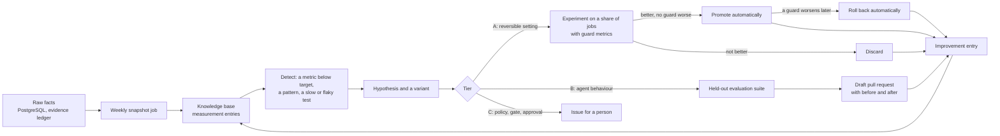

# Process metrics and the improvement loop

- Status: decided by the owner on 2026-11-20. The arithmetic of the section "How each number is computed" is built in the `metrics` module of `crates/domain`. Nothing else is built: see "What is built and what is not". The decisions and the options weighed are in [ADR 0029](../adr/0029-process-metrics-and-improvement-loop.md).
- Form: design.

## Purpose

The factory should get faster and better with every job, and it should be able to prove it. This document says which numbers the factory keeps, how each is computed, where they are written, and how a number becomes an improvement: automatically where the change is safe and reversible, through a person where it is not.

## The loop



## The metric catalogue

Each metric is an entry of kind `metric` in the knowledge base, with the fields of the table and a tested formula. Units follow [ADR 0029](../adr/0029-process-metrics-and-improvement-loop.md) Decision 2: integers in the computation, rounding at display only.

### Speed

| Metric | Unit | Formula | Cut by |
|---|---|---|---|
| Lead time to pull request | ms | Pull request opened minus job accepted, per job; median and 90th percentile | project, pack, risk tier |
| Stage duration | ms | Stage run end minus start | stage, outcome |
| Human wait time | ms | Sum of the time a job waited in `NEEDS_HUMAN` or for an approval | project, reason |
| Time to first failing test | ms | First failing test result minus start of the verify run | project |
| Test run time | ms | Verify run duration; share spent in the slowest 10 tests | project |

### Quality

| Metric | Unit | Formula | Cut by |
|---|---|---|---|
| First-pass gate success | ratio | Tasks whose first attempt passed every gate / tasks | agent, pack, model |
| Rework rounds | count | Rework rounds per phase per job (ADR 0023) | phase, agent |
| Review precision | ratio | Findings a person or a later fix confirmed / findings raised | reviewer agent, model |
| Escaped defects | count | Bugs linked to a merged factory pull request within 30 days of the merge | project, pack |
| Flaky tests | count | Tests whose result changed with no code change, in the window | project |
| Human rejection rate | ratio | Pull requests closed without merge / pull requests opened | project, pack |

### Cost

| Metric | Unit | Formula | Cut by |
|---|---|---|---|
| Cost per accepted pull request | micro-USD | Broker-metered spend of the job / merged pull requests | project, pack |
| Tokens per task | count | Input plus output tokens of all attempts of a task | agent, model |
| Escalations to the larger model | ratio | Tasks that needed the larger model / tasks | agent |

### Knowledge

| Metric | Unit | Formula | Cut by |
|---|---|---|---|
| Knowledge coverage | ratio | Active business rules with at least one enforcing test / active business rules | project |
| Knowledge drift | count | Active entries whose code changed without confirmation (gate findings) | project |
| Knowledge use | ratio | Tasks whose agents read at least one relevant entry / tasks | agent |

### Delivery (read only, where the project deploys through its own pipeline)

Lead time for changes, deployment frequency, change failure rate, time to restore service. The factory never deploys; it only reads these from the project's own pipeline when the project grants that read.

## How each number is computed

This section is the contract for the `metrics` module of `crates/domain`. The module is pure: it reads no clock, no file and no database, and every function gives the same answer for the same input. Each rule below has tests at zero, one, the largest value, a negative value where the type allows one, and the rounding edge.

### Units and sums

| Quantity | Type | Unit | Valid range |
|---|---|---|---|
| Duration | `Milliseconds` | milliseconds, unsigned | 0 to 2^53 - 1 |
| Money | `MicroUsd` | millionths of a United States dollar, signed (a refund is negative) | -(2^53 - 1) to 2^53 - 1 |
| Count | `u64` | things counted | 0 to 2^53 - 1 when written to a ledger entry |

A duration and an amount of money are different types, so one cannot be added to the other. A sum that leaves the valid range is refused with an error. It never wraps and never saturates, because a saturated total would look like a real number.

### Division and rounding

Every division that is shown or stored rounds half to even: a result exactly halfway between two integers goes to the even one. So 5 / 2 gives 2, 7 / 2 gives 4, and -5 / 2 gives -2. A division by zero is refused.

### Rates

A rate is a `Proportion`: a numerator and a denominator, both counts, with the numerator never above the denominator and the denominator never zero. It is divided only for display, as a percentage with one decimal place, rounded half to even. Examples: 14 of 23 is shown as 60.9 %, 1 of 2000 (0.05 %) is shown as 0.0 %, and 3 of 2000 (0.15 %) is shown as 0.2 %.

### Percentiles and the median

A percentile is taken by nearest rank over the exact samples of the window. With `n` samples sorted from the smallest and a percentile `p`, the rank is `p × n / 100` rounded up, and the value is the sample at that rank, counting from 1. The result is always one of the samples, so it needs no rounding. The median is the 50th percentile by this rule; with an even number of samples it is the lower of the two middle ones. Percentiles are given in hundredths of a percent, so that 2.5 percent can be written exactly. No samples give an error, not zero.

### Too few samples

A metric computed from fewer samples than its minimum (20 unless its definition says otherwise) has no value. The result says "too few samples" and carries the number of samples that were there.

### Comparing a rate before and after

1. Each rate gets a Wilson score interval at 95 percent, with the conventional value 1.96 (exactly 49 / 25) for the normal quantile. The two bounds are found by an exact integer search for the roots of the Wilson equation on a grid of millionths; no square root and no floating point is involved. The lower bound is rounded down and the upper bound up, so the interval is never narrower than the exact one.
2. The interval of the difference (after minus before) is built from the two Wilson intervals by Newcombe's hybrid score method. ADR 0029 asks for "a Wilson score interval" and for an interval that "excludes zero"; an interval of a difference is needed for that, and this is the standard one built from Wilson intervals. Its one square root is an integer square root rounded outward.
3. All results are in millionths (one millionth is 0.0001 of a percentage point). Every rounding goes outward, so the interval of the difference contains the exact one and is at most 7 millionths wider on each side. A rate of more than 2^32 trials is refused.

Options weighed for step 1: the closed formula with an integer square root was rejected, because with very few samples the rounding of the square root moves the bound by thousands of millionths; floating point was rejected by ADR 0029. The exact search costs about forty comparisons per interval.

### Comparing a duration or a cost before and after

The point value is the median after minus the median before. Its interval is a percentile bootstrap:

1. Draw, with replacement, as many values from the "before" samples as there are, and the same for "after". Take the difference of the two medians.
2. Repeat 2000 times (the number can be set between 1000 and 100 000).
3. The interval runs from the 2.5th to the 97.5th percentile of those differences, by nearest rank. If the measured difference lies outside those two values, the interval is widened to hold it.

The draws come from a fixed, documented generator (SplitMix64) started from a seed that is part of the input, and each index is drawn without bias (by rejection). The same samples and the same seed always give the same interval, on every machine. The default seed is 29. A separate script, `crates/domain/tests/oracle/median_bootstrap_oracle.py`, implements the same procedure, and a test holds the two to the same numbers.

### The decision

Each metric states its direction: lower is better (durations, costs, defects) or higher is better (success rates). A change is an **improvement** only when the whole interval of the difference lies on the good side of zero, a **worsening** only when the whole interval lies on the bad side, and **no clear change** otherwise. An interval that touches zero is no clear change.

## A measurement entry

```markdown
---
id: M-2026-W47
kind: measurement
title: Process numbers, week 47 of 2026
window: { from: 2026-11-16T00:00:00Z, to: 2026-11-23T00:00:00Z }
query_version: 3
computed_at_commit: 3f2a9c1
---

| Metric | Value | Samples | Previous week |
|---|---|---|---|
| Lead time to pull request, median | 41 min | 23 | 55 min |
| First-pass gate success | 60.9 % (14 of 23) | 23 | 52.4 % (11 of 21) |
| Cost per accepted pull request | 0.84 USD | 19 | 1.02 USD |
| Escaped defects | too few samples | 3 | too few samples |

## What stands out
...
```

## Tier A settings

A setting can be changed automatically only if it is declared here with its safe range. The first candidates:

| Setting | Safe range | Guard metrics |
|---|---|---|
| Test order (targeted tests first) | on or off; the full suite always runs | escaped defects, gate failure rate |
| Parallel tasks per job | 1 to the policy's limit | gate failure rate, cost per accepted pull request |
| Starting model tier for a task kind | only tiers that passed the evaluation for that agent | first-pass gate success, escaped defects |
| Order of independent reviewers | any order; all still run | review precision |

A setting outside this table is tier B or C.

## Experiments

A tier A variant runs on a share of jobs (10 percent by default) chosen by a hash of the job identifier, so the choice is reproducible. It is promoted when the comparison of ADR 0029 Decision 2 shows an improvement on its target metric and no guard metric is worse beyond its interval. It is rolled back when, after promotion, a guard metric worsens beyond its interval over the next window. Both are recorded as `improvement` entries and ledger entries.

## What is built and what is not

| Part | State |
|---|---|
| The arithmetic of "How each number is computed" | Built: `crates/domain/src/metrics/`, with its tests |
| The metric catalogue as typed definitions and as `metric` entries | Not built |
| The snapshot job over the facts the database already holds | Not built. It needs the knowledge base of [ADR 0028](../adr/0028-project-knowledge-base.md) for its `measurement` entries |
| Tier A settings, experiments, promotion and rollback | Not built. They come after enough jobs exist to measure |
| The retrospective agent and the scheduled sweeps | Not built |
