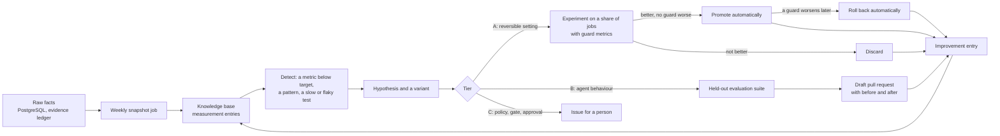

# Process metrics and the improvement loop

- Status: decided by the owner on 2026-11-20. Nothing is built. The decisions and the options weighed are in [ADR 0029](../adr/0029-process-metrics-and-improvement-loop.md).
- Form: design.

## Purpose

The factory should get faster and better with every job, and it should be able to prove it. This document says which numbers the factory keeps, how each is computed, where they are written, and how a number becomes an improvement: automatically where the change is safe and reversible, through a person where it is not.

## The loop



## The metric catalogue

Each metric is an entry of kind `metric` in the knowledge base, with the fields of the table and a tested formula. Units follow [ADR 0029](../adr/0029-process-metrics-and-improvement-loop.md) Decision 2: integers in the computation, rounding at display only.

### Speed

| Metric | Unit | Formula | Cut by |
|---|---|---|---|
| Lead time to pull request | ms | Pull request opened minus job accepted, per job; median and 90th percentile | project, pack, risk tier |
| Stage duration | ms | Stage run end minus start | stage, outcome |
| Human wait time | ms | Sum of the time a job waited in `NEEDS_HUMAN` or for an approval | project, reason |
| Time to first failing test | ms | First failing test result minus start of the verify run | project |
| Test run time | ms | Verify run duration; share spent in the slowest 10 tests | project |

### Quality

| Metric | Unit | Formula | Cut by |
|---|---|---|---|
| First-pass gate success | ratio | Tasks whose first attempt passed every gate / tasks | agent, pack, model |
| Rework rounds | count | Rework rounds per phase per job (ADR 0022) | phase, agent |
| Review precision | ratio | Findings a person or a later fix confirmed / findings raised | reviewer agent, model |
| Escaped defects | count | Bugs linked to a merged factory pull request within 30 days of the merge | project, pack |
| Flaky tests | count | Tests whose result changed with no code change, in the window | project |
| Human rejection rate | ratio | Pull requests closed without merge / pull requests opened | project, pack |

### Cost

| Metric | Unit | Formula | Cut by |
|---|---|---|---|
| Cost per accepted pull request | micro-USD | Broker-metered spend of the job / merged pull requests | project, pack |
| Tokens per task | count | Input plus output tokens of all attempts of a task | agent, model |
| Escalations to the larger model | ratio | Tasks that needed the larger model / tasks | agent |

### Knowledge

| Metric | Unit | Formula | Cut by |
|---|---|---|---|
| Knowledge coverage | ratio | Active business rules with at least one enforcing test / active business rules | project |
| Knowledge drift | count | Active entries whose code changed without confirmation (gate findings) | project |
| Knowledge use | ratio | Tasks whose agents read at least one relevant entry / tasks | agent |

### Delivery (read only, where the project deploys through its own pipeline)

Lead time for changes, deployment frequency, change failure rate, time to restore service. The factory never deploys; it only reads these from the project's own pipeline when the project grants that read.

## A measurement entry

```markdown
---
id: M-2026-W47
kind: measurement
title: Process numbers, week 47 of 2026
window: { from: 2026-11-16T00:00:00Z, to: 2026-11-23T00:00:00Z }
query_version: 3
computed_at_commit: 3f2a9c1
---

| Metric | Value | Samples | Previous week |
|---|---|---|---|
| Lead time to pull request, median | 41 min | 23 | 55 min |
| First-pass gate success | 61.0 % (14 of 23) | 23 | 52.4 % (11 of 21) |
| Cost per accepted pull request | 0.84 USD | 19 | 1.02 USD |
| Escaped defects | too few samples | 3 | too few samples |

## What stands out
...
```

## Tier A settings

A setting can be changed automatically only if it is declared here with its safe range. The first candidates:

| Setting | Safe range | Guard metrics |
|---|---|---|
| Test order (targeted tests first) | on or off; the full suite always runs | escaped defects, gate failure rate |
| Parallel tasks per job | 1 to the policy's limit | gate failure rate, cost per accepted pull request |
| Starting model tier for a task kind | only tiers that passed the evaluation for that agent | first-pass gate success, escaped defects |
| Order of independent reviewers | any order; all still run | review precision |

A setting outside this table is tier B or C.

## Experiments

A tier A variant runs on a share of jobs (10 percent by default) chosen by a hash of the job identifier, so the choice is reproducible. It is promoted when the comparison of ADR 0029 Decision 2 shows an improvement on its target metric and no guard metric is worse beyond its interval. It is rolled back when, after promotion, a guard metric worsens beyond its interval over the next window. Both are recorded as `improvement` entries and ledger entries.

## What is not built

Everything here. The first step is the metric definitions and the snapshot job over the facts the database already holds; the experiments come after enough jobs exist to measure.
