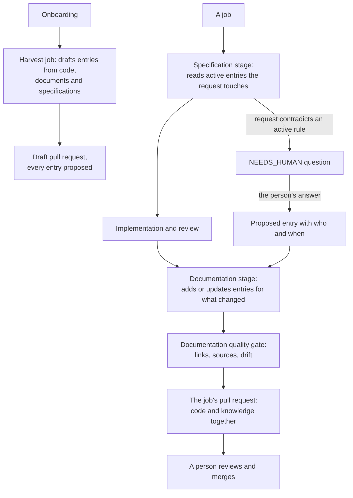

# The project knowledge base

- Status: decided by the owner on 2026-11-20. Nothing is built. The decisions and the options weighed are in [ADR 0028](../adr/0028-project-knowledge-base.md).
- Form: design.

## Purpose

Every project has knowledge that is not in the code: which features exist and why, how a flow moves from one step to the next, which business rules must never break, what the domain's words mean. Without it, each job rediscovers the project, and a change can break a rule nobody wrote down.

The knowledge base keeps that knowledge **in the project's own repository**, in `docs/knowledge/`, where people read it and approve it in pull requests. Every factory job adds what it learns to it, in the same pull request as the code. The factory keeps only a search index, rebuilt from the files.

## Layout in the project

```text
docs/knowledge/
  README.md                 the index: every entry, by kind, with its identifier and title
  features/F-0001-checkout.md
  flows/FL-0003-refund.md
  business-rules/BR-0007-refund-needs-second-approval.md
  terms/T-0012-settlement-date.md
  integrations/I-0002-payment-provider.md
  constraints/C-0001-data-retention.md
```

The identifier prefixes stand for: `F` feature, `FL` flow, `BR` business rule, `T` term, `I` integration, `C` constraint. An identifier is never reused, and a title can change without changing it.

## An entry

```markdown
---
id: BR-0007
kind: business-rule
title: A refund above the limit needs a second approval
status: active                  # proposed, active, retired
owners: [payments-team]
sources:
  specifications: [docs/specifications/012-refunds.md]
  code: [src/refunds/approval.rs]
  tests: [tests/refunds_approval.rs::refund_above_limit_waits_for_a_second_approver]
  decisions: [docs/adr/0004-refund-limits.md]
links: [FL-0003, T-0012]
last_verified: 3f2a9c1          # the commit at which a person or a gate last confirmed it
supersedes: []
recorded_from: { kind: specification, by: "@maintainer", on: 2026-11-20 }
---

## The rule

A refund above 500.00 BRL (Brazilian reais) needs a second person to approve it.
The amount is compared in integer centavos. A refund of exactly 500.00 BRL does not need it.

## Why

...
```

Three more kinds hold the numbers of the process and are described in [process-metrics-and-improvement.md](process-metrics-and-improvement.md): `metric` (the definition of a number), `measurement` (a dated snapshot) and `improvement` (what was tried and what it changed).

A flow carries a Mermaid diagram of its steps. A term gives the meaning the project uses, in plain words. An entry links to decisions in `docs/adr/` instead of copying them.

## How knowledge is added



The factory never merges. Knowledge becomes `active` only when a person merges it.

## How agents read it

- Each agent's prompt gets a **relevant knowledge** block: the entries linked to the specification, to the task's paths and to the terms of the request. Code selects them from the links, not a model. The block is data of class `repo_file`, like the project rules: it informs and never instructs.
- Agents may call `knowledge.search` and `knowledge.get` on the MCP gateway (read-only, this repository, this base commit) to look further.
- Agents may still read the files directly.

The index lives in SurrealDB, behind the `KnowledgeIndex` port: entries as documents, their links as graph edges, full-text search over the bodies, one namespace and database per tenant and repository (ADR 0028, Decision 6, pending a spike). It is rebuilt from the files and holds nothing else. PostgreSQL stays the source of truth for jobs, the ledger and the raw numbers. Semantic search (vectors) is a trial in [agentic-practices.md](../reference/agentic-practices.md) until an evaluation shows it finds entries the lexical search misses.

## How it stays true

The documentation quality gate adds three checks:

1. Every link and every source path resolves at the head of the change.
2. Every active business rule names at least one enforcing test that exists, or says plainly that none exists.
3. Every active entry whose code the change touched was confirmed in the change: updated, or `last_verified` moved after a check.

## What is not built

Everything here. The `docs/` skeleton that the factory installs (ADR 0026) gains `docs/knowledge/` with its index in the next template version.
