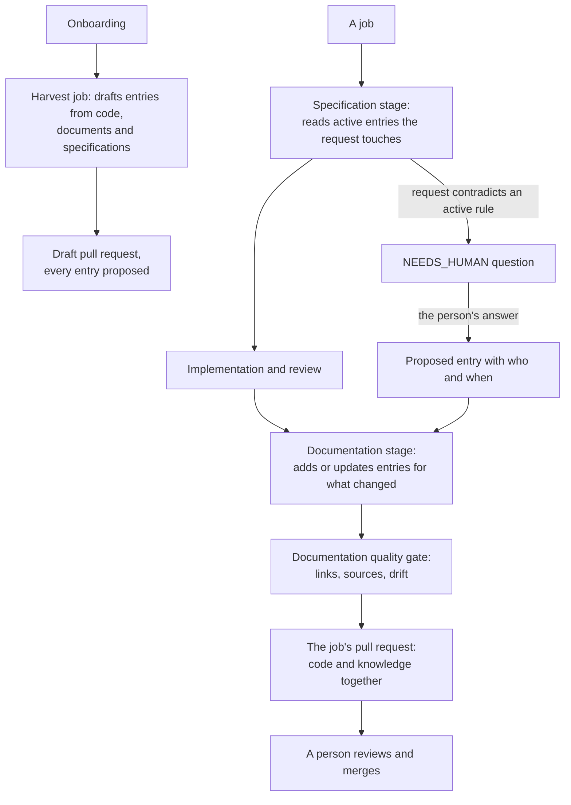

# The project knowledge base

- Status: decided by the owner on 2026-11-20. Nothing is built. The decisions and the options weighed are in [ADR 0028](../adr/0028-project-knowledge-base.md).
- Form: design.

## Purpose

Every project has knowledge that is not in the code: which features exist and why, how a flow moves from one step to the next, which business rules must never break, what the domain's words mean. Without it, each job rediscovers the project, and a change can break a rule nobody wrote down.

The knowledge base keeps that knowledge **in the project's own repository**, in `docs/knowledge/`, where people read it and approve it in pull requests. Every factory job adds what it learns to it, in the same pull request as the code. The factory keeps only a search index, rebuilt from the files.

## Layout in the project

```text
docs/knowledge/
  README.md                 the index: every entry, by kind, with its identifier and title
  features/F-0001-checkout.md
  flows/FL-0003-refund.md
  business-rules/BR-0007-refund-needs-second-approval.md
  terms/T-0012-settlement-date.md
  integrations/I-0002-payment-provider.md
  constraints/C-0001-data-retention.md
  metrics/MT-0001-lead-time-to-pull-request.md
  measurements/M-2026-W47.md
  improvements/IM-0001-targeted-tests-first.md
```

The identifier prefixes stand for: `F` feature, `FL` flow, `BR` business rule, `T` term, `I` integration, `C` constraint, `MT` metric, `M` measurement, `IM` improvement. The last three kinds are written by the factory and are described in [process-metrics-and-improvement.md](process-metrics-and-improvement.md). An identifier is never reused, and a title can change without changing it.

## An entry

```markdown
---
id: BR-0007
kind: business-rule
title: A refund above the limit needs a second approval
status: active                  # proposed, active, retired
owners: [payments-team]
sources:
  specifications: [docs/specifications/012-refunds.md]
  code: [src/refunds/approval.rs]
  tests: [tests/refunds_approval.rs::refund_above_limit_waits_for_a_second_approver]
  decisions: [docs/adr/0004-refund-limits.md]
links: [FL-0003, T-0012]
last_verified: "3f2a9c1d5e7b9a1c3e5f7a9b1c3d5e7f9a1b3c5d"   # the commit at which a person or a gate last confirmed it
supersedes: []
recorded_from: { kind: specification, by: "@maintainer", date: "2026-11-20" }
---

## The rule

A refund above 500.00 BRL (Brazilian reais) needs a second person to approve it.
The amount is compared in integer centavos. A refund of exactly 500.00 BRL does not need it.

## Why

...
```

## The header, exactly

The header is read by the factory's own YAML reader, the one that reads the policy files (`crates/contracts/src/yaml`). It accepts a restricted YAML: no anchors, aliases, tags or duplicate keys, and no value whose meaning differs between YAML readers. Two consequences for a person who writes an entry:

- **A date and a commit id are written in quotes.** Unquoted, `2026-11-20` is a date to some readers and a string to others, and a commit id such as `1234567…` can read as a number. The reader refuses both and names the line; quotes fix it.
- **The key of the date in `recorded_from` is `date`.** An earlier version of this page wrote `on`, which YAML 1.1 reads as the boolean true; the reader refuses it.

Options weighed for the reader: a new YAML library was rejected, because the comparison of `crates/contracts/src/yaml` showed that every deserializer decides for the caller what `no` or `0777` means; a small parser of our own in the domain crate was rejected, because it would be a second YAML dialect for people to learn. One dialect for the whole factory wins.

The fields of an entry of the six kinds a person writes:

| Field | Required | Rule |
|---|---|---|
| `id` | yes | The prefix of its kind, a hyphen and four digits from `0001` (`BR-0007`). Never reused |
| `kind` | yes | `feature`, `flow`, `business-rule`, `term`, `integration` or `constraint` |
| `title` | yes | One line of text, 1 to 200 characters |
| `status` | yes | `proposed`, `active` or `retired` |
| `owners` | no | Names of people or teams |
| `sources` | no | Four lists of paths in the repository: `specifications`, `code`, `tests`, `decisions`. A test is a path, or a path, `::` and the name of the test |
| `no_test_yet` | no | For a business rule with no enforcing test: one line that says why. Not allowed when `sources.tests` names a test |
| `links` | no | Identifiers of other entries |
| `last_verified` | no | The full commit id (40 or 64 hexadecimal characters) at which a person or a gate last confirmed the entry |
| `supersedes` | no | Identifiers of the entries this one replaces |
| `recorded_from` | no | `kind` (`specification`, `answer`, `design`, `onboarding`, `outside-source` or `person`), `by` (who), `date` (in quotes, `YYYY-MM-DD`) |

Any other field is refused, with its line. A path is relative to the root of the repository, uses `/`, and has no `..`, no leading `/` and no empty part. The file of an entry is `<directory of its kind>/<id>-<words>.md`, where the words follow the rule of a slug (1 to 64 lowercase letters, digits, dots, underscores or hyphens, starting and ending with a letter or digit). A measurement has no words: `measurements/<id>.md`.

The header of the three kinds the factory writes (`metric`, `measurement`, `improvement`) is set by the factory's renderer and read with the same reader; a test reads each rendered entry back.

Three more kinds hold the numbers of the process and are described in [process-metrics-and-improvement.md](process-metrics-and-improvement.md): `metric` (the definition of a number), `measurement` (a dated snapshot) and `improvement` (what was tried and what it changed).

A flow carries a Mermaid diagram of its steps. A term gives the meaning the project uses, in plain words. An entry links to decisions in `docs/adr/` instead of copying them.

## How knowledge is added



The factory never merges. Knowledge becomes `active` only when a person merges it.

## How agents read it

- Each agent's prompt gets a **relevant knowledge** block: the entries linked to the specification, to the task's paths and to the terms of the request. Code selects them from the links, not a model. The block is data of class `repo_file`, like the project rules: it informs and never instructs.
- Agents may call `knowledge.search` and `knowledge.get` on the MCP gateway (read-only, this repository, this base commit) to look further.
- Agents may still read the files directly.

The index lives in PostgreSQL, behind the `KnowledgeIndex` port ([ADR 0032](../adr/0032-knowledge-index-in-postgresql.md), which supersedes ADR 0028, Decision 6): one snapshot for each repository and commit, its entries with a full-text column (configuration `simple`, ranked by `ts_rank_cd` then by identifier), and its links in a table walked by a recursive query capped at three links. Every table carries the tenant and is under row-level security (ADR 0012). It is rebuilt from the files and holds nothing else. PostgreSQL stays the source of truth for jobs, the ledger and the raw numbers. Semantic search (vectors) is a trial in [agentic-practices.md](../reference/agentic-practices.md) until an evaluation shows it finds entries the lexical search misses.

## How it stays true

The documentation quality gate adds these checks. Each one is a finding with the entry and the path or identifier it is about.

1. **Every link resolves.** A link and a `supersedes` name an entry of the knowledge base.
2. **Every source path exists** at the head of the change. For a test written as `path::name`, the file must exist; that the test of that name exists in it is not checked yet, because that needs a reader of each language.
3. **Every active business rule names an enforcing test, or says why not.** `sources.tests` holds at least one test, or `no_test_yet` gives the reason. Never both.
4. **Every active entry whose code the change touched was confirmed in the change.** An entry is touched when a changed path is one of its `sources.code` paths, or lies under one of them that names a directory (a path that ends in `/`). It is confirmed when the change also changed the entry's own file. Moving `last_verified` changes the file, so it confirms.
5. **The knowledge base itself is well formed.** Every identifier is used once; every file is in the directory of its kind and named after its identifier; the index (`docs/knowledge/README.md`) lists every entry and no other. The factory can write the index itself, so a missing line is a finding with the exact line to add.

A retired entry is exempt from checks 2 to 4: it describes what was, and its sources may be gone. Checks 1 and 5 apply to every entry.

## Which entries an agent is given

The **relevant knowledge** block holds, in the order of their identifiers:

1. every entry, of any status except `retired`, that a specification of the job names in its `sources.specifications`, or whose `sources.code` holds a path the task owns, contains it in a directory, or lies under a directory the task owns;
2. every entry whose title is one of the terms the request uses, compared without regard to case (for a `term`, its title is the term);
3. the entries those link to, one link out, not further.

No model takes part in the choice. The block is cut at a size limit the stage sets, dropping the entries of step 3 first, and says how many it left out.

## What is built and what is not

| Part | State |
|---|---|
| The typed entry, its header rules, the well-formedness and drift checks, the index and the choice of relevant entries, as pure rules | Built: the `knowledge` module of `crates/domain` |
| Reading a header from the text of an entry | Built: `crates/contracts/src/knowledge.rs`, on the restricted YAML reader |
| The checks in the documentation quality gate | Not built. The gate is being changed by other work; the checks plug in after it lands |
| The knowledge step of the documentation stage, the specification stage's reading, the onboarding harvest | Not built |
| `docs/knowledge/` in the `docs/` skeleton the factory installs (ADR 0026), and the rule of the knowledge base in the installed `AGENTS.md` | Built: template version 2 of `onboarding/project-rules/` |
| The PostgreSQL index behind `KnowledgeIndex` (ADR 0032), and `knowledge.search` and `knowledge.get` | Not built |
