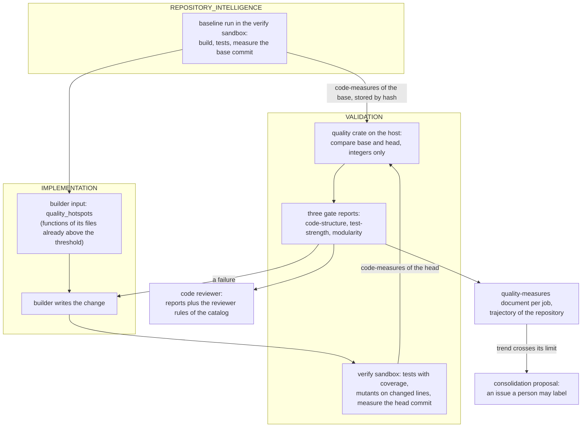

# The quality ratchet: structure, test strength and modularity

- Status: design, proposed with [ADR 0030](../adr/0030-quality-ratchet-for-structure-tests-and-modularity.md) on 2026-11-20. Nothing here is built.
- Form: architecture.
- Goal: say exactly what the three quality gates measure, how every number is computed, where each part runs, and what has to be true before the gates are called done.

## Purpose in one paragraph

Every change the factory delivers must leave the target repository at least as well structured, as well tested and as modular as it found it. Language tools measure the code at the base commit and at the head commit inside the verify sandbox. The host compares the two in integer arithmetic and fails the change for what it made worse. Debt that was already there never fails a change. The measures of every job are kept, so the trajectory of a repository can be read over time.

## Where each part runs

| Part | Runs in | Trusts | Reads |
|---|---|---|---|
| Measurement tools | Verify sandbox, no network, from the gate definitions at the protected base | Nothing the builder wrote, except as data to measure | The commit's files; for coverage and mutation, the test run |
| `quality` crate | Host, control plane, pure functions | Only the two `code-measures` documents after they are checked | Both documents, the changed lines from the trusted tree diff, the manifest's `quality` section at the base |
| Code reviewer | Its sandbox | Nothing; it judges | The three gate reports and the diff |

The base document is made once per base commit and gate definition set, during the baseline run, and is reused by every later stage run of the job.

## The `code-measures` document, version 1

One document per commit, written by the profile's measurement command. Every field is required unless marked optional. Unknown fields are refused.

| Field | Content |
|---|---|
| `commit` | The commit the measures describe. It must equal the commit the sandbox was given. |
| `functions` | Per function: path, qualified name, first and last line, cyclomatic complexity (at least 1), source lines (at least 1). |
| `rule_hits` | Per hit: rule identifier from the catalog, path, line. |
| `module_edges` | Per edge: the module that depends, the module it depends on. Module names are the language's own. |
| `coverage` (optional) | Per executable line: path, line, hit count. Only in the head document. |
| `mutants` (optional) | Per mutant: identifier, path, line, the change the tool made (a short label), outcome: `caught`, `missed`, `timeout` or `unviable`. Only in the head document. |
| `tool_versions` | The version of each tool that contributed, as probed. |

The host refuses the whole document, and the gate is `BLOCKED`, when:

- a path is not in the commit's tree, or a line is past the end of its file;
- a function's first line is after its last line, or two functions of one file have the same qualified name and first line;
- a count is 0 where at least 1 is required, or any integer is above 2^53 − 1 (ADR 0011);
- the document is larger than its cap (16 MiB) or holds more than 1,000,000 functions, rule hits, edges or coverage lines.

Duplicates are not in the document: the host finds them itself from the files (below), so no tool is needed for them.

## The arithmetic

Every measure is defined by the integer formula below. The integer formula is the definition, not an approximation of a real number. Sums are computed in unsigned 128-bit integers with checked operations. An overflow refuses the document instead of wrapping. Every stored result fits within 2^53 − 1.

### Erosion

For each function `f` with cyclomatic complexity `c(f)` and source lines `s(f)`:

- `root(f) = isqrt(s(f) × 1,000,000)`, the integer square root rounded down. It is the square root of the source lines times 1,000, rounded down.
- `mass(f) = c(f) × root(f)`.
- `erosion = floor(1,000 × (sum of mass(f) over functions with c(f) > T) / (sum of mass(f) over all functions))`, in parts per thousand. `T` is the threshold, 10 by default.
- With no function, erosion is not defined, and the report says so. It is never 0.

Worked example, threshold 10:

| Function | Complexity | Source lines | root | mass | Above threshold |
|---|---|---|---|---|---|
| a | 12 | 16 | 4,000 | 48,000 | yes |
| b | 2 | 9 | 3,000 | 6,000 | no |
| c | 1 | 4 | 2,000 | 2,000 | no |

Erosion = floor(1,000 × 48,000 / 56,000) = floor(857.14…) = 857 parts per thousand.

### Duplication

The host reads the measured files of the commit and finds duplicated runs of lines without any language tool:

1. Each line is normalized: white space at both ends removed, every inner run of white space made one space.
2. A line is significant when, after normalization, it holds at least one letter or digit. Blank lines and lines of only punctuation (a lone brace) are skipped and do not break a run.
3. Every window of `W` consecutive significant lines (6 by default) is hashed with SHA-256 over its normalized lines joined by line feeds.
4. A window whose hash occurs two or more times in the commit is a duplicate. Every line in it belongs to the duplicate set `D`.

`duplication = floor(1,000 × |D| / L)`, where `L` is the number of non-blank lines of the measured files. With `L = 0` it is not defined.

This finds copies that are the same after white space (type 1 clones). Copies with renamed variables (type 2) need a tokenizer per language. A profile may add them later through a `rule_hits` rule. The study's structural duplicates are closer to type 2, so the first version will find fewer copies than the study did. The record says so instead of claiming parity.

### Verbosity

`verbosity = floor(1,000 × |F ∪ D| / L)`, where `F` is the set of lines with a hit of a deterministic catalog rule. A line hit by several rules, or both flagged and duplicated, counts once.

### Coverage of the changed lines

`A` is the set of executable lines in the head's coverage data that the trusted tree diff marks as added or changed. `C` is the subset with a hit count above 0. The rule passes when `1,000 × |C| ≥ floor_coverage × |A|`, with `floor_coverage` 900 by default. With `|A| = 0` the rule does not apply, and the report says so.

Example: 37 of 41 changed lines ran. `1,000 × 37 = 37,000 ≥ 900 × 41 = 36,900`, so it passes, at 902 parts per thousand.

### Mutation score on the changed lines

Mutants are made only on added and changed lines. `killed = caught + timeout`, `viable = caught + missed + timeout`, and `unviable` mutants (they did not compile) are left out.

- With `viable ≥ 20`, the rule passes when `1,000 × killed ≥ floor_mutation × viable`, with `floor_mutation` 800 by default.
- With `viable < 20`, there is no score. Every `missed` mutant is a warning and goes to the reviewer, who judges whether the tests are enough. A small sample is not turned into a percentage.
- With more than 200 mutants, the run takes 200, chosen deterministically. The mutants are ordered by SHA-256 of the job identifier, a line feed and the mutant identifier, and the first 200 are kept. The same job always tests the same mutants, and the order is recorded.

Example: 17 caught, 0 timeouts, 4 missed. `viable = 21`, `1,000 × 17 = 17,000 ≥ 800 × 21 = 16,800`, so it passes, at 809 parts per thousand.

A `timeout` counts as killed because the test run noticed something was wrong, as the common mutation tools count it. The report lists timeouts separately so a person can see them.

### Modularity

The modules and the edges of each commit form a directed graph. The host finds its strongly connected components with Tarjan's algorithm. A cycle is a component with two or more modules, or a module with an edge to itself.

- **New cycle:** a component of the head holds an edge that is not in the base. It fails.
- **Forbidden edge:** the head has an edge that matches a `forbidden_edges` rule of the manifest's `quality` section and the base did not. It fails. An existing forbidden edge is a warning.

### Comparing base and head

| Rule | Fails when |
|---|---|
| Complex function | In the head, a function with complexity above `T` is new, or has a higher complexity than the function of the same path and qualified name in the base. A renamed function counts as new. |
| New duplicate | A window that is a duplicate in the head includes an added line, and the base had fewer occurrences of its hash. |
| Blocking catalog rule | An added line has a hit of a rule whose severity is `block`. |
| Changed-line coverage | The coverage rule above does not pass. |
| Mutation score | The mutation rule above does not pass. |
| Modularity | A new cycle or a new forbidden edge. |

The repository-wide numbers of the head (erosion, duplication, verbosity) are compared with the base for `baseline_comparison.delta` and for warnings. They never fail a change.

## The rule catalog

`fixtures/code-quality/rules.json` is the single source of truth for the code rules, in the same way `fixtures/readability/rules.json` is for prose. A rule has an identifier, a severity (`block` or `warn`), the languages it applies to, a suggested fix and a mode. A `deterministic` rule is matched by the profile's structural search tool. A `reviewer` rule is given to the code reviewer as a checklist item. The catalog fails to load, and the gate is `BLOCKED`, when a deterministic rule has no matcher for a language it names, or a reviewer rule claims to block.

First rows, from antislop's code skill and the study's failure modes:

| Rule | Mode | Severity | Catches |
|---|---|---|---|
| `comment-decorative-separator` | deterministic | block | A comment line that is mostly a repeated `=`, `-`, `*` or `#` |
| `comment-end-marker` | deterministic | block | `// end if`, `# end of function` and the like after a closing line |
| `comment-emoji` | deterministic | block | A pictograph inside a comment |
| `comment-vague-todo` | deterministic | warn | A to-do note with no named task (`TODO: improve this`) |
| `python-identity-comprehension` | deterministic | warn | `[x for x in items]` where `list(items)` is meant |
| `comment-restates-code` | reviewer | warn | A comment that says what the next line plainly does |
| `comment-narrates-steps` | reviewer | warn | `Step 1`, `Step 2` comments instead of a clear structure |
| `function-several-jobs` | reviewer | warn | One function that parses, decides and writes |
| `repeated-branch-without-helper` | reviewer | warn | The same block copied for each option or flag |
| `single-use-abstraction` | reviewer | warn | A trait, interface or factory with one implementation and no stated reason |

For Rust, many verbose idioms the study lists in Python (a needless `bool` comparison, a `let` that is returned at once, a redundant clone) are already Clippy lints. The lint gate already refuses any relaxation of those, so the catalog does not repeat them. The profile decides which Clippy groups the project's lint gate runs.

## The project manifest's `quality` section

Read at the protected base, never from the builder's commit.

| Key | Meaning |
|---|---|
| `complexity_threshold` | `T`. It may be lowered, and raised only above the profile's value with a reason. |
| `exclude` | Path globs left out of every measure (generated or vendored code), each with a reason. |
| `allow_complex` | Qualified function names allowed above `T`, each with a reason and a ceiling for its complexity. |
| `forbidden_edges` | Layering rules: module globs that must not depend on other module globs. |

A key that would make the profile's rule weaker than the central policy allows is a load error, as with every project setting.

## Candidate tools per language

None of these is verified or approved yet (ADR 0030, owner decision 1). Each is listed so the shape of a profile can be seen.

| Measure | Rust (first) | Python | TypeScript and JavaScript |
|---|---|---|---|
| Complexity and source lines | `rust-code-analysis-cli` | `radon` | `typhonjs-escomplex` or ESLint's complexity rule |
| Catalog rules | `ast-grep` | `ast-grep` | `ast-grep` |
| Coverage | `cargo-llvm-cov` with the `llvm-tools` component | `coverage.py` | `c8` |
| Mutants on changed lines | `cargo-mutants` with its diff option | `mutmut` | StrykerJS in incremental mode |
| Module graph | `cargo-modules` | `import-linter` or `pydeps` | `dependency-cruiser` |

## What must be true before the gates are called done

- **Arithmetic.** Property tests for every formula at its boundaries. They cover an empty set, one function, the threshold itself (complexity 10 is not above 10) and the largest allowed counts. They also cover a ratio exactly at the floor (`1,000 × 9 = 9,000 ≥ 900 × 10`), one short of it, and 19 and 20 viable mutants. An overflow refuses and never wraps.
- **Refusals.** A test for every refusal of the document. The cases are a path that is not in the tree, a line past the end, a count of 0, an integer above 2^53 − 1 and a document over its cap.
- **Deliberate breaks.** As elsewhere in this repository, a mutation script (`crates/quality/tests/mutations/*.py`) breaks each rule and each refusal on purpose and checks that a test fails.
- **No pass without a measure.** A missing tool, a failed probe, a refused document and a timed-out run each give `BLOCKED`, never `PASSED`.
- **The trajectory evaluation** of ADR 0030, Decision 6, on the five-issue fixture, with and without the gates.

## Residual risk

Coverage data and mutation outcomes come from running the builder's code. A test can write its own coverage data, or detect a mutant (by hashing its own source, for example) and fail on purpose. These measures are as trustworthy as a test report, and no more. The threat model will gain an entry for this when the gates are built. Its mitigations are the weakening gate, the reviewer, who sees the tests and the surviving mutants, and the hidden acceptance tests of the evaluation. Structure, duplication and modularity are read from the files without running them, so they do not carry this risk.
