# Slice 0 and Slice 1 plan

- Status: Slice 0 baseline, partly built. Eleven packages are merged on `feat/slice-0-foundation`. The plan was revised on 2026-10-27 after the implementers' findings: five packages were added (`s1-domain-revision`, `s1-database-tenancy-and-state-sync`, `s1-xtask-extensions`, `s1-ci-database-and-generated-checks`, `s1-telemetry-wiring`) and others were amended (ADR 0010 to 0013).
- Date: 2026-10-27
- Author: software_architect
- Source of truth: [`work-packages.json`](work-packages.json). The tables, the dependency graph, the waves and the critical path below are generated from it by `docs/architecture/tools/check_work_packages.py`, which also checks that concurrent packages own disjoint paths, that the graph has no cycle, that the port lists agree, and that every P0 negative test has an owner. Do not edit text between the `GENERATED` markers by hand. The critical path is computed from relative sizes. It is not a schedule.
- Related: [overview](overview.md), [state machines](state-machine.md), [ADR index](../adr/README.md), [contract schemas](../../schemas/README.md), [negative test catalog](../security/negative-test-catalog.md)

## 1. What the two slices deliver

### Slice 0: foundation

A compiling workspace whose architecture rules fail the build when broken; the pure domain, the four state machines proven against `state-machine.json`; the port traits with labelled fakes and shared contract tests; the first PostgreSQL migrations with database tests; CI that matches local checks; the security baseline and policies; telemetry initialization; and two risk-first spikes that settle the open questions in ADR 0005 and ADR 0006.

Slice 0 is done when all of these hold. Each is a command.

1. `cargo build --workspace --locked` and `cargo xtask check-architecture` pass, and the negative fixtures for each rule make the check fail.
2. `cargo nextest run -p factory-domain` passes, including the conformance test that reads `state-machine.json`, and the generated tables are in sync (`python3 -I docs/architecture/tools/render_state_machine.py --check`).
3. `schemas/validate.sh` passes, and the Rust types round-trip every valid example (`cargo nextest run -p factory-contracts --test schema_examples`).
4. `scripts/db-test.sh migrations` and the database tests pass on PostgreSQL in Docker.
5. `scripts/ci.sh` passes locally and returns 3 with BLOCKED when a required tool is missing.
6. Both spikes have a written verdict (GO, GO with a named fallback, or NO-GO), and ADR 0005 and ADR 0006 carry the amendment.
7. The policy conflicts listed in section 12 are resolved by their owners, or recorded as accepted differences by a human.

### Slice 1: the genuine end-to-end MVP

The master prompt's section 15 path, on one fixture repository: an authorized GitHub issue, intake, repository context, a real Spec Kit specification, an independent typed architecture and task plan, a sandboxed single builder, real checks, an independent technical review, professional documentation and its quality gate, a draft pull request with an evidence manifest, and a manual approval. It persists stages and artifacts and ends with no merge and no deploy.

**The rule that governs everything below: nothing is mocked without a label.** Every adapter reports `real` or `fake`. Fakes live only in `testkit`, which may appear only as a dev-dependency. Evidence from a fake is accepted only in test mode and never supports an assurance level. A production-mode job refuses to start with a fake. An unavailable dependency produces **BLOCKED** and exit code 3. It never produces a pass.

## 2. What is blocked until a person acts

Some of Slice 1 cannot be verified on this machine today. The plan says so now. It does not hide the gap behind fakes.

| Needed | Why | What stays possible without it | Who acts |
|---|---|---|---|
| **API keys for the model providers, each with a provider-side hard spend limit** | The default design runs the agent tools inside the sandbox behind a broker that holds real keys. Subscription logins cannot be brokered or metered (ADR 0005, ADR 0009). Both tools on this machine are logged in by subscription only. | Everything with the fake runtime in test mode, the probe, the broker with a labelled fake provider, and the redirect checks in the agent spike. | A human supplies the keys. |
| **A registered GitHub App** with the permissions in `docs/security/secrets-and-credentials.md` section 3.1 | Per-job narrowed installation tokens are required by the P0 authorization tests. | The GitHub adapter against the fake GitHub server FX-GH. | A human registers the App. |
| **A fixture repository on GitHub with a branch-protection ruleset** | A repository that fails the protection preflight runs at level L0 and opens no pull request (ADR 0009). | Scenarios against FX-GH. | A human, or an org admin, creates and protects the repository. |
| **The named requester allowlist** in protected configuration | Requester authorization (ADR 0009). | Tests with a fixture allowlist. | A human names the people. |
| **Permission to make real model calls during the spikes** | The Spec Kit and agent spikes include live runs. | Protocol checks against the labelled fake provider. | A human approves a spend ceiling. |

Consequently:

- **A real-provider adapter smoke test is BLOCKED unless an API key is supplied.** The test reports BLOCKED. A subscription login does not satisfy it.
- **Scenarios E1 and E2 (real adapters) cannot run today.** They exit with code 3 and name the missing item.
- **No acceptance report may present fake-runtime results as a real-provider result.** The report labels every scenario real or test mode.

## 3. Rules for every work package

1. **Strict TDD.** The first commit of a package is a failing test, or the failing fixture for a rule. The package lists those tests as its done criteria.
2. **No overlapping ownership.** A package edits only the paths it owns. The validator proves concurrent packages are disjoint. Where two packages own overlapping paths, one depends on the other.
3. **The skeleton merges first.** Only `s0-workspace-skeleton` creates crate directories. After it merges, each directory belongs to the package named in the ownership map. Manifests already list the dependencies the rules allow, and `lib.rs` files already declare their modules, so no package edits another's file.
4. **Ports change by request.** After `ports-v1` is tagged, a change to `crates/ports` or its contract suites is made in a pull request that the architect reviews, updates the fake and the contract suite in the same change, and bumps the tag.
5. **Negative tests are part of the package.** Each test has the name prefix `negative_` plus the lower-case catalog id (for example `negative_nt_sbx_01_...`), so a name filter selects it. Each has a control-off switch and must fail with its control off (catalog principle 2).
6. **BLOCKED, never skipped.** A test that needs Docker, a key, a token or a service reports BLOCKED when it is absent, through the guard in the test harness.
7. **Evidence, not assertion.** A package is done when its commands pass and the output is recorded in the pull request. Reviewer sign-off criteria name the reviewer.
8. **Plain English.** Titles, descriptions, commit messages and documents follow the human-readable rules. Machine ids live in separate fields.
9. **Protected paths.** CI workflows, `deny.toml`, `policies/`, gate configuration and tests that other packages rely on change only through the owning role (`sre`, `security`) and its review.
10. **The `frontend` role has no work before Slice 4.**

## 4. Work packages

<!-- GENERATED:begin wp-summary -->
| Work package | Id | Slice | Role | Size | Wave | Depends on | Critical path |
|---|---|---|---|---|---|---|---|
| Create the Cargo workspace and the architecture checks | `s0-workspace-skeleton` | 0 | software_engineer | M | 0 | none | yes |
| Define identifiers, value types and contract types in the domain crate | `s0-domain-vocabulary` | 0 | software_engineer | L | 1 | `s0-workspace-skeleton` | yes |
| Implement the four state machines exactly as the transition tables | `s0-state-machines` | 0 | software_engineer | L | 2 | `s0-domain-vocabulary` | yes |
| Define the port traits and the labelled fakes with shared contract tests | `s0-ports-and-testkit` | 0 | software_engineer | L | 2 | `s0-domain-vocabulary` |  |
| Validate contracts and load agent, profile, project and policy definitions | `s0-contracts-and-registry` | 0 | software_engineer | M | 3 | `s0-domain-vocabulary`, `s0-ports-and-testkit` |  |
| Create the first PostgreSQL migrations and database tests | `s0-database-baseline` | 0 | dba | L | 1 | `s0-workspace-skeleton` |  |
| Set up continuous integration that runs the same checks as a developer | `s0-ci-pipeline` | 0 | sre | M | 1 | `s0-workspace-skeleton`, `s0-security-baseline` |  |
| Write the security baseline, policies and supply-chain rules | `s0-security-baseline` | 0 | security | M | 0 | none |  |
| Initialize tracing and OpenTelemetry for the binaries | `s0-telemetry-baseline` | 0 | observability | S | 1 | `s0-workspace-skeleton` |  |
| Settle the open Spec Kit questions: revision, checklist, arguments and running in the sandbox | `s0-spec-kit-spike` | 0 | software_engineer | M | 1 | `s0-agent-runtime-spike` |  |
| Prove how the agent tools run inside the sandbox behind the broker | `s0-agent-runtime-spike` | 0 | software_engineer | M | 0 | none |  |
| Build and pin the sandbox image for the fixture project | `s1-sandbox-images` | 1 | sre | M | 1 | `s0-workspace-skeleton` |  |
| Implement the Docker sandbox supervisor and the posture verifier | `s1-sandbox-adapter` | 1 | software_engineer | L | 6 | `s0-ports-and-testkit`, `s1-sandbox-images`, `s1-security-test-harness`, `s1-redaction`, `s1-ports-revision` | yes |
| Implement the PostgreSQL store, the evidence ledger and the local artifact store | `s1-storage-postgres` | 1 | software_engineer | L | 6 | `s0-ports-and-testkit`, `s0-database-baseline`, `s1-database-tenancy-and-state-sync`, `s1-ports-revision`, `s1-database-port-alignment` |  |
| Build the durable workflow engine | `s1-engine-core` | 1 | software_engineer | XL | 4 | `s0-state-machines`, `s0-ports-and-testkit`, `s1-domain-revision` | yes |
| Evaluate approval, tool grant, protected path and budget policy as pure rules | `s1-policy-evaluation` | 1 | software_engineer | L | 4 | `s0-state-machines`, `s0-security-baseline`, `s0-contracts-and-registry`, `s1-domain-revision` |  |
| Implement the Claude Code and Codex adapters that run inside the sandbox | `s1-agent-runtime-adapters` | 1 | software_engineer | L | 7 | `s0-ports-and-testkit`, `s0-agent-runtime-spike`, `s1-sandbox-adapter`, `s1-ports-revision` | yes |
| Implement the GitHub App adapter for issues, narrowed tokens, draft pull requests and webhooks | `s1-github-adapter` | 1 | software_engineer | L | 6 | `s0-ports-and-testkit`, `s1-security-test-harness`, `s1-redaction`, `s1-ports-revision` |  |
| Write the agent manifests, prompts and the general-software profile | `s1-agent-definitions` | 1 | software_engineer | M | 4 | `s0-contracts-and-registry`, `s0-agent-runtime-spike` |  |
| Write the documentation policy and the readability rubric with a test corpus | `s1-documentation-rubric` | 1 | documenter | S | 0 | none |  |
| Build the human-readable artifact quality gate | `s1-readability-gate` | 1 | software_engineer | M | 2 | `s0-domain-vocabulary`, `s1-documentation-rubric` |  |
| Build the Spec Kit adapter and the specification stage | `s1-spec-adapter-and-stage` | 1 | software_engineer | L | 7 | `s0-spec-kit-spike`, `s1-engine-core`, `s0-contracts-and-registry`, `s1-agent-definitions`, `s1-prompt-assembly`, `s1-policy-evaluation`, `s1-workspace-ingestion`, `s1-ports-revision` |  |
| Build the intake and repository context stages | `s1-stage-intake-and-repository` | 1 | software_engineer | M | 7 | `s1-engine-core`, `s1-sandbox-adapter`, `s1-workspace-ingestion`, `s1-agent-definitions`, `s1-readability-gate`, `s1-policy-evaluation`, `s1-prompt-assembly`, `s1-ports-revision` |  |
| Build the domain discovery, architecture and task planning stages | `s1-stage-architecture-and-planning` | 1 | software_engineer | L | 6 | `s1-engine-core`, `s1-agent-definitions`, `s0-contracts-and-registry`, `s1-readability-gate`, `s1-prompt-assembly`, `s1-ports-revision` |  |
| Build the documentation stages and the documentation quality gate | `s1-stage-documentation` | 1 | software_engineer | L | 7 | `s1-engine-core`, `s1-sandbox-adapter`, `s1-workspace-ingestion`, `s1-agent-definitions`, `s1-documentation-rubric`, `s1-readability-gate`, `s1-prompt-assembly`, `s1-ports-revision` |  |
| Build the delivery and approval stages | `s1-stage-delivery-and-approval` | 1 | software_engineer | L | 7 | `s1-engine-core`, `s1-github-adapter`, `s1-readability-gate`, `s1-policy-evaluation`, `s1-redaction`, `s1-ports-revision` |  |
| Wire the API, worker and command line into runnable programs | `s1-apps-composition` | 1 | software_engineer | L | 9 | `s1-engine-core`, `s1-storage-postgres`, `s1-sandbox-adapter`, `s1-workspace-ingestion`, `s1-agent-runtime-adapters`, `s1-github-adapter`, `s1-egress-and-broker`, `s0-contracts-and-registry`, `s0-telemetry-baseline`, `s1-policy-evaluation`, `s1-spec-adapter-and-stage`, `s1-stage-intake-and-repository`, `s1-stage-architecture-and-planning`, `s1-stage-implementation-and-review`, `s1-trusted-gates-and-validation`, `s1-supply-chain-gates`, `s1-stage-documentation`, `s1-stage-delivery-and-approval`, `s1-agent-definitions`, `s1-security-test-harness`, `s1-telemetry-wiring`, `s1-ports-revision` | yes |
| Create the fixture repository and the end-to-end acceptance harness | `s1-fixture-and-e2e-harness` | 1 | qa | L | 1 | `s0-workspace-skeleton` |  |
| Verify traces, metrics and correlation across a job | `s1-observability-instrumentation` | 1 | observability | M | 5 | `s0-telemetry-baseline`, `s1-engine-core` |  |
| Provide local Compose deployment, backup and restore | `s1-local-deployment` | 1 | sre | M | 2 | `s0-ci-pipeline`, `s1-sandbox-images` |  |
| Review queries, indexes and retention against realistic data volumes | `s1-database-review` | 1 | dba | M | 7 | `s1-storage-postgres`, `s1-local-deployment` |  |
| Test prompt injection, sandbox escape attempts and secret handling | `s1-security-review-and-tests` | 1 | security | L | 9 | `s0-security-baseline`, `s1-sandbox-adapter`, `s1-workspace-ingestion`, `s1-egress-and-broker`, `s1-github-adapter`, `s1-agent-runtime-adapters`, `s1-fixture-and-e2e-harness`, `s1-stage-intake-and-repository`, `s1-policy-evaluation`, `s1-redaction`, `s1-prompt-assembly`, `s1-trusted-gates-and-validation`, `s1-supply-chain-gates`, `s1-security-test-harness`, `s1-stage-implementation-and-review` | yes |
| Run and record the Slice 1 end-to-end proof | `s1-end-to-end-run` | 1 | qa | M | 10 | `s1-apps-composition`, `s1-fixture-and-e2e-harness`, `s1-local-deployment`, `s1-observability-instrumentation`, `s1-security-review-and-tests` | yes |
| Write the guides, reference, runbooks and the recorded walkthrough | `s1-docs-and-walkthrough` | 1 | documenter | L | 11 | `s1-end-to-end-run`, `s1-documentation-rubric`, `s1-database-review` | yes |
| Build the host-side workspace, git hardening and output ingestion | `s1-workspace-ingestion` | 1 | software_engineer | L | 6 | `s0-ports-and-testkit`, `s1-security-test-harness`, `s1-policy-evaluation`, `s1-redaction`, `s1-ports-revision` |  |
| Build the model broker and the per-job egress relay | `s1-egress-and-broker` | 1 | software_engineer | XL | 6 | `s0-ports-and-testkit`, `s1-security-test-harness`, `s1-redaction`, `s1-ports-revision` |  |
| Assemble prompts with a data envelope and hardened untrusted text | `s1-prompt-assembly` | 1 | software_engineer | M | 5 | `s0-contracts-and-registry`, `s1-policy-evaluation`, `s1-redaction` |  |
| Redact secrets from every output the factory stores or sends | `s1-redaction` | 1 | software_engineer | M | 2 | `s0-domain-vocabulary`, `s0-security-baseline` |  |
| Build the dependency and supply chain gates | `s1-supply-chain-gates` | 1 | software_engineer | M | 7 | `s1-engine-core`, `s1-policy-evaluation`, `s1-sandbox-adapter`, `s1-security-test-harness` |  |
| Build the security test harness and the hostile fixtures | `s1-security-test-harness` | 1 | qa | L | 3 | `s0-ports-and-testkit` |  |
| Build the trusted gates and the validation stage | `s1-trusted-gates-and-validation` | 1 | software_engineer | L | 7 | `s1-engine-core`, `s1-sandbox-adapter`, `s1-workspace-ingestion`, `s1-policy-evaluation`, `s1-redaction`, `s1-ports-revision` |  |
| Build the implementation and review stages | `s1-stage-implementation-and-review` | 1 | software_engineer | L | 8 | `s1-engine-core`, `s1-sandbox-adapter`, `s1-workspace-ingestion`, `s1-agent-runtime-adapters`, `s1-agent-definitions`, `s1-policy-evaluation`, `s1-prompt-assembly`, `s1-ports-revision` | yes |
| Bring the domain crate in line with the revised state machine and contracts | `s1-domain-revision` | 1 | software_engineer | L | 3 | `s0-domain-vocabulary`, `s0-state-machines` | yes |
| Add row-level security and bring the state tables in line with the revised state machine | `s1-database-tenancy-and-state-sync` | 1 | dba | L | 2 | `s0-database-baseline` |  |
| Extend the architecture check with the repository-wide span name scan and the adapter allow lists | `s1-xtask-extensions` | 1 | software_engineer | L | 6 | `s0-workspace-skeleton`, `s0-telemetry-baseline`, `s1-ports-revision` |  |
| Move the local database to PostgreSQL 18 and test it, with the generated files, in CI | `s1-ci-database-and-generated-checks` | 1 | sre | M | 4 | `s0-ci-pipeline`, `s1-database-tenancy-and-state-sync`, `s1-domain-revision` |  |
| Connect the real redactor to telemetry and add the job trace context | `s1-telemetry-wiring` | 1 | observability | M | 4 | `s0-telemetry-baseline`, `s1-redaction`, `s1-domain-revision` |  |
| Revise the ports, fakes, contract suites and engine to ports v1.1 | `s1-ports-revision` | 1 | software_engineer | XL | 5 | `s0-ports-and-testkit`, `s0-contracts-and-registry`, `s1-domain-revision`, `s1-engine-core`, `s1-security-test-harness` | yes |
| Add the migration that the revised ports need and align the claim notes | `s1-database-port-alignment` | 1 | dba | M | 3 | `s1-database-tenancy-and-state-sync` |  |
<!-- GENERATED:end wp-summary -->

## 5. Parallel waves and the critical path

A wave is the earliest point at which a package can start, counting dependency hops. Packages in one wave can run in parallel. Everything here is computed from the dependency graph and the relative sizes.

<!-- GENERATED:begin waves -->
| Wave | Can start when the previous waves it needs are done | Packages |
|---|---|---|
| 0 | nothing | `s0-workspace-skeleton`, `s0-security-baseline`, `s0-agent-runtime-spike`, `s1-documentation-rubric` |
| 1 | packages of wave 0 or earlier | `s0-domain-vocabulary`, `s0-database-baseline`, `s0-ci-pipeline`, `s0-telemetry-baseline`, `s0-spec-kit-spike`, `s1-sandbox-images`, `s1-fixture-and-e2e-harness` |
| 2 | packages of wave 1 or earlier | `s0-state-machines`, `s0-ports-and-testkit`, `s1-readability-gate`, `s1-local-deployment`, `s1-redaction`, `s1-database-tenancy-and-state-sync` |
| 3 | packages of wave 2 or earlier | `s0-contracts-and-registry`, `s1-security-test-harness`, `s1-domain-revision`, `s1-database-port-alignment` |
| 4 | packages of wave 3 or earlier | `s1-engine-core`, `s1-policy-evaluation`, `s1-agent-definitions`, `s1-ci-database-and-generated-checks`, `s1-telemetry-wiring` |
| 5 | packages of wave 4 or earlier | `s1-observability-instrumentation`, `s1-prompt-assembly`, `s1-ports-revision` |
| 6 | packages of wave 5 or earlier | `s1-sandbox-adapter`, `s1-storage-postgres`, `s1-github-adapter`, `s1-stage-architecture-and-planning`, `s1-workspace-ingestion`, `s1-egress-and-broker`, `s1-xtask-extensions` |
| 7 | packages of wave 6 or earlier | `s1-agent-runtime-adapters`, `s1-spec-adapter-and-stage`, `s1-stage-intake-and-repository`, `s1-stage-documentation`, `s1-stage-delivery-and-approval`, `s1-database-review`, `s1-supply-chain-gates`, `s1-trusted-gates-and-validation` |
| 8 | packages of wave 7 or earlier | `s1-stage-implementation-and-review` |
| 9 | packages of wave 8 or earlier | `s1-apps-composition`, `s1-security-review-and-tests` |
| 10 | packages of wave 9 or earlier | `s1-end-to-end-run` |
| 11 | packages of wave 10 or earlier | `s1-docs-and-walkthrough` |
<!-- GENERATED:end waves -->

### The longest chain

<!-- GENERATED:begin critical-path -->
| Step | Work package | Size | Cumulative weight |
|---|---|---|---|
| 1 | Create the Cargo workspace and the architecture checks (`s0-workspace-skeleton`) | M | 3 |
| 2 | Define identifiers, value types and contract types in the domain crate (`s0-domain-vocabulary`) | L | 8 |
| 3 | Implement the four state machines exactly as the transition tables (`s0-state-machines`) | L | 13 |
| 4 | Bring the domain crate in line with the revised state machine and contracts (`s1-domain-revision`) | L | 18 |
| 5 | Build the durable workflow engine (`s1-engine-core`) | XL | 26 |
| 6 | Revise the ports, fakes, contract suites and engine to ports v1.1 (`s1-ports-revision`) | XL | 34 |
| 7 | Implement the Docker sandbox supervisor and the posture verifier (`s1-sandbox-adapter`) | L | 39 |
| 8 | Implement the Claude Code and Codex adapters that run inside the sandbox (`s1-agent-runtime-adapters`) | L | 44 |
| 9 | Build the implementation and review stages (`s1-stage-implementation-and-review`) | L | 49 |
| 10 | Wire the API, worker and command line into runnable programs (`s1-apps-composition`) | L | 54 |
| 11 | Run and record the Slice 1 end-to-end proof (`s1-end-to-end-run`) | M | 57 |
| 12 | Write the guides, reference, runbooks and the recorded walkthrough (`s1-docs-and-walkthrough`) | L | 62 |

Total relative weight along the longest chain: 62.

Other packages with zero slack, because a second chain ties with the first. A delay in any of them delays the end: `s1-security-review-and-tests`.
<!-- GENERATED:end critical-path -->

How to read this: a zero-slack package is one whose delay delays the end. The chain runs through the skeleton, the domain, the ports and the fakes, the security test harness, the sandbox supervisor, the agent runtime adapters, the implementation and review stage, the composition roots, the end-to-end run and the documentation. Two observations follow from the computation, and both are plan choices that the lead can change.

- **The security test harness is on the critical path** because the sandbox supervisor, the broker, the GitHub adapter and the workspace code all need its fake GitHub server, canary sweeper, Docker guard and hostile fixtures to finish their negative tests. I tested the effect on a copy of the plan: if the sandbox supervisor, the broker and the workspace package did not wait for the harness, the computed longest chain would fall from 46 to 44, because a second chain through the contracts, policy and workspace packages is within two units of it. So splitting the harness helps a little and is not worth a re-plan by itself.
- **The state machines and the engine have slack** because the sandbox chain is longer. They should still start as soon as their dependencies finish, since every stage package waits for the engine.

The two spikes are not on the longest chain by weight, but a NO-GO re-plans the packages that follow them. Start both in wave 0 and 1.

<!-- GENERATED:begin slack -->
| Work package | Earliest finish | Slack |
|---|---|---|
| `s0-workspace-skeleton` | 3 | 0 |
| `s0-domain-vocabulary` | 8 | 0 |
| `s0-state-machines` | 13 | 0 |
| `s1-domain-revision` | 18 | 0 |
| `s1-engine-core` | 26 | 0 |
| `s1-ports-revision` | 34 | 0 |
| `s1-sandbox-adapter` | 39 | 0 |
| `s1-agent-runtime-adapters` | 44 | 0 |
| `s1-stage-implementation-and-review` | 49 | 0 |
| `s1-apps-composition` | 54 | 0 |
| `s1-security-review-and-tests` | 54 | 0 |
| `s1-end-to-end-run` | 57 | 0 |
| `s1-docs-and-walkthrough` | 62 | 0 |
| `s0-ports-and-testkit` | 13 | 5 |
| `s1-github-adapter` | 39 | 5 |
| `s1-workspace-ingestion` | 39 | 5 |
| `s1-spec-adapter-and-stage` | 44 | 5 |
| `s1-stage-documentation` | 44 | 5 |
| `s1-stage-delivery-and-approval` | 44 | 5 |
| `s1-trusted-gates-and-validation` | 44 | 5 |
| `s1-stage-intake-and-repository` | 42 | 7 |
| `s1-egress-and-broker` | 42 | 7 |
| `s1-supply-chain-gates` | 42 | 7 |
| `s1-security-test-harness` | 18 | 8 |
| `s0-contracts-and-registry` | 16 | 10 |
| `s1-storage-postgres` | 39 | 10 |
| `s1-stage-architecture-and-planning` | 39 | 10 |
| `s1-database-review` | 42 | 15 |
| `s1-policy-evaluation` | 23 | 16 |
| `s1-prompt-assembly` | 26 | 18 |
| `s1-redaction` | 11 | 23 |
| `s1-xtask-extensions` | 39 | 23 |
| `s1-agent-definitions` | 19 | 25 |
| `s1-observability-instrumentation` | 29 | 25 |
| `s0-security-baseline` | 3 | 28 |
| `s1-sandbox-images` | 6 | 28 |
| `s0-database-baseline` | 8 | 28 |
| `s1-database-tenancy-and-state-sync` | 13 | 28 |
| `s1-database-port-alignment` | 16 | 28 |
| `s1-telemetry-wiring` | 21 | 28 |
| `s1-readability-gate` | 11 | 33 |
| `s0-agent-runtime-spike` | 3 | 36 |
| `s0-spec-kit-spike` | 6 | 38 |
| `s1-documentation-rubric` | 1 | 40 |
| `s1-fixture-and-e2e-harness` | 8 | 41 |
| `s1-ci-database-and-generated-checks` | 21 | 41 |
| `s0-telemetry-baseline` | 4 | 42 |
| `s0-ci-pipeline` | 6 | 45 |
| `s1-local-deployment` | 9 | 45 |
<!-- GENERATED:end slack -->

### Dependency graph

```mermaid
flowchart LR
  classDef crit fill:#fde8e8,stroke:#b42318,color:#400;
  classDef norm fill:#f3f6fb,stroke:#4a6fa5,color:#102a43;
  subgraph slice0["Slice 0: foundation"]
    s0_workspace_skeleton["s0-workspace-skeleton"]
    s0_domain_vocabulary["s0-domain-vocabulary"]
    s0_state_machines["s0-state-machines"]
    s0_ports_and_testkit["s0-ports-and-testkit"]
    s0_contracts_and_registry["s0-contracts-and-registry"]
    s0_database_baseline["s0-database-baseline"]
    s0_ci_pipeline["s0-ci-pipeline"]
    s0_security_baseline["s0-security-baseline"]
    s0_telemetry_baseline["s0-telemetry-baseline"]
    s0_spec_kit_spike["s0-spec-kit-spike"]
    s0_agent_runtime_spike["s0-agent-runtime-spike"]
  end
  subgraph slice1["Slice 1: end-to-end MVP"]
    s1_sandbox_images["s1-sandbox-images"]
    s1_sandbox_adapter["s1-sandbox-adapter"]
    s1_storage_postgres["s1-storage-postgres"]
    s1_engine_core["s1-engine-core"]
    s1_policy_evaluation["s1-policy-evaluation"]
    s1_agent_runtime_adapters["s1-agent-runtime-adapters"]
    s1_github_adapter["s1-github-adapter"]
    s1_agent_definitions["s1-agent-definitions"]
    s1_documentation_rubric["s1-documentation-rubric"]
    s1_readability_gate["s1-readability-gate"]
    s1_spec_adapter_and_stage["s1-spec-adapter-and-stage"]
    s1_stage_intake_and_repository["s1-stage-intake-and-repository"]
    s1_stage_architecture_and_planning["s1-stage-architecture-and-planning"]
    s1_stage_documentation["s1-stage-documentation"]
    s1_stage_delivery_and_approval["s1-stage-delivery-and-approval"]
    s1_apps_composition["s1-apps-composition"]
    s1_fixture_and_e2e_harness["s1-fixture-and-e2e-harness"]
    s1_observability_instrumentation["s1-observability-instrumentation"]
    s1_local_deployment["s1-local-deployment"]
    s1_database_review["s1-database-review"]
    s1_security_review_and_tests["s1-security-review-and-tests"]
    s1_end_to_end_run["s1-end-to-end-run"]
    s1_docs_and_walkthrough["s1-docs-and-walkthrough"]
    s1_workspace_ingestion["s1-workspace-ingestion"]
    s1_egress_and_broker["s1-egress-and-broker"]
    s1_prompt_assembly["s1-prompt-assembly"]
    s1_redaction["s1-redaction"]
    s1_supply_chain_gates["s1-supply-chain-gates"]
    s1_security_test_harness["s1-security-test-harness"]
    s1_trusted_gates_and_validation["s1-trusted-gates-and-validation"]
    s1_stage_implementation_and_review["s1-stage-implementation-and-review"]
    s1_domain_revision["s1-domain-revision"]
    s1_database_tenancy_and_state_sync["s1-database-tenancy-and-state-sync"]
    s1_xtask_extensions["s1-xtask-extensions"]
    s1_ci_database_and_generated_checks["s1-ci-database-and-generated-checks"]
    s1_telemetry_wiring["s1-telemetry-wiring"]
    s1_ports_revision["s1-ports-revision"]
    s1_database_port_alignment["s1-database-port-alignment"]
  end
  s0_workspace_skeleton --> s0_domain_vocabulary
  s0_domain_vocabulary --> s0_state_machines
  s0_domain_vocabulary --> s0_ports_and_testkit
  s0_domain_vocabulary --> s0_contracts_and_registry
  s0_ports_and_testkit --> s0_contracts_and_registry
  s0_workspace_skeleton --> s0_database_baseline
  s0_workspace_skeleton --> s0_ci_pipeline
  s0_security_baseline --> s0_ci_pipeline
  s0_workspace_skeleton --> s0_telemetry_baseline
  s0_agent_runtime_spike --> s0_spec_kit_spike
  s0_workspace_skeleton --> s1_sandbox_images
  s0_ports_and_testkit --> s1_sandbox_adapter
  s1_sandbox_images --> s1_sandbox_adapter
  s1_security_test_harness --> s1_sandbox_adapter
  s1_redaction --> s1_sandbox_adapter
  s1_ports_revision --> s1_sandbox_adapter
  s0_ports_and_testkit --> s1_storage_postgres
  s0_database_baseline --> s1_storage_postgres
  s1_database_tenancy_and_state_sync --> s1_storage_postgres
  s1_ports_revision --> s1_storage_postgres
  s1_database_port_alignment --> s1_storage_postgres
  s0_state_machines --> s1_engine_core
  s0_ports_and_testkit --> s1_engine_core
  s1_domain_revision --> s1_engine_core
  s0_state_machines --> s1_policy_evaluation
  s0_security_baseline --> s1_policy_evaluation
  s0_contracts_and_registry --> s1_policy_evaluation
  s1_domain_revision --> s1_policy_evaluation
  s0_ports_and_testkit --> s1_agent_runtime_adapters
  s0_agent_runtime_spike --> s1_agent_runtime_adapters
  s1_sandbox_adapter --> s1_agent_runtime_adapters
  s1_ports_revision --> s1_agent_runtime_adapters
  s0_ports_and_testkit --> s1_github_adapter
  s1_security_test_harness --> s1_github_adapter
  s1_redaction --> s1_github_adapter
  s1_ports_revision --> s1_github_adapter
  s0_contracts_and_registry --> s1_agent_definitions
  s0_agent_runtime_spike --> s1_agent_definitions
  s0_domain_vocabulary --> s1_readability_gate
  s1_documentation_rubric --> s1_readability_gate
  s0_spec_kit_spike --> s1_spec_adapter_and_stage
  s1_engine_core --> s1_spec_adapter_and_stage
  s0_contracts_and_registry --> s1_spec_adapter_and_stage
  s1_agent_definitions --> s1_spec_adapter_and_stage
  s1_prompt_assembly --> s1_spec_adapter_and_stage
  s1_policy_evaluation --> s1_spec_adapter_and_stage
  s1_workspace_ingestion --> s1_spec_adapter_and_stage
  s1_ports_revision --> s1_spec_adapter_and_stage
  s1_engine_core --> s1_stage_intake_and_repository
  s1_sandbox_adapter --> s1_stage_intake_and_repository
  s1_workspace_ingestion --> s1_stage_intake_and_repository
  s1_agent_definitions --> s1_stage_intake_and_repository
  s1_readability_gate --> s1_stage_intake_and_repository
  s1_policy_evaluation --> s1_stage_intake_and_repository
  s1_prompt_assembly --> s1_stage_intake_and_repository
  s1_ports_revision --> s1_stage_intake_and_repository
  s1_engine_core --> s1_stage_architecture_and_planning
  s1_agent_definitions --> s1_stage_architecture_and_planning
  s0_contracts_and_registry --> s1_stage_architecture_and_planning
  s1_readability_gate --> s1_stage_architecture_and_planning
  s1_prompt_assembly --> s1_stage_architecture_and_planning
  s1_ports_revision --> s1_stage_architecture_and_planning
  s1_engine_core --> s1_stage_documentation
  s1_sandbox_adapter --> s1_stage_documentation
  s1_workspace_ingestion --> s1_stage_documentation
  s1_agent_definitions --> s1_stage_documentation
  s1_documentation_rubric --> s1_stage_documentation
  s1_readability_gate --> s1_stage_documentation
  s1_prompt_assembly --> s1_stage_documentation
  s1_ports_revision --> s1_stage_documentation
  s1_engine_core --> s1_stage_delivery_and_approval
  s1_github_adapter --> s1_stage_delivery_and_approval
  s1_readability_gate --> s1_stage_delivery_and_approval
  s1_policy_evaluation --> s1_stage_delivery_and_approval
  s1_redaction --> s1_stage_delivery_and_approval
  s1_ports_revision --> s1_stage_delivery_and_approval
  s1_engine_core --> s1_apps_composition
  s1_storage_postgres --> s1_apps_composition
  s1_sandbox_adapter --> s1_apps_composition
  s1_workspace_ingestion --> s1_apps_composition
  s1_agent_runtime_adapters --> s1_apps_composition
  s1_github_adapter --> s1_apps_composition
  s1_egress_and_broker --> s1_apps_composition
  s0_contracts_and_registry --> s1_apps_composition
  s0_telemetry_baseline --> s1_apps_composition
  s1_policy_evaluation --> s1_apps_composition
  s1_spec_adapter_and_stage --> s1_apps_composition
  s1_stage_intake_and_repository --> s1_apps_composition
  s1_stage_architecture_and_planning --> s1_apps_composition
  s1_stage_implementation_and_review --> s1_apps_composition
  s1_trusted_gates_and_validation --> s1_apps_composition
  s1_supply_chain_gates --> s1_apps_composition
  s1_stage_documentation --> s1_apps_composition
  s1_stage_delivery_and_approval --> s1_apps_composition
  s1_agent_definitions --> s1_apps_composition
  s1_security_test_harness --> s1_apps_composition
  s1_telemetry_wiring --> s1_apps_composition
  s1_ports_revision --> s1_apps_composition
  s0_workspace_skeleton --> s1_fixture_and_e2e_harness
  s0_telemetry_baseline --> s1_observability_instrumentation
  s1_engine_core --> s1_observability_instrumentation
  s0_ci_pipeline --> s1_local_deployment
  s1_sandbox_images --> s1_local_deployment
  s1_storage_postgres --> s1_database_review
  s1_local_deployment --> s1_database_review
  s0_security_baseline --> s1_security_review_and_tests
  s1_sandbox_adapter --> s1_security_review_and_tests
  s1_workspace_ingestion --> s1_security_review_and_tests
  s1_egress_and_broker --> s1_security_review_and_tests
  s1_github_adapter --> s1_security_review_and_tests
  s1_agent_runtime_adapters --> s1_security_review_and_tests
  s1_fixture_and_e2e_harness --> s1_security_review_and_tests
  s1_stage_intake_and_repository --> s1_security_review_and_tests
  s1_policy_evaluation --> s1_security_review_and_tests
  s1_redaction --> s1_security_review_and_tests
  s1_prompt_assembly --> s1_security_review_and_tests
  s1_trusted_gates_and_validation --> s1_security_review_and_tests
  s1_supply_chain_gates --> s1_security_review_and_tests
  s1_security_test_harness --> s1_security_review_and_tests
  s1_stage_implementation_and_review --> s1_security_review_and_tests
  s1_apps_composition --> s1_end_to_end_run
  s1_fixture_and_e2e_harness --> s1_end_to_end_run
  s1_local_deployment --> s1_end_to_end_run
  s1_observability_instrumentation --> s1_end_to_end_run
  s1_security_review_and_tests --> s1_end_to_end_run
  s1_end_to_end_run --> s1_docs_and_walkthrough
  s1_documentation_rubric --> s1_docs_and_walkthrough
  s1_database_review --> s1_docs_and_walkthrough
  s0_ports_and_testkit --> s1_workspace_ingestion
  s1_security_test_harness --> s1_workspace_ingestion
  s1_policy_evaluation --> s1_workspace_ingestion
  s1_redaction --> s1_workspace_ingestion
  s1_ports_revision --> s1_workspace_ingestion
  s0_ports_and_testkit --> s1_egress_and_broker
  s1_security_test_harness --> s1_egress_and_broker
  s1_redaction --> s1_egress_and_broker
  s1_ports_revision --> s1_egress_and_broker
  s0_contracts_and_registry --> s1_prompt_assembly
  s1_policy_evaluation --> s1_prompt_assembly
  s1_redaction --> s1_prompt_assembly
  s0_domain_vocabulary --> s1_redaction
  s0_security_baseline --> s1_redaction
  s1_engine_core --> s1_supply_chain_gates
  s1_policy_evaluation --> s1_supply_chain_gates
  s1_sandbox_adapter --> s1_supply_chain_gates
  s1_security_test_harness --> s1_supply_chain_gates
  s0_ports_and_testkit --> s1_security_test_harness
  s1_engine_core --> s1_trusted_gates_and_validation
  s1_sandbox_adapter --> s1_trusted_gates_and_validation
  s1_workspace_ingestion --> s1_trusted_gates_and_validation
  s1_policy_evaluation --> s1_trusted_gates_and_validation
  s1_redaction --> s1_trusted_gates_and_validation
  s1_ports_revision --> s1_trusted_gates_and_validation
  s1_engine_core --> s1_stage_implementation_and_review
  s1_sandbox_adapter --> s1_stage_implementation_and_review
  s1_workspace_ingestion --> s1_stage_implementation_and_review
  s1_agent_runtime_adapters --> s1_stage_implementation_and_review
  s1_agent_definitions --> s1_stage_implementation_and_review
  s1_policy_evaluation --> s1_stage_implementation_and_review
  s1_prompt_assembly --> s1_stage_implementation_and_review
  s1_ports_revision --> s1_stage_implementation_and_review
  s0_domain_vocabulary --> s1_domain_revision
  s0_state_machines --> s1_domain_revision
  s0_database_baseline --> s1_database_tenancy_and_state_sync
  s0_workspace_skeleton --> s1_xtask_extensions
  s0_telemetry_baseline --> s1_xtask_extensions
  s1_ports_revision --> s1_xtask_extensions
  s0_ci_pipeline --> s1_ci_database_and_generated_checks
  s1_database_tenancy_and_state_sync --> s1_ci_database_and_generated_checks
  s1_domain_revision --> s1_ci_database_and_generated_checks
  s0_telemetry_baseline --> s1_telemetry_wiring
  s1_redaction --> s1_telemetry_wiring
  s1_domain_revision --> s1_telemetry_wiring
  s0_ports_and_testkit --> s1_ports_revision
  s0_contracts_and_registry --> s1_ports_revision
  s1_domain_revision --> s1_ports_revision
  s1_engine_core --> s1_ports_revision
  s1_security_test_harness --> s1_ports_revision
  s1_database_tenancy_and_state_sync --> s1_database_port_alignment
  class s0_workspace_skeleton crit;
  class s0_domain_vocabulary crit;
  class s0_state_machines crit;
  class s0_ports_and_testkit norm;
  class s0_contracts_and_registry norm;
  class s0_database_baseline norm;
  class s0_ci_pipeline norm;
  class s0_security_baseline norm;
  class s0_telemetry_baseline norm;
  class s0_spec_kit_spike norm;
  class s0_agent_runtime_spike norm;
  class s1_sandbox_images norm;
  class s1_sandbox_adapter crit;
  class s1_storage_postgres norm;
  class s1_engine_core crit;
  class s1_policy_evaluation norm;
  class s1_agent_runtime_adapters crit;
  class s1_github_adapter norm;
  class s1_agent_definitions norm;
  class s1_documentation_rubric norm;
  class s1_readability_gate norm;
  class s1_spec_adapter_and_stage norm;
  class s1_stage_intake_and_repository norm;
  class s1_stage_architecture_and_planning norm;
  class s1_stage_documentation norm;
  class s1_stage_delivery_and_approval norm;
  class s1_apps_composition crit;
  class s1_fixture_and_e2e_harness norm;
  class s1_observability_instrumentation norm;
  class s1_local_deployment norm;
  class s1_database_review norm;
  class s1_security_review_and_tests crit;
  class s1_end_to_end_run crit;
  class s1_docs_and_walkthrough crit;
  class s1_workspace_ingestion norm;
  class s1_egress_and_broker norm;
  class s1_prompt_assembly norm;
  class s1_redaction norm;
  class s1_supply_chain_gates norm;
  class s1_security_test_harness norm;
  class s1_trusted_gates_and_validation norm;
  class s1_stage_implementation_and_review crit;
  class s1_domain_revision crit;
  class s1_database_tenancy_and_state_sync norm;
  class s1_xtask_extensions norm;
  class s1_ci_database_and_generated_checks norm;
  class s1_telemetry_wiring norm;
  class s1_ports_revision crit;
  class s1_database_port_alignment norm;
```

<!-- GENERATED:begin wp-graph -->

<!-- GENERATED:end wp-graph -->

## 6. Ownership map

No two packages that can run at the same time own the same path. Paths outside the plan belong to other specialists and are read-only for every package.

<!-- GENERATED:begin ownership-map -->
| Path | Owner | Role | Slice |
|---|---|---|---|
| `.cargo/**` | `s0-workspace-skeleton` | software_engineer | 0 |
| `.claude/**` | Spec Kit specialist | outside this plan |  |
| `.env.example` | `s0-ci-pipeline` | sre | 0 |
| `.github/**` | `s0-ci-pipeline` | sre | 0 |
| `.github/**` | `s1-ci-database-and-generated-checks` | sre | 1 |
| `.gitignore` | lead | outside this plan |  |
| `.specify/**` | Spec Kit specialist | outside this plan |  |
| `Cargo.lock` | `s0-workspace-skeleton` | software_engineer | 0 |
| `Cargo.toml` | `s0-workspace-skeleton` | software_engineer | 0 |
| `README.md` | `s1-docs-and-walkthrough` | documenter | 1 |
| `agents/**` | `s1-agent-definitions` | software_engineer | 1 |
| `apps/**` | `s1-apps-composition` | software_engineer | 1 |
| `apps/*/Cargo.toml` | `s0-workspace-skeleton` | software_engineer | 0 |
| `apps/*/src/main.rs` | `s0-workspace-skeleton` | software_engineer | 0 |
| `apps/egress-sidecar/**` | `s1-egress-and-broker` | software_engineer | 1 |
| `crates/*/Cargo.toml` | `s0-workspace-skeleton` | software_engineer | 0 |
| `crates/*/clippy.toml` | `s0-workspace-skeleton` | software_engineer | 0 |
| `crates/*/src/lib.rs` | `s0-workspace-skeleton` | software_engineer | 0 |
| `crates/contracts/**` | `s0-contracts-and-registry` | software_engineer | 0 |
| `crates/contracts/src/registry.rs` | `s1-ports-revision` | software_engineer | 1 |
| `crates/contracts/src/validator.rs` | `s1-ports-revision` | software_engineer | 1 |
| `crates/contracts/tests/registry.rs` | `s1-ports-revision` | software_engineer | 1 |
| `crates/contracts/tests/validator_limits.rs` | `s1-ports-revision` | software_engineer | 1 |
| `crates/domain/**` | `s0-domain-vocabulary` | software_engineer | 0 |
| `crates/domain/src/contracts/**` | `s1-domain-revision` | software_engineer | 1 |
| `crates/domain/src/contracts/evidence_ledger_entry.rs` | `s1-ports-revision` | software_engineer | 1 |
| `crates/domain/src/contracts/review_verdict.rs` | `s1-ports-revision` | software_engineer | 1 |
| `crates/domain/src/contracts/stage_contract.rs` | `s1-ports-revision` | software_engineer | 1 |
| `crates/domain/src/ids.rs` | `s1-ports-revision` | software_engineer | 1 |
| `crates/domain/src/ledger.rs` | `s1-domain-revision` | software_engineer | 1 |
| `crates/domain/src/machines/**` | `s0-state-machines` | software_engineer | 0 |
| `crates/domain/src/machines/**` | `s1-domain-revision` | software_engineer | 1 |
| `crates/domain/src/machines/**` | `s1-ports-revision` | software_engineer | 1 |
| `crates/domain/src/patterns.rs` | `s1-ports-revision` | software_engineer | 1 |
| `crates/domain/src/policy/**` | `s1-policy-evaluation` | software_engineer | 1 |
| `crates/domain/src/redaction/**` | `s1-redaction` | software_engineer | 1 |
| `crates/domain/src/scope.rs` | `s1-ports-revision` | software_engineer | 1 |
| `crates/domain/src/state/**` | `s1-domain-revision` | software_engineer | 1 |
| `crates/domain/src/state/**` | `s1-ports-revision` | software_engineer | 1 |
| `crates/domain/src/values/**` | `s1-domain-revision` | software_engineer | 1 |
| `crates/domain/src/values/timestamp.rs` | `s1-ports-revision` | software_engineer | 1 |
| `crates/domain/src/vocabulary/**` | `s1-ports-revision` | software_engineer | 1 |
| `crates/domain/tests/contract_examples.rs` | `s1-domain-revision` | software_engineer | 1 |
| `crates/domain/tests/contract_examples.rs` | `s1-ports-revision` | software_engineer | 1 |
| `crates/domain/tests/contract_rules.rs` | `s1-domain-revision` | software_engineer | 1 |
| `crates/domain/tests/contract_rules.rs` | `s1-ports-revision` | software_engineer | 1 |
| `crates/domain/tests/ledger_chain.rs` | `s1-domain-revision` | software_engineer | 1 |
| `crates/domain/tests/policy.rs` | `s1-policy-evaluation` | software_engineer | 1 |
| `crates/domain/tests/redaction.rs` | `s1-redaction` | software_engineer | 1 |
| `crates/domain/tests/state_machine_conformance.rs` | `s0-state-machines` | software_engineer | 0 |
| `crates/domain/tests/state_machine_conformance.rs` | `s1-domain-revision` | software_engineer | 1 |
| `crates/domain/tests/state_machine_conformance.rs` | `s1-ports-revision` | software_engineer | 1 |
| `crates/domain/tests/state_machine_properties.rs` | `s0-state-machines` | software_engineer | 0 |
| `crates/domain/tests/state_machine_properties.rs` | `s1-domain-revision` | software_engineer | 1 |
| `crates/domain/tests/state_machine_properties.rs` | `s1-ports-revision` | software_engineer | 1 |
| `crates/domain/tests/support/**` | `s1-domain-revision` | software_engineer | 1 |
| `crates/domain/tests/support/**` | `s1-ports-revision` | software_engineer | 1 |
| `crates/domain/tests/tools/**` | `s1-domain-revision` | software_engineer | 1 |
| `crates/domain/tests/tools/**` | `s1-ports-revision` | software_engineer | 1 |
| `crates/domain/tests/values.rs` | `s1-domain-revision` | software_engineer | 1 |
| `crates/egress/**` | `s1-egress-and-broker` | software_engineer | 1 |
| `crates/github/**` | `s1-github-adapter` | software_engineer | 1 |
| `crates/observability/**` | `s0-telemetry-baseline` | observability | 0 |
| `crates/observability/**` | `s1-telemetry-wiring` | observability | 1 |
| `crates/ports/**` | `s0-ports-and-testkit` | software_engineer | 0 |
| `crates/ports/**` | `s1-ports-revision` | software_engineer | 1 |
| `crates/runtime/**` | `s1-agent-runtime-adapters` | software_engineer | 1 |
| `crates/sandbox/Cargo.toml` | `s1-sandbox-adapter` | software_engineer | 1 |
| `crates/sandbox/clippy.toml` | `s1-sandbox-adapter` | software_engineer | 1 |
| `crates/sandbox/src/container/**` | `s1-sandbox-adapter` | software_engineer | 1 |
| `crates/sandbox/src/lib.rs` | `s1-sandbox-adapter` | software_engineer | 1 |
| `crates/sandbox/src/process.rs` | `s1-sandbox-adapter` | software_engineer | 1 |
| `crates/sandbox/src/supervisor/**` | `s1-sandbox-adapter` | software_engineer | 1 |
| `crates/sandbox/src/workspace/**` | `s1-workspace-ingestion` | software_engineer | 1 |
| `crates/sandbox/tests/container/**` | `s1-sandbox-adapter` | software_engineer | 1 |
| `crates/sandbox/tests/workspace/**` | `s1-workspace-ingestion` | software_engineer | 1 |
| `crates/spec_adapter/**` | `s1-spec-adapter-and-stage` | software_engineer | 1 |
| `crates/storage/Cargo.toml` | `s1-storage-postgres` | software_engineer | 1 |
| `crates/storage/clippy.toml` | `s1-storage-postgres` | software_engineer | 1 |
| `crates/storage/diesel.toml` | `s0-database-baseline` | dba | 0 |
| `crates/storage/src/artifact_fs/**` | `s1-storage-postgres` | software_engineer | 1 |
| `crates/storage/src/lib.rs` | `s1-storage-postgres` | software_engineer | 1 |
| `crates/storage/src/pg/**` | `s1-storage-postgres` | software_engineer | 1 |
| `crates/storage/src/schema.rs` | `s0-database-baseline` | dba | 0 |
| `crates/storage/src/schema.rs` | `s1-database-port-alignment` | dba | 1 |
| `crates/storage/tests/**` | `s1-storage-postgres` | software_engineer | 1 |
| `crates/testkit/**` | `s0-ports-and-testkit` | software_engineer | 0 |
| `crates/testkit/src/*.rs` | `s1-ports-revision` | software_engineer | 1 |
| `crates/testkit/src/contracts/**` | `s1-ports-revision` | software_engineer | 1 |
| `crates/testkit/src/fx/**` | `s1-security-test-harness` | qa | 1 |
| `crates/testkit/src/fx/spawn.rs` | `s1-ports-revision` | software_engineer | 1 |
| `crates/testkit/src/fx/spawn/**` | `s1-ports-revision` | software_engineer | 1 |
| `crates/testkit/tests/**` | `s1-ports-revision` | software_engineer | 1 |
| `crates/workflow/Cargo.toml` | `s1-engine-core` | software_engineer | 1 |
| `crates/workflow/clippy.toml` | `s1-engine-core` | software_engineer | 1 |
| `crates/workflow/src/audit/**` | `s1-engine-core` | software_engineer | 1 |
| `crates/workflow/src/audit/**` | `s1-ports-revision` | software_engineer | 1 |
| `crates/workflow/src/commands/**` | `s1-engine-core` | software_engineer | 1 |
| `crates/workflow/src/commands/**` | `s1-ports-revision` | software_engineer | 1 |
| `crates/workflow/src/engine/**` | `s1-engine-core` | software_engineer | 1 |
| `crates/workflow/src/engine/**` | `s1-ports-revision` | software_engineer | 1 |
| `crates/workflow/src/gates/command/**` | `s1-trusted-gates-and-validation` | software_engineer | 1 |
| `crates/workflow/src/gates/dag/**` | `s1-stage-architecture-and-planning` | software_engineer | 1 |
| `crates/workflow/src/gates/docs/**` | `s1-stage-documentation` | software_engineer | 1 |
| `crates/workflow/src/gates/framework/**` | `s1-engine-core` | software_engineer | 1 |
| `crates/workflow/src/gates/framework/**` | `s1-ports-revision` | software_engineer | 1 |
| `crates/workflow/src/gates/mod.rs` | `s1-engine-core` | software_engineer | 1 |
| `crates/workflow/src/gates/mod.rs` | `s1-ports-revision` | software_engineer | 1 |
| `crates/workflow/src/gates/readability/**` | `s1-readability-gate` | software_engineer | 1 |
| `crates/workflow/src/gates/scope/**` | `s1-trusted-gates-and-validation` | software_engineer | 1 |
| `crates/workflow/src/gates/spec/**` | `s1-spec-adapter-and-stage` | software_engineer | 1 |
| `crates/workflow/src/gates/supply_chain/**` | `s1-supply-chain-gates` | software_engineer | 1 |
| `crates/workflow/src/handlers/**` | `s1-engine-core` | software_engineer | 1 |
| `crates/workflow/src/handlers/**` | `s1-ports-revision` | software_engineer | 1 |
| `crates/workflow/src/lib.rs` | `s1-engine-core` | software_engineer | 1 |
| `crates/workflow/src/prompts/**` | `s1-prompt-assembly` | software_engineer | 1 |
| `crates/workflow/src/scheduler/**` | `s1-engine-core` | software_engineer | 1 |
| `crates/workflow/src/scheduler/**` | `s1-ports-revision` | software_engineer | 1 |
| `crates/workflow/src/stages/approval/**` | `s1-stage-delivery-and-approval` | software_engineer | 1 |
| `crates/workflow/src/stages/architecture/**` | `s1-stage-architecture-and-planning` | software_engineer | 1 |
| `crates/workflow/src/stages/delivery/**` | `s1-stage-delivery-and-approval` | software_engineer | 1 |
| `crates/workflow/src/stages/documentation_review/**` | `s1-stage-documentation` | software_engineer | 1 |
| `crates/workflow/src/stages/documenting/**` | `s1-stage-documentation` | software_engineer | 1 |
| `crates/workflow/src/stages/domain_discovery/**` | `s1-stage-architecture-and-planning` | software_engineer | 1 |
| `crates/workflow/src/stages/implementation/**` | `s1-stage-implementation-and-review` | software_engineer | 1 |
| `crates/workflow/src/stages/intake/**` | `s1-stage-intake-and-repository` | software_engineer | 1 |
| `crates/workflow/src/stages/mod.rs` | `s1-engine-core` | software_engineer | 1 |
| `crates/workflow/src/stages/planning/**` | `s1-stage-architecture-and-planning` | software_engineer | 1 |
| `crates/workflow/src/stages/repo_intel/**` | `s1-stage-intake-and-repository` | software_engineer | 1 |
| `crates/workflow/src/stages/review/**` | `s1-stage-implementation-and-review` | software_engineer | 1 |
| `crates/workflow/src/stages/specification/**` | `s1-spec-adapter-and-stage` | software_engineer | 1 |
| `crates/workflow/src/stages/validation/**` | `s1-trusted-gates-and-validation` | software_engineer | 1 |
| `crates/workflow/tests/audit.rs` | `s1-engine-core` | software_engineer | 1 |
| `crates/workflow/tests/audit.rs` | `s1-ports-revision` | software_engineer | 1 |
| `crates/workflow/tests/delivery/**` | `s1-stage-delivery-and-approval` | software_engineer | 1 |
| `crates/workflow/tests/documentation/**` | `s1-stage-documentation` | software_engineer | 1 |
| `crates/workflow/tests/engine_scenarios.rs` | `s1-engine-core` | software_engineer | 1 |
| `crates/workflow/tests/engine_scenarios.rs` | `s1-ports-revision` | software_engineer | 1 |
| `crates/workflow/tests/implementation/**` | `s1-stage-implementation-and-review` | software_engineer | 1 |
| `crates/workflow/tests/intake_repo/**` | `s1-stage-intake-and-repository` | software_engineer | 1 |
| `crates/workflow/tests/invariants.rs` | `s1-engine-core` | software_engineer | 1 |
| `crates/workflow/tests/invariants.rs` | `s1-ports-revision` | software_engineer | 1 |
| `crates/workflow/tests/planning/**` | `s1-stage-architecture-and-planning` | software_engineer | 1 |
| `crates/workflow/tests/prompts/**` | `s1-prompt-assembly` | software_engineer | 1 |
| `crates/workflow/tests/readability/**` | `s1-readability-gate` | software_engineer | 1 |
| `crates/workflow/tests/security/**` | `s1-security-review-and-tests` | security | 1 |
| `crates/workflow/tests/specification/**` | `s1-spec-adapter-and-stage` | software_engineer | 1 |
| `crates/workflow/tests/supply_chain/**` | `s1-supply-chain-gates` | software_engineer | 1 |
| `crates/workflow/tests/support/**` | `s1-ports-revision` | software_engineer | 1 |
| `crates/workflow/tests/validation/**` | `s1-trusted-gates-and-validation` | software_engineer | 1 |
| `deny.toml` | `s0-security-baseline` | security | 0 |
| `docs/adr/**` | software_architect | outside this plan |  |
| `docs/architecture/**` | software_architect | outside this plan |  |
| `docs/database/**` | `s0-database-baseline` | dba | 0 |
| `docs/database/**` | `s1-database-review` | dba | 1 |
| `docs/database/**` | `s1-database-tenancy-and-state-sync` | dba | 1 |
| `docs/database/**` | `s1-database-port-alignment` | dba | 1 |
| `docs/guides/**` | `s1-docs-and-walkthrough` | documenter | 1 |
| `docs/observability/conventions.md` | `s0-telemetry-baseline` | observability | 0 |
| `docs/observability/conventions.md` | `s1-telemetry-wiring` | observability | 1 |
| `docs/observability/runbooks/**` | `s1-observability-instrumentation` | observability | 1 |
| `docs/reference/**` | `s1-docs-and-walkthrough` | documenter | 1 |
| `docs/reference/documentation-policy.md` | `s1-documentation-rubric` | documenter | 1 |
| `docs/reports/slice-1-acceptance.md` | `s1-end-to-end-run` | qa | 1 |
| `docs/runbooks/**` | `s1-docs-and-walkthrough` | documenter | 1 |
| `docs/security/**` | `s0-security-baseline` | security | 0 |
| `docs/security/**` | `s1-security-review-and-tests` | security | 1 |
| `docs/spec-kit/**` | Spec Kit specialist | outside this plan |  |
| `docs/spikes/agent-runtime.md` | `s0-agent-runtime-spike` | software_engineer | 0 |
| `docs/spikes/spec-kit-headless.md` | `s0-spec-kit-spike` | software_engineer | 0 |
| `docs/walkthroughs/**` | `s1-docs-and-walkthrough` | documenter | 1 |
| `fixtures/readability/**` | `s1-documentation-rubric` | documenter | 1 |
| `fixtures/recordings/agent-cli/**` | `s0-agent-runtime-spike` | software_engineer | 0 |
| `fixtures/recordings/e2e/**` | `s1-end-to-end-run` | qa | 1 |
| `fixtures/recordings/spec-kit/**` | `s0-spec-kit-spike` | software_engineer | 0 |
| `fixtures/repos/security/**` | `s1-security-test-harness` | qa | 1 |
| `fixtures/repos/word-count/**` | `s1-fixture-and-e2e-harness` | qa | 1 |
| `infra/compose/**` | `s0-ci-pipeline` | sre | 0 |
| `infra/compose/**` | `s1-ci-database-and-generated-checks` | sre | 1 |
| `infra/otel/**` | `s0-telemetry-baseline` | observability | 0 |
| `infra/sandbox-images/**` | `s1-sandbox-images` | sre | 1 |
| `migrations/**` | `s0-database-baseline` | dba | 0 |
| `migrations/**` | `s1-database-review` | dba | 1 |
| `migrations/**` | `s1-database-tenancy-and-state-sync` | dba | 1 |
| `migrations/**` | `s1-database-port-alignment` | dba | 1 |
| `policies/**` | `s0-security-baseline` | security | 0 |
| `profiles/**` | `s1-agent-definitions` | software_engineer | 1 |
| `rust-toolchain.toml` | `s0-workspace-skeleton` | software_engineer | 0 |
| `rustfmt.toml` | `s0-workspace-skeleton` | software_engineer | 0 |
| `schemas/**` | software_architect | outside this plan |  |
| `scripts/backup.sh` | `s1-local-deployment` | sre | 1 |
| `scripts/ci.sh` | `s0-ci-pipeline` | sre | 0 |
| `scripts/ci/**` | `s0-ci-pipeline` | sre | 0 |
| `scripts/ci/**` | `s1-ci-database-and-generated-checks` | sre | 1 |
| `scripts/db-test.sh` | `s0-database-baseline` | dba | 0 |
| `scripts/db-test.sh` | `s1-database-tenancy-and-state-sync` | dba | 1 |
| `scripts/db-test.sh` | `s1-database-port-alignment` | dba | 1 |
| `scripts/dev-up.sh` | `s0-ci-pipeline` | sre | 0 |
| `scripts/docs-check.sh` | `s1-docs-and-walkthrough` | documenter | 1 |
| `scripts/e2e.sh` | `s1-fixture-and-e2e-harness` | qa | 1 |
| `scripts/restore-drill.sh` | `s1-local-deployment` | sre | 1 |
| `scripts/restore.sh` | `s1-local-deployment` | sre | 1 |
| `scripts/smoke.sh` | `s1-local-deployment` | sre | 1 |
| `specs/**` | Spec Kit specialist | outside this plan |  |
| `tests/contract/**` | `s1-fixture-and-e2e-harness` | qa | 1 |
| `tests/end_to_end/**` | `s1-fixture-and-e2e-harness` | qa | 1 |
| `tests/observability/**` | `s1-observability-instrumentation` | observability | 1 |
| `tests/security/**` | `s0-security-baseline` | security | 0 |
| `tests/security/**` | `s1-security-review-and-tests` | security | 1 |
| `universal_agentic_software_factory_master_prompt.md` | lead | outside this plan |  |
| `xtask/**` | `s0-workspace-skeleton` | software_engineer | 0 |
| `xtask/**` | `s1-xtask-extensions` | software_engineer | 1 |
<!-- GENERATED:end ownership-map -->

## 7. Ports

Signatures are sketches. **The exact signatures are in [ports-v1.1](ports-v1.1.md)**, which replaces `ports-v1` after the independent review ([ADR 0014](../adr/0014-ports-v1-1-claim-protocol-and-port-revision.md)). Where a sketch below differs from that file, the file wins: the claim is `SystemTx::find_claim_candidates` then `AttemptOps::start_attempt`, the lease lives on the attempt, `AgentRuntime::run` takes the session and returns a report, the code host publishes check runs, and `Workspace` and `JobRepo` are two traits. `s1-ports-revision` makes the code match, and the contract suites and fakes with it. Every real adapter is built to pass the same contract suite as its fake. A trait whose name ends in `Ops` is a small piece of a larger port, split to keep each trait focused. Error enums are closed.

```rust
// crates/ports/src/time.rs
pub trait Clock: Send + Sync {
    fn now(&self) -> Timestamp;
}

pub trait IdGenerator: Send + Sync {
    /// A UUID version 7.
    fn new_uuid(&self) -> Uuid;
}

#[async_trait]
pub trait CancelSignal: Send + Sync {
    fn is_cancelled(&self) -> bool;
    async fn cancelled(&self);
}
```

```rust
// crates/ports/src/store.rs
pub struct TenantScope(TenantId);   // built only from an authenticated principal
pub struct SystemScope(());         // built only by the engine; Store::begin_system is called from workflow only (DEP-09)
pub struct Versioned<T> { pub value: T, pub version: Version }

#[async_trait]
pub trait Store: Send + Sync {
    fn fidelity(&self) -> Fidelity;
    /// Makes the transaction-local tenant setting before any other statement (ADR 0012).
    async fn begin(&self, scope: TenantScope) -> Result<Box<dyn Tx>, StoreError>;
    /// Uses the system role's own connection pool (ADR 0012). Read-only: it finds work (ADR 0014).
    async fn begin_system(&self, scope: SystemScope) -> Result<Box<dyn SystemTx>, StoreError>;
    /// Before any tenant is known. A narrow SECURITY DEFINER function behind it (ADR 0012).
    /// `None` for every miss reason, so the caller cannot tell which one it was.
    async fn resolve_token(&self, hash: &TokenHash, audience: &Audience) -> Result<Option<ResolvedPrincipal>, StoreError>;
    /// The pair names the repository: one installation covers many repositories.
    async fn resolve_installation(&self, installation: InstallationId, repository: GithubRepositoryId) -> Result<Option<ResolvedRepository>, StoreError>;
    /// An audit record that belongs to no tenant, under the platform tenant.
    async fn record_platform_audit(&self, scope: PlatformScope, event: NewAuditEvent) -> Result<AuditRecord, StoreError>;
    /// The answer after `CommitOutcomeUnknown`.
    async fn committed(&self, scope: TenantScope, witness: Witness) -> Result<bool, StoreError>;
    async fn schema_version(&self) -> Result<SchemaVersion, StoreError>;
}

/// The cross-tenant, read-only transaction: find claim candidates and due attempts.
#[async_trait]
pub trait SystemTx: Send {
    async fn database_time(&mut self) -> Result<Timestamp, StoreError>;
    async fn find_claim_candidates(&mut self, limit: u32) -> Result<Vec<ClaimCandidate>, StoreError>;
    async fn find_due_attempts(&mut self, reason: DueReason, limit: u32) -> Result<Vec<DueAttempt>, StoreError>;
    async fn finish(self: Box<Self>) -> Result<(), StoreError>;
}

/// One database transaction. Dropping it without commit rolls back.
#[async_trait]
pub trait Tx: JobOps + RequestOps + DeliveryOps + RepositoryOps + StageRunOps + AttemptOps + TaskNodeOps + StageArtifactOps + ApprovalOps + LedgerOps + OutboxOps + AuditOps + ArtifactIndexOps + PrincipalOps + Send {
    /// Database time. Lease and deadline checks use this and never the Clock port.
    async fn database_time(&mut self) -> Result<Timestamp, StoreError>;
    async fn commit(self: Box<Self>) -> Result<(), StoreError>;
    async fn rollback(self: Box<Self>) -> Result<(), StoreError>;
}

#[async_trait]
pub trait StageRunOps {
    async fn insert_stage_run(&mut self, new: NewStageRun) -> Result<Versioned<StageRun>, StoreError>;
    async fn get_stage_run(&mut self, id: StageRunId) -> Result<Versioned<StageRun>, StoreError>;
    async fn list_stage_runs(&mut self, job: JobId) -> Result<Vec<Versioned<StageRun>>, StoreError>;
    /// Compare and swap. `StoreError::Conflict` when `expected` is stale. The transition carries the
    /// guard that cleared it (ADR 0014, decision 3) and the records it requires.
    async fn transition_stage_run(&mut self, id: StageRunId, expected: Version, t: AppliedTransition<StageRunStatus>, effects: StageRunEffects) -> Result<Version, StoreError>;
    /// While READY, moves not_before. The only update that is not a transition.
    async fn postpone_stage_run(&mut self, id: StageRunId, expected: Version, delay: Duration) -> Result<Version, StoreError>;
}

#[async_trait]
pub trait AttemptOps {
    /// Atomic: READY to RUNNING (S03), epoch plus one, the attempt in STARTING with its lease.
    /// Found by `SystemTx::find_claim_candidates` first (ADR 0014, decision 1).
    async fn start_attempt(&mut self, start: StartAttempt) -> Result<StartedAttempt, StoreError>;
    /// Rejects the write when the fence is not current. The lease lives on the attempt.
    async fn heartbeat(&mut self, fence: Fence, ttl: Duration) -> Result<LeaseRenewal, StoreError>;
    async fn transition_attempt(&mut self, id: AttemptId, expected: Version, epoch: LeaseEpoch, t: AppliedTransition<AttemptStatus>, end: AttemptEnd) -> Result<Version, StoreError>;
}

#[async_trait]
pub trait LedgerOps {
    /// Appends at head + 1. The hashes are computed by domain code and checked here.
    async fn append_ledger_entry(&mut self, entry: LedgerEntry) -> Result<LedgerHead, StoreError>;
    async fn ledger_head(&mut self, job: JobId) -> Result<Option<LedgerHead>, StoreError>;
    async fn read_ledger(&mut self, job: JobId, from: Sequence, limit: u32) -> Result<Vec<LedgerEntry>, StoreError>;
}

#[async_trait]
pub trait OutboxOps {
    async fn enqueue_event(&mut self, event: DomainEvent) -> Result<(), StoreError>;
    async fn read_events(&mut self, job: JobId, from: OutboxSeq, limit: u32) -> Result<Vec<DomainEvent>, StoreError>;
}

#[async_trait]
pub trait AuditOps {
    /// Append only. The record names the actor, the policy hash and the correlation id.
    async fn record_audit(&mut self, event: AuditEvent) -> Result<(), StoreError>;
}

// JobOps, TaskNodeOps, ArtifactIndexOps and PrincipalOps follow the same pattern:
// typed inserts, gets, compare-and-swap updates, tenant-scoped, closed StoreError.
#[async_trait] pub trait JobOps {}
#[async_trait] pub trait TaskNodeOps {}
#[async_trait] pub trait ArtifactIndexOps {}
#[async_trait] pub trait PrincipalOps {}

pub enum StoreError { Conflict, NotFound, TenantMismatch, LeaseFenced, ChainBroken, Unavailable, Constraint(String) }
```

```rust
// crates/ports/src/artifact.rs
#[async_trait]
pub trait ArtifactStore: Send + Sync {
    fn backend(&self) -> ArtifactBackend;          // LocalFs now, S3Compatible in Slice 2
    fn fidelity(&self) -> Fidelity;
    /// Idempotent. Never overwrites. The same bytes give the same reference.
    async fn put(&self, bytes: Bytes, media_type: MediaType) -> Result<ArtifactRef, ArtifactError>;
    /// Re-hashes on read. Answers only for a tenant whose index row names the hash (ADR 0014, decision 9).
    async fn get(&self, scope: &TenantScope, r: &ArtifactRef) -> Result<Bytes, ArtifactError>;
    async fn exists(&self, scope: &TenantScope, r: &ArtifactRef) -> Result<bool, ArtifactError>;
}
pub enum ArtifactError { NotFound, HashMismatch { expected: Sha256, actual: Sha256 }, TooLarge { limit: u64 }, Io(BackendStep) }
```

```rust
// crates/ports/src/sandbox.rs
pub enum SandboxProfile { FetchDeps, Agent, Verify }

pub struct SandboxSpec {
    pub job: JobId,
    pub attempt: AttemptId,
    pub profile: SandboxProfile,
    pub image: ImageDigest,               // a digest, never a tag
    pub limits: SandboxLimits,            // every value at least 1; swap at least memory
    pub network: NetworkAttachment,       // None, or JobInternal { sidecar }
    pub mounts: SandboxMounts,            // typed: the workspace mounts and named caches, nothing else can be written
    pub job_token: Option<JobTokenMount>, // agent profile only; carries the secret, the adapter writes the file
    pub env: FixedEnv,                    // set by the supervisor from a fixed list
}

impl SandboxSpec {
    /// Pure. Rejects anything weaker than the policy: privileged, added capabilities, host namespaces,
    /// unconfined seccomp or AppArmor, a tag-only image, user 0, a zero limit, a workspace path that is
    /// not normalized. Mounts are typed, so the Docker socket cannot be named at all (ADR 0014, decision 5).
    pub fn validate(&self, policy: &SandboxPolicy) -> Result<(), PolicyViolation> { todo!() }
}

#[async_trait]
pub trait SandboxProvider: Send + Sync {
    fn fidelity(&self) -> Fidelity;
    /// Create, inspect, compare with policy, start, run the runtime self-check.
    /// Never returns a container that did not pass. A mismatch removes it and fails closed.
    async fn create_verified(&self, spec: SandboxSpec, cancel: &dyn CancelSignal) -> Result<Box<dyn SandboxSession>, SandboxError>;
    /// Removes containers, networks, sidecars and token files whose attempt is not in `live`.
    async fn sweep_orphans(&self, live: &[AttemptId]) -> Result<Vec<SandboxId>, SandboxError>;
}

#[async_trait]
pub trait SandboxSession: Send {
    fn id(&self) -> &SandboxId;
    fn posture(&self) -> &PostureReport;
    /// argv only. There is no shell string. Output is redacted before it is stored.
    async fn exec(&mut self, req: ExecRequest, cancel: &dyn CancelSignal) -> Result<ExecResult, SandboxError>;
    /// The supervisor enforces the wall clock and the disk cap. Docker offers neither.
    async fn stop_and_remove(self: Box<Self>, reason: TeardownReason) -> Result<TeardownReport, SandboxError>;
}

pub struct ExecRequest { pub argv: Vec<String>, pub cwd: RepoPath, pub stdin: Option<Vec<u8>>, pub timeout: Duration, pub max_output_bytes: u64 }
pub struct ExecResult { pub exit_code: Option<i32>, pub signal: Option<i32>, pub timed_out: bool, pub oom_killed: bool,
                        pub stdout: ArtifactRef, pub stderr: ArtifactRef, pub started_at: Timestamp, pub finished_at: Timestamp }
pub enum SandboxError { PolicyViolation(PolicyViolation), PostureMismatch(PostureDiff), ImageUnavailable, DaemonUnavailable,
                        ProvisionFailed(ProvisionStage), Timeout, ResourceExceeded(Resource), Cancelled, TeardownFailed { leaked: bool } }
```

```rust
// crates/ports/src/workspace.rs (ports-v1.1: the job owns the object store, an attempt owns a worktree)
#[async_trait]
pub trait WorkspaceProvider: Send + Sync {
    fn fidelity(&self) -> Fidelity;
    /// Puts the branch tip into the job's object store and returns the commit it fetched.
    async fn fetch(&self, job: JobId, target: &FetchTarget, branch: &BranchName, cancel: &dyn CancelSignal) -> Result<FetchedBase, WorkspaceError>;
    /// A sparse, detached worktree of a commit in that store. Paths the rules call hidden are excluded.
    async fn create(&self, req: WorkspaceRequest, cancel: &dyn CancelSignal) -> Result<Box<dyn Workspace>, WorkspaceError>;
    async fn repo(&self, job: JobId) -> Result<Box<dyn JobRepo>, WorkspaceError>;
    async fn dispose_job(&self, job: JobId) -> Result<(), WorkspaceError>;
    async fn sweep_orphans(&self, live: &[AttemptId], live_jobs: &[JobId]) -> Result<Vec<AttemptId>, WorkspaceError>;
}

/// The trusted object store of one job. Reads, patches and pushes, never the sandbox-writable tree.
#[async_trait]
pub trait JobRepo: Send + Sync {
    async fn read_file_at(&self, commit: &CommitSha, path: &RepoPath, max_bytes: u64, view: ReadView) -> Result<Vec<u8>, WorkspaceError>;
    async fn list_at(&self, commit: &CommitSha, glob: &RepoGlob, limit: usize, view: ReadView) -> Result<Vec<RepoPath>, WorkspaceError>;
    async fn export_patch(&self, base: &CommitSha, head: &CommitSha, max_bytes: u64, cancel: &dyn CancelSignal) -> Result<PatchExport, WorkspaceError>;
    /// Pushes a commit the factory made in this job. Works after a restart.
    async fn push(&self, target: &PushTarget, commit: &CommitSha, cancel: &dyn CancelSignal) -> Result<(), WorkspaceError>;
}

/// Host side of one attempt's checkout. The sandbox never sees the trusted git directory.
#[async_trait]
pub trait Workspace: Send + Sync {
    fn mounts(&self) -> WorkspaceMounts;
    fn base(&self) -> &CommitSha;
    /// Call after the container is gone. No-follow audit walk, temporary-index tree diff, path rules,
    /// rejection of gitlinks and escaping symlinks, secret scan.
    async fn ingest(&self, cancel: &dyn CancelSignal) -> Result<IngestedChange, WorkspaceError>;
    async fn commit(&self, change: &IngestedChange, req: CommitRequest) -> Result<CommitSha, WorkspaceError>;
    async fn dispose(self: Box<Self>) -> Result<(), WorkspaceError>;
}
pub enum WorkspaceError { HiddenPathPresent(RepoPath), EscapingSymlink(RepoPath), Gitlink(RepoPath), NestedGit(RepoPath),
                          ProtectedPathChanged(Vec<PathViolation>), SecretFound(Vec<Finding>), TooLarge, PathNotFound(RepoPath),
                          UnknownCommit, NotFetched, BaseMoved, NonFastForward, NotMadeHere, BranchNotAllowed, Unauthorized,
                          Cancelled, Timeout, Git { operation: GitOperation, exit: Option<i32> }, Io(IoOperation) }
```

```rust
// crates/ports/src/agent.rs
#[async_trait]
pub trait AgentRuntime: Send + Sync {
    fn id(&self) -> &RuntimeId;                 // "claude-code-cli", "codex-cli", "fake"
    fn fidelity(&self) -> Fidelity;
    async fn probe(&self, session: &mut dyn SandboxSession) -> Result<RuntimeCapabilities, ProbeError>;
    /// Starts the tool inside `session`. The engine validates the output. This never marks success.
    /// Always returns a report: a failed run still carries its usage, transcript and denials.
    async fn run(&self, session: &mut dyn SandboxSession, req: AgentRunRequest, cancel: &dyn CancelSignal) -> AgentRunReport;
}

pub struct AgentRunRequest {
    pub attempt: AttemptId,
    pub agent: AgentRef,
    pub prompt: AssembledPrompt,           // untrusted text only inside the data envelope
    pub output_schema: SchemaRef,
    pub max_output_bytes: u64,             // more than this is OutputTooLarge
    pub broker: BrokerEndpoint,            // where the sidecar relays to
    pub job_token: JobTokenRef,
    pub tools: GrantedTools,               // decided by policy, never by the agent
    pub limits: AgentLimits,
    pub model: ModelSelection,
    pub flag_set: FlagSet,                 // per stage; see ADR 0005
}
pub struct AgentRunReport { pub outcome: Result<RawOutput /* bytes, unvalidated */, AgentRunError>, pub transcript: Option<ArtifactRef>,
                            pub usage: Usage, pub runtime_version: Option<String>, pub exit: Option<ExitInfo>, pub permission_denials: Vec<Denial> }
pub enum AgentRunError { ProviderUnavailable, RateLimited { retry_after: Option<Duration> }, AuthenticationRequired, Timeout,
                         ProcessFailed(ExitInfo), OutputMissing, OutputTooLarge, Cancelled, CapabilityMissing(Capability), BudgetRefused }

pub trait ModelRouter: Send + Sync {
    /// Pure. The need carries `exclude` (runtimes that failed) and `probed` (what the probes found).
    fn route(&self, need: &RoutingNeed) -> Result<RoutingDecision, RoutingError>;   // reads policies/model_routing.yaml
}

/// The seam through which spend reaches a broker. The engine never holds one (ST-14).
#[async_trait]
pub trait MeteringOps: Send + Sync {
    async fn record_usage(&self, token: &JobTokenId, delta: Usage) -> Result<TokenUsage, BrokerError>;
}

#[async_trait]
pub trait ModelBroker: Send + Sync {
    fn fidelity(&self) -> Fidelity;
    /// Bound to tenant, job and stage, with a cost ceiling and an allowed provider and model list.
    async fn issue(&self, req: JobTokenRequest) -> Result<IssuedJobToken, BrokerError>;
    /// Idempotent.
    async fn revoke(&self, token: &JobTokenId) -> Result<(), BrokerError>;
    /// Idempotent. Removes the tokens of attempts that crashed.
    async fn revoke_for_job(&self, job: JobId) -> Result<(), BrokerError>;
    async fn usage(&self, token: &JobTokenId) -> Result<TokenUsage, BrokerError>;
}
```

```rust
// crates/ports/src/registry.rs
pub trait AgentRegistry: Send + Sync {
    fn manifest(&self, id: &AgentId, req: &VersionReq) -> Result<AgentManifest, RegistryError>;
    fn prompt(&self, manifest: &AgentManifest) -> Result<PromptTemplate, RegistryError>;     // hash checked
    fn profiles_matching(&self, tags: &[DomainTag]) -> Result<Vec<DomainCapabilityProfile>, RegistryError>;
}

pub trait OutputValidator: Send + Sync {
    /// The only path for agent output: size, depth, node budget and repeated keys are checked before a value exists.
    fn validate_bytes(&self, kind: ContractKind, version: u32, bytes: &[u8]) -> Result<ValidatedOutput, Vec<Violation>>;
    /// For values the factory built itself.
    fn validate_value(&self, kind: ContractKind, version: u32, instance: &serde_json::Value) -> Result<(), Vec<Violation>>;
}
```

```rust
// crates/ports/src/spec.rs
#[async_trait]
pub trait SpecificationProvider: Send + Sync {
    fn fidelity(&self) -> Fidelity;
    /// Runs the skills in the sandbox. The stage handler then stops the sandbox, ingests, commits and reads the files.
    async fn run(&self, req: &SpecRequest, ctx: &mut SpecContext<'_>) -> Result<SpecRunReport, SpecError>;
    /// Pure. Builds the typed outcome from the committed bytes.
    fn assemble(&self, req: &SpecRequest, files: &SpecFileSet) -> Result<SpecOutcome, SpecError>;
}
pub enum SpecOperation { Constitution, Specify, Clarify, Checklist }     // no other variant can be written
pub struct SpecRequest { pub job: JobId, pub op: SpecOperation, pub feature_directory: FeatureDir,
                         pub request_file: RepoPath, pub answers: Vec<HumanAnswer>, pub revision: Option<RevisionRequest> }
pub enum SpecOutcome { Draft(Box<SpecificationDraft>), NeedsHuman(Vec<OpenQuestion>) }
pub enum SpecError { ToolMissing, VersionMismatch { expected: String, found: String }, IntegrityNotOk(Vec<Finding>),
                     ExtensionsPresent, PostConditionFailed(Vec<PostCondition>), ParseError { path: RepoPath, reason: ParseReason },
                     Runtime(AgentRunError) }
```

```rust
// crates/ports/src/githost.rs
/// A token is minted for exactly this tenant, job, stage and repository, with the permissions of the stage.
pub struct GitScope { pub tenant: TenantId, pub job: JobId, pub stage: StageKind, pub repo: RepoRef }

#[async_trait]
pub trait IssueSource: Send + Sync {
    /// Always a live fetch. A webhook payload is a hint.
    async fn fetch_issue(&self, scope: &GitScope, issue: &IssueRef) -> Result<Issue, GitHostError>;
    /// A comment with its author's numeric id. Operator commands arrive this way (FR-029).
    async fn fetch_comment(&self, scope: &GitScope, comment: &CommentRef) -> Result<Comment, GitHostError>;
    async fn label_actor(&self, scope: &GitScope, issue: &IssueRef, label: &str) -> Result<Option<GithubActor>, GitHostError>;
    /// Reads the rulesets that apply to the default branch (Metadata read). Never asks for Administration.
    async fn repository_protection(&self, scope: &GitScope) -> Result<ProtectionReport, GitHostError>;
}

/// Verifies a webhook before anything parses or stores it. Pure; the `api` binary depends on this port.
pub trait WebhookVerifier: Send + Sync {
    fn fidelity(&self) -> Fidelity;
    fn verify(&self, raw_body: &[u8], headers: &WebhookHeaders) -> Result<VerifiedDelivery, WebhookRejection>;
}

#[async_trait]
pub trait ChangeHost: Send + Sync {
    fn fidelity(&self) -> Fidelity;
    async fn fetch_target(&self, scope: &GitScope) -> Result<FetchTarget, GitHostError>;                       // read credential, one repository
    async fn push_target(&self, scope: &GitScope, branch: &BranchName) -> Result<PushTarget, GitHostError>;   // factory/* only
    async fn resolve_branch(&self, scope: &GitScope, branch: &BranchName) -> Result<CommitSha, GitHostError>;
    /// Idempotent for the same head branch.
    async fn open_draft_pull_request(&self, scope: &GitScope, req: DraftPrRequest) -> Result<PullRequestRef, GitHostError>;
    async fn update_pull_request_body(&self, scope: &GitScope, pr: &PullRequestRef, body: &str, etag: Option<&str>) -> Result<(), GitHostError>;
    /// Sanitized and secret-checked inside the adapter. At least once by key (a marker reduces duplicates).
    async fn post_comment(&self, scope: &GitScope, target: &CommentTarget, body: &str, idempotency_key: &str) -> Result<CommentRef, GitHostError>;
    /// A check run carries the App's identity; a commit status does not (ADR 0014, decision 7).
    async fn publish_check(&self, scope: &GitScope, req: CheckRequest) -> Result<CheckRef, GitHostError>;
    async fn pull_request_state(&self, scope: &GitScope, pr: &PullRequestRef) -> Result<PullRequestState, GitHostError>;
    /// Called at job end, failure and cancel, and by the cleanup sweep.
    async fn revoke_job_tokens(&self, job: JobId) -> Result<(), GitHostError>;
    // There is no merge method, no method that marks a pull request ready, and none whose name starts
    // with merge, ready or undraft (rule DEP-09).
}
```

```rust
// crates/ports/src/process.rs (ports-v1.1)
/// The one funnel through which the factory starts a host process. Only the sandbox crate holds one.
#[async_trait]
pub trait ProcessRunner: Send + Sync {
    fn fidelity(&self) -> Fidelity;
    /// `req.program` is `Program::Docker` or `Program::Git`; nothing else can be named.
    async fn run(&self, req: SpawnRequest, cancel: &dyn CancelSignal) -> Result<SpawnOutput, SpawnError>;
}
```

```rust
// crates/workflow/src/handlers/mod.rs
/// The only thing a stage package implements. It holds no engine type and does not write status.
#[async_trait]
pub trait StageHandler: Send + Sync {
    fn kind(&self) -> StageKind;
    /// Resolve the StageContract for this run from the manifest, profile, policy and inputs.
    fn contract(&self, ctx: &ContractContext<'_>) -> Result<StageContract, StageError>;
    /// Do the work. May use agents, sandboxes and workspaces. Never writes status.
    async fn execute(&self, ctx: &mut StageContext<'_>) -> Result<StageOutput, StageError>;
    /// Decide the gate from stored evidence. Agent prose is never proof.
    async fn evaluate(&self, ctx: &GateContext<'_>) -> Result<GateDecision, StageError>;
}
```

<!-- GENERATED:begin ports-registry -->
| Port | Crate | Defined by | Fake | Real implementation | Built by | Used by |
|---|---|---|---|---|---|---|
| `Clock` | ports | `s0-ports-and-testkit` | FakeClock | SystemClock in apps | `s1-apps-composition` | `s1-engine-core`, `s1-storage-postgres` |
| `IdGenerator` | ports | `s0-ports-and-testkit` | SequentialIdGenerator | UuidV7Generator in apps | `s1-apps-composition` | `s1-engine-core` |
| `CancelSignal` | ports | `s0-ports-and-testkit` | FakeCancel | adapter over a Tokio cancellation token in apps | `s1-apps-composition` | `s1-engine-core`, `s1-agent-runtime-adapters` |
| `Tx` | ports | `s0-ports-and-testkit` | InMemoryTx | PgTx in storage | `s1-storage-postgres` | `s1-engine-core` |
| `Store` | ports | `s0-ports-and-testkit` | InMemoryStore | PgStore in storage | `s1-storage-postgres` | `s1-engine-core` |
| `ArtifactStore` | ports | `s0-ports-and-testkit` | InMemoryArtifactStore | LocalFsArtifactStore in storage | `s1-storage-postgres` | `s1-engine-core`, `s1-stage-delivery-and-approval` |
| `SandboxProvider` | ports | `s0-ports-and-testkit` | FakeSandbox | DockerSandbox supervisor in sandbox | `s1-sandbox-adapter` | `s1-engine-core`, `s1-stage-intake-and-repository`, `s1-stage-implementation-and-review`, `s1-trusted-gates-and-validation`, `s1-stage-documentation`, `s1-supply-chain-gates` |
| `SandboxSession` | ports | `s0-ports-and-testkit` | FakeSandboxSession | DockerSession in sandbox | `s1-sandbox-adapter` | `s1-agent-runtime-adapters`, `s1-stage-implementation-and-review`, `s1-trusted-gates-and-validation`, `s1-supply-chain-gates` |
| `WorkspaceProvider` | ports | `s0-ports-and-testkit` | FakeWorkspaceProvider | GitWorkspaceProvider in sandbox | `s1-workspace-ingestion` | `s1-engine-core`, `s1-stage-intake-and-repository` |
| `Workspace` | ports | `s0-ports-and-testkit` | FakeWorkspace | GitWorkspace in sandbox | `s1-workspace-ingestion` | `s1-stage-intake-and-repository`, `s1-stage-implementation-and-review`, `s1-trusted-gates-and-validation`, `s1-stage-documentation`, `s1-spec-adapter-and-stage`, `s1-stage-delivery-and-approval` |
| `AgentRuntime` | ports | `s0-ports-and-testkit` | FakeAgentRuntime | ClaudeCodeRuntime and CodexRuntime in runtime | `s1-agent-runtime-adapters` | `s1-engine-core`, `s1-spec-adapter-and-stage`, `s1-stage-intake-and-repository`, `s1-stage-architecture-and-planning`, `s1-stage-implementation-and-review`, `s1-stage-documentation` |
| `ModelRouter` | ports | `s0-ports-and-testkit` | StaticModelRouter | PolicyModelRouter in contracts | `s0-contracts-and-registry` | `s1-engine-core` |
| `AgentRegistry` | ports | `s0-ports-and-testkit` | InMemoryAgentRegistry | FileAgentRegistry in contracts | `s0-contracts-and-registry` | `s1-engine-core`, `s1-stage-architecture-and-planning` |
| `OutputValidator` | ports | `s0-ports-and-testkit` | none: the real validator is pure and fast, tests use it directly | SchemaOutputValidator in contracts | `s0-contracts-and-registry` | `s1-engine-core`, `s1-spec-adapter-and-stage`, `s1-stage-architecture-and-planning`, `s1-trusted-gates-and-validation` |
| `SpecificationProvider` | ports | `s0-ports-and-testkit` | FakeSpecificationProvider | SpecKitProvider in spec_adapter | `s1-spec-adapter-and-stage` | its own crate |
| `IssueSource` | ports | `s0-ports-and-testkit` | FakeIssueSource | GitHubIssueSource in github (GitHub App) | `s1-github-adapter` | `s1-stage-intake-and-repository`, `s1-apps-composition` |
| `ChangeHost` | ports | `s0-ports-and-testkit` | FakeChangeHost | GitHubChangeHost in github (GitHub App) | `s1-github-adapter` | `s1-stage-delivery-and-approval` |
| `StageHandler` | workflow | `s1-engine-core` | scripted handlers in workflow tests | one handler per stage kind in workflow | `s1-spec-adapter-and-stage`, `s1-stage-intake-and-repository`, `s1-stage-architecture-and-planning`, `s1-stage-implementation-and-review`, `s1-trusted-gates-and-validation`, `s1-stage-documentation`, `s1-stage-delivery-and-approval` | `s1-engine-core` |
| `ModelBroker` | ports | `s0-ports-and-testkit` | FakeModelBroker | Broker in egress | `s1-egress-and-broker` | `s1-engine-core` |
| `SystemTx` | ports | `s1-ports-revision` | InMemorySystemTx | PgSystemTx in storage | `s1-storage-postgres` | `s1-engine-core` |
| `JobRepo` | ports | `s1-ports-revision` | FakeJobRepo | GitJobRepo in sandbox | `s1-workspace-ingestion` | `s1-spec-adapter-and-stage`, `s1-stage-delivery-and-approval`, `s1-stage-documentation`, `s1-stage-implementation-and-review`, `s1-stage-intake-and-repository`, `s1-trusted-gates-and-validation` |
| `ProcessRunner` | ports | `s1-ports-revision` | ScriptedProcessRunner | OsProcessRunner in sandbox | `s1-sandbox-adapter` | `s1-sandbox-adapter`, `s1-workspace-ingestion` |
| `WebhookVerifier` | ports | `s1-ports-revision` | FakeWebhookVerifier | GitHubWebhookVerifier in github | `s1-github-adapter` | `s1-apps-composition` |
<!-- GENERATED:end ports-registry -->

## 8. Slice 0 work packages

<!-- GENERATED:begin wp-details-0 -->
#### Create the Cargo workspace and the architecture checks

| Field | Value |
|---|---|
| Id | `s0-workspace-skeleton` |
| Owner role | software_engineer |
| Reviewers | software_architect |
| Size | M (relative weight 3) |
| Wave | 0 |
| On the critical path | yes |
| Depends on | none |

Create the workspace with the twelve library crates and four binaries from ADR 0002 as empty compiling shells. A shell has no dependencies and only a short crate comment; the package that owns the crate adds its dependencies and its module declarations. Each crate inherits the workspace lints, and the four crates that must stay free of I/O carry their clippy ban list. Every binary prints that it is not implemented and exits with an error. External dependency versions are pinned in the manifest of the crate that uses them, so parallel packages never edit the root manifest. Write the xtask architecture check test-first, including the source-scan rules that the negative-test catalog lists as static checks. This package merges before any other package touches a crate directory.

Owns: `Cargo.toml`, `Cargo.lock`, `rust-toolchain.toml`, `rustfmt.toml`, `.cargo/**`, `xtask/**`, `crates/*/Cargo.toml`, `crates/*/clippy.toml`, `crates/*/src/lib.rs`, `apps/*/Cargo.toml`, `apps/*/src/main.rs`

Inputs: ADR 0002; docs/architecture/crate-dependency-rules.json; docs/architecture/overview.md

Done when:

| # | Check | How | Command or evidence |
|---|---|---|---|
| 1 | The workspace builds from a clean checkout. | command | `cargo build --workspace --locked` |
| 2 | The architecture check passes on the skeleton. | command | `cargo xtask check-architecture` |
| 3 | Each rule DEP-01 to DEP-04 and DEP-08 to DEP-10 has a failing fixture that makes the check exit non-zero. | test | `cargo nextest run -p xtask` |
| 4 | Static checks ST-01 (no safe.directory wildcard), ST-02 (no equality comparison on signatures), ST-03 (no shell spawn), ST-04 (dangerous container flags only in the posture verifier deny list and tests), ST-05 (no merge or deploy path without the approval check) and ST-09 (workspace reads only through the ingestion module) each have a failing fixture. | test | `cargo nextest run -p xtask static_checks` |
| 5 | The clippy bans fire: a scratch crate using each banned call fails under the same clippy.toml. | test | `cargo nextest run -p xtask clippy_bans` |
| 6 | Lints and formatting are clean. | command | `cargo clippy --workspace --all-targets -- -D warnings && cargo fmt --all -- --check` |
| 7 | The set of crates in cargo metadata equals the set in crate-dependency-rules.json, so every listed crate and binary exists as an empty compiling shell. | command | `cargo xtask check-architecture` |
| 8 | Every crate sets [lints] workspace = true, and a crate that does not fails the architecture check (DEP-06). | test | `cargo nextest run -p xtask dependency_rules` |

#### Define identifiers, value types and contract types in the domain crate

| Field | Value |
|---|---|
| Id | `s0-domain-vocabulary` |
| Owner role | software_engineer |
| Reviewers | software_architect |
| Size | L (relative weight 5) |
| Wave | 1 |
| On the critical path | yes |
| Depends on | `s0-workspace-skeleton` |

Write the pure types: identifiers, tenant scope, versions, hashes, timestamps, fidelity, execution mode, every status enum with the exact serialized names from state-machine.json, and one Rust type per schema. Add the ledger chain hash as a pure function. No I/O, no clock, no randomness.

Owns: `crates/domain/**`

Inputs: schemas/*.schema.json and schemas/examples; docs/architecture/state-machine.json; ADR 0007; ADR 0008

Done when:

| # | Check | How | Command or evidence |
|---|---|---|---|
| 1 | Every valid example under schemas/examples deserializes into its type and serializes back to an equal JSON value. | test | `cargo nextest run -p factory-domain --test contract_examples` |
| 2 | Status enum names equal the state lists in state-machine.json. | test | `cargo nextest run -p factory-domain status_names_match_state_machine_json` |
| 3 | The ledger chain hash reproduces values computed by an independent script on a fixture chain. | test | `cargo nextest run -p factory-domain chain_hash_matches_independent_oracle` |
| 4 | Clippy bans and the architecture check pass for the crate. | command | `cargo clippy -p factory-domain -- -D warnings && cargo xtask check-architecture` |

#### Implement the four state machines exactly as the transition tables

| Field | Value |
|---|---|
| Id | `s0-state-machines` |
| Owner role | software_engineer |
| Reviewers | software_architect |
| Size | L (relative weight 5) |
| Wave | 2 |
| On the critical path | yes |
| Depends on | `s0-domain-vocabulary` |

Write the Job, StageRun, Attempt and TaskNode transition functions as pure code, the named guard predicates, the invalidation rules, and the conformance and property tests that read state-machine.json. This package is test-first by construction: the conformance test is written before the functions.

Owns: `crates/domain/src/machines/**`, `crates/domain/tests/state_machine_conformance.rs`, `crates/domain/tests/state_machine_properties.rs`

Inputs: docs/architecture/state-machine.json; docs/architecture/state-machine.md

Done when:

| # | Check | How | Command or evidence |
|---|---|---|---|
| 1 | For each machine the accepted (from, event) pairs equal the JSON, and every other pair is rejected with a typed error and no state change. | test | `cargo nextest run -p factory-domain --test state_machine_conformance` |
| 2 | Every guard id in the JSON has a named predicate, and every predicate has an entry. | test | `cargo nextest run -p factory-domain guard_registry_matches_json` |
| 3 | Ten thousand generated command sequences never leave the tables (QA-1). | test | `cargo nextest run -p factory-domain --test state_machine_properties` |
| 4 | The invalidation function reproduces every row of the JSON invalidation table. | test | `cargo nextest run -p factory-domain invalidation_rules_match_json` |
| 5 | Adding a transition to a copy of the JSON makes the conformance test fail, so the test is not vacuous. | test | `cargo nextest run -p factory-domain conformance_detects_a_changed_table` |
| 6 | The generated tables in state-machine.md are in sync. | command | `python3 -I docs/architecture/tools/render_state_machine.py --check` |

#### Define the port traits and the labelled fakes with shared contract tests

| Field | Value |
|---|---|
| Id | `s0-ports-and-testkit` |
| Owner role | software_engineer |
| Reviewers | software_architect, security |
| Size | L (relative weight 5) |
| Wave | 2 |
| On the critical path | no |
| Depends on | `s0-domain-vocabulary` |

Fix version 1 of the port traits and their closed error enums from the sketches in this plan, and build testkit: faithful in-memory fakes that each report fidelity fake, the scripted adversarial runtime FX-ADV, a controllable clock FX-CLOCK, and generic contract test suites that run against any implementation. The same suites later run against the real adapters, which is how a fake is kept honest. Revised after the independent review by s1-ports-revision (ADR 0014); the signatures in docs/architecture/ports-v1.1.md replace the ports-v1 sketches.

Owns: `crates/ports/**`, `crates/testkit/**`

Inputs: Port sketches in this document; ADR 0003; ADR 0004; ADR 0005; ADR 0007

Ports: defines `Clock`, `IdGenerator`, `CancelSignal`, `Tx`, `Store`, `ArtifactStore`, `SandboxProvider`, `SandboxSession`, `WorkspaceProvider`, `Workspace`, `AgentRuntime`, `ModelRouter`, `AgentRegistry`, `OutputValidator`, `SpecificationProvider`, `IssueSource`, `ChangeHost`, `ModelBroker`; implements none; uses none.

Done when:

| # | Check | How | Command or evidence |
|---|---|---|---|
| 1 | Each contract suite passes against its in-memory fake: store (CAS, lease fencing, tenant scope, ledger chain, outbox), artifact store, sandbox, workspace, agent runtime, model broker, change host. | test | `cargo nextest run -p factory-testkit` |
| 2 | Every fake reports fidelity fake. | test | `cargo nextest run -p factory-testkit every_fake_reports_fake_fidelity` |
| 3 | The scripted adversarial runtime obeys any script it is given and records every prompt it receives with the structured parts separated (FX-ADV). | test | `cargo nextest run -p factory-testkit fx_adv_records_prompts_and_obeys_the_script` |
| 4 | ChangeHost has no method whose name starts with merge, and testkit is a dev-dependency only. | command | `cargo xtask check-architecture` |
| 5 | Every public trait documents its preconditions, postconditions, closed error set and idempotency. | test | `cargo nextest run -p factory-ports trait_docs_state_the_contract` |
| 6 | The architect reviewed the port surface and the revision is tagged ports-v1. | review | reviewer sign-off recorded in the pull request |

#### Validate contracts and load agent, profile, project and policy definitions

| Field | Value |
|---|---|
| Id | `s0-contracts-and-registry` |
| Owner role | software_engineer |
| Reviewers | software_architect |
| Size | M (relative weight 3) |
| Wave | 3 |
| On the critical path | no |
| Depends on | `s0-domain-vocabulary`, `s0-ports-and-testkit` |

Embed the schemas, implement OutputValidator with hard size and depth limits, and load agent manifests, domain capability profiles, project manifests and the policy files. The loader follows the parser contract written at the top of policies/security.yaml: typed structs with unknown keys rejected, a single document, no anchors, aliases or merge keys, a schema version that must match, and a policy hash over the canonical form. The existing schema examples and their expectation files are the test oracle.

Owns: `crates/contracts/**`

Inputs: schemas/; policies/ as written by the security specialist; ADR 0005

Ports: defines none; implements `AgentRegistry`, `ModelRouter`, `OutputValidator`; uses none.

Done when:

| # | Check | How | Command or evidence |
|---|---|---|---|
| 1 | Every valid example validates and every invalid example is rejected at the path named in its .expect file. | test | `cargo nextest run -p factory-contracts --test schema_examples` |
| 2 | The two YAML example files are loaded directly through the YAML loader, validated against their schemas, and equal to the JSON transcriptions that the domain crate tests: schemas/examples/domain-capability-profile/valid/quant-trading-from-master-prompt.yaml and schemas/examples/project-manifest/valid/word-count-fixture.yaml. The domain crate only reads the JSON transcriptions. | test | `cargo nextest run -p factory-contracts --test yaml_examples` |
| 3 | Every keyword used by the schemas (if/then/else, dependentSchemas, contains, oneOf, not) behaves as in check-jsonschema, proven by the same examples. | test | `cargo nextest run -p factory-contracts --test schema_examples` |
| 4 | A YAML parser is chosen from at least two maintained candidates, with serde_yaml excluded as deprecated, and the comparison is written down. | review | reviewer sign-off recorded in the pull request |
| 5 | Loaders reject a manifest whose prompt hash does not match the prompt file, and name the file and field in the error. | test | `cargo nextest run -p factory-contracts loader_errors_name_file_and_field` |
| 6 | The policy files in policies/ load without error. | test | `cargo nextest run -p factory-contracts --test policy_files` |
| 7 | The schema suite still passes. | command | `schemas/validate.sh` |
| 8 | Policy loading is strict: an unknown key, a wrong schema version, a duplicate key, an anchor, alias or merge key, a wrong type, an invalid regex or glob, and a missing default action each fail the load (NT-POL-03). Policy is read only from the protected configuration source, never from an environment path, a feature branch or the target repository (NT-POL-01). | test | `cargo nextest run -p factory-contracts negative_nt_pol_01 negative_nt_pol_03 st_06` |
| 9 | Adapter output with an unknown field, wrong types, depth 10,000, a 10 MB body, invalid UTF-8 or a traversal path is rejected before any parse that could exhaust memory (NT-TOOL-09). | test | `cargo nextest run -p factory-contracts negative_nt_tool_09` |

#### Create the first PostgreSQL migrations and database tests

| Field | Value |
|---|---|
| Id | `s0-database-baseline` |
| Owner role | dba |
| Reviewers | software_architect, security |
| Size | L (relative weight 5) |
| Wave | 1 |
| On the critical path | no |
| Depends on | `s0-workspace-skeleton` |

Design and migrate the first schema: tenant, repository, principal, API token with expiry, audience and revocation, webhook delivery with a unique delivery id, job, original request, stage run, attempt with lease columns, task node, artifact metadata, evidence ledger, append-only audit event with actor, policy hash and correlation id, outbox and approval. Encode the rules from ADR 0007 and ADR 0008 in constraints, triggers and roles, and prove them with database tests.

Owns: `migrations/**`, `crates/storage/src/schema.rs`, `crates/storage/diesel.toml`, `scripts/db-test.sh`, `docs/database/**`

Inputs: ADR 0001; ADR 0004; ADR 0007; ADR 0008; docs/architecture/state-machine.json; schemas/evidence-ledger-entry.schema.json; schemas/domain-event.schema.json

Done when:

| # | Check | How | Command or evidence |
|---|---|---|---|
| 1 | Migrations run up, redo and up on an empty PostgreSQL, and the committed schema.rs equals diesel print-schema. | command | `scripts/db-test.sh migrations` |
| 2 | An unknown status is rejected for every status column, and the allowed values equal the state lists in state-machine.json. | command | `scripts/db-test.sh statuses` |
| 3 | UPDATE and DELETE on the evidence ledger fail for the application role, and a gapped insert fails. | command | `scripts/db-test.sh ledger` |
| 4 | A foreign key that points at another tenant's row is rejected, and unique constraints include the tenant. | command | `scripts/db-test.sh tenancy` |
| 5 | UPDATE of a terminal stage run row fails except for the supersede transition. | command | `scripts/db-test.sh terminal_rows` |
| 6 | The claim, sweep, timeline and ledger-tail queries use index scans on 10,000 generated rows, with plans recorded. | command | `scripts/db-test.sh plans` |
| 7 | The application role can only INSERT and SELECT on the audit event table: UPDATE, DELETE, TRUNCATE and DROP fail (NT-AUD-01). | command | `scripts/db-test.sh audit` |
| 8 | A second webhook delivery with the same delivery id violates a unique constraint and is handled without creating a second job or outbox row (supports NT-WH-04). | command | `scripts/db-test.sh webhook_delivery` |

#### Set up continuous integration that runs the same checks as a developer

| Field | Value |
|---|---|
| Id | `s0-ci-pipeline` |
| Owner role | sre |
| Reviewers | security |
| Size | M (relative weight 3) |
| Wave | 1 |
| On the critical path | no |
| Depends on | `s0-workspace-skeleton`, `s0-security-baseline` |

Write one script that runs every check, and a workflow that calls it, so local and CI results cannot drift. A missing tool is reported as BLOCKED with its own exit code. It never counts as a pass. Add the Compose file with PostgreSQL.

Owns: `.github/**`, `scripts/ci.sh`, `scripts/dev-up.sh`, `infra/compose/**`, `.env.example`, `scripts/ci/**`

Inputs: ADR 0002; docs/architecture/overview.md section on checks

Done when:

| # | Check | How | Command or evidence |
|---|---|---|---|
| 1 | The script runs format, clippy, tests, deny, audit, the architecture check, schema validation, both document checks and the Mermaid check, and exits non-zero on any failure. | command | `scripts/ci.sh` |
| 2 | With a required tool hidden from PATH the script prints BLOCKED and exits 3, not 0. | test | `scripts/ci.sh --self-test-blocked` |
| 3 | Compose brings up a healthy PostgreSQL. | command | `docker compose -f infra/compose/docker-compose.yml up -d --wait` |
| 4 | The example environment file holds no secret-looking values. | test | `scripts/ci.sh --self-test-no-secrets` |
| 5 | The workflow runs the same script and is green on the first pull request. | review | reviewer sign-off recorded in the pull request |
| 6 | CI actions are pinned to full commit SHAs (ST-10), and a secret scan of the full repository history runs, reporting BLOCKED when the scanner is not installed (ST-08). | command | `scripts/ci.sh --self-test-pinning` |

#### Write the security baseline, policies and supply-chain rules

| Field | Value |
|---|---|
| Id | `s0-security-baseline` |
| Owner role | security |
| Reviewers | software_architect |
| Size | M (relative weight 3) |
| Wave | 0 |
| On the critical path | no |
| Depends on | none |

Already in progress with the security specialist. Threat model over the eight trust boundaries, the four policy files, the supply-chain policy, the container profile review for ADR 0003, the set of git hardening options for host git operations, secret redaction rules, and the first prompt-injection corpus.

Owns: `docs/security/**`, `policies/**`, `deny.toml`, `tests/security/**`

Inputs: docs/architecture/overview.md trust boundaries; ADR 0003; ADR 0005; ADR 0006

Done when:

| # | Check | How | Command or evidence |
|---|---|---|---|
| 1 | The threat model walks all eight trust boundaries with a STRIDE pass and records residual risk. | review | reviewer sign-off recorded in the pull request |
| 2 | The four policy files exist: approval, security, quality, model_routing. | command | `ls policies/approval.yaml policies/security.yaml policies/quality.yaml policies/model_routing.yaml` |
| 3 | Dependency and license policy passes. | command | `cargo deny check` |
| 4 | The container profile and the host git hardening options are reviewed and written down. | review | reviewer sign-off recorded in the pull request |
| 5 | The injection corpus has at least 10 cases covering issue text, repository files and tool output. | command | `test "$(find tests/security/injection -type f \| wc -l)" -ge 10` |
| 6 | The conflicts listed in ADR 0009 are resolved in the policy files: rework cap, automatic approval of allowlisted dependency names, and role resolution by allowlist. | review | reviewer sign-off recorded in the pull request |

#### Initialize tracing and OpenTelemetry for the binaries

| Field | Value |
|---|---|
| Id | `s0-telemetry-baseline` |
| Owner role | observability |
| Reviewers | software_architect |
| Size | S (relative weight 1) |
| Wave | 1 |
| On the critical path | no |
| Depends on | `s0-workspace-skeleton` |

Provide init functions, the span and attribute naming constants, the conventions page and a local collector configuration. Logs carry the job correlation id.

Owns: `crates/observability/**`, `docs/observability/conventions.md`, `infra/otel/**`

Inputs: ADR 0004; docs/architecture/overview.md QA-7

Done when:

| # | Check | How | Command or evidence |
|---|---|---|---|
| 1 | Init is idempotent and the span and attribute constants equal the table in the conventions page. | test | `cargo nextest run -p factory-observability` |
| 2 | Log lines carry correlation_id when a job span is active. | test | `cargo nextest run -p factory-observability log_lines_carry_correlation_id` |
| 3 | One span reaches a local OTLP receiver. Without a receiver the test reports BLOCKED. | test | `cargo nextest run -p factory-observability --test export_smoke` |
| 4 | Every metric, log and trace field name used in code is in the attribute allowlist (ST-07). | test | `cargo nextest run -p factory-observability st_07_field_names_are_allowlisted` |

#### Settle the open Spec Kit questions: revision, checklist, arguments and running in the sandbox

| Field | Value |
|---|---|
| Id | `s0-spec-kit-spike` |
| Owner role | software_engineer |
| Reviewers | software_architect, security |
| Size | M (relative weight 3) |
| Wave | 1 |
| On the critical path | no |
| Depends on | `s0-agent-runtime-spike` |

Risk-first spike for ADR 0006, narrowed to what the Spec Kit specialist left unverified. Test the proposed revision method, the checklist pre-run and the preset option, the specify skill with clarification markers, an explicit feature directory in the skill arguments, the file-based request input against an adversarial issue body, concurrent runs in separate worktrees, and all four skills inside the hardened sandbox profile. The specialist's host-run recordings stay as labelled evidence. Live runs need an API key and are BLOCKED without one. Protocol-level checks use the labelled fake provider from the agent spike.

Owns: `fixtures/recordings/spec-kit/**`, `docs/spikes/spec-kit-headless.md`

Inputs: ADR 0006; specify 1.1.2; claude 2.1.311; codex 0.163.0

Done when:

| # | Check | How | Command or evidence |
|---|---|---|---|
| 1 | A run manifest records the Spec Kit and host versions, the exact command, exit code, duration and the sha256 of every produced file, for each recorded run. | command | `python3 -I fixtures/recordings/spec-kit/check_manifest.py` |
| 2 | The report answers each unverified item in ADR 0006 with a pointer to a recorded file, or marks it BLOCKED with the reason. | review | reviewer sign-off recorded in the pull request |
| 3 | A recorded revision run follows the proposed method (new feature directory seeded on the host, change by clarify or a reviewed edit) and passes the seven post-conditions. Or the report states the method failed and names the replacement. | review | reviewer sign-off recorded in the pull request |
| 4 | The checklist skill produces a checklist without a plan.md through the adapter pre-run, or the failure and the preset attempt are recorded. An empty plan.md is never used. | review | reviewer sign-off recorded in the pull request |
| 5 | The file-based request input and the quoted-block fallback are both run against an adversarial issue body. The security specialist accepts one in writing. | review | reviewer sign-off recorded in the pull request |
| 6 | The skills start and finish inside the hardened agent profile with a masked .git, or the report names what blocks them. | review | reviewer sign-off recorded in the pull request |
| 7 | The verdict is GO, GO with a named fallback, or NO-GO, and ADR 0006 carries the amendment. | review | reviewer sign-off recorded in the pull request |

#### Prove how the agent tools run inside the sandbox behind the broker

| Field | Value |
|---|---|
| Id | `s0-agent-runtime-spike` |
| Owner role | software_engineer |
| Reviewers | software_architect, security |
| Size | M (relative weight 3) |
| Wave | 0 |
| On the critical path | no |
| Depends on | none |

Risk-first spike for ADR 0005. Install Claude Code and Codex into a hardened container image, start each under the agent profile with a masked .git, point each at a local labelled fake provider through a base URL or settings file with a dummy key, and record the request each sends. Test structured output with the real gate-report schema, the non-interactive permission behavior, cancellation and exit codes. Evaluate the host tool bridge as the hardening target. Real provider calls need an API key and are BLOCKED without one.

Owns: `fixtures/recordings/agent-cli/**`, `docs/spikes/agent-runtime.md`

Inputs: ADR 0005; ADR 0003; schemas/gate-report.schema.json

Done when:

| # | Check | How | Command or evidence |
|---|---|---|---|
| 1 | Recordings exist for each tool with version, command, exit code and output, and a manifest checks the required keys. | command | `python3 -I fixtures/recordings/agent-cli/check_manifest.py` |
| 2 | Each tool is installed into a container image and starts under the hardened profile with a masked .git, or the report names what blocks it. | review | reviewer sign-off recorded in the pull request |
| 3 | Each tool is redirected to the labelled fake provider and the request it sends (path, headers, whether the credential came from a file or helper) is recorded, or the report says it cannot be redirected and the fallback in secrets-and-credentials.md section 4.4 is chosen. | review | reviewer sign-off recorded in the pull request |
| 4 | The report records whether the structured-output options accept the gate-report schema and what the tool sent. | review | reviewer sign-off recorded in the pull request |
| 5 | The report answers every other item in ADR 0005 under 'Not verified' with a pointer to a recording. | review | reviewer sign-off recorded in the pull request |
| 6 | The bridge evaluation records GO or NO-GO per tool as the hardening target, with the evidence that the built-in shell was unavailable to the model. | review | reviewer sign-off recorded in the pull request |
| 7 | ADR 0005 carries the amendment: accepted version range, bridge verdict and the fallback for any tool that fails. | review | reviewer sign-off recorded in the pull request |
<!-- GENERATED:end wp-details-0 -->

## 9. Slice 1 work packages

<!-- GENERATED:begin wp-details-1 -->
#### Build and pin the sandbox image for the fixture project

| Field | Value |
|---|---|
| Id | `s1-sandbox-images` |
| Owner role | sre |
| Reviewers | security |
| Size | M (relative weight 3) |
| Wave | 1 |
| On the critical path | no |
| Depends on | `s0-workspace-skeleton` |

Build the images the supervisor runs: the agent image (non-root user, the build toolchain and the agent command line tools, no git binary), the verify image (toolchain only), and the egress sidecar image. Pin each by digest and record the digests where the adapter and the gate reports can read them.

Owns: `infra/sandbox-images/**`

Inputs: ADR 0003; the fixture project decision in this plan

Done when:

| # | Check | How | Command or evidence |
|---|---|---|---|
| 1 | The build script produces the three images and writes their digests to images.json. | command | `infra/sandbox-images/build.sh` |
| 2 | The hardened profile from sandbox-policy.md runs the toolchain offline as a non-root user in the verify image. | command | `infra/sandbox-images/smoke.sh` |
| 3 | No image contains a real credential, a GitHub CLI, a git binary or a secret-looking environment value, and only the agent image contains agent tools. | command | `infra/sandbox-images/audit.sh` |
| 4 | A suitable base image tag for the pinned Rust toolchain exists, confirmed before the build is written, or the plan records the substitute. Installing each agent tool into the agent image is confirmed or the report names what blocks it. | review | reviewer sign-off recorded in the pull request |

#### Implement the Docker sandbox supervisor and the posture verifier

| Field | Value |
|---|---|
| Id | `s1-sandbox-adapter` |
| Owner role | software_engineer |
| Reviewers | security, software_architect, sre |
| Size | L (relative weight 5) |
| Wave | 6 |
| On the critical path | yes |
| Depends on | `s0-ports-and-testkit`, `s1-sandbox-images`, `s1-security-test-harness`, `s1-redaction`, `s1-ports-revision` |

Implement SandboxProvider over the Docker command line as the supervisor in sandbox-policy.md section 9: three network profiles with per-job internal networks and the sidecar, create then inspect then compare against policy then start, the runtime self-check, wall-clock and disk enforcement by the supervisor, redacted log streaming with the daemon log driver off, the janitor, and fail-closed behavior. Gates run in fresh verify containers. Built to the ports-v1.1 shape (ADR 0014): typed mounts only, a posture report that covers hardening, image, limits, network, mounts and environment and is compared by the pure function in ports, non-zero limits, AppArmor reported as not available only where the policy allows it, and the job token file written by this adapter on a tmpfs it controls and removed on every teardown path. Every host process is started through ProcessRunner from one file, process.rs.

Owns: `crates/sandbox/Cargo.toml`, `crates/sandbox/clippy.toml`, `crates/sandbox/src/lib.rs`, `crates/sandbox/src/container/**`, `crates/sandbox/src/supervisor/**`, `crates/sandbox/tests/container/**`, `crates/sandbox/src/process.rs`

Inputs: ADR 0003; port sketches; infra/sandbox-images/images.json

Ports: defines none; implements `SandboxProvider`, `SandboxSession`, `ProcessRunner`; uses `ProcessRunner`.

Done when:

| # | Check | How | Command or evidence |
|---|---|---|---|
| 1 | The sandbox contract suite passes against the Docker adapter as it does against the fake. Without Docker it reports BLOCKED. | test | `cargo nextest run -p factory-sandbox --test container` |
| 2 | The posture verifier rejects each forbidden setting and runs the runtime self-check (NT-SBX-01, NT-SBX-02). | test | `cargo nextest run -p factory-sandbox negative_nt_sbx_01 negative_nt_sbx_02` |
| 3 | The verify profile has no network, and the agent profile on a per-job internal network reaches no other job, no external address and no metadata address (NT-SBX-03, NT-SBX-04). | test | `cargo nextest run -p factory-sandbox negative_nt_sbx_03 negative_nt_sbx_04` |
| 4 | Read-only root, capability removal, kernel path masking, the resource limits and the supervisor-enforced wall-clock deadline hold (NT-SBX-06, NT-SBX-07, NT-SBX-08). The disk poll kills a writer that exceeds the cap. | test | `cargo nextest run -p factory-sandbox negative_nt_sbx_06 negative_nt_sbx_07 negative_nt_sbx_08` |
| 5 | No daemon socket is reachable, no real credential is visible, and a stopped daemon, a missing image, a bad policy file or a failed sidecar leaves the job BLOCKED with nothing run (NT-SBX-12, NT-SBX-13, NT-SBX-14). | test | `cargo nextest run -p factory-sandbox negative_nt_sbx_12 negative_nt_sbx_13 negative_nt_sbx_14` |
| 6 | Images run only by digest. A tag, an unknown digest or an image that is not pre-pulled is refused (NT-SUP-05). | test | `cargo nextest run -p factory-sandbox negative_nt_sup_05` |
| 7 | Process arguments and environments recorded by the spawn recorder contain no secret (NT-SEC-09, sandbox part). | test | `cargo nextest run -p factory-sandbox negative_nt_sec_09` |
| 8 | No generated argument vector contains a denied flag, over randomly generated specifications, and nothing in the crate starts a shell (ST-03). | test | `cargo nextest run -p factory-sandbox denied_flags_are_never_emitted` |
| 9 | The janitor removes labelled containers, networks and sidecars whose attempt is terminal. | test | `cargo nextest run -p factory-sandbox janitor_removes_orphans` |
| 10 | Shell metacharacters in an argument run as literals, and a shell interpreter is denied (NT-TOOL-01, S part). Inside the agent sandbox the same payload runs as a non-root user without capabilities, writes only to the allowed mounts, and leaves no host marker (B part). Paths that leave the workspace, hidden paths and writes outside the writable mounts are refused (NT-TOOL-04, B part). Argument-injection commands run inside the sandbox without effect on evidence or the network (NT-TOOL-05, B part). | test | `cargo nextest run -p factory-sandbox negative_nt_tool_01 negative_nt_tool_04 negative_nt_tool_05` |
| 11 | The posture compare finds a drift in each of limits, network, mounts, environment and image on a real container, and a missing AppArmor is accepted only when the policy flag is set. | test | `cargo nextest run -p factory-sandbox --test container posture_covers_every_part` |
| 12 | The job token file exists inside the agent container at its fixed path, is mode 0400, is absent from the host after teardown by completion, failure, cancellation and timeout, and never appears in Debug output. | test | `cargo nextest run -p factory-sandbox --test container token_file_lifecycle` |
| 13 | Only crates/sandbox/src/process.rs contains a process-spawning call, and the Docker supervisor runs against a scripted ProcessRunner in every unit test. | command | `cargo xtask check-architecture` |

#### Implement the PostgreSQL store, the evidence ledger and the local artifact store

| Field | Value |
|---|---|
| Id | `s1-storage-postgres` |
| Owner role | software_engineer |
| Reviewers | dba, software_architect |
| Size | L (relative weight 5) |
| Wave | 6 |
| On the critical path | no |
| Depends on | `s0-ports-and-testkit`, `s0-database-baseline`, `s1-database-tenancy-and-state-sync`, `s1-ports-revision`, `s1-database-port-alignment` |

Implement Store and Tx over Diesel with diesel-async, claim and lease operations, outbox writes, the ledger with chain verification, and LocalFsArtifactStore. The shared contract suite from testkit runs against it. Follow the notes in docs/database/for-the-storage-crate.md and ADR 0012. Claims lock with FOR NO KEY UPDATE SKIP LOCKED. Store::begin makes the tenant setting as its first statement, the system scope uses its own role and pool, and the two lookups outside a transaction use the narrow functions. The isolation tests run as the application login. No database message or detail text ever reaches an API client. Built to the ports-v1.1 shape (ADR 0014): SystemTx for the candidate search and the due-attempt queries, start_attempt as the DBA's two-step claim with the lease on the attempt, inserts that are idempotent by id and content, the listings, Store::committed to settle an unknown commit outcome, record_platform_audit under the platform tenant, resolve_installation with the repository id, and an artifact store whose get and exists join the tenant's index row.

Owns: `crates/storage/Cargo.toml`, `crates/storage/clippy.toml`, `crates/storage/src/lib.rs`, `crates/storage/src/pg/**`, `crates/storage/src/artifact_fs/**`, `crates/storage/tests/**`

Inputs: ADR 0001; ADR 0004; ADR 0007; ADR 0008; ADR 0012; migrations/; docs/database/for-the-storage-crate.md; docs/database/ledger-and-audit.md (the hash vectors)

Ports: defines none; implements `ArtifactStore`, `Store`, `Tx`, `SystemTx`; uses `Clock`.

Done when:

| # | Check | How | Command or evidence |
|---|---|---|---|
| 1 | The store contract suite passes against PgStore on PostgreSQL in Docker, the same suite that passes against the in-memory fake. | test | `cargo nextest run -p factory-storage --test store_contract` |
| 2 | Two workers that find the same candidate: exactly one start_attempt wins, the loser gets Conflict, and the winner's stage run is RUNNING at epoch plus one with its attempt in STARTING. | test | `cargo nextest run -p factory-storage concurrent_claim_has_one_winner` |
| 3 | A zombie worker's write with an old lease epoch is rejected. | test | `cargo nextest run -p factory-storage stale_lease_epoch_is_fenced` |
| 4 | A fault injected after the outbox insert rolls back the status change, the ledger entry and the outbox row together. | test | `cargo nextest run -p factory-storage transition_is_atomic` |
| 5 | Every repository method refuses to return or change another tenant's rows. | test | `cargo nextest run -p factory-storage --test tenant_isolation` |
| 6 | Concurrent appends to one job give a continuous, verifiable chain. The test that flips one byte of a stored entry does it as the table owner with the ledger trigger disabled (ALTER TABLE ... DISABLE TRIGGER), and the verifier then fails. | test | `cargo nextest run -p factory-storage --test ledger_chain` |
| 7 | The first append test reproduces the two published hash vectors of docs/database/ledger-and-audit.md, so the database check and the domain function agree. | test | `cargo nextest run -p factory-storage ledger_vectors_from_the_database_docs` |
| 8 | The artifact store is idempotent, verifies hashes on read, detects a corrupted blob and writes read-only files. | test | `cargo nextest run -p factory-storage --test artifact_fs` |
| 9 | Lease expiry is judged by the database clock, shown with a skewed Clock. | test | `cargo nextest run -p factory-storage lease_expiry_uses_database_time` |
| 10 | 100 interleavings of two workers claiming one job produce exactly one winner, and a renewal with a wrong owner or tenant is refused (NT-LSE-02). | test | `cargo nextest run -p factory-storage negative_nt_lse_02` |
| 11 | The application role cannot UPDATE, DELETE, TRUNCATE or DROP the audit tables (NT-AUD-01), and the audit events carry actor, policy hash and correlation id. | test | `cargo nextest run -p factory-storage negative_nt_aud_01` |
| 12 | Claims use FOR NO KEY UPDATE SKIP LOCKED, shown by a ledger append that is not blocked while a claimer holds the stage run. | test | `cargo nextest run -p factory-storage claim_does_not_block_ledger_appends` |
| 13 | Every tenant transaction makes the tenant setting first. Run as the application login with two tenants, a call for tenant A never reads or changes tenant B's rows and a call with no tenant sees nothing (NT-TEN-01, Rust part). The store refuses to become ready when its role can bypass row-level security or owns the tables. | test | `cargo nextest run -p factory-storage negative_nt_ten_01 refuses_a_role_that_bypasses_rls` |
| 14 | The two lookups outside a transaction answer None for every miss reason, so a caller cannot tell an unknown token from an expired one, and resolve_installation needs the pair of installation and repository ids. | test | `cargo nextest run -p factory-storage lookups_hide_the_reason` |
| 15 | Every database error maps to the closed StoreError. The message and detail text of the database, which can name another tenant's key value, never reach a caller and are logged only after redaction. | test | `cargo nextest run -p factory-storage database_text_never_reaches_a_caller` |
| 16 | A connection that drops after COMMIT was sent is reported as an unknown outcome, and Store::committed answers from the witness whether the transaction was applied, shown with a fault injected between the commit and the reply. | test | `cargo nextest run -p factory-storage unknown_commit_outcome_is_settled_by_the_witness` |
| 17 | A tenant cannot read, or test the existence of, an artifact that another tenant holds under the same hash. | test | `cargo nextest run -p factory-storage --test artifact_tenancy` |
| 18 | The due-attempt queries find an expired lease, a passed deadline and a passed teardown deadline by the database clock, and a platform audit event lands under the platform tenant only. | test | `cargo nextest run -p factory-storage due_attempts_and_platform_audit` |

#### Build the durable workflow engine

| Field | Value |
|---|---|
| Id | `s1-engine-core` |
| Owner role | software_engineer |
| Reviewers | software_architect, dba |
| Size | XL (relative weight 8) |
| Wave | 4 |
| On the critical path | yes |
| Depends on | `s0-state-machines`, `s0-ports-and-testkit`, `s1-domain-revision` |

Build admission, the claim loop, leases with heartbeats and the sweeper, attempt result handling with output validation, retry with back-off, the gate framework, rework routing, supersession, human decisions, bounds, the ledger and outbox writes, the StageHandler trait and registry, the job audit verifier, and the production-mode refusal of fake adapters. All of it runs first against the in-memory fakes. The skeleton pre-declares the module lines for every stage and gate directory, so the stage packages add code without editing the files this package owns. It also owns the audit event stream with actor, policy hash and correlation id, and the credential and budget hooks around each attempt (job token issue and revoke through ModelBroker). Adapted to ports v1.1 by s1-ports-revision: the claim is a read-only candidate search followed by a start in the tenant scope, rows are listed instead of read back from event payloads, a transition carries the guard that cleared it, and the commit witness settles an unknown commit outcome.

Owns: `crates/workflow/Cargo.toml`, `crates/workflow/clippy.toml`, `crates/workflow/src/lib.rs`, `crates/workflow/src/engine/**`, `crates/workflow/src/commands/**`, `crates/workflow/src/scheduler/**`, `crates/workflow/src/audit/**`, `crates/workflow/src/handlers/**`, `crates/workflow/src/gates/mod.rs`, `crates/workflow/src/gates/framework/**`, `crates/workflow/src/stages/mod.rs`, `crates/workflow/tests/engine_scenarios.rs`, `crates/workflow/tests/invariants.rs`, `crates/workflow/tests/audit.rs`

Inputs: docs/architecture/state-machine.json; ADR 0001; ADR 0004; ADR 0008; port sketches

Ports: defines `StageHandler`; implements none; uses `AgentRegistry`, `AgentRuntime`, `ArtifactStore`, `CancelSignal`, `Clock`, `IdGenerator`, `ModelBroker`, `ModelRouter`, `OutputValidator`, `SandboxProvider`, `StageHandler`, `Store`, `Tx`, `WorkspaceProvider`, `SystemTx`.

Done when:

| # | Check | How | Command or evidence |
|---|---|---|---|
| 1 | The engine scenario suite, written generically over Store, passes on the in-memory store with scripted fake stage handlers in test mode. | test | `cargo nextest run -p factory-workflow --test engine_scenarios` |
| 2 | Each invariant INV-01 to INV-11 has a named test. | test | `cargo nextest run -p factory-workflow --test invariants` |
| 3 | A runtime that always fails reaches WAITING_FOR_HUMAN within a bounded number of steps (INV-10). | test | `cargo nextest run -p factory-workflow bounded_failure_escalates` |
| 4 | A human answer starts a new attempt window, so the failure after an answer retries before it escalates again, and the total stays bounded (ADR 0010). | test | `cargo nextest run -p factory-workflow human_answer_starts_a_new_window` |
| 5 | A rework after documentation supersedes the documentation runs, driven by the JSON invalidation table. | test | `cargo nextest run -p factory-workflow invalidation_follows_the_table` |
| 6 | An external change (the source request edited, or a value bound to gate evidence changed) supersedes exactly the runs the invalidation table lists, the first one included, cancels their active attempts and creates new runs. | test | `cargo nextest run -p factory-workflow external_changes_follow_the_table` |
| 7 | A stage skipped by a recorded rule does not stall the pipeline or the completion of the job. | test | `cargo nextest run -p factory-workflow skipped_stage_does_not_stall_the_pipeline` |
| 8 | Dropping the engine mid-transaction and starting a new one resumes the job without loss or duplication. | test | `cargo nextest run -p factory-workflow restart_resumes_without_duplication` |
| 9 | Production mode refuses to start with any fake adapter (INV-08). | test | `cargo nextest run -p factory-workflow production_mode_refuses_fakes` |
| 10 | The audit verifier detects a broken chain, a fake entry in production, and a PASSED run without evidence. | test | `cargo nextest run -p factory-workflow --test audit` |
| 11 | Store::begin_system is called only inside this crate. | command | `cargo xtask check-architecture` |
| 12 | A stale worker that resumes after its lease was taken cannot push, comment, start a sandbox or change state (NT-LSE-01). | test | `cargo nextest run -p factory-workflow negative_nt_lse_01` |
| 13 | Missing, blocked or stale gate evidence refuses promotion (NT-MRG-02), and a repeated failing action ends in WAITING_FOR_HUMAN after the stagnation window (NT-BUD-03). | test | `cargo nextest run -p factory-workflow negative_nt_mrg_02 negative_nt_bud_03` |
| 14 | Every audit event type the policy requires is emitted with actor, policy hash and correlation id, shown by a scripted scenario per type (NT-AUD-03, engine part). | test | `cargo nextest run -p factory-workflow --test audit every_required_event_type` |
| 15 | Every outbox event carries the traceparent derived from its job id, and two engine instances working on one job produce events with one trace id (ADR 0013). | test | `cargo nextest run -p factory-workflow events_carry_the_job_traceparent` |

#### Evaluate approval, tool grant, protected path and budget policy as pure rules

| Field | Value |
|---|---|
| Id | `s1-policy-evaluation` |
| Owner role | software_engineer |
| Reviewers | security, software_architect |
| Size | L (relative weight 5) |
| Wave | 4 |
| On the critical path | no |
| Depends on | `s0-state-machines`, `s0-security-baseline`, `s0-contracts-and-registry`, `s1-domain-revision` |

Write the pure policy functions the guards need, with deny overrides, as policies/security.yaml specifies: requester allowlist, admission, autonomy level from the repository preflight, risk tier, tool grants as the intersection of manifest, policy and stage need, command classes, path normalization and protected-path matching, required approval role, override permission, new-dependency decisions, rework caps and budget checks. When the tests pass, flip policy.status in the policy file to enforced (its owner makes that edit).

Owns: `crates/domain/src/policy/**`, `crates/domain/tests/policy.rs`

Inputs: policies/; docs/security/; guards in state-machine.json

Done when:

| # | Check | How | Command or evidence |
|---|---|---|---|
| 1 | Table-driven tests built from the policy files cover admission, the requester allowlist, tool grants, protected paths, approval roles, overrides and budgets. | test | `cargo nextest run -p factory-domain --test policy` |
| 2 | A project policy can only tighten: adding an egress host, removing a protected group, raising a limit, enabling level L3 or adding a tool grant is refused; lowering a budget is allowed (NT-POL-02). | test | `cargo nextest run -p factory-domain negative_nt_pol_02` |
| 3 | Deny overrides allow, and the exception flow works only through the recorded human decision (NT-POL-04). | test | `cargo nextest run -p factory-domain negative_nt_pol_04` |
| 4 | The forbidden command classes, the never-grantable tools and self-grant attempts are refused, and path normalization defeats traversal, encoding and case tricks (NT-TOOL-02, NT-TOOL-03, NT-TOOL-04, NT-TOOL-05, NT-GATE-04). | test | `cargo nextest run -p factory-domain negative_nt_tool_02 negative_nt_tool_03 negative_nt_tool_04 negative_nt_tool_05` |
| 5 | A granted tool set never exceeds the manifest's allowed tools, over generated inputs, and an unknown tool or path class is denied. | test | `cargo nextest run -p factory-domain grants_never_exceed_the_manifest` |
| 6 | An override of a mandatory gate of an active profile is refused (INV-07), and a new direct dependency always needs a human (ADR 0009). | test | `cargo nextest run -p factory-domain override_and_dependency_rules` |
| 7 | The rework cap in the policy file is at most two. A larger value fails the test (ADR 0009). | test | `cargo nextest run -p factory-domain rework_cap_matches_the_default` |
| 8 | The structured-output repair cap in the policy file is at most two. A larger value fails the test (ADR 0010). | test | `cargo nextest run -p factory-domain repair_cap_matches_the_default` |

#### Implement the Claude Code and Codex adapters that run inside the sandbox

| Field | Value |
|---|---|
| Id | `s1-agent-runtime-adapters` |
| Owner role | software_engineer |
| Reviewers | security, software_architect |
| Size | L (relative weight 5) |
| Wave | 7 |
| On the critical path | yes |
| Depends on | `s0-ports-and-testkit`, `s0-agent-runtime-spike`, `s1-sandbox-adapter`, `s1-ports-revision` |

Implement AgentRuntime for both tools following ADR 0005 and the spike verdict: the probe, argument builders from a closed allow list, starting the tool inside the sandbox through the session with the job token and the broker address, output parsing and usage accounting, failure mapping, and cancellation. Live smoke tests need an API key and are BLOCKED without one. Built to the ports-v1.1 shape (ADR 0014): run always returns a report, with the transcript, usage and denials the adapter could collect even when the run failed; the final output is read as bytes up to a limit and never parsed by the adapter; a larger output is OutputTooLarge.

Owns: `crates/runtime/**`

Inputs: ADR 0005; fixtures/recordings/agent-cli/; docs/spikes/agent-runtime.md

Ports: defines none; implements `AgentRuntime`; uses `CancelSignal`, `SandboxSession`.

Done when:

| # | Check | How | Command or evidence |
|---|---|---|---|
| 1 | The probe turns recorded help text into the expected flag observations, and an unsupported version blocks the stage. | test | `cargo nextest run -p factory-runtime --test probe` |
| 2 | Bypass flags are emitted only for a sandbox target whose posture check passed. For any other target the builder refuses. Only allow-listed flags appear, and the flag set differs per stage (the slash-command disable flag is absent for the specification stage). | test | `cargo nextest run -p factory-runtime argument_safety` |
| 3 | Repository-resident agent configuration (hooks, environment blocks, MCP servers, instruction files) is never honored: the hostile fixture produces no marker file and no unexpected connection (NT-INJ-07). | test | `cargo nextest run -p factory-runtime negative_nt_inj_07` |
| 4 | The environment of the spawned tool is fixed by the supervisor, and an env parameter or an LD_PRELOAD-style value from the agent has no effect. The created container has only allowlisted names in Config.Env, and the posture verifier rejects one created with LD_PRELOAD or RUSTFLAGS (NT-TOOL-06, S and B parts). | test | `cargo nextest run -p factory-runtime negative_nt_tool_06` |
| 5 | A command that floods output, a command that sleeps past its timeout and background children started with setsid are bounded and the whole process group ends (NT-TOOL-07). | test | `cargo nextest run -p factory-runtime negative_nt_tool_07` |
| 6 | Recorded real outputs parse into outcomes with usage, and malformed output maps to a typed error. | test | `cargo nextest run -p factory-runtime --test output_parsing` |
| 7 | Provider outage, rate limit and missing credential map to the closed error set, using a scripted stand-in process labelled fake. | test | `cargo nextest run -p factory-runtime --test failure_mapping` |
| 8 | A live smoke test through the broker records fidelity-real evidence. Without an API key or a binary it reports BLOCKED. A subscription login does not count. | test | `FACTORY_LIVE=1 cargo nextest run -p factory-runtime --test live_smoke` |
| 9 | A run that times out, is cancelled or exits with a failure still returns its usage, its stored transcript and its permission denials, and an output over the limit is OutputTooLarge, shown with scripted stand-in processes labelled fake. | test | `cargo nextest run -p factory-runtime --test failure_report` |

#### Implement the GitHub App adapter for issues, narrowed tokens, draft pull requests and webhooks

| Field | Value |
|---|---|
| Id | `s1-github-adapter` |
| Owner role | software_engineer |
| Reviewers | security |
| Size | L (relative weight 5) |
| Wave | 6 |
| On the critical path | no |
| Depends on | `s0-ports-and-testkit`, `s1-security-test-harness`, `s1-redaction`, `s1-ports-revision` |

Implement IssueSource and ChangeHost as a GitHub App: sign the App JWT, mint one installation token per job narrowed to one repository and to the permissions of one stage, revoke it at job end, verify webhook signatures on the raw body, deduplicate deliveries, run the repository protection preflight, push only to factory branches, and write only sanitized text. Merging is not implemented. Requester authorization is the named allowlist from policy, not a GitHub role. Built to the ports-v1.1 shape (ADR 0014): gate results are check runs created as the App, the preflight reads the rulesets that apply to the default branch with the Metadata permission and never asks for Administration, a bypass attestation is a recorded statement by an organization admin, comments are fetched with the numeric id of their author, fetch and push credentials are narrowed to one repository, and webhooks are verified by a pure WebhookVerifier before anything is stored. The App never marks a pull request ready for review.

Owns: `crates/github/**`

Inputs: master prompt sections 1, 3 and 11; GitHub REST documentation read at implementation time

Ports: defines none; implements `ChangeHost`, `IssueSource`, `WebhookVerifier`; uses none.

Done when:

| # | Check | How | Command or evidence |
|---|---|---|---|
| 1 | Webhook signature verification passes known-answer vectors computed by an independent script, rejects missing, malformed, SHA-1-only and tampered signatures, uses the raw body and compares in constant time (NT-WH-02, NT-WH-03, ST-02). | test | `cargo nextest run -p factory-github negative_nt_wh_02 negative_nt_wh_03` |
| 2 | Webhook state is re-fetched from the API, not trusted from the payload, events arriving out of order are handled, and the factory ignores its own events and other bots' (NT-WH-06, NT-WH-09). | test | `cargo nextest run -p factory-github negative_nt_wh_06 negative_nt_wh_09` |
| 3 | A token is minted for one repository only and carries only the permissions of the stage, and access to another repository fails (NT-AUTHZ-06, NT-AUTHZ-07). | test | `cargo nextest run -p factory-github negative_nt_authz_06 negative_nt_authz_07` |
| 4 | An App that holds a forbidden permission is refused at onboarding, or capped at level L0 (NT-AUTHZ-09). A repository without branch protection, without checks pinned to the App, or with the App in a bypass list runs at level L0 (NT-MRG-07). | test | `cargo nextest run -p factory-github negative_nt_authz_09 negative_nt_mrg_07` |
| 5 | Text bound for GitHub is blocked when it holds a secret, and markdown with image, link and reference tricks cannot carry data out (NT-SEC-03, NT-SEC-04). | test | `cargo nextest run -p factory-github negative_nt_sec_03 negative_nt_sec_04` |
| 6 | Tokens are revoked at the end of a job that succeeded, failed, was cancelled and was orphaned (NT-SEC-10, GitHub part). | test | `cargo nextest run -p factory-github negative_nt_sec_10` |
| 7 | The factory's own process arguments and environments hold no token (NT-SEC-09, GitHub part). | test | `cargo nextest run -p factory-github negative_nt_sec_09` |
| 8 | Opening a draft pull request is idempotent for the same head branch, and the contract suite passes as it does for the fake. | test | `cargo nextest run -p factory-github --test change_host_contract` |
| 9 | No merge call exists in the crate, and rate-limit responses are handled with back-off. | command | `cargo xtask check-architecture` |
| 10 | A live smoke test opens and closes a draft pull request on the fixture repository using a registered App. Without the App credentials it reports BLOCKED. | test | `FACTORY_LIVE=1 cargo nextest run -p factory-github --test live_smoke` |
| 11 | The contract suite for the change host passes against the adapter with a recorded GitHub response: a check run is updated and not duplicated, a pull request needs a pushed head, and a comment is found by its marker before posting. | test | `cargo nextest run -p factory-github --test change_host_contract check_runs_and_markers` |
| 12 | The ruleset reader turns a recorded response of the rules for a branch into a protection report, a repository with only classic branch protection is capped at L0 with a named reason, and a missing attestation caps it too. The recorded responses are fixtures with the date they were taken. | test | `cargo nextest run -p factory-github --test protection` |
| 13 | The webhook verifier passes the verifier contract suite, tells a pull request comment from an issue comment using a recorded delivery, and reads no state from the payload. | test | `cargo nextest run -p factory-github --test webhook_verifier` |
| 14 | A live check against a fixture repository shows that a required check pinned to the App's id is not satisfied by a check run of the same name from another App. Without credentials it reports BLOCKED. If it passes the claim of ADR 0014 decision 7 stands; if not, the decision is reopened. | test | `FACTORY_LIVE=1 cargo nextest run -p factory-github --test live_pinning` |

#### Write the agent manifests, prompts and the general-software profile

| Field | Value |
|---|---|
| Id | `s1-agent-definitions` |
| Owner role | software_engineer |
| Reviewers | security, documenter |
| Size | M (relative weight 3) |
| Wave | 4 |
| On the critical path | no |
| Depends on | `s0-contracts-and-registry`, `s0-agent-runtime-spike` |

Write the manifest and versioned prompt for each Slice 1 role: intake classifier, specification writer, specification reviewer, architect, planner, builder, code reviewer, documentation writer, documentation reviewer. Write the general-software profile. Placements are sandbox only. Add per-agent conformance fixtures. These are conformance checks, not quality evaluations.

Owns: `agents/**`, `profiles/**`

Inputs: schemas/agent-manifest.schema.json; schemas/domain-capability-profile.schema.json; ADR 0005; docs/spikes/agent-runtime.md

Done when:

| # | Check | How | Command or evidence |
|---|---|---|---|
| 1 | Every manifest and profile in the repository validates through the loader, and every prompt hash matches its file. | test | `cargo nextest run -p factory-contracts --test repo_definitions` |
| 2 | Every manifest allows only the sandbox placement in Slice 1, and writers and readers are consistent with their tool access. | test | `cargo nextest run -p factory-contracts placements_follow_tool_access` |
| 3 | Rendered prompts keep untrusted inputs inside the delimited data section, shown by a deterministic string test per agent. | test | `cargo nextest run -p factory-contracts --test prompt_rendering` |
| 4 | Each agent has conformance fixtures, and the scripted fake runtime's outputs validate against the agent's output schema. | test | `cargo nextest run -p factory-contracts --test agent_conformance` |

#### Write the documentation policy and the readability rubric with a test corpus

| Field | Value |
|---|---|
| Id | `s1-documentation-rubric` |
| Owner role | documenter |
| Reviewers | software_architect |
| Size | S (relative weight 1) |
| Wave | 0 |
| On the critical path | no |
| Depends on | none |

Define the rules the Human-Readable Artifact Quality Gate checks, the minimal documentation set per change type with the Diataxis mapping, and a corpus of good and bad examples, including every bad example from the master prompt and Portuguese samples.

Owns: `fixtures/readability/**`, `docs/reference/documentation-policy.md`

Inputs: master prompt: communication policy and section 10; schemas/README.md conventions

Done when:

| # | Check | How | Command or evidence |
|---|---|---|---|
| 1 | The corpus has at least 8 good and 20 bad examples, and each bad example declares the rule id it breaks in a header line. | command | `python3 -I fixtures/readability/check_corpus.py` |
| 2 | Every bad example from the master prompt is in the corpus. | command | `python3 -I fixtures/readability/check_corpus.py --prompt-examples` |
| 3 | The policy lists, per change type, the required documents, their audience and their form. | review | reviewer sign-off recorded in the pull request |

#### Build the human-readable artifact quality gate

| Field | Value |
|---|---|
| Id | `s1-readability-gate` |
| Owner role | software_engineer |
| Reviewers | documenter |
| Size | M (relative weight 3) |
| Wave | 2 |
| On the critical path | no |
| Depends on | `s0-domain-vocabulary`, `s1-documentation-rubric` |

Implement the deterministic rules from the rubric as a pure function that reads titles, task bodies, specifications, pull request text and documentation and returns a gate report. The engine wraps it as a gate. It warns on style and blocks only clear policy violations, and it never changes the text.

Owns: `crates/workflow/src/gates/readability/**`, `crates/workflow/tests/readability/**`

Inputs: fixtures/readability/; docs/reference/documentation-policy.md; schemas/gate-report.schema.json

Done when:

| # | Check | How | Command or evidence |
|---|---|---|---|
| 1 | Every good example passes and every bad example fails with the rule id in its header. | test | `cargo nextest run -p factory-workflow --test readability` |
| 2 | The gate never alters its input and reports warnings separately from blocking violations, in the warnings field of the gate report. A report with only warnings is PASSED with an empty failures list. | test | `cargo nextest run -p factory-workflow readability_never_edits_and_separates_severity` |
| 3 | Metadata identifiers stay stable when a title is reworded. | test | `cargo nextest run -p factory-workflow ids_are_stable_when_titles_change` |
| 4 | Non-English prose outside quotes and code is flagged, and quoted source text is not. | test | `cargo nextest run -p factory-workflow english_check_respects_quotes_and_code` |
| 5 | Its reports validate against the gate-report schema. | test | `cargo nextest run -p factory-workflow readability_reports_match_the_schema` |
| 6 | A repository's disabled_readability_rules switches off title-type-tag and no other rule, and a rule that blocks stays on whatever the manifest says (ADR 0009 item 19). | test | `cargo nextest run -p factory-workflow readability_manifest_switches_off_only_warning_rules` |

#### Build the Spec Kit adapter and the specification stage

| Field | Value |
|---|---|
| Id | `s1-spec-adapter-and-stage` |
| Owner role | software_engineer |
| Reviewers | security, software_architect |
| Size | L (relative weight 5) |
| Wave | 7 |
| On the critical path | no |
| Depends on | `s0-spec-kit-spike`, `s1-engine-core`, `s0-contracts-and-registry`, `s1-agent-definitions`, `s1-prompt-assembly`, `s1-policy-evaluation`, `s1-workspace-ingestion`, `s1-ports-revision` |

Implement SpecKitProvider in the spec_adapter crate, the pure parser that turns Spec Kit files into a SpecificationContract, the specification stage handler and the deterministic gate with freeze and revision. Follows ADR 0006 and the spike verdict: invocation syntax read from integration.json, no init on an initialised repository, an explicit feature directory per job in its own worktree, the seven post-conditions after every skill, the question detector, the checklist pre-run, the revision method, and issue text kept out of the instruction channel. The stage profile check is a gate of this stage and cannot be waived: a forbidden Spec Kit artifact after the run, or a denied skill in the event stream, makes it FAILED, the stage BLOCKED and the output discarded. Built to the ports-v1.1 shape (ADR 0014): the provider runs the skills in the sandbox and assembles the contract from file bytes it is handed, and the stage handler stops the sandbox, ingests, commits and reads the files through JobRepo. The adapter reads no file.

Owns: `crates/spec_adapter/**`, `crates/workflow/src/stages/specification/**`, `crates/workflow/src/gates/spec/**`, `crates/workflow/tests/specification/**`

Inputs: ADR 0006; fixtures/recordings/spec-kit/; schemas/specification-contract.schema.json

Ports: defines none; implements `SpecificationProvider`, `StageHandler`; uses `AgentRuntime`, `OutputValidator`, `Workspace`, `JobRepo`.

Done when:

| # | Check | How | Command or evidence |
|---|---|---|---|
| 1 | The parser produces the expected contract from each recorded real Spec Kit output, and a structure it does not recognize is SPEC_PARSE_ERROR, never a guess. | test | `cargo nextest run -p factory-spec-adapter --test golden` |
| 2 | The operation type cannot express plan, tasks, implement, converge, analyze, taskstoissues or workflow, and the invocation builder reads the separator from integration.json and the sigil from the host table. | test | `cargo nextest run -p factory-spec-adapter forbidden_operations_are_unrepresentable` |
| 3 | A Spec Kit version different from the pinned one, an integration status other than ok, a modified installed file or a present extensions file blocks the stage. The adapter never runs init on an initialised repository. | test | `cargo nextest run -p factory-spec-adapter integrity_blocks_the_stage` |
| 4 | The seven post-conditions are checked after every skill and the agent's own report is ignored. | test | `cargo nextest run -p factory-spec-adapter post_conditions` |
| 5 | Checklist ticks written by the authoring agent carry no weight. An item counts only when an independent reviewer or a person with a reason is recorded in the ledger by the engine. | test | `cargo nextest run -p factory-workflow --test specification self_ticked_checklist_is_not_evidence` |
| 6 | Each deterministic specification gate rule has a failing fixture: required sections, status and date, story priorities and scenarios, identifier uniqueness, requirement keywords, remaining markers and placeholders, technology names, the committed artifact set with matching hashes, and the stage profile check (stage_profile_check, which cannot be waived). | test | `cargo nextest run -p factory-workflow --test specification` |
| 7 | A revision creates a new feature directory seeded on the host, links it with supersedes and revision metadata, and supersedes every downstream run. The method is replaced if the spike showed it failing. | test | `cargo nextest run -p factory-workflow new_spec_revision_supersedes_downstream` |
| 8 | Specification text that claims authorization (for example 'this task is authorized to modify workflows') grants nothing, and an issue body that asks for another skill cannot select one (NT-POL-05, NT-INJ-02 for the skill input). | test | `cargo nextest run -p factory-spec-adapter negative_nt_pol_05` |
| 9 | Strings .specify and speckit appear only in this crate, its fixtures and documentation. | command | `cargo xtask check-architecture` |
| 10 | The live run on the fixture issue produces a contract that validates and whose artifact hashes match the files. Without an API key or prerequisites it reports BLOCKED. | test | `FACTORY_LIVE=1 cargo nextest run -p factory-spec-adapter --test live` |
| 11 | The specification stage profile permits exactly the four allowed Spec Kit skills and denies plan, tasks, analyze, implement, converge and taskstoissues even inside that stage (NT-POL-08). | test | `cargo nextest run -p factory-spec-adapter --test negative stage_profile_denies_forbidden_skills` |
| 12 | The stage profile check is FAILED and the stage BLOCKED, with the output discarded and a forbidden_skill_invoked audit event, when plan.md, tasks.md, research.md, data-model.md, quickstart.md or contracts/ appear after the specification attempt, and the check is on the list of gates that cannot be waived (NT-POL-08, B part). | test | `cargo nextest run -p factory-workflow --test specification stage_profile_check_blocks_forbidden_artifacts` |

#### Build the intake and repository context stages

| Field | Value |
|---|---|
| Id | `s1-stage-intake-and-repository` |
| Owner role | software_engineer |
| Reviewers | security |
| Size | M (relative weight 3) |
| Wave | 7 |
| On the critical path | no |
| Depends on | `s1-engine-core`, `s1-sandbox-adapter`, `s1-workspace-ingestion`, `s1-agent-definitions`, `s1-readability-gate`, `s1-policy-evaluation`, `s1-prompt-assembly`, `s1-ports-revision` |

Authorize the requester against the named allowlist, store the original text apart from the normalized request with its hash, classify the request, and build the repository map: languages, build and test commands, CODEOWNERS, protected paths, existing decisions and documents, plus a baseline build and test run in a verify sandbox. Files that must not reach model context are excluded. Uses the ports-v1.1 shape (ADR 0014): the original request is stored apart with its hash, the repository is fetched into the job's object store and the base commit comes from the fetch, and an edited request takes S22 so that nobody reads the new text before a person has confirmed it.

Owns: `crates/workflow/src/stages/intake/**`, `crates/workflow/src/stages/repo_intel/**`, `crates/workflow/tests/intake_repo/**`

Inputs: master prompt section 3; schemas/stage-contract.schema.json; fixtures/repos/word-count

Ports: defines none; implements `StageHandler`; uses `AgentRuntime`, `IssueSource`, `SandboxProvider`, `Workspace`, `WorkspaceProvider`, `JobRepo`.

Done when:

| # | Check | How | Command or evidence |
|---|---|---|---|
| 1 | A label applied by someone who is not on the requester allowlist is rejected at admission with a recorded reason and one explanatory comment that does not reveal which test failed (NT-AUTHZ-01). | test | `cargo nextest run -p factory-workflow negative_nt_authz_01` |
| 2 | An issue edited by someone without authorization after the intake snapshot is detected by a hash mismatch. The job's runs from INTAKE on are superseded, no agent reads the new text, and the new intake run waits for re-authorization with the job WAITING_FOR_HUMAN (NT-AUTHZ-05; the catalog's name awaiting_reauthorization is this condition, ADR 0010). | test | `cargo nextest run -p factory-workflow negative_nt_authz_05` |
| 3 | The original text is stored separately with its hash, and the normalized request uses a plain-English title that passes the readability gate. | test | `cargo nextest run -p factory-workflow --test intake_repo original_and_normalized_are_separate` |
| 4 | An issue that contains instructions cannot change the tools granted to any stage. | test | `cargo nextest run -p factory-workflow --test intake_repo issue_text_cannot_change_grants` |
| 5 | The context builder excludes .env files, private keys, tokens in the README and secret-bearing configuration (NT-SEC-07). | test | `cargo nextest run -p factory-workflow negative_nt_sec_07` |
| 6 | The repository map for the fixture lists its build and test commands, CODEOWNERS and protected paths, and validates against its schema. | test | `cargo nextest run -p factory-workflow --test intake_repo repository_map_for_the_fixture` |
| 7 | The baseline build and test run produces a gate report with fidelity real on the fixture. | test | `FACTORY_LIVE=1 cargo nextest run -p factory-workflow --test intake_repo baseline_in_sandbox` |

#### Build the domain discovery, architecture and task planning stages

| Field | Value |
|---|---|
| Id | `s1-stage-architecture-and-planning` |
| Owner role | software_engineer |
| Reviewers | software_architect |
| Size | L (relative weight 5) |
| Wave | 6 |
| On the critical path | no |
| Depends on | `s1-engine-core`, `s1-agent-definitions`, `s0-contracts-and-registry`, `s1-readability-gate`, `s1-prompt-assembly`, `s1-ports-revision` |

Resolve the domain profile and probe its tools, run the architecture agent and the traceability gate, run the planner and the deterministic task DAG validator. Add an independent critic only when policy requires it for the risk tier. Uses the ports-v1.1 shape (ADR 0014): the task graph is stored with one atomic insert that creates every node and edge.

Owns: `crates/workflow/src/stages/domain_discovery/**`, `crates/workflow/src/stages/architecture/**`, `crates/workflow/src/stages/planning/**`, `crates/workflow/src/gates/dag/**`, `crates/workflow/tests/planning/**`

Inputs: schemas/task-dag.schema.json; schemas/domain-capability-profile.schema.json; master prompt sections 5 and 6, and stage 4 and 5

Ports: defines none; implements `StageHandler`; uses `AgentRegistry`, `AgentRuntime`, `OutputValidator`.

Done when:

| # | Check | How | Command or evidence |
|---|---|---|---|
| 1 | The general-software profile resolves, its tool probes are recorded, and a missing mandatory tool makes the stage BLOCKED. | test | `cargo nextest run -p factory-workflow --test planning discovery_blocks_on_missing_mandatory_tool` |
| 2 | Every requirement must be mapped to a design element, with a failing fixture for an unmapped requirement. | test | `cargo nextest run -p factory-workflow --test planning traceability_gate` |
| 3 | The DAG validator rejects a cycle, a dangling dependency, a duplicate id, overlapping owned files without an ordering edge, an uncovered acceptance scenario, an over-large plan and a task missing a template part, and accepts the valid schema example. | test | `cargo nextest run -p factory-workflow --test planning dag_validator` |
| 4 | The independent critic runs for high-risk work and not for low-risk work. | test | `cargo nextest run -p factory-workflow --test planning critic_runs_only_when_policy_requires` |
| 5 | Task titles and bodies pass the readability gate. | test | `cargo nextest run -p factory-workflow --test planning task_text_is_readable` |

#### Build the documentation stages and the documentation quality gate

| Field | Value |
|---|---|
| Id | `s1-stage-documentation` |
| Owner role | software_engineer |
| Reviewers | documenter, software_architect |
| Size | L (relative weight 5) |
| Wave | 7 |
| On the critical path | no |
| Depends on | `s1-engine-core`, `s1-sandbox-adapter`, `s1-workspace-ingestion`, `s1-agent-definitions`, `s1-documentation-rubric`, `s1-readability-gate`, `s1-prompt-assembly`, `s1-ports-revision` |

Derive the minimal documentation set from the change, write it, and check it with the Documentation Quality Gate: links, executed snippets, command references against real help output, diagram syntax, required-page coverage, readability, secrets, changelog. The gate distinguishes NOT_APPLICABLE, BLOCKED, FAILED and PASSED. This package also defines the documentation plan schema through a pull request to schemas/ with architect review. Uses the ports-v1.1 shape (ADR 0014): documentation files are committed and read back through JobRepo.

Owns: `crates/workflow/src/stages/documenting/**`, `crates/workflow/src/stages/documentation_review/**`, `crates/workflow/src/gates/docs/**`, `crates/workflow/tests/documentation/**`

Inputs: master prompt section 10; docs/reference/documentation-policy.md; fixtures/readability/; schemas/gate-report.schema.json

Ports: defines none; implements `StageHandler`; uses `AgentRuntime`, `SandboxProvider`, `Workspace`, `JobRepo`.

Done when:

| # | Check | How | Command or evidence |
|---|---|---|---|
| 1 | The impact policy derives the right set: a new command line flag needs usage text and a changelog entry, and a pure refactor is NOT_APPLICABLE with the rule recorded. | test | `cargo nextest run -p factory-workflow --test documentation impact_policy` |
| 2 | The documentation plan validates against its schema. | test | `cargo nextest run -p factory-workflow --test documentation plan_matches_schema` |
| 3 | Each check has a failing fixture: broken link, snippet whose output differs, command that does not exist, bad diagram, missing required page, secret in text, missing changelog. | test | `cargo nextest run -p factory-workflow --test documentation gate_checks` |
| 4 | When diagrams exist and the diagram parser is absent the result is BLOCKED, and when nothing applies it is NOT_APPLICABLE with a reason. Absence is never PASSED. | test | `cargo nextest run -p factory-workflow --test documentation absence_is_never_a_pass` |
| 5 | The documentation reviewer's input excludes the writer's self-assessment. | test | `cargo nextest run -p factory-workflow --test documentation reviewer_independence` |
| 6 | Defects route by defect class: documentation back to DOCUMENTING, code behavior back to IMPLEMENTATION, and specification or policy to a person. A deterministic failure of the documentation gate counts as a documentation defect (ADR 0010). | test | `cargo nextest run -p factory-workflow --test documentation defects_route_by_class` |
| 7 | External links are not fetched. The report says how many it did not check and never calls one valid, and internal links and anchors are checked (ADR 0009 item 18). | test | `cargo nextest run -p factory-workflow --test documentation external_links_are_not_reported_valid` |

#### Build the delivery and approval stages

| Field | Value |
|---|---|
| Id | `s1-stage-delivery-and-approval` |
| Owner role | software_engineer |
| Reviewers | security, software_architect |
| Size | L (relative weight 5) |
| Wave | 7 |
| On the critical path | no |
| Depends on | `s1-engine-core`, `s1-github-adapter`, `s1-readability-gate`, `s1-policy-evaluation`, `s1-redaction`, `s1-ports-revision` |

Build the evidence manifest, push the job branch from the control plane with the narrowed token, open the draft pull request with the English body, and handle approve, reject, rework, pause and cancel from the CLI and from authorized GitHub comments, bound to the evidence digest the human saw. There is no merge and no deploy. Uses the ports-v1.1 shape (ADR 0014): the branch is pushed with JobRepo::push, which works after a restart, gate results are published as check runs, the base is resolved again before the push, approvals are recorded and counted through ApprovalOps for the head the approver saw, and the pull request stays a draft.

Owns: `crates/workflow/src/stages/delivery/**`, `crates/workflow/src/stages/approval/**`, `crates/workflow/tests/delivery/**`

Inputs: schemas/evidence-manifest.schema.json; master prompt section 11; ADR 0008

Ports: defines none; implements `StageHandler`; uses `ArtifactStore`, `ChangeHost`, `Workspace`, `JobRepo`.

Done when:

| # | Check | How | Command or evidence |
|---|---|---|---|
| 1 | The manifest validates against its schema, includes the verified ledger head, and its limitations name every gate that did not run and every adapter that was not real. | test | `cargo nextest run -p factory-workflow --test delivery manifest_is_complete_and_honest` |
| 2 | The pull request is a draft, its body carries the manifest hash and the links to the specification, plan and documentation, and it passes the readability gate. | test | `cargo nextest run -p factory-workflow --test delivery pull_request_body` |
| 3 | A failing gate refuses approval-to-merge and no merge call reaches GitHub (NT-MRG-01). Marking ready is refused before gates and reviews finish (NT-MRG-08). | test | `cargo nextest run -p factory-workflow negative_nt_mrg_01 negative_nt_mrg_08` |
| 4 | The head moving after approval invalidates the approval (NT-MRG-03). Approval by the App, another bot, or the requester on a high-risk change is not counted (NT-MRG-06). | test | `cargo nextest run -p factory-workflow negative_nt_mrg_03 negative_nt_mrg_06` |
| 5 | Auto-merge and deploy are off at levels L1 and L2, a project policy cannot enable level L3, and the merge and deploy commands are refused (NT-MRG-05). | test | `cargo nextest run -p factory-workflow negative_nt_mrg_05` |
| 6 | A command from a user who is not on the allowlist is ignored and audited with no oracle in the reply (NT-AUTHZ-02). | test | `cargo nextest run -p factory-workflow negative_nt_authz_02` |
| 7 | A retry between push and opening the pull request, and duplicate comment posting, create no duplicate (NT-LSE-03). | test | `cargo nextest run -p factory-workflow negative_nt_lse_03` |
| 8 | An approval with a stale evidence digest is rejected. | test | `cargo nextest run -p factory-workflow --test delivery stale_digest_is_rejected` |
| 9 | No code path merges or deploys. | command | `cargo xtask check-architecture` |
| 10 | Before the branch is pushed and when an approval is recorded, the base commit, the gate definition hash, the policy hash and the image digest are compared with the evidence manifest, and a difference supersedes the validation, review, documentation review, delivery and approval runs (ADR 0010). | test | `cargo nextest run -p factory-workflow --test delivery evidence_binding_is_rechecked` |
| 11 | An approval is refused while a translation-unfaithful warning in the evidence has no recorded human decision (ADR 0009 item 17). | test | `cargo nextest run -p factory-workflow --test delivery translation_warnings_need_a_decision` |
| 12 | A person can send rework from a waiting or blocked stage only to the targets of the human rework table, and the cap of two rounds applies to each count. | test | `cargo nextest run -p factory-workflow --test delivery human_rework_targets` |

#### Wire the API, worker and command line into runnable programs

| Field | Value |
|---|---|
| Id | `s1-apps-composition` |
| Owner role | software_engineer |
| Reviewers | software_architect, security |
| Size | L (relative weight 5) |
| Wave | 9 |
| On the critical path | yes |
| Depends on | `s1-engine-core`, `s1-storage-postgres`, `s1-sandbox-adapter`, `s1-workspace-ingestion`, `s1-agent-runtime-adapters`, `s1-github-adapter`, `s1-egress-and-broker`, `s0-contracts-and-registry`, `s0-telemetry-baseline`, `s1-policy-evaluation`, `s1-spec-adapter-and-stage`, `s1-stage-intake-and-repository`, `s1-stage-architecture-and-planning`, `s1-stage-implementation-and-review`, `s1-trusted-gates-and-validation`, `s1-supply-chain-gates`, `s1-stage-documentation`, `s1-stage-delivery-and-approval`, `s1-agent-definitions`, `s1-security-test-harness`, `s1-telemetry-wiring`, `s1-ports-revision` |

Write the composition roots: configuration, adapter selection by profile, the HTTP API with webhook verification and token authentication, the worker loop that also hosts the model broker listener, the operator CLI including a probe command, the egress sidecar binary entry point, health endpoints, and the contract-first OpenAPI file. The production profile refuses fakes. API tokens are opaque, stored hashed, with expiry, audience and revocation, so there is no JWT to attack. Uses the ports-v1.1 shape (ADR 0014): the api binary depends on WebhookVerifier, not on the github crate, and the composition root calls require_permitted for every port in the registry, shown by a test.

Owns: `apps/**`

Inputs: all adapters and stage handlers; ADR 0002; docs/architecture/crate-dependency-rules.json apps section

Ports: defines none; implements `CancelSignal`, `Clock`, `IdGenerator`; uses `IssueSource`, `WebhookVerifier`.

Done when:

| # | Check | How | Command or evidence |
|---|---|---|---|
| 1 | The release build succeeds. | command | `cargo build --workspace --release --locked` |
| 2 | The probe command prints the capability record of each runtime and the environment checks, and exits 3 with BLOCKED lines when a required tool is missing. | test | `cargo nextest run -p factory-cli --test probe` |
| 3 | The production profile refuses to start with any fake adapter. | test | `cargo nextest run -p factory-worker production_profile_refuses_fakes` |
| 4 | The readiness endpoint fails when the database schema is behind. | test | `cargo nextest run -p factory-api readiness_checks_schema_version` |
| 5 | The OpenAPI document is valid and the router matches it. | test | `cargo nextest run -p factory-api --test openapi_contract` |
| 6 | The engine scenario suite passes on PgStore in CI, the same suite that passes on the in-memory store. | test | `cargo nextest run -p factory-worker --test engine_scenarios_on_postgres` |
| 7 | Killing the worker at every stage boundary, in test mode with the fake runtime, still ends in a completed job. | test | `cargo nextest run -p factory-worker --test kill_at_every_boundary` |
| 8 | An unsigned webhook is rejected before any parsing or database access, and the same signed delivery sent 50 times concurrently creates one job, one outbox row and 49 duplicate-delivery audit events (NT-WH-01, NT-WH-04). | test | `cargo nextest run -p factory-api negative_nt_wh_01 negative_nt_wh_04` |
| 9 | Missing, expired, wrong-audience, JWT-with-no-algorithm and logged-out tokens each give a bare 401 (NT-WEB-05). | test | `cargo nextest run -p factory-api negative_nt_web_05` |
| 10 | Tenant A asking for tenant B's job, artifact or log ids, including sequential guesses, gets the same 404 with similar timing (NT-TEN-05). | test | `cargo nextest run -p factory-api negative_nt_ten_05` |
| 11 | A webhook for an unknown installation or a transferred repository is dropped and audited (NT-AUTHZ-08). | test | `cargo nextest run -p factory-api negative_nt_authz_08` |
| 12 | Every binary builds the redactor from the loaded policy and the registry of the factory's secret values and passes it to the telemetry setup. The worker and the API run each stretch of work on a job inside a factory.job span with the derived trace context. | test | `cargo nextest run -p factory-worker telemetry_gets_the_real_redactor job_work_runs_in_a_job_span` |
| 13 | The worker holds two connection pools with two different login roles, one for tenant transactions and one for the system scope, and the configuration is refused if both name the same role (ADR 0012). | test | `cargo nextest run -p factory-worker two_pools_two_roles` |

#### Create the fixture repository and the end-to-end acceptance harness

| Field | Value |
|---|---|
| Id | `s1-fixture-and-e2e-harness` |
| Owner role | qa |
| Reviewers | software_architect |
| Size | L (relative weight 5) |
| Wave | 1 |
| On the critical path | no |
| Depends on | `s0-workspace-skeleton` |

Create the fixture repository, a small dependency-free Rust command line tool with tests, documentation, CODEOWNERS and a project manifest, plus the English and Portuguese issue texts. Write the scenarios and the machine-checkable assertions A1 to A14 first, so the end-to-end test is red from the start. The fixture's GitHub repository needs a branch-protection ruleset, or the job runs at level L0 and opens no pull request. The end-to-end assertion about stages reads the list of Slice 1 stages from docs/architecture/state-machine.json and does not hard-code a number (ADR 0014; the specification's count is edited separately).

Owns: `fixtures/repos/word-count/**`, `tests/end_to_end/**`, `tests/contract/**`, `scripts/e2e.sh`

Inputs: Slice 1 acceptance section of this document; schemas/; master prompt sections 15 and 16

Done when:

| # | Check | How | Command or evidence |
|---|---|---|---|
| 1 | The script lists the scenarios E1 to E9. | command | `scripts/e2e.sh --list` |
| 2 | The assertion library passes on canned passing job records and fails on canned bad ones: a fake adapter in production, documentation before review, a PASSED run with no ledger entry, a merged pull request. | test | `scripts/e2e.sh --self-test` |
| 3 | The fixture builds and its own tests pass in the sandbox image, and it has a deliberate gap the issue asks to fill. | command | `scripts/e2e.sh --check-fixture` |
| 4 | Without a GitHub token or a fixture remote the harness reports BLOCKED and exits 3. | test | `scripts/e2e.sh --self-test-blocked` |
| 5 | The harness refuses to run a scenario against a fixture remote that fails the protection preflight, and reports BLOCKED. | test | `scripts/e2e.sh --self-test-preflight` |

#### Verify traces, metrics and correlation across a job

| Field | Value |
|---|---|
| Id | `s1-observability-instrumentation` |
| Owner role | observability |
| Reviewers | software_architect |
| Size | M (relative weight 3) |
| Wave | 5 |
| On the critical path | no |
| Depends on | `s0-telemetry-baseline`, `s1-engine-core` |

Own the tests and runbooks for telemetry. Call sites live in the packages that own the code. This package reviews them and fails the build when a stage handler has no span.

Owns: `tests/observability/**`, `docs/observability/runbooks/**`

Inputs: docs/observability/conventions.md; overview QA-7

Done when:

| # | Check | How | Command or evidence |
|---|---|---|---|
| 1 | An engine scenario run produces spans job, stage run, attempt, tool call and gate with the required attributes, parented correctly. | test | `cargo nextest run --test trace_shape` |
| 2 | Every registered stage handler produces a span. | test | `cargo nextest run --test every_handler_has_a_span` |
| 3 | The correlation id appears on all log lines and events of a job. | test | `cargo nextest run --test correlation_id_everywhere` |
| 4 | The metric names for queue depth, duration, gate failures, retries and spend exist in the registry. | test | `cargo nextest run --test metric_names` |
| 5 | Two engine instances that work on one job, one after the other, produce spans with one trace id (ADR 0013). | test | `cargo nextest run --test one_trace_across_restarts` |

#### Provide local Compose deployment, backup and restore

| Field | Value |
|---|---|
| Id | `s1-local-deployment` |
| Owner role | sre |
| Reviewers | dba, security |
| Size | M (relative weight 3) |
| Wave | 2 |
| On the critical path | no |
| Depends on | `s0-ci-pipeline`, `s1-sandbox-images` |

Extend the Compose setup for the full local run, add backup, restore and a restore drill for PostgreSQL and the artifact directory, a smoke script and the troubleshooting notes that come from running them.

Owns: `scripts/backup.sh`, `scripts/restore.sh`, `scripts/restore-drill.sh`, `scripts/smoke.sh`

Inputs: ADR 0007; ADR 0008; infra/compose/

Done when:

| # | Check | How | Command or evidence |
|---|---|---|---|
| 1 | Compose reaches healthy and the smoke script passes the probe and the readiness check. | command | `scripts/smoke.sh` |
| 2 | Restoring a backup into a fresh container passes the ledger verifier. | command | `scripts/restore-drill.sh` |
| 3 | The artifact directory backup restores byte-identical blobs, checked by hash. | command | `scripts/restore-drill.sh --artifacts` |
| 4 | No secret-looking value is committed. | command | `scripts/ci.sh --self-test-no-secrets` |

#### Review queries, indexes and retention against realistic data volumes

| Field | Value |
|---|---|
| Id | `s1-database-review` |
| Owner role | dba |
| Reviewers | software_architect |
| Size | M (relative weight 3) |
| Wave | 7 |
| On the critical path | no |
| Depends on | `s1-storage-postgres`, `s1-local-deployment` |

Measure the hot queries at 100,000 rows with row-level security on, propose retention and partitioning for the outbox, ledger and artifact metadata, and check that version N-1 code runs on version N schema.

Owns: `docs/database/**`, `migrations/**`

Inputs: crates/storage/; ADR 0007; ADR 0008

Done when:

| # | Check | How | Command or evidence |
|---|---|---|---|
| 1 | Plans for claim, sweep, timeline and ledger tail at 100,000 rows are recorded, and none uses a sequential scan on the claim path. | command | `scripts/db-test.sh plans --rows 100000` |
| 2 | Retention and partitioning proposals exist for the outbox, ledger and artifact metadata. | review | reviewer sign-off recorded in the pull request |
| 3 | Each migration added in Slice 1 works with the previous code version. | command | `scripts/db-test.sh compat` |
| 4 | The cost of row-level security is measured at 100,000 rows (the extra statement per transaction, the claim and sweep plans) and recorded, and the result of each item ADR 0012 listed as not verified is in docs/database. | review | reviewer sign-off recorded in the pull request |

#### Test prompt injection, sandbox escape attempts and secret handling

| Field | Value |
|---|---|
| Id | `s1-security-review-and-tests` |
| Owner role | security |
| Reviewers | software_architect |
| Size | L (relative weight 5) |
| Wave | 9 |
| On the critical path | yes |
| Depends on | `s0-security-baseline`, `s1-sandbox-adapter`, `s1-workspace-ingestion`, `s1-egress-and-broker`, `s1-github-adapter`, `s1-agent-runtime-adapters`, `s1-fixture-and-e2e-harness`, `s1-stage-intake-and-repository`, `s1-policy-evaluation`, `s1-redaction`, `s1-prompt-assembly`, `s1-trusted-gates-and-validation`, `s1-supply-chain-gates`, `s1-security-test-harness`, `s1-stage-implementation-and-review` |

Own the cross-cutting negative tests and check that every P0 test of the catalog has an owner and a control-off variant. Run the injection corpus through the engine with a scripted runtime that obeys the injected instruction, then through the real runtime when a key exists. Run the full-job canary sweep and the audit coverage matrix. Update the threat model with findings.

Owns: `docs/security/**`, `tests/security/**`, `crates/workflow/tests/security/**`

Inputs: docs/security/ from the baseline; tests/security/injection; all adapters

Done when:

| # | Check | How | Command or evidence |
|---|---|---|---|
| 1 | With a runtime scripted to obey each injected instruction, policy still denies the effect, the protected path stays unchanged, there is no network and no secret read, shown by ledger and sandbox logs (NT-INJ-01, NT-INJ-03). Tool-output injection (NT-INJ-04) has its B and S parts in full: every control-plane endpoint but the broker rejects the job token, no approval or grant appears, the posture at the end equals the posture at the start, and supervisor-run output sits in a data envelope. The C part is BLOCKED until s0-agent-runtime-spike has run. | test | `cargo nextest run -p factory-workflow negative_nt_inj_01 negative_nt_inj_03 negative_nt_inj_04` |
| 2 | A full fixture job with canaries planted for every secret class leaves no canary in any sink (NT-SEC-01). | test | `cargo nextest run -p factory-workflow negative_nt_sec_01` |
| 3 | Every audit event type the policy requires appears in a scripted scenario, none lacks an actor, policy hash and correlation id, and the coverage matrix lists the owner of each (NT-AUD-03). | test | `cargo nextest run -p factory-workflow negative_nt_aud_03` |
| 4 | Every P0 test of the catalog maps to a work package and a crate in the work package source, and each test has a control-off variant that fails. | command | `python3 -I docs/architecture/tools/check_work_packages.py --check` |
| 5 | The threat model records findings and residual risks, with no open high-severity item lacking a disposition. | review | reviewer sign-off recorded in the pull request |

#### Run and record the Slice 1 end-to-end proof

| Field | Value |
|---|---|
| Id | `s1-end-to-end-run` |
| Owner role | qa |
| Reviewers | software_architect, security |
| Size | M (relative weight 3) |
| Wave | 10 |
| On the critical path | yes |
| Depends on | `s1-apps-composition`, `s1-fixture-and-e2e-harness`, `s1-local-deployment`, `s1-observability-instrumentation`, `s1-security-review-and-tests` |

Run the scenarios, with real adapters where the claim needs them and labelled test mode for the rest, triage failures into issues, and write the acceptance report with commands, results, durations, costs and limitations. Real-agent scenarios are BLOCKED until an API key with a provider-side spend limit is supplied, and the GitHub fixture needs a registered App and a protection ruleset. The report says so and does not substitute fake results.

Owns: `fixtures/recordings/e2e/**`, `docs/reports/slice-1-acceptance.md`

Inputs: fixtures/repos/word-count; scripts/e2e.sh

Done when:

| # | Check | How | Command or evidence |
|---|---|---|---|
| 1 | Scenarios E1 and E2 pass all assertions A1 to A14 with real adapters. Without an API key, an App registration or a protected fixture repository the command exits 3 and prints BLOCKED with the missing item. | command | `scripts/e2e.sh --scenario E1 --scenario E2` |
| 2 | Scenarios E3 to E9 pass in test mode, and the report marks them as using fakes. | command | `scripts/e2e.sh --scenario E3 --scenario E4 --scenario E5 --scenario E6 --scenario E7 --scenario E8 --scenario E9` |
| 3 | The acceptance report lists commands, results, timings, costs and limitations, and every PASS in it points to a recording. | command | `scripts/e2e.sh --check-report` |
| 4 | If any prerequisite was missing the report says BLOCKED and names it. No PASS is fabricated. | review | reviewer sign-off recorded in the pull request |

#### Write the guides, reference, runbooks and the recorded walkthrough

| Field | Value |
|---|---|
| Id | `s1-docs-and-walkthrough` |
| Owner role | documenter |
| Reviewers | software_architect, sre |
| Size | L (relative weight 5) |
| Wave | 11 |
| On the critical path | yes |
| Depends on | `s1-end-to-end-run`, `s1-documentation-rubric`, `s1-database-review` |

Write the README, quickstart, configuration and command reference, runbooks, the Spec Kit integration guide with the Spec Kit specialist, production guidance, and the walkthrough built from the real end-to-end recordings. The factory's own documentation goes through the same checks it applies to others.

Owns: `README.md`, `docs/guides/**`, `docs/runbooks/**`, `docs/reference/**`, `docs/walkthroughs/**`, `scripts/docs-check.sh`

Inputs: fixtures/recordings/e2e/; docs/reports/slice-1-acceptance.md; docs/reference/documentation-policy.md

Done when:

| # | Check | How | Command or evidence |
|---|---|---|---|
| 1 | Links resolve, code snippets run, and every command in the documents exists in the real help output. | command | `scripts/docs-check.sh` |
| 2 | The quickstart works from a clean clone, executed by the manual check below (the default CI run does not run it: it clones and builds the repository and its last step needs a Docker daemon). | command | `scripts/docs-check.sh --quickstart` |
| 3 | Every configuration key in the reference exists in code and every key in code is documented. | command | `scripts/docs-check.sh --config-keys` |
| 4 | Each claim in the walkthrough cites a recorded file or ledger entry. | command | `scripts/docs-check.sh --walkthrough` |
| 5 | The documents pass the readability gate. | command | `scripts/docs-check.sh --readability` |

#### Build the host-side workspace, git hardening and output ingestion

| Field | Value |
|---|---|
| Id | `s1-workspace-ingestion` |
| Owner role | software_engineer |
| Reviewers | security, software_architect |
| Size | L (relative weight 5) |
| Wave | 6 |
| On the critical path | no |
| Depends on | `s0-ports-and-testkit`, `s1-security-test-harness`, `s1-policy-evaluation`, `s1-redaction`, `s1-ports-revision` |

Implement WorkspaceProvider and Workspace as sandbox-policy.md section 6 requires: a trusted bare mirror that is never mounted, a sparse detached worktree per job, a read-only /dev/null bound over .git, host-side version control with a fixed environment, protected-path overlays, and the ingestion pipeline (stop the container, no-follow audit walk, temporary-index tree diff, protected-path evaluation, gitlink and symlink rejection, secret scan, then commit). All reads of sandbox output go through one module. Built to the ports-v1.1 shape (ADR 0014): the job owns a trusted object store that survives restarts and an attempt owns a worktree over it. fetch puts the branch tip into the store, create makes a sparse detached worktree of any commit in it (a verify workspace is read-only and holds the held-out tests), JobRepo reads committed files in an agent view and a trusted view, exports a patch as an artifact, and pushes a commit the factory made. Every path decision comes from PathRules (the five modes, NFC and case folding, re-inclusion, the aliases of .git). Git is started through ProcessRunner.

Owns: `crates/sandbox/src/workspace/**`, `crates/sandbox/tests/workspace/**`

Inputs: ADR 0003; docs/security/sandbox-policy.md section 6; policies/security.yaml path_access

Ports: defines none; implements `Workspace`, `WorkspaceProvider`, `JobRepo`; uses `ProcessRunner`.

Done when:

| # | Check | How | Command or evidence |
|---|---|---|---|
| 1 | The workspace contract suite passes against the git adapter as it does against the fake. | test | `cargo nextest run -p factory-sandbox --test workspace` |
| 2 | Ingestion rejects a symlink to a host canary, a FIFO, a socket, a hardlink to a file outside the job root and an archive entry that escapes, and no host canary content reaches any artifact (NT-SBX-09). | test | `cargo nextest run -p factory-sandbox negative_nt_sbx_09` |
| 3 | A hostile nested .git, a replaced .git and hostile git configuration keys never run code on the host, and host git runs with the fixed environment only (NT-SBX-10). | test | `cargo nextest run -p factory-sandbox negative_nt_sbx_10` |
| 4 | Protected files cannot be modified in the sandbox, hidden paths do not exist in the checkout and a file created at a hidden path fails the job (NT-SBX-11, NT-GATE-08 sandbox part). | test | `cargo nextest run -p factory-sandbox negative_nt_sbx_11 negative_nt_gate_08` |
| 5 | Every read of a workspace or output path goes through the ingestion module (ST-09), and no safe.directory wildcard exists (ST-01). | command | `cargo xtask check-architecture` |
| 6 | A rename counts as two paths and a mode or type change as a modification in the protected-path evaluation. | test | `cargo nextest run -p factory-sandbox rename_counts_as_two_paths` |
| 7 | A second workspace starts at a commit the first made, and push works from a new provider value over the same host directory after a simulated restart. A commit the factory did not make is refused. | test | `cargo nextest run -p factory-sandbox --test workspace restart_keeps_commits` |
| 8 | PathRules refuses a case variant of a protected path, a Unicode-ignorable and an 8.3 form of .git, allows an added test and refuses an edited one under additions_only, and applies a re-inclusion only inside its own group. | test | `cargo nextest run -p factory-sandbox path_rules_follow_the_policy` |
| 9 | The patch for the same two commits is byte for byte the same, a verify workspace is read-only and holds the holdouts, and the agent view of a hidden path is not found. | test | `cargo nextest run -p factory-sandbox --test workspace patch_and_views` |

#### Build the model broker and the per-job egress relay

| Field | Value |
|---|---|
| Id | `s1-egress-and-broker` |
| Owner role | software_engineer |
| Reviewers | security, software_architect |
| Size | XL (relative weight 8) |
| Wave | 6 |
| On the critical path | no |
| Depends on | `s0-ports-and-testkit`, `s1-security-test-harness`, `s1-redaction`, `s1-ports-revision` |

Implement the model broker that holds the real provider keys and the egress relay that runs as the per-job sidecar, following sandbox-policy.md section 5 and secrets-and-credentials.md section 4. The broker issues, checks and revokes job tokens, forwards only allowed API paths, meters usage against the job ceiling and alerts at 80 and 100 percent. The relay allows exact hosts, rejects private and metadata ranges after its own resolution, pins the connection and enforces a byte quota. Real calls need an API key and are BLOCKED without one. Tests use a labelled fake provider. Built to the ports-v1.1 shape (ADR 0014): the relay records spend through MeteringOps, the broker revokes every token of a job on request, and the contract suite covers both.

Owns: `crates/egress/**`, `apps/egress-sidecar/**`

Inputs: ADR 0005; docs/security/sandbox-policy.md section 5; docs/security/secrets-and-credentials.md section 4; policies/security.yaml egress and budgets

Ports: defines none; implements `ModelBroker`; uses none.

Done when:

| # | Check | How | Command or evidence |
|---|---|---|---|
| 1 | The ModelBroker contract suite passes against the real broker as it does against the fake. | test | `cargo nextest run -p factory-egress --test broker_contract` |
| 2 | The relay refuses a non-allowlisted host, a lookalike host, a userinfo trick, an IP literal, a private or metadata address after resolution and a rebinding answer, and enforces the byte quota (NT-SBX-05). | test | `cargo nextest run -p factory-egress negative_nt_sbx_05` |
| 3 | At the ceiling the broker revokes the job token and refuses further calls, recorded cost is at most the ceiling plus one maximum request, and audit events are written at 80 and 100 percent (NT-BUD-01). | test | `cargo nextest run -p factory-egress negative_nt_bud_01` |
| 4 | A tool that ignores its own budget flag is still stopped, and the next request after revocation is refused (NT-BUD-07). | test | `cargo nextest run -p factory-egress negative_nt_bud_07` |
| 5 | The real provider key never appears in the container, in a log, in a trace or in a response body, shown by the canary sweep. | test | `cargo nextest run -p factory-egress real_key_never_leaves_the_broker` |
| 6 | A live call through the broker with a real key succeeds. Without a key it reports BLOCKED. | test | `FACTORY_LIVE=1 cargo nextest run -p factory-egress --test live_smoke` |
| 7 | revoke_for_job revokes every token of the job including those of crashed attempts, and spend recorded through MeteringOps that reaches the ceiling revokes the token in the same step. | test | `cargo nextest run -p factory-egress --test broker_contract revoke_for_job_and_metering` |

#### Assemble prompts with a data envelope and hardened untrusted text

| Field | Value |
|---|---|
| Id | `s1-prompt-assembly` |
| Owner role | software_engineer |
| Reviewers | security |
| Size | M (relative weight 3) |
| Wave | 5 |
| On the critical path | no |
| Depends on | `s0-contracts-and-registry`, `s1-policy-evaluation`, `s1-redaction` |

Build the pure prompt assembly that policies/security.yaml section 14 requires: untrusted text never enters the instruction channel, it goes into a typed envelope with source, class, hash and fetch time, delimiter collisions are neutralized, hidden and bidirectional characters are stripped, and files that must not reach model context are excluded. It also builds the Spec Kit skill input as the fixed instruction in ADR 0006.

Owns: `crates/workflow/src/prompts/**`, `crates/workflow/tests/prompts/**`

Inputs: policies/security.yaml untrusted_content and path_access; ADR 0005; ADR 0006

Done when:

| # | Check | How | Command or evidence |
|---|---|---|---|
| 1 | An issue title and body containing the envelope close marker, a fake system block, zero-width and bidirectional characters and a long payload never break out of the envelope (NT-INJ-02). | test | `cargo nextest run -p factory-workflow negative_nt_inj_02` |
| 2 | Captured prompts of a full fake job contain no canary for a holdout, a second tenant or a secret-bearing file (NT-SEC-11, NT-GATE-08 prompt part). | test | `cargo nextest run -p factory-workflow negative_nt_sec_11` |
| 3 | The Spec Kit skill input is a fixed instruction with the request in a file or a delimited block, never as free text after the command, and a hostile issue body cannot select another skill. | test | `cargo nextest run -p factory-workflow spec_kit_input_is_a_fixed_instruction` |
| 4 | Delimiter collision is checked on every untrusted field and a colliding field is escaped or rejected, shown by a generated test. | test | `cargo nextest run -p factory-workflow envelope_collision_check` |

#### Redact secrets from every output the factory stores or sends

| Field | Value |
|---|---|
| Id | `s1-redaction` |
| Owner role | software_engineer |
| Reviewers | security |
| Size | M (relative weight 3) |
| Wave | 2 |
| On the critical path | no |
| Depends on | `s0-domain-vocabulary`, `s0-security-baseline` |

Implement the pure redactor and secret check described in docs/security/secrets-and-credentials.md: an in-memory exact-value registry matched in raw, base64, hex, percent-encoded and JSON-escaped forms, the vendor patterns from the policy, and matching across chunk boundaries. Logs, artifacts, GitHub-bound text and traces all call it. The telemetry crate wraps this redactor (s1-telemetry-wiring), so it must be built from the loaded policy without I/O and be shared between threads.

Owns: `crates/domain/src/redaction/**`, `crates/domain/tests/redaction.rs`

Inputs: policies/security.yaml secrets; docs/security/secrets-and-credentials.md section 6

Done when:

| # | Check | How | Command or evidence |
|---|---|---|---|
| 1 | A token split over two writes, ANSI codes between characters, encoded forms and zero-width characters do not evade redaction (NT-SEC-02). | test | `cargo nextest run -p factory-domain negative_nt_sec_02` |
| 2 | The vendor patterns pass their positive and negative samples and compile with the regex crate dialect. | test | `cargo nextest run -p factory-domain --test redaction patterns` |
| 3 | The redactor is pure: it makes no clock, file or network call. | command | `cargo clippy -p factory-domain -- -D warnings` |
| 4 | The redactor is built from the policy's pattern list without any I/O, can be shared between threads, and its patterns are not a second copy of the policy. | test | `cargo nextest run -p factory-domain --test redaction redactor_is_built_from_the_policy_and_is_shareable` |

#### Build the dependency and supply chain gates

| Field | Value |
|---|---|
| Id | `s1-supply-chain-gates` |
| Owner role | software_engineer |
| Reviewers | security |
| Size | M (relative weight 3) |
| Wave | 7 |
| On the critical path | no |
| Depends on | `s1-engine-core`, `s1-policy-evaluation`, `s1-sandbox-adapter`, `s1-security-test-harness` |

Implement the typed dependency request, its heuristics (registry existence, first-publish age, name distance to popular names, license), the human decision for every new direct dependency, the fetch_deps flow with install scripts disabled, and the gate that rejects lockfile and source tampering. Scanners that are not installed are BLOCKED.

Owns: `crates/workflow/src/gates/supply_chain/**`, `crates/workflow/tests/supply_chain/**`

Inputs: policies/security.yaml supply_chain; docs/security/sandbox-policy.md fetch_deps profile

Ports: defines none; implements none; uses `SandboxProvider`, `SandboxSession`.

Done when:

| # | Check | How | Command or evidence |
|---|---|---|---|
| 1 | A name absent from the registry, a package first published three days ago, a near-miss of a popular name and a name equal to an internal package each escalate to a human and none is approved automatically (NT-SUP-01). | test | `cargo nextest run -p factory-workflow negative_nt_sup_01` |
| 2 | A package with an install script and a crate with a build script write a marker and fail to reach the network in the fetch_deps profile, and install scripts do not run (NT-SUP-02). | test | `cargo nextest run -p factory-workflow negative_nt_sup_02` |
| 3 | Edits to lockfile sources or checksums, a git or path dependency, a patch section or an alternate registry in the build configuration fail the gate (NT-SUP-03). | test | `cargo nextest run -p factory-workflow negative_nt_sup_03` |
| 4 | A scanner that is not installed makes the gate BLOCKED, never PASSED. | test | `cargo nextest run -p factory-workflow scanner_absence_is_blocked` |

#### Build the security test harness and the hostile fixtures

| Field | Value |
|---|---|
| Id | `s1-security-test-harness` |
| Owner role | qa |
| Reviewers | security |
| Size | L (relative weight 5) |
| Wave | 3 |
| On the critical path | no |
| Depends on | `s0-ports-and-testkit` |

Build the harness components of the negative-test catalog that other packages need: the fake GitHub server FX-GH, the canary generator and sweeper FX-CANARY, the sink collector FX-SINKS, the process spawn recorder FX-SPAWN, the Docker availability guard FX-DOCKER, the controllable DNS and HTTP servers FX-DNS, the fake registry FX-REG, and the clean and hostile fixture repositories. Every test built on them gets a control-off switch, and a test that still passes with its control off is rejected.

Owns: `crates/testkit/src/fx/**`, `fixtures/repos/security/**`

Inputs: docs/security/negative-test-catalog.md sections 1 and 2

Done when:

| # | Check | How | Command or evidence |
|---|---|---|---|
| 1 | Each harness component has its own tests, and every fake server is labelled fake in the data it records. | test | `cargo nextest run -p factory-testkit fx` |
| 2 | The canary sweeper finds each canary in the raw, base64, base64url, hex, percent-encoded and JSON-escaped forms and across chunk boundaries. | test | `cargo nextest run -p factory-testkit canary_sweeper_finds_encoded_forms` |
| 3 | The Docker guard marks a Docker-dependent test BLOCKED when the daemon is absent and removes containers and networks labelled by the test run. | test | `cargo nextest run -p factory-testkit docker_guard_blocks_and_cleans` |
| 4 | The clean and hostile fixture repositories match the catalog's description, checked by a manifest test. | test | `cargo nextest run -p factory-testkit fixture_repositories_match_the_catalog` |

#### Build the trusted gates and the validation stage

| Field | Value |
|---|---|
| Id | `s1-trusted-gates-and-validation` |
| Owner role | software_engineer |
| Reviewers | security, software_architect |
| Size | L (relative weight 5) |
| Wave | 7 |
| On the critical path | no |
| Depends on | `s1-engine-core`, `s1-sandbox-adapter`, `s1-workspace-ingestion`, `s1-policy-evaluation`, `s1-redaction`, `s1-ports-revision` |

Run validation in a fresh verify container from the commit, using gate definitions read from the protected base commit, never from the builder's branch. Evaluate the scope, protected-path, test-protection, secret and evidence-binding rules on the host-side tree diff. Missing evidence is BLOCKED. The supervisor's observation of the exit code is the evidence, not a file the builder could write. The stage profile check belongs to the specification stage package, which owns the gate that runs after a specification attempt. Uses the ports-v1.1 shape (ADR 0014): the gates run in a read-only verify workspace of the candidate commit that holds the held-out tests, and a missing tool or an unavailable sandbox blocks the stage run (S21) and never passes it.

Owns: `crates/workflow/src/stages/validation/**`, `crates/workflow/src/gates/command/**`, `crates/workflow/src/gates/scope/**`, `crates/workflow/tests/validation/**`

Inputs: ADR 0003; master prompt section 8; schemas/gate-report.schema.json; schemas/project-manifest.schema.json; docs/security/negative-test-catalog.md section 7

Ports: defines none; implements `StageHandler`; uses `OutputValidator`, `SandboxProvider`, `SandboxSession`, `Workspace`, `JobRepo`.

Done when:

| # | Check | How | Command or evidence |
|---|---|---|---|
| 1 | Test code is additions-only, and removed, ignored or skipped tests are flagged across the supported frameworks (NT-GATE-01, NT-GATE-02). | test | `cargo nextest run -p factory-workflow negative_nt_gate_01 negative_nt_gate_02` |
| 2 | Edits to CI, gate and instruction files fail the gate, and path tricks (rename, case, composed characters) do not evade it (NT-GATE-03, NT-GATE-04). | test | `cargo nextest run -p factory-workflow negative_nt_gate_03 negative_nt_gate_04` |
| 3 | Builder-supplied gates and fabricated reports are ignored: validation uses the base commit's definitions and the supervisor's exit code (NT-GATE-05, NT-GATE-06). | test | `cargo nextest run -p factory-workflow negative_nt_gate_05 negative_nt_gate_06` |
| 4 | A missing tool, zero collected tests, a timeout and a skipped gate each give BLOCKED, never PASSED (NT-GATE-07, INV-06). | test | `cargo nextest run -p factory-workflow negative_nt_gate_07` |
| 5 | Evidence is bound to the commit, the policy hash and the image digest, and evidence for an older commit does not count (NT-GATE-10). | test | `cargo nextest run -p factory-workflow negative_nt_gate_10` |
| 6 | Secrets in the diff are blocked before anything is committed or sent (NT-SEC-05). | test | `cargo nextest run -p factory-workflow negative_nt_sec_05` |
| 7 | The gate reports validate against the gate-report schema and name the trusted definition's source and hash. | test | `cargo nextest run -p factory-workflow --test validation gate_reports_match_the_schema` |

#### Build the implementation and review stages

| Field | Value |
|---|---|
| Id | `s1-stage-implementation-and-review` |
| Owner role | software_engineer |
| Reviewers | security, software_architect |
| Size | L (relative weight 5) |
| Wave | 8 |
| On the critical path | yes |
| Depends on | `s1-engine-core`, `s1-sandbox-adapter`, `s1-workspace-ingestion`, `s1-agent-runtime-adapters`, `s1-agent-definitions`, `s1-policy-evaluation`, `s1-prompt-assembly`, `s1-ports-revision` |

Run the single builder over the task graph in order inside the agent sandbox, hand the workspace to ingestion and commit on the host, then run an independent review that never sees the builder's own account. Deterministic failures outrank a reviewer PASS. Uses the ports-v1.1 shape (ADR 0014): the implementation commit is made before anything is read from it, the reviewer receives the exported patch, the agent's output is validated as review findings from bytes and wrapped into the stored verdict with the engine's own fields, and the gate checks that every finding of a verdict other than PASS cites a file and a line that exist in the patch.

Owns: `crates/workflow/src/stages/implementation/**`, `crates/workflow/src/stages/review/**`, `crates/workflow/tests/implementation/**`

Inputs: ADR 0005; master prompt sections 7 and 9; schemas/review-verdict.schema.json

Ports: defines none; implements `StageHandler`; uses `AgentRuntime`, `SandboxProvider`, `SandboxSession`, `Workspace`, `JobRepo`.

Done when:

| # | Check | How | Command or evidence |
|---|---|---|---|
| 1 | Tasks run in topological order, each commit is made on the host after ingestion, and a planted hook does not run. | test | `cargo nextest run -p factory-workflow --test implementation commits_happen_on_the_host` |
| 2 | The reviewer's input has the frozen spec, the diff and the gate reports, and no builder summary, shown by inspecting the run request. | test | `cargo nextest run -p factory-workflow --test implementation reviewer_never_sees_the_builder_summary` |
| 3 | A reviewer manipulated by text in the diff that returns PASS cannot override a FAILED deterministic gate (NT-INJ-06). | test | `cargo nextest run -p factory-workflow negative_nt_inj_06` |
| 4 | A failed deterministic gate sends the work back to implementation with the reports, up to the cap of two rounds, then to a human. | test | `cargo nextest run -p factory-workflow --test implementation rework_is_capped_at_two` |
| 5 | After a crash the next attempt resumes at the first task that is not SUCCEEDED. | test | `cargo nextest run -p factory-workflow --test implementation resume_after_crash` |
| 6 | The agent tool runs only in the agent profile, and the builder refuses to run with any other target. | test | `cargo nextest run -p factory-workflow --test implementation agent_runs_only_in_the_sandbox` |

#### Bring the domain crate in line with the revised state machine and contracts

| Field | Value |
|---|---|
| Id | `s1-domain-revision` |
| Owner role | software_engineer |
| Reviewers | software_architect |
| Size | L (relative weight 5) |
| Wave | 3 |
| On the critical path | yes |
| Depends on | `s0-domain-vocabulary`, `s0-state-machines` |

Make the Rust code of the domain crate follow the changes made to state-machine.json and the schemas on 2026-10-27 (ADR 0010, ADR 0011 and ADR 0013): the renamed retry guard and the repair cap, the attempt limit as an escalation condition, skipped stages that satisfy their dependants, the defect routing matrix and the human rework routes, three new invalidation rows, a timestamp that compares by instant, warnings in the gate report, the manifest field, the integer bounds and the derived trace context of a job. This package must land in the same branch as the JSON and schema changes, because the conformance and example tests of the domain crate fail until it does. A temporary checklist, docs/architecture/domain-revision-checklist.md, mapped every JSON change to the function and the test; it was deleted when the work landed when every row is true. It is test-first: the failing conformance run is the first commit.

Owns: `crates/domain/src/machines/**`, `crates/domain/src/state/**`, `crates/domain/src/values/**`, `crates/domain/src/contracts/**`, `crates/domain/src/ledger.rs`, `crates/domain/tests/state_machine_conformance.rs`, `crates/domain/tests/state_machine_properties.rs`, `crates/domain/tests/contract_examples.rs`, `crates/domain/tests/contract_rules.rs`, `crates/domain/tests/ledger_chain.rs`, `crates/domain/tests/values.rs`, `crates/domain/tests/support/**`, `crates/domain/tests/tools/**`

Inputs: docs/architecture/state-machine.json; ADR 0010; ADR 0011; ADR 0013; schemas/

Done when:

| # | Check | How | Command or evidence |
|---|---|---|---|
| 1 | This package merges together with the changes to state-machine.json and the schemas, so no branch has a red conformance test. The reviewer checks the order of the commits: the failing run first, then the code. | review | reviewer sign-off recorded in the pull request |
| 2 | The whole conformance file passes against the revised JSON, including the guard rename, the new edge of SKIPPED, the new actor of S13 and the eight invalidation rows. | test | `cargo nextest run -p factory-domain --test state_machine_conformance` |
| 3 | The defect routing matrix and the human rework routes are tested cell by cell against the JSON, and a verdict with mixed defect classes picks the class by precedence. | test | `cargo nextest run -p factory-domain defect_routing_matches_json human_rework_routes_match_json mixed_defect_classes_follow_precedence` |
| 4 | BUDGET_EXHAUSTED, an exhausted attempt limit and an exhausted repair cap choose S07 and never S06, over generated facts, and an attempt window restarts at a human answer. | test | `cargo nextest run -p factory-domain budget_and_attempt_limit_escalate repair_cap_is_at_most_two` |
| 5 | A skipped run satisfies the upstream and the completion guards, is planned for supersession by an upstream change, and creates no assurance level. | test | `cargo nextest run -p factory-domain skipped_stage_satisfies_dependants skipped_stage_is_superseded` |
| 6 | Timestamps with the same instant are equal, hash alike and order alike whatever their spelling, and the factory's own values have no trailing zero in the fraction. | test | `cargo nextest run -p factory-domain --test values timestamp_equality_ignores_spelling from_utc_is_the_shortest_spelling` |
| 7 | The gate report has warnings, the project manifest has the disabled readability rules, and a BLOCKED or NOT_APPLICABLE report with warnings is refused. The generated example index is regenerated. | test | `python3 -I crates/domain/tests/tools/gen_example_index.py --check && cargo nextest run -p factory-domain --test contract_examples --test contract_rules` |
| 8 | The integer limit of a ledger entry in the schema equals the limit the hash function enforces, and an out-of-range seed is refused when the value is built. | test | `cargo nextest run -p factory-domain schema_integer_maximum_equals_ledger_limit` |
| 9 | The traceparent derived from a job id has the job's UUID as trace id, the documented span id and the sampled flag, and matches the W3C pattern. | test | `cargo nextest run -p factory-domain --test values traceparent_for_job` |
| 10 | The state machine document, the schemas, the independent ledger oracle and the lints are still clean. | command | `python3 -I docs/architecture/tools/render_state_machine.py --check && schemas/validate.sh && python3 -I crates/domain/tests/oracle/ledger_chain_oracle.py --check && cargo clippy -p factory-domain --all-targets -- -D warnings` |
| 11 | docs/architecture/domain-revision-checklist.md is deleted in the same pull request, with architect review, because every row is true. | review | reviewer sign-off recorded in the pull request |

#### Add row-level security and bring the state tables in line with the revised state machine

| Field | Value |
|---|---|
| Id | `s1-database-tenancy-and-state-sync` |
| Owner role | dba |
| Reviewers | software_architect, security |
| Size | L (relative weight 5) |
| Wave | 2 |
| On the critical path | no |
| Depends on | `s0-database-baseline` |

Implement the design of ADR 0012 before the storage crate exists: row-level security on every tenant table with the transaction-local tenant setting and NULLIF, the group roles factory_app and factory_system with their own policies, the two narrow lookup functions for tokens and installations, and a catalog-driven rls suite with a control-off check. In the same package, add the migration that the revised state machine needs (the edge SKIPPED to SUPERSEDED, its terminal-row trigger and the reference rows) and bring the status and terminal-row suites in line. Rewrite docs/database/tenancy.md and add the recipe for setting the tenant to the storage notes. Record the result of each item that ADR 0012 lists as not verified.

Owns: `migrations/**`, `docs/database/**`, `scripts/db-test.sh`

Inputs: ADR 0007; ADR 0010; ADR 0012; docs/database/tenancy.md; docs/architecture/state-machine.json; policies/security.yaml tenancy; docs/security/negative-test-catalog.md NT-TEN-01

Done when:

| # | Check | How | Command or evidence |
|---|---|---|---|
| 1 | The status and terminal-row suites pass against the revised state-machine.json: the edge SKIPPED to SUPERSEDED exists in the reference rows and the terminal-row trigger allows it, and nothing else leaves a terminal state. | command | `scripts/db-test.sh statuses terminal_rows` |
| 2 | The new rls suite finds every table with a tenant column from the catalog and shows that a session for tenant A cannot select, insert, update or delete tenant B's rows, that a session with no tenant sees nothing, and that a second transaction on a reused connection sees nothing and raises no error (NT-TEN-01, database part). | command | `scripts/db-test.sh rls` |
| 3 | The rls suite checks the roles: no application role has BYPASSRLS, owns a table or is a superuser, and no login is a member of both factory_app and factory_system. Switching row-level security off on one table makes the suite fail, so the suite is not vacuous. | command | `scripts/db-test.sh rls` |
| 4 | The two lookup functions return the tenant and principal for a valid token and the tenant and repository for an installation, return no row for every miss reason, are not executable by PUBLIC, and pin their search path. | command | `scripts/db-test.sh tokens rls` |
| 5 | The claim, sweep, relay, webhook and approval suites still pass when run as the application and system roles under row-level security, and composite foreign keys still reject another tenant's parent. | command | `scripts/db-test.sh lease outbox webhook_delivery approvals tenancy` |
| 6 | The claim and sweep plans still use their indexes with row-level security on, on 10,000 rows. | command | `scripts/db-test.sh plans` |
| 7 | Migrations still run up, redo and up on an empty database, and the committed schema.rs equals the output of diesel print-schema. | command | `scripts/db-test.sh migrations` |
| 8 | docs/database/tenancy.md, the storage notes and the not-covered page describe the design as built, and each item that ADR 0012 lists as not verified has a recorded result. | review | reviewer sign-off recorded in the pull request |

#### Extend the architecture check with the repository-wide span name scan and the adapter allow lists

| Field | Value |
|---|---|
| Id | `s1-xtask-extensions` |
| Owner role | software_engineer |
| Reviewers | software_architect, security |
| Size | L (relative weight 5) |
| Wave | 6 |
| On the critical path | no |
| Depends on | `s0-workspace-skeleton`, `s0-telemetry-baseline`, `s1-ports-revision` |

Add to the xtask architecture check: the repository-wide static check ST-07 that compares every span name, attribute key and metric field written in a tracing call with the tables of the observability conventions page (ADR 0013); the external crate and feature check for adapter crates, which today returns early so their allow lists are enforced by review only; and a structured source_scans section in docs/architecture/crate-dependency-rules.json that holds the lists the source scans use today as constants (shells, spawn permissions, dangerous container flags, ingestion paths, crate names), so that a reviewer changes them in one reviewed file. The structure of that section is proposed in the pull request and reviewed by the architect, who owns the file. The domain crate's uuid and time feature limits are already in the rules file; this package adds the failing fixtures for them. It also closes the bypasses the independent review found (ADR 0014, decision 11; docs/architecture/ports-v1.1.md section 12), each with a failing fixture first: the DEP-05 ban list gains the Path and PathBuf methods that touch the file system, std::env, Unix sockets, tokio::time, OffsetDateTime::now_utc and now_local, and the uuid generators; the resolved feature set of time, uuid and tokio is read from cargo metadata and compared with the allow list, so an adapter cannot enable time/std for the domain; an allow or expect of a DEP-05 lint in an inner crate fails; the spawn scan resolves use-as aliases and scans every file the module tree includes, deciding test code only from cfg(test); only one file may contain a process-spawning call; the constructors of TenantScope, SystemScope, PlatformScope, ResolvedPrincipal and IngestedChange are called only from the crates that may; the workflow crate does not mention MeteringOps; ChangeHost has no method starting with merge, ready or undraft; the clippy-ban tests ignore CARGO_TARGET_DIR (F-23); an invariant register check fails when an INV id has no named test (F-24); and a path or git dependency under an allowed crate name fails (F-31).

Owns: `xtask/**`

Inputs: ADR 0002; ADR 0013; docs/architecture/crate-dependency-rules.json; docs/observability/conventions.md; docs/security/negative-test-catalog.md ST-07

Done when:

| # | Check | How | Command or evidence |
|---|---|---|---|
| 1 | ST-07 over the whole workspace has a failing fixture each for an unknown span name in a peer crate, an unknown factory. field, a metric recorded with the wrong kind and a label that is not listed for its metric. The tables are read from the conventions page. | test | `cargo nextest run -p xtask static_checks st_07` |
| 2 | The check passes on the real workspace with ST-07 switched on. | command | `cargo xtask check-architecture` |
| 3 | Adapter crates are checked for external crates and features against their allow lists. A fixture adapter with a crate that is not listed fails, and one that enables a tokio feature that is not listed fails. | test | `cargo nextest run -p xtask dependency_rules dep_04_adapters` |
| 4 | The domain crate fails the check if it enables a uuid feature other than std or any feature of time, shown by one fixture for each. | test | `cargo nextest run -p xtask dependency_rules dep_04_domain_features` |
| 5 | The source scans read their lists from the source_scans section of the rules file, a test fails if a list is still a constant in the xtask sources, and a named crate that does not exist fails the check. | test | `cargo nextest run -p xtask source_scans_come_from_the_rules_file` |
| 6 | The architect reviews the structure of the source_scans section, and the rules file and its generated overview are in sync. | review | reviewer sign-off recorded in the pull request |
| 7 | Lints and formatting are clean, and the rules checker still passes. | command | `cargo clippy -p xtask --all-targets -- -D warnings && python3 -I docs/architecture/tools/check_crate_rules.py --check` |
| 8 | Each bypass the review found has a failing fixture and the check now fails on it: a Path::exists, read_dir, std::env::var or Unix socket call in the domain crate, time/std enabled from another crate, an allow attribute over a banned call, a use-as alias of Command, a module file named like a test file without cfg(test), and a path dependency under an allowed name. | test | `cargo nextest run -p xtask review_bypasses` |
| 9 | The clippy-ban tests pass when CARGO_TARGET_DIR is set to a shared directory, and the invariant register check lists every INV id that has no test naming it. | test | `CARGO_TARGET_DIR=$(mktemp -d) cargo nextest run -p xtask clippy_bans invariant_register` |

#### Move the local database to PostgreSQL 18 and test it, with the generated files, in CI

| Field | Value |
|---|---|
| Id | `s1-ci-database-and-generated-checks` |
| Owner role | sre |
| Reviewers | security |
| Size | M (relative weight 3) |
| Wave | 4 |
| On the critical path | no |
| Depends on | `s0-ci-pipeline`, `s1-database-tenancy-and-state-sync`, `s1-domain-revision` |

Move the local Compose database from PostgreSQL 17 to PostgreSQL 18, pinned by digest (infra/compose/postgres.yml pins 17 today, while scripts/db-test.sh and ADR 0007 as revised use 18; the data directory of the 18 image is /var/lib/postgresql). Add step files under scripts/ci/steps.d/ that run scripts/db-test.sh against a postgres:18 service container with the diesel command line tool pinned to 2.3.11, and that run the two generated file checks: the example index (crates/domain/tests/tools/gen_example_index.py --check) and the ledger oracle fixture (crates/domain/tests/oracle/ledger_chain_oracle.py --check). The workflow already fails on any non-zero exit of scripts/ci.sh, which includes the exit code 3 that means BLOCKED (read in ci.yml on 2026-10-27). This package makes sure the database step cannot be BLOCKED in CI by giving it the service container, and proves that a missing database still fails the job. How the diesel tool is installed on the runner (it needs libpq) is not verified.

Owns: `.github/**`, `scripts/ci/**`, `infra/compose/**`

Inputs: scripts/ci.sh header (step file format); .github/workflows/ci.yml; scripts/db-test.sh; ADR 0007; ADR 0012; infra/compose/postgres.yml

Done when:

| # | Check | How | Command or evidence |
|---|---|---|---|
| 1 | The local Compose database runs PostgreSQL 18 pinned by digest, keeps its data in a named volume at the path the 18 image uses, and reports healthy. | command | `docker compose -f infra/compose/docker-compose.yml up -d --wait` |
| 2 | A step file runs scripts/db-test.sh with the service container's admin URL and the pinned diesel tool, and all suites pass in CI. | command | `scripts/ci.sh --only db-tests` |
| 3 | With no database available the database step ends with exit code 3, scripts/ci.sh exits 3, and the workflow step that runs it fails. BLOCKED is never a pass in CI. | test | `scripts/ci.sh --self-test-blocked` |
| 4 | The example index and the ledger oracle fixture are checked as steps, and a stale file makes the step fail. | command | `scripts/ci.sh --only generated-files` |
| 5 | The workflow still passes the pinning and policy checks: actions pinned to commit SHAs, no pull_request_target, read-only token. | command | `scripts/ci.sh --self-test-pinning` |
| 6 | The security specialist reviews the new service container and the way the tool is installed. | review | reviewer sign-off recorded in the pull request |

#### Connect the real redactor to telemetry and add the job trace context

| Field | Value |
|---|---|
| Id | `s1-telemetry-wiring` |
| Owner role | observability |
| Reviewers | software_architect, security |
| Size | M (relative weight 3) |
| Wave | 4 |
| On the critical path | no |
| Depends on | `s0-telemetry-baseline`, `s1-redaction`, `s1-domain-revision` |

Finish the telemetry baseline as ADR 0013 decides: implement the Scrub seam over domain::redaction::Redactor, delete the stopgap PolicyPatternScrubber and the test that keeps it equal to the policy, make the scrubber a required argument of TelemetryConfig::new so that a binary cannot start telemetry without it, add a helper that builds the factory.job span of one stretch of work with the remote parent derived from the job id, and update section 12 of the conventions page. The composition roots pass the redactor and open the stretch spans in s1-apps-composition.

Owns: `crates/observability/**`, `docs/observability/conventions.md`

Inputs: ADR 0013; docs/observability/conventions.md; crates/domain/src/redaction/

Done when:

| # | Check | How | Command or evidence |
|---|---|---|---|
| 1 | TelemetryConfig::new takes the scrubber, and nothing in the workspace refers to PolicyPatternScrubber any more. | command | `cargo build --workspace --locked && ! git grep -q PolicyPatternScrubber -- crates apps` |
| 2 | A canary secret in a span attribute, a span event and a log line is replaced by the real redactor before export, and a redactor that fails drops the value (NT-SEC-01, telemetry sinks). | test | `cargo nextest run -p factory-observability canary_is_redacted_in_spans_events_and_logs` |
| 3 | The job stretch helper gives a span whose trace id is the job's derived trace id, so two processes that work on one job produce one trace. | test | `cargo nextest run -p factory-observability job_stretch_uses_the_derived_trace_id` |
| 4 | The existing telemetry tests, the name tables and the conventions page still agree. | command | `cargo nextest run -p factory-observability` |
| 5 | Section 12 of the conventions page no longer lists the redactor, the peer-crate names and the trace context as open, and says what was decided. | review | reviewer sign-off recorded in the pull request |

#### Revise the ports, fakes, contract suites and engine to ports v1.1

| Field | Value |
|---|---|
| Id | `s1-ports-revision` |
| Owner role | software_engineer |
| Reviewers | software_architect, security |
| Size | XL (relative weight 8) |
| Wave | 5 |
| On the critical path | yes |
| Depends on | `s0-ports-and-testkit`, `s0-contracts-and-registry`, `s1-domain-revision`, `s1-engine-core`, `s1-security-test-harness` |

Make the code match docs/architecture/ports-v1.1.md and ADR 0014, in one pull request per port group so that every trait, its fake and its contract suite change together: the Store (two-step claim with the lease on the attempt, a read-only SystemTx, idempotent inserts, listings, due-work queries, the audit shape, the platform audit call, the commit witness), guard-bound transitions (GuardCleared), the workspace split into a job-owned object store (JobRepo) and an attempt-owned worktree, PathRules with the policy's five modes, the typed sandbox spec with a full posture report, agent output as bytes with a report that survives failure, router exclusion and probed capabilities, the metering seam, ProcessRunner, WebhookVerifier, check runs instead of commit statuses, and tenant-scoped artifact reads. Add the domain items the ports need, the state machine rows S21 and S22 and the three schema rules that docs/architecture/state-machine.json and schemas/ already carry, adapt the workflow engine to the new store with no event payload used as a read model, and write the missing contract suites. Every check of every suite must be shown to fail against a seeded defect, and the register test fails when one is not.

Owns: `crates/ports/**`, `crates/testkit/src/*.rs`, `crates/testkit/src/contracts/**`, `crates/testkit/src/fx/spawn.rs`, `crates/testkit/src/fx/spawn/**`, `crates/testkit/tests/**`, `crates/domain/src/ids.rs`, `crates/domain/src/scope.rs`, `crates/domain/src/vocabulary/**`, `crates/domain/src/values/timestamp.rs`, `crates/domain/src/machines/**`, `crates/domain/src/state/**`, `crates/domain/src/contracts/review_verdict.rs`, `crates/domain/src/contracts/stage_contract.rs`, `crates/domain/src/contracts/evidence_ledger_entry.rs`, `crates/domain/tests/contract_examples.rs`, `crates/domain/tests/contract_rules.rs`, `crates/domain/tests/state_machine_conformance.rs`, `crates/domain/tests/state_machine_properties.rs`, `crates/contracts/src/registry.rs`, `crates/contracts/src/validator.rs`, `crates/contracts/tests/registry.rs`, `crates/contracts/tests/validator_limits.rs`, `crates/workflow/src/engine/**`, `crates/workflow/src/commands/**`, `crates/workflow/src/scheduler/**`, `crates/workflow/src/audit/**`, `crates/workflow/src/handlers/**`, `crates/workflow/src/gates/mod.rs`, `crates/workflow/src/gates/framework/**`, `crates/workflow/tests/engine_scenarios.rs`, `crates/workflow/tests/invariants.rs`, `crates/workflow/tests/audit.rs`, `crates/workflow/tests/support/**`, `crates/domain/src/patterns.rs`, `crates/domain/tests/support/**`, `crates/domain/tests/tools/**`

Inputs: docs/architecture/ports-v1.1.md (the signatures, the finding table, the JSON change to Rust table); ADR 0014; docs/reviews/architecture-foundation-review.md; docs/database/for-the-storage-crate.md (the claim recipe); docs/architecture/state-machine.json; schemas/ (review-verdict, stage-contract, evidence-ledger-entry)

Ports: defines `JobRepo`, `ProcessRunner`, `SystemTx`, `WebhookVerifier`; implements none; uses none.

Done when:

| # | Check | How | Command or evidence |
|---|---|---|---|
| 1 | Every trait of the ports crate has the headings Preconditions, Postconditions, Errors, Idempotency and Cancellation and timeouts, and no secret type shows its value in Debug output. | test | `cargo nextest run -p factory-ports` |
| 2 | The store contract suite, with every new check of ports-v1.1 section 9, passes on the in-memory store, and each seeded defect makes the check named for it fail. The fake refuses to start work for a job that is not ACTIVE, allows one live attempt, honours not_before and the attempt limit, and lets two transactions find the same candidate. | test | `cargo nextest run -p factory-testkit --test store_contract` |
| 3 | The workspace and sandbox suites pass on their fakes with the new checks: a second workspace starts at a commit the first made, push works after a simulated restart, a case variant of a protected path is refused, a verify workspace is read-only, the posture compare finds a drift in each part, and the token file is absent after teardown. | test | `cargo nextest run -p factory-testkit --test workspace_contract --test sandbox_contract` |
| 4 | The agent, router, broker, registry and specification suites pass on their fakes with the new checks: a failed run reports usage and transcript, excluding an answer yields another runtime or an error, metering to the ceiling revokes the token, validate_bytes refuses a repeated key and an oversize body, and assemble reads real file bytes. | test | `cargo nextest run -p factory-testkit --test agent_contract --test router_registry_contract --test broker_contract --test spec_provider` |
| 5 | The change host suite passes on its fake: a pull request needs a pushed head, a closed one is not reused, a check run is updated and not duplicated, and a comment is found by its marker before posting. | test | `cargo nextest run -p factory-testkit --test githost_contract` |
| 6 | Every check of every contract suite is named in at least one defect table or carries a waiver with a reason and a trigger, and deleting each rule of each fake in turn makes its suite fail. The review's two survivors, the duplicate task key and the audit limit, are the first entries. | test | `cargo nextest run -p factory-testkit --test contract_register` |
| 7 | The domain conformance, property and example tests pass with S21, S22, the restated guards, the clearance token and the three schema rules. AppliedTransition::plan refuses a clearance for another guard, and a missing environment blocks before anything else. | test | `cargo nextest run -p factory-domain` |
| 8 | The real validator refuses a repeated key, an oversize body, deep nesting and an excessive node count from bytes before a value exists, and the policy router honours exclusions and probe results. | test | `cargo nextest run -p factory-contracts` |
| 9 | The engine scenarios run on the revised store with no event payload used as a read model. They include a crash between the candidate search and the start, a crash after the start, two workers that find one candidate, an unknown commit outcome settled by the witness, a missing environment that blocks, a changed request that needs reauthorization, and a retry that does not wait for a lease. | test | `cargo nextest run -p factory-workflow --test engine_scenarios` |
| 10 | Each invariant INV-01 to INV-11 has a test that names it, including INV-01 and INV-11 which the review found unnamed. | test | `cargo nextest run -p factory-workflow --test invariants` |
| 11 | The schemas validate and every new invalid example is rejected by the Rust type for the reason stated in the examples table. | command | `schemas/validate.sh && cargo nextest run -p factory-domain --test contract_examples` |
| 12 | Lints and the architecture check pass on the whole workspace. | command | `cargo clippy --workspace --all-targets -- -D warnings && cargo xtask check-architecture` |
| 13 | The architect reviews the diff against ports-v1.1 and signs off, any deviation is listed with its reason in the pull request, and a release candidate tag is made only if the same contract suites are in it. | review | reviewer sign-off recorded in the pull request |

#### Add the migration that the revised ports need and align the claim notes

| Field | Value |
|---|---|
| Id | `s1-database-port-alignment` |
| Owner role | dba |
| Reviewers | software_architect |
| Size | M (relative weight 3) |
| Wave | 3 |
| On the critical path | no |
| Depends on | `s1-database-tenancy-and-state-sync` |

Regenerate the state machine reference rows from docs/architecture/state-machine.json (the transitions S21 and S22, their events and guards), add stage_runs.failing_set_sha256 and the two nullable attestation columns on repositories, grant the tenant role what the new columns need, add the due-attempt queries and the start-attempt statement sequence to the lease suite, and bring docs/database/for-the-storage-crate.md in line with ADR 0014: one claim recipe, a sweep that covers lease, deadline and teardown, and the recipe for the blocked stage run. The migration is an expand step: nothing is removed, so version N and N+1 of the code can run on one schema.

Owns: `migrations/**`, `docs/database/**`, `scripts/db-test.sh`, `crates/storage/src/schema.rs`

Inputs: ADR 0014; docs/architecture/ports-v1.1.md section 8; docs/architecture/state-machine.json; docs/database/tools/state_machine_sql.py

Done when:

| # | Check | How | Command or evidence |
|---|---|---|---|
| 1 | The status and outbox suites pass against the regenerated state machine rows: S21 and S22 exist with their events, the outbox foreign key accepts stage_run.blocked for S21, and an unknown status is still refused. | command | `scripts/db-test.sh statuses outbox` |
| 2 | The lease suite runs the candidate search and the start-attempt statement sequence as the system and application roles, finds an attempt past its deadline and one past its teardown deadline, and still ends with exactly one winner in 12 rounds of four workers. | command | `scripts/db-test.sh lease rls` |
| 3 | The new columns accept and refuse the values the ports document, the tenant role can write them, and the system role cannot. | command | `scripts/db-test.sh privileges tenancy` |
| 4 | Migrations run up, redo and up on an empty database, a data-preserving upgrade keeps existing rows, and the committed schema.rs equals the output of diesel print-schema. | command | `scripts/db-test.sh migrations` |
| 5 | The storage notes describe one claim recipe that agrees with the port, name the due-attempt queries, and say FOR NO KEY UPDATE everywhere. | review | reviewer sign-off recorded in the pull request |
<!-- GENERATED:end wp-details-1 -->

## 10. Slice 1 acceptance

### The fixture

`word-count`: a small, dependency-free Rust command line tool with tests, a README, a changelog, CODEOWNERS and a `.factory/project.yaml` that validates against the project manifest schema. Having no dependencies means it builds with no network. It has a deliberate gap: the planned issue asks for a `--json` flag, and the schemas' examples describe that exact job. The Rust choice is a default (see the open questions). The GitHub copy needs a protection ruleset.

### Scenarios

| Id | What it shows | Adapters | Today |
|---|---|---|---|
| E1 | English issue to approved draft pull request | real | **BLOCKED**: needs API keys, a GitHub App, a protected fixture repository and the requester allowlist |
| E2 | The same flow from a Portuguese issue, with English specification, plan, pull request and documentation | real | **BLOCKED**, same reasons |
| E3 | A failing check blocks promotion: two rework rounds, then WAITING_FOR_HUMAN and no pull request | fake, test mode | possible after the engine and stages exist |
| E4 | Prompt injection in the issue and in repository documents has no effect | scripted adversarial runtime, test mode | possible |
| E5 | The worker is killed at every stage boundary and the job still completes | fake, test mode | possible |
| E6 | A requester who is not on the allowlist is rejected at admission | fake GitHub server | possible |
| E7 | The same signed webhook delivered 50 times creates one job | fake GitHub server | possible |
| E8 | A builder change to a protected path fails the scope gate | fake, test mode | possible |
| E9 | A production-profile start with a fake adapter is refused | none | possible |

### Assertions

The harness reads the database and GitHub, not log text. All of them must hold for E1 and E2.

| Id | Assertion |
|---|---|
| A1 | The job is `COMPLETED`. Every stage kind in scope has exactly one `PASSED` run that is not superseded, and the order respects `requires`. |
| A2 | `DOCUMENTING` and `DOCUMENTATION_REVIEW` both completed after `REVIEW` passed and before `DELIVERY`, shown by ledger sequence. |
| A3 | The pull request exists on GitHub, is a draft, links the issue, and its head branch holds the code and the documentation commits. |
| A4 | The evidence manifest validates, `limitations` is not empty, every adapter is real, the ledger chain verifies, and the head hash in the pull request body equals the stored head. |
| A5 | The specification contract validates, its artifact hashes match the files on the branch, and `skills_invoked` is a subset of the four allowed. |
| A6 | The task graph validates and passes the planner validator, every acceptance scenario is covered, and the changed paths are inside the union of owned files. |
| A7 | Every gate report validates, every `PASSED` report has exit code 0 for all commands, images are pinned by digest, and fidelity is real. |
| A8 | Every human-facing artifact passes the readability gate. For E2 the specification, plan, pull request and documentation are English. |
| A9 | The job waited in `WAITING_FOR_HUMAN` until an authorized approval, then completed. The pull request was not merged and the base branch is unchanged. |
| A10 | No code path called merge or deploy, and the token used had no merge permission. |
| A11 | Every attempt has a span whose parent is its stage run span, and the correlation id appears on every event and log line. |
| A12 | The documentation gate report is `PASSED` with the link check and snippet execution actually run. `NOT_APPLICABLE` only with a recorded rule. |
| A13 | Introduce a failing check, as in E3: `DELIVERY` never starts. |
| A14 | The ledger holds no entry with fidelity `fake` in a production-mode job, and no `fake` adapter appears in the manifest. |

## 11. The P0 negative tests

The security specialist's catalog is the oracle. The validator parses it live, so a new or changed P0 test fails the check until it has an owner.

<!-- GENERATED:begin negative-test-summary -->
The catalog has 88 P0 tests. 88 are mapped to a work package and a crate: 83 with full scope and 5 with reduced scope, listed under gaps. 3 of the full ones have a part that stays BLOCKED until a spike has run. 0 have no owner. The catalog also has 36 P1 and 5 P2 tests, which it requires before Slice 2 and later (0 P1 mapped so far), and 10 static checks, all mapped.
<!-- GENERATED:end negative-test-summary -->

### P0 tests and their owners

<!-- GENERATED:begin negative-test-map -->
| Test | Title | Catalog level | Catalog owner | Work package | Crate | Also | Scope |
|---|---|---|---|---|---|---|---|
| `NT-AUD-01` | Append-only audit | Integration (PostgreSQL) | storage | `s1-storage-postgres` | `storage` | `s0-database-baseline` | full |
| `NT-AUD-03` | Coverage | Integration | Integration, all, P0 | `s1-security-review-and-tests` | `workflow` | `s1-engine-core` | partial |
| `NT-AUTHZ-01` | Unauthorized label | Integration | github api | `s1-stage-intake-and-repository` | `workflow` | `s1-apps-composition` | full |
| `NT-AUTHZ-02` | Command by an unauthorized user | Integration | github | `s1-stage-delivery-and-approval` | `workflow` | `s1-github-adapter` | full |
| `NT-AUTHZ-05` | Issue edited after authorization | Integration | workflow github | `s1-stage-intake-and-repository` | `workflow` | `s1-github-adapter` | full |
| `NT-AUTHZ-06` | Token narrowing across repositories | Integration | github | `s1-github-adapter` | `github` |  | full |
| `NT-AUTHZ-07` | Stage-scoped permissions | Integration | github | `s1-github-adapter` | `github` |  | full |
| `NT-AUTHZ-08` | Unknown tenant binding | Integration | api github | `s1-apps-composition` | `api` | `s1-github-adapter` | full |
| `NT-AUTHZ-09` | App permission audit | Integration | github | `s1-github-adapter` | `github` |  | full |
| `NT-BUD-01` | Per-task cost ceiling | Integration | runtime scheduler | `s1-egress-and-broker` | `egress` | `s1-engine-core` | full |
| `NT-BUD-03` | Turns, tool calls, stagnation | Integration | workflow | `s1-engine-core` | `workflow` | `s1-stage-implementation-and-review` | partial |
| `NT-BUD-07` | CLI budget ignored, revocation latency | Integration | runtime | `s1-egress-and-broker` | `egress` | `s1-agent-runtime-adapters` | full |
| `NT-GATE-01` | Test code is additions-only | Integration | policy quality | `s1-trusted-gates-and-validation` | `workflow` | `s1-policy-evaluation` | full |
| `NT-GATE-02` | Removed, ignored or skipped tests | Integration | quality | `s1-trusted-gates-and-validation` | `workflow` |  | full |
| `NT-GATE-03` | CI, gate and instruction file edits | Integration | policy github | `s1-trusted-gates-and-validation` | `workflow` | `s1-policy-evaluation` | full |
| `NT-GATE-04` | Path normalization and rename tricks | Unit | policy | `s1-policy-evaluation` | `domain` | `s1-trusted-gates-and-validation` | full |
| `NT-GATE-05` | Builder-supplied gates are ignored | Integration | quality | `s1-trusted-gates-and-validation` | `workflow` |  | full |
| `NT-GATE-06` | Fabricated evidence | Integration | quality sandbox | `s1-trusted-gates-and-validation` | `workflow` | `s1-sandbox-adapter` | full |
| `NT-GATE-07` | Missing evidence is BLOCKED | Integration | quality | `s1-trusted-gates-and-validation` | `workflow` |  | full |
| `NT-GATE-08` | Holdout visibility | Integration | sandbox evals | `s1-workspace-ingestion` | `sandbox` | `s1-prompt-assembly`, `s1-sandbox-adapter` | partial |
| `NT-GATE-10` | Evidence binding and flaky retries | Integration | quality | `s1-trusted-gates-and-validation` | `workflow` |  | full |
| `NT-INJ-01` | Compromised model obeys issue text | Integration | agents policy runtime sandbox | `s1-security-review-and-tests` | `workflow` | `s1-policy-evaluation`, `s1-agent-runtime-adapters`, `s1-prompt-assembly` | full |
| `NT-INJ-02` | Envelope hardening | Unit | agents | `s1-prompt-assembly` | `workflow` | `s1-spec-adapter-and-stage` | full |
| `NT-INJ-03` | Repository document injection | Integration | agents policy | `s1-security-review-and-tests` | `workflow` | `s1-policy-evaluation` | full |
| `NT-INJ-04` | Tool-output injection | Integration | runtime agents sandbox | `s1-security-review-and-tests` | `workflow` | `s1-agent-runtime-adapters` | full |
| `NT-INJ-06` | Reviewer manipulation and isolation | Integration | quality workflow | `s1-stage-implementation-and-review` | `workflow` | `s1-trusted-gates-and-validation` | full |
| `NT-INJ-07` | Repository-resident agent configuration | Unit and integration | agents runtime | `s1-agent-runtime-adapters` | `runtime` | `s1-sandbox-adapter` | full |
| `NT-LSE-01` | Stale worker fencing | Integration | workflow github | `s1-engine-core` | `workflow` | `s1-stage-delivery-and-approval` | full |
| `NT-LSE-02` | Claim race and forged renewal | Integration (PostgreSQL) | workflow | `s1-storage-postgres` | `storage` | `s1-engine-core` | full |
| `NT-LSE-03` | Idempotent side effects | Integration | github workflow | `s1-stage-delivery-and-approval` | `workflow` | `s1-github-adapter` | full |
| `NT-MRG-01` | Failing gate | Integration | workflow github | `s1-stage-delivery-and-approval` | `workflow` | `s1-github-adapter` | full |
| `NT-MRG-02` | Missing, blocked or stale gates | Integration | workflow | `s1-engine-core` | `workflow` | `s1-stage-delivery-and-approval` | full |
| `NT-MRG-03` | Head moves after approval | Integration | workflow github | `s1-stage-delivery-and-approval` | `workflow` | `s1-github-adapter` | full |
| `NT-MRG-05` | Auto-merge and deploy are off | Integration | workflow | `s1-stage-delivery-and-approval` | `workflow` |  | full |
| `NT-MRG-06` | Self and bot approval | Integration | workflow github | `s1-stage-delivery-and-approval` | `workflow` | `s1-github-adapter` | full |
| `NT-MRG-07` | Repository protection preflight | Integration | github | `s1-github-adapter` | `github` |  | full |
| `NT-MRG-08` | The factory never marks a pull request ready | Integration | workflow | `s1-stage-delivery-and-approval` | `workflow` |  | full |
| `NT-POL-01` | Policy source | Unit and integration | policy | `s0-contracts-and-registry` | `contracts` |  | full |
| `NT-POL-02` | Tighten-only overrides | Unit | policy | `s1-policy-evaluation` | `domain` |  | full |
| `NT-POL-03` | Schema strictness | Unit | policy | `s0-contracts-and-registry` | `contracts` |  | full |
| `NT-POL-04` | Deny overrides and the exception flow | Unit | policy | `s1-policy-evaluation` | `domain` |  | full |
| `NT-POL-05` | Specification prose is not authorization | Integration | policy spec_adapter | `s1-spec-adapter-and-stage` | `spec_adapter` | `s1-policy-evaluation` | full |
| `NT-POL-08` | Stage tool profile denies forbidden Spec Kit skills | Unit and integration | runtime spec_adapter policy | `s1-spec-adapter-and-stage` | `spec_adapter` | `s1-agent-runtime-adapters`, `s1-policy-evaluation`, `s1-sandbox-adapter` | full |
| `NT-SBX-01` | Posture verifier rejects forbidden settings | Integration | sandbox | `s1-sandbox-adapter` | `sandbox` |  | full |
| `NT-SBX-02` | Runtime self-check | Unit and integration | sandbox | `s1-sandbox-adapter` | `sandbox` |  | full |
| `NT-SBX-03` | Network none | Integration | sandbox | `s1-sandbox-adapter` | `sandbox` |  | full |
| `NT-SBX-04` | Internal network isolation | Integration | sandbox | `s1-sandbox-adapter` | `sandbox` |  | full |
| `NT-SBX-05` | Egress sidecar allowlist | Integration | sandbox | `s1-egress-and-broker` | `egress` | `s1-sandbox-adapter` | full |
| `NT-SBX-06` | Read-only root, tmpfs, capabilities, kernel paths | Integration | sandbox | `s1-sandbox-adapter` | `sandbox` |  | full |
| `NT-SBX-07` | Resource limits | Integration | sandbox | `s1-sandbox-adapter` | `sandbox` |  | full |
| `NT-SBX-08` | Wall-clock deadline | Integration | sandbox | `s1-sandbox-adapter` | `sandbox` |  | full |
| `NT-SBX-09` | Ingestion hardening | Integration | sandbox | `s1-workspace-ingestion` | `sandbox` |  | full |
| `NT-SBX-10` | Hostile git | Integration | sandbox quality | `s1-workspace-ingestion` | `sandbox` |  | full |
| `NT-SBX-11` | Protected overlay and hidden paths | Integration | sandbox | `s1-workspace-ingestion` | `sandbox` |  | full |
| `NT-SBX-12` | No daemon access | Integration | sandbox | `s1-sandbox-adapter` | `sandbox` |  | full |
| `NT-SBX-13` | Credential isolation | Integration | sandbox | `s1-sandbox-adapter` | `sandbox` | `s1-egress-and-broker` | full |
| `NT-SBX-14` | Fail closed | Integration | sandbox workflow | `s1-sandbox-adapter` | `sandbox` | `s1-engine-core` | full |
| `NT-SBX-17` | Model broker forwards no provider-side tool, remote server or fetched content (T-17) | Integration | egress | `s1-egress-and-broker` | `egress` | `s1-agent-runtime-adapters` | full |
| `NT-SEC-01` | Canary sweep of a full job | E2E | observability | `s1-security-review-and-tests` | `workflow` | `s1-redaction`, `s1-github-adapter`, `s1-sandbox-adapter`, `s1-egress-and-broker`, `s1-telemetry-wiring` | partial |
| `NT-SEC-02` | Redaction evasion | Unit | observability policy | `s1-redaction` | `domain` |  | full |
| `NT-SEC-03` | GitHub-bound text is blocked | Integration | github | `s1-github-adapter` | `github` | `s1-redaction` | full |
| `NT-SEC-04` | Markdown exfiltration | Unit | github | `s1-github-adapter` | `github` |  | full |
| `NT-SEC-05` | Secrets in the diff | Integration | quality | `s1-trusted-gates-and-validation` | `workflow` | `s1-redaction` | full |
| `NT-SEC-07` | Context builder | Integration | repository_intel agents | `s1-stage-intake-and-repository` | `workflow` | `s1-prompt-assembly` | full |
| `NT-SEC-09` | Process arguments and environment | Integration | sandbox github | `s1-sandbox-adapter` | `sandbox` | `s1-github-adapter` | full |
| `NT-SEC-10` | Token revocation | Integration | github runtime | `s1-github-adapter` | `github` | `s1-agent-runtime-adapters`, `s1-egress-and-broker` | full |
| `NT-SEC-11` | Model-context exclusions | Integration | agents | `s1-prompt-assembly` | `workflow` |  | full |
| `NT-SUP-01` | Slopsquat and typosquat requests | Integration | policy quality | `s1-supply-chain-gates` | `workflow` | `s1-policy-evaluation` | full |
| `NT-SUP-02` | Install and build scripts | Integration | sandbox quality | `s1-supply-chain-gates` | `workflow` | `s1-sandbox-adapter` | full |
| `NT-SUP-03` | Lockfile and source tampering | Integration | quality | `s1-supply-chain-gates` | `workflow` |  | full |
| `NT-SUP-05` | Image pinning | Integration | sandbox | `s1-sandbox-adapter` | `sandbox` |  | full |
| `NT-TEN-01` | Row-level security | Integration (PostgreSQL) | storage | `s1-storage-postgres` | `storage` | `s1-database-tenancy-and-state-sync` | full |
| `NT-TEN-05` | API object references | Integration | api | `s1-apps-composition` | `api` | `s1-storage-postgres` | full |
| `NT-TOOL-01` | No shell interpretation | Integration | runtime sandbox | `s1-sandbox-adapter` | `sandbox` | `s1-agent-runtime-adapters` | full |
| `NT-TOOL-02` | Forbidden command class matrix | Unit | policy | `s1-policy-evaluation` | `domain` |  | full |
| `NT-TOOL-03` | Unknown tools, never-grantable tools, self-grant | Unit and integration | policy agents | `s1-policy-evaluation` | `domain` | `s1-security-review-and-tests` | full |
| `NT-TOOL-04` | Path policy | Unit and integration | policy runtime sandbox | `s1-policy-evaluation` | `domain` | `s1-workspace-ingestion`, `s1-sandbox-adapter` | full |
| `NT-TOOL-05` | Argument injection | Unit and integration | policy sandbox | `s1-policy-evaluation` | `domain` | `s1-sandbox-adapter` | full |
| `NT-TOOL-06` | Environment injection | Integration | runtime sandbox | `s1-agent-runtime-adapters` | `runtime` | `s1-sandbox-adapter` | full |
| `NT-TOOL-07` | Output flood, timeout, process group | Integration | runtime sandbox | `s1-agent-runtime-adapters` | `runtime` | `s1-sandbox-adapter` | full |
| `NT-TOOL-09` | Structured output abuse | Unit | agents | `s0-contracts-and-registry` | `contracts` | `s1-agent-runtime-adapters` | full |
| `NT-WEB-05` | API authentication | Integration | api | `s1-apps-composition` | `api` |  | full |
| `NT-WH-01` | Missing signature | Integration | api | `s1-apps-composition` | `api` |  | full |
| `NT-WH-02` | Invalid signatures | Unit and static | github | `s1-github-adapter` | `github` |  | full |
| `NT-WH-03` | Raw body is used | Unit | github | `s1-github-adapter` | `github` |  | full |
| `NT-WH-04` | Replay of one delivery | Integration | api events | `s1-apps-composition` | `api` | `s1-storage-postgres`, `s0-database-baseline` | partial |
| `NT-WH-06` | Out-of-order events and payload as a hint | Integration | github | `s1-github-adapter` | `github` | `s1-stage-intake-and-repository` | full |
| `NT-WH-09` | Self-generated events | Integration | github | `s1-github-adapter` | `github` |  | full |
<!-- GENERATED:end negative-test-map -->

### Static checks

<!-- GENERATED:begin static-check-map -->
| Check | What it proves | Work package | Where |
|---|---|---|---|
| `ST-01` | No occurrence of `safe.directory` set to `*` anywhere in code or config | `s0-workspace-skeleton` | `xtask/tests/static_checks.rs` |
| `ST-02` | No `==` or `.eq()` comparison on MAC or signature values; the verification function uses a | `s0-workspace-skeleton` | `xtask/tests/static_checks.rs` |
| `ST-03` | No process spawn of a shell (`sh`, `bash`, `zsh`, `cmd`) and no `shell=true` equivalent in | `s0-workspace-skeleton` | `xtask/tests/static_checks.rs` |
| `ST-04` | The strings `--privileged`, `--cap-add`, `seccomp=unconfined`, `apparmor=unconfined`, `--n | `s0-workspace-skeleton` | `xtask/tests/static_checks.rs` |
| `ST-05` | No endpoint, function or workflow named deploy, release publish or merge is reachable with | `s0-workspace-skeleton` | `xtask/tests/static_checks.rs` |
| `ST-06` | Policy files pass the parser, have unique keys, no anchors or merge keys, and every `threa | `s0-contracts-and-registry` | `crates/contracts/tests/negative.rs` |
| `ST-07` | Every metrics, log and trace field name used in code is in the attribute allowlist | `s1-xtask-extensions` | `xtask/tests/static_checks.rs` |
| `ST-08` | No secret-pattern match in the repository history (full-history scan with the patterns fro | `s0-ci-pipeline` | `.github/workflows/ci.yml` |
| `ST-09` | All reads of workspace or output paths go through the single ingestion module | `s0-workspace-skeleton` | `xtask/tests/static_checks.rs` |
| `ST-10` | CI actions pinned to full commit SHAs | `s0-ci-pipeline` | `.github/workflows/ci.yml` |
<!-- GENERATED:end static-check-map -->

### Gaps: parts of a P0 test with no owner in Slice 1

These are listed so they are not hidden. Each says what is not covered, why and when it is resolved.

<!-- GENERATED:begin negative-test-gaps -->
| Test | Not covered in Slice 1 | Why | Resolved in |
|---|---|---|---|
| NT-WH-04 | Publishing to NATS and the idempotent event consumer | The events crate is deferred to Slice 2. Slice 1 stores the outbox row and the unique delivery id. | Slice 2 |
| NT-GATE-08 | Held-out evaluation data in the evals component | There is no evals crate before Slice 4. Sandbox, prompts and sinks are covered. | Slice 4 |
| NT-SEC-01 | NATS messages and memory stores as sinks in the canary sweep | Neither exists in Slice 1. | Slice 2 and Slice 4 |
| NT-BUD-03 | A turn cap on the agent tool | Claude Code 2.1.311 has no --max-turns flag and Codex exec shows no budget flag. Only stagnation detection and the broker ceiling bound the run. | needs a decision: broker request counting, or a tool that supports a cap |
| NT-AUD-03 | Event types whose emitting component is built late | The coverage test can only finish when every emitter exists. | end of Slice 1, by the coverage matrix |
<!-- GENERATED:end negative-test-gaps -->

### Parts that stay BLOCKED until a spike has run

<!-- GENERATED:begin negative-test-blocked-parts -->
| Test | Part that reports BLOCKED, with the reason |
|---|---|
| `NT-INJ-04` | [C] The request the broker forwards after the injection keeps the command output in a tool-result part and not in the instruction part. BLOCKED until s0-agent-runtime-spike has shown the event fields. The [T] part applies only if the host tool bridge is chosen. |
| `NT-TOOL-04` | [C] CLI deny rules generated from the path policy block a read of .env and the CLI reports the denial. BLOCKED until s0-agent-runtime-spike has shown whether the CLI supports deny rules. |
| `NT-TOOL-05` | [C] CLI deny rules generated from forbidden_args block the call and the CLI reports it. BLOCKED until s0-agent-runtime-spike has shown whether the CLI supports deny rules. |
<!-- GENERATED:end negative-test-blocked-parts -->

The catalog's names for crates differ from this layout. `agents` is the module `workflow::prompts` plus the `agents/` data directory. `policy` is the module `domain::policy` and its loader in `contracts`. `quality` is the module `workflow::gates`. `repository_intel` and `planner` are modules of `workflow`. `scheduler` is the engine loop inside the worker. `events` and `evals` are deferred.

## 12. Reconciliation with the Spec Kit and security work

Found while reading `docs/spec-kit/` and `docs/security/` after the first draft. "Resolved" means my files changed. "Open" means a file owned by someone else must change, or a person must decide.

| # | Conflict or gap | Resolution | State |
|---|---|---|---|
| 1 | The master prompt writes `/speckit.specify`. Spec Kit 1.1.2 uses `/speckit-specify` on Claude Code and `$speckit-specify` on Codex, and stores the separator in `.specify/integration.json`. | ADR 0006: read the separator and the sigil, never hard-code. | Resolved |
| 2 | `specify init` silently picks Copilot without `--integration`, and re-running it overwrites installed files. | ADR 0006: explicit integration, never re-init, `integration status --json` must be `ok`. | Resolved |
| 3 | The active feature comes from `SPECIFY_FEATURE_DIRECTORY`, then `.specify/feature.json`, never the branch. | ADR 0006: explicit directory per job, one worktree per job. The specify skill honoring an explicit directory in its arguments is UNVERIFIED. | Resolved, spike |
| 4 | Spec Kit has no supported in-place revision of `spec.md`. | ADR 0006: a revision is a new feature directory seeded on the host, linked by `supersedes_spec_version` and `provenance.revision` (new schema fields). | Proposal, needs spike |
| 5 | The checklist skill fails without `plan.md`. | ADR 0006: adapter pre-run, or a preset. Never an empty `plan.md`. | Proposal, needs spike |
| 6 | Skill arguments are trusted input in Spec Kit's wording. The security policy forbids untrusted text in the instruction channel. | ADR 0006: request in a file, fixed instruction. Fallback is a quoted block that needs the security specialist's acceptance. Negative tests NT-INJ-02 and NT-POL-05. | Proposal, needs spike and acceptance |
| 7 | Checklist ticks are self-assessed by the author. | ADR 0006: they count as no evidence. The gate is deterministic and independent. | Resolved |
| 8 | The first draft ran agents on the host. Command allowlists do not contain an agent. | ADR 0005: the agent runs inside the sandbox by default. | Resolved, pending confirmation |
| 9 | The first draft mounted the git directory read-only into the container. | ADR 0003: masked `.git`, no git in the sandbox, host git with a fixed environment. | Resolved |
| 10 | Three network profiles, a per-job relay and a model broker (sandbox-policy sections 2 and 5) were missing from my layout. | New `egress` crate, `egress-sidecar` binary, `ModelBroker` port, and the package `s1-egress-and-broker`. | Resolved |
| 11 | Docker enforces neither a wall-clock limit nor `--storage-opt` disk size on this machine. | ADR 0003: the supervisor enforces both. | Resolved |
| 12 | Subscription logins cannot be brokered or metered. | ADR 0005 and ADR 0009: API keys. Real-provider tests BLOCKED until supplied. Section 2 above. | Resolved, pending a person |
| 13 | `policies/approval.yaml` resolves roles by GitHub repository permission. The decided default is a named allowlist. | ADR 0009 item 5. The engine requires allowlist membership. | Resolved by the policy owner: `policies/approval.yaml` has `authority.source: named_allowlist` and the catalog setups use the allowlist (read 2026-10-27) |
| 14 | `policies/security.yaml` `budgets.per_job.max_rework_iterations` is 3. The decided default is 2. | ADR 0009 item 6. A test fails if the policy exceeds 2. | Resolved by the policy owner: it is 2 (read 2026-10-27) |
| 15 | `policies/security.yaml` `supply_chain.new_direct_dependency.auto_approve_when` includes `name_on_org_allowlist`. The decided default is always a human. | ADR 0009 item 4. | Resolved by the policy owner: the key is gone, and `approval.yaml` says no allowlist or heuristic approves a new name (read 2026-10-27) |
| 16 | `policies/security.yaml` requires `--disable-slash-commands` for Claude Code. Spec Kit skills are slash commands and would stop resolving. | ADR 0005: the flag set is per stage and the flag is absent for the specification stage. Whether `--bare` still resolves project skills is UNVERIFIED. | Resolved in my files and, since 2026-10-27, in the policy file (the flag is per stage) |
| 17 | The catalog's tool tests assume factory-mediated tool calls (`exec.run`, `fs.write`, `approval.grant`). With the agent in the sandbox its own tools are not mediated. | Section 11 gaps. The tests apply to supervisor-run commands. If a human picks the host tool bridge they apply in full. | Resolved in the catalog, which now splits each tool test into S, B and C parts (and T for the bridge). The plan maps the S and B parts in full and the C parts as BLOCKED until `s0-agent-runtime-spike` (section 11) |
| 18 | The security documents say "policy crate", "quality", "agents", "planner" and "scheduler". Those are deferred or are modules in this layout. | ADR 0002 and section 11 give the mapping. | Resolved |
| 19 | `policies/security.yaml` has `status: designed`. | `s1-policy-evaluation` makes the tests pass. Its owner then flips the status. | Open, in sequence |
| 20 | My role name `security_reviewer` (a human) differs from the policy's `security_approver`. | Renamed in the state machine and the schemas. The review verdict keeps `security_reviewer` for the agent role. | Resolved |
| 21 | The catalog's P0 tests need a GitHub App (narrowed installation tokens, permission audit). My first draft used a fine-grained token in Slice 1. | `s1-github-adapter` implements App authentication. A token is a development fallback at most. | Resolved |
| 22 | The catalog's API authentication test (NT-WEB-05) presumes expiring, audience-bound tokens and logout. | Opaque hashed tokens with expiry, audience and revocation. There is no JWT to attack. | Resolved |
| 23 | `policies/security.yaml` `budgets.on_exhaustion` says `stop_job_revoke_job_token_mark_BLOCKED`. The state machine had three different outcomes for exhaustion: fail (`S06`), a person (INV-10 and the domain code), and BLOCKED (the policy). | ADR 0010 decision 1: every limit asks a person; the policy value becomes `stop_job_revoke_job_token_wait_for_human`. | **Open**: the policy owner changes the value |
| 24 | NT-TOOL-09 expects the stage state `FAILED` after two repairs. | ADR 0010: the stage run is `WAITING_FOR_HUMAN`, or `FAILED` when the contract does not list `INVALID_OUTPUT` in `retry_on`. It never advances. The test's wording should say "does not advance". | **Open**: the catalog owner |
| 25 | NT-AUTHZ-05 names a job state `awaiting_reauthorization` that the machine does not have. | ADR 0010 decision 4: a new invalidation row; the new intake run and the job are `WAITING_FOR_HUMAN`. | **Open**: the catalog owner uses the machine's wording |
| 26 | ADR 0007 deferred row-level security while `policies/security.yaml` requires it, so NT-TEN-01 could not pass. | ADR 0012 turns it on in Slice 1. New package `s1-database-tenancy-and-state-sync` before `s1-storage-postgres`. | Resolved, pending confirmation (ADR 0009 item 13) |
| 27 | `gate_integrity.invalidated_by` lists six items and the invalidation table covered two. | ADR 0010 decision 4 maps each item to a row. | Resolved |
| 28 | The state machine JSON changed and the Rust code in `domain` and the database tables still follow the old file. | The packages `s1-domain-revision` and `s1-database-tenancy-and-state-sync`. The temporary checklist `domain-revision-checklist.md` was deleted when the domain work landed. | **Open** until both land. The conformance tests and the `statuses` suite fail until then |
| 29 | `docs/observability/conventions.md` section 12 lists three unsettled items: peer crate names, two redactors, and the trace context. | ADR 0013 and the packages `s1-xtask-extensions` and `s1-telemetry-wiring`. | Resolved in the plan. The page is updated by `s1-telemetry-wiring` |
| 30 | `docs/database/tenancy.md`, `not-covered.md` and the README say row-level security is deferred. | `s1-database-tenancy-and-state-sync` rewrites them. | **Open**, in sequence |
| 31 | `docs/reference/documentation-policy.md` section 11 lists open decisions that ADR 0009 items 15 to 19 now answer. | The documenter updates the section. | **Open**: the documenter |
| 32 | `xtask` enforces external crate allow lists for rings 0 and 1 and the application crates, and returns early for adapters. | `s1-xtask-extensions` checks adapters too. | Resolved in the plan |
| 33 | The threat model (open question Q9 and control C-36) and the secret handling documents treat row-level security as later work. | Names ADR 0012. | **Open**: the security specialist updates the timing |
| 34 | `infra/compose/postgres.yml` pins PostgreSQL 17, while `scripts/db-test.sh` runs 18 and ADR 0007 as revised pins 18. | The package `s1-ci-database-and-generated-checks` moves Compose to 18, pinned by digest. | **Open**: the SRE |

## 13. Risks and spikes

| Id | Risk | Detection | Owner package |
|---|---|---|---|
| R1 | The agent tools cannot start under the hardened profile with a masked `.git`. | Agent spike | `s0-agent-runtime-spike` |
| R2 | A tool cannot be redirected to the broker, so the key must enter the container. | Agent spike, against the labelled fake provider | `s0-agent-runtime-spike` |
| R3 | The broker cannot meter usage from streaming responses precisely enough for the ceiling. | Broker tests with a fake provider that reports usage in each format | `s1-egress-and-broker` |
| R4 | The revision method does not work with the installed skills. | Spec Kit spike | `s0-spec-kit-spike` |
| R5 | `--bare` stops project skills from resolving. | Spec Kit spike | `s0-spec-kit-spike` |
| R6 | Docker Desktop networking between the sidecar, a per-job internal network and a broker on the host behaves differently from a Linux host. | Sandbox tests (NT-SBX-04) | `s1-sandbox-adapter` |
| R7 | No disk quota: a fast writer overshoots between polls. | Sandbox test NT-SBX-07, and the production host choice | `s1-sandbox-adapter`, `sre` |
| R8 | `diesel-async` is pre-1.0 and fails a pattern we need. | Storage tests | `s1-storage-postgres` |
| R9 | The YAML parser choice: `serde_yaml` is deprecated on crates.io. | Comparison recorded in the contracts package | `s0-contracts-and-registry` |
| R10 | Mermaid C4 diagrams parse but render badly. The check is syntax only. | Manual look on GitHub | architect, `documenter` |
| R11 | The security harness is on the critical path and delays the sandbox work. | Computed above | the lead |

## 14. Open questions for a human

1. **Confirm or reverse the nineteen defaults in ADR 0009**, above all that the agent runs inside the sandbox behind a broker (item 1), that row-level security is on in Slice 1 (item 13, which reverses a statement of the accepted ADR 0007), and that a limit asks a person instead of failing or blocking (item 7).
2. **Supply API keys with a provider-side spend limit**, or accept a named exception that uses subscription logins on the host. Until one of them, real-agent scenarios are BLOCKED.
3. **Register the GitHub App** and create the protected fixture repository, or say who will.
4. **Name the requester allowlist** and where protected configuration lives.
5. **Approve a spend ceiling for the spikes' live model calls.**
6. **Accept the added assurance level `VERIFIED_IN_SANDBOX`**, which the master prompt does not name but Slice 1 needs (state-machine.md).
7. **Confirm the fixture language.** A dependency-free Rust tool is the default.
8. **Decide the turn cap gap** (NT-BUD-03): broker request counting, or a tool that supports a cap.
9. **Name the ADR directory.** The master prompt says `docs/adr/`. The harness convention is `docs/adrs/`.
10. **Choose the secret manager and the production sandbox host** (security questions Q3 and Q4).

## 15. Keeping this file true

1. Edit `work-packages.json`, then run `python3 -I docs/architecture/tools/check_work_packages.py --write`. CI runs `--check`.
2. When a port changes, edit the sketch in section 7 and the `ports` list together. The checker fails if a registered port has no `pub trait` sketch.
3. When the security catalog changes, run `--check`. A new P0 test fails until it has an owner or a gap.
4. Section 12 is a log. Add a row when a new conflict appears and change its state when an owner resolves it.
