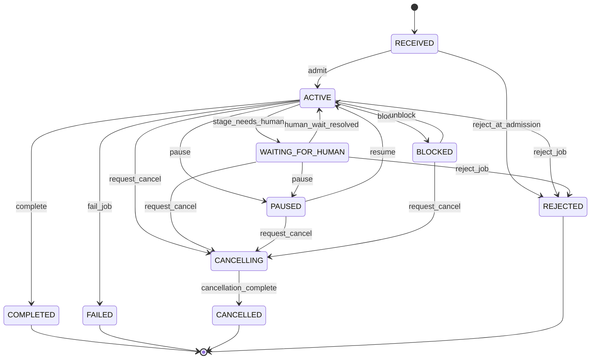
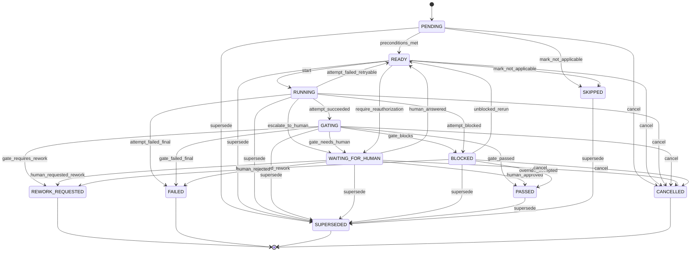
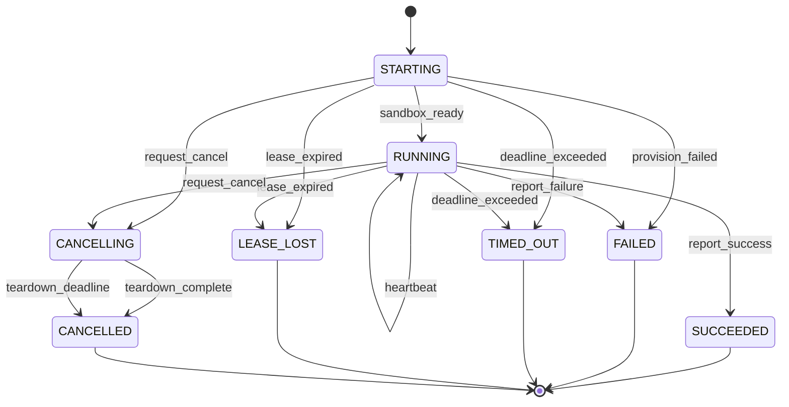
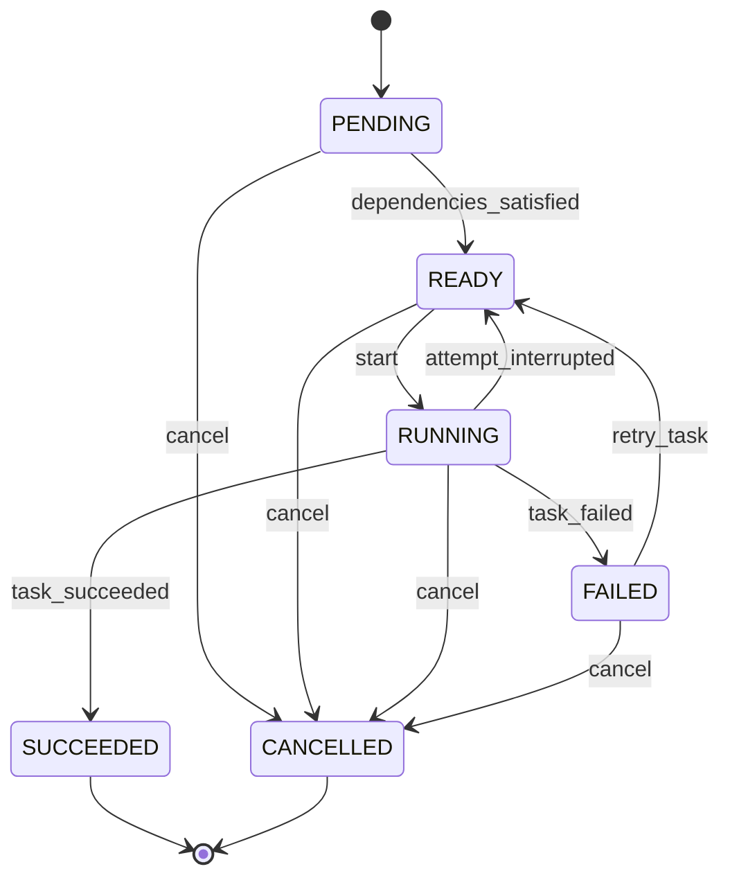

# State machines and legal transitions

- Status: Accepted for Slice 0, revised on 2026-10-27 by [ADR 0010](../adr/0010-failure-escalation-routing-and-invalidation.md), which the domain crate implements (the conformance tests passed at commit `c4d7df1`). Revised again on 2026-10-27 by [ADR 0014](../adr/0014-ports-v1-1-claim-protocol-and-port-revision.md): the stage run machine gains `S21` and `S22`, and the guards `G_LEASE_ACQUIRED`, `G_SANDBOX_PROVISIONED` and `G_UNRECOVERABLE` are restated. The Rust change is carried by the work package `s1-ports-revision`, and **the conformance tests fail until it lands**.
- Date: 2026-10-27
- Source of truth: [`state-machine.json`](state-machine.json). The tables and diagrams below are generated from it by `docs/architecture/tools/render_state_machine.py`. Do not edit text between the `GENERATED` markers by hand.
- Related decisions: [ADR 0001](../adr/0001-orchestration-engine.md), [ADR 0004](../adr/0004-event-model.md), [ADR 0008](../adr/0008-artifact-store-and-evidence-ledger.md), [ADR 0010](../adr/0010-failure-escalation-routing-and-invalidation.md).

## What this document fixes

The workflow engine decides whether a job moves forward. A language model never does. An agent returns data, a gate reads that data and the recorded evidence, and the engine applies the result in one database transaction. This file lists every move the engine is allowed to make. A move that is not listed is rejected, and the stored state stays as it was.

Four machines are defined: Job, StageRun, Attempt, and a minimal TaskNode. Their relationship:

- A **Job** is one request. It owns an ordered set of stage runs.
- A **StageRun** is one execution of one stage kind (for example `SPECIFICATION`). Rework creates a new run. It never reopens an old one.
- An **Attempt** is one try at a stage run, owned by one worker through one lease. A stage run may have several attempts.
- A **TaskNode** is one node of the planned task graph. In Slice 1 the graph runs sequentially inside one `IMPLEMENTATION` attempt.

## Ground rules

1. **One writer.** Only the engine writes a status. Workers and humans send commands; the engine checks the guard and applies the transition.
2. **Compare-and-swap.** Every status change is `UPDATE ... WHERE id = $1 AND version = $2`. A stale version is a typed conflict, not a silent overwrite.
3. **Evidence in the same transaction.** The status change, the ledger entries that justify it and the outbox events it emits commit together or not at all.
4. **Agent text carries no authority.** A stage passes only when its gate finds evidence. "Tests pass" in an agent summary changes nothing.
5. **Terminal runs are immutable.** `PASSED` and `SKIPPED` are settled but can become `SUPERSEDED` when an input changes. Nothing else leaves a terminal state.
6. **Bounded loops.** Attempts, repairs and rework rounds have limits. Reaching a limit, or a budget limit, sends the stage to a human. It does not loop again, and it does not fail the stage ([ADR 0010](../adr/0010-failure-escalation-routing-and-invalidation.md)).
7. **Late and duplicate commands are safe.** A command for a terminal attempt, or with an old lease epoch, is rejected and audited. A repeated command with the same idempotency key returns the first result.

## Actors

<!-- GENERATED:begin actors -->
| Actor | Meaning |
|---|---|
| `engine` | The workflow use-case layer. The only component that writes a status, always inside one database transaction. Every transition in this file is applied by the engine; the actor column only says who may request it. |
| `worker` | A process that holds an attempt lease. May request transitions for its own attempt only, and only with the current lease epoch. |
| `sweeper` | The timer tick inside the engine. Acts on deadlines, lease expiry and retry back-off. |
| `gate` | The deterministic gate evaluator called by the engine while a stage run is GATING. Reads evidence, never agent prose. |
| `requester` | The human who submitted the request. Must appear on the tenant's named requester allowlist in protected configuration. Holding a GitHub role is not enough. |
| `operator` | A human with operational rights on the tenant: pause, resume, cancel, unblock, grant budget. |
| `approver` | A human with the approval role defined by the tenant approval policy. |
| `security_approver` | A human on the explicit security approver list kept in protected central configuration. Required to dispose of a security-class block. Matches the role of the same name in policies/approval.yaml. |
| `org_admin` | A human organization administrator. May raise a budget above its ceiling, raise autonomy, and enable anything that is off by default. Matches policies/approval.yaml. |
<!-- GENERATED:end actors -->

## Pipeline order and where documentation sits

Gates are not separate stages. Each stage has its own `GATING` phase, which is where its gate runs.

<!-- GENERATED:begin pipeline -->
| # | Stage kind | Requires | Executor | Gate (the GATING phase of this stage) | Human gate | Slice |
|---|---|---|---|---|---|---|
| 1 | `INTAKE` | none | agent | deterministic checks on the normalized request plus bounded repair; human clarification when ambiguity is material | when_ambiguous | 1 |
| 2 | `REPOSITORY_INTELLIGENCE` | `INTAKE` | deterministic | reproducible repository map and a build and test baseline run in a sandbox | never | 1 |
| 3 | `SPECIFICATION` | `INTAKE`, `REPOSITORY_INTELLIGENCE` | agent_via_spec_kit | deterministic specification gate plus independent specification reviewer; freezes the SpecificationContract | policy_by_risk | 1 |
| 4 | `DOMAIN_DISCOVERY` | `SPECIFICATION` | deterministic | profile resolution and tool capability probes; BLOCKED when a mandatory profile gate cannot run | never | 1 |
| 5 | `ARCHITECTURE` | `SPECIFICATION`, `DOMAIN_DISCOVERY` | agent | schema validation, requirement-to-design traceability coverage, independent critic when risk tier is high or a design decision needs a person | policy_by_risk | 1 |
| 6 | `TASK_PLANNING` | `ARCHITECTURE` | agent | deterministic DAG validator: acyclic, every acceptance criterion covered, owned files do not overlap, sizes bounded | never | 1 |
| 7 | `IMPLEMENTATION` | `TASK_PLANNING` | agent_in_sandbox | scope check: changed paths inside owned files, no protected path touched, no test weakening | never | 1 |
| 8 | `VALIDATION` | `IMPLEMENTATION` | deterministic_in_fresh_sandbox | trusted gate definitions from the protected base branch; format, lint, build, tests, secret scan, acceptance evidence mapping | never | 1 |
| 9 | `REVIEW` | `VALIDATION` | independent_agent | ReviewVerdict from a reviewer that receives the frozen spec, the diff and verified gate evidence, and not the builder summary | on_NEEDS_HUMAN | 1 |
| 10 | `DOCUMENTING` | `REVIEW` | agent | documentation plan and traceability recorded; docs committed on the job branch | never | 1 |
| 11 | `DOCUMENTATION_REVIEW` | `DOCUMENTING` | deterministic_plus_independent_agent | Documentation Quality Gate (links, snippets, diagrams, readability, coverage) plus independent documentation reviewer | on_NEEDS_HUMAN | 1 |
| 12 | `DELIVERY` | `DOCUMENTATION_REVIEW` | deterministic | control plane pushes the branch and opens a draft pull request with the evidence manifest; verifies the PR exists and the body carries the manifest hash | never | 1 |
| 13 | `APPROVAL` | `DELIVERY` | deterministic | human decision: approve, reject, rework, pause or cancel | always | 1 |
| 14 | `MERGE` | `APPROVAL` | deterministic | not implemented; disabled by default; requires per-repository policy and final re-validation after merge-base sync | policy | 4 |
<!-- GENERATED:end pipeline -->

`DOCUMENTING` and `DOCUMENTATION_REVIEW` come after `REVIEW` has passed and before `DELIVERY` and `APPROVAL`, for three reasons.

- Documentation describes behavior that has already been built, validated and reviewed. Writing it earlier means rewriting it after every rework.
- The documentation commit has to ride on the same job branch as the code, so the draft pull request contains both and the evidence manifest covers both.
- A human approves one coherent package. Approving code and then learning that the documentation is wrong, or missing, defeats the approval.

The cost is a longer path before the first pull request exists. The master prompt allows documentation to start incrementally in parallel with implementation for large work. That is a Slice 3 optimization. Even then the final run of both documentation stages must happen against the final commit, which is why the invalidation rules below supersede them whenever `IMPLEMENTATION` produces a new commit.

### Rework routes

<!-- GENERATED:begin rework-routes -->
| Failing stage | Trigger | New run of | Note |
|---|---|---|---|
| `SPECIFICATION` | gate CHANGES_REQUIRED | `SPECIFICATION` | clarify loop; unresolved product decisions go to a human |
| `ARCHITECTURE` | gate CHANGES_REQUIRED | `ARCHITECTURE` |  |
| `TASK_PLANNING` | validator FAILED | `TASK_PLANNING` | bounded replan |
| `IMPLEMENTATION` | scope check FAILED | `IMPLEMENTATION` |  |
| `VALIDATION` | any mandatory gate FAILED | `IMPLEMENTATION` | the builder receives the gate reports, not a summary |
| `REVIEW` | verdict CHANGES_REQUIRED | `IMPLEMENTATION` | findings are deduplicated before the builder sees them; applies to defect classes code_behavior and documentation, see defect_routing |
| `DOCUMENTATION_REVIEW` | CHANGES_REQUIRED with defect_class documentation | `DOCUMENTING` |  |
| `DOCUMENTATION_REVIEW` | CHANGES_REQUIRED with defect_class code_behavior | `IMPLEMENTATION` | the documentation exposed a code or behavior mismatch |
| `APPROVAL` | human requests rework | `IMPLEMENTATION` | human instructions are authorized input but still untrusted text; the baseline route, see human_rework_routes for the full set |
<!-- GENERATED:end rework-routes -->

#### Which defect class sends the work where

A reviewer's finding names a defect class: `code_behavior`, `documentation`, `specification` or `policy`. The builder can fix the first two. The last two are decisions for a person, so the gate asks one (`S10`) instead of sending the work back or failing the job. The specification stage is the exception for its own artifact. The class is taken from the findings that justify the verdict, which are those of severity blocker, high or medium. When they differ, the first class in this order wins: specification, policy, code behavior, documentation.

<!-- GENERATED:begin defect-routing -->
| Stage with a reviewer | `specification` | `policy` | `code_behavior` | `documentation` |
|---|---|---|---|---|
| `SPECIFICATION` | rework | human | rework | rework |
| `ARCHITECTURE` | human | human | rework | rework |
| `REVIEW` | human | human | rework | rework |
| `DOCUMENTATION_REVIEW` | human | human | rework | rework |
<!-- GENERATED:end defect-routing -->

`rework` follows the row of the table above (the documentation review picks its row by class). `human` is the gate outcome `gate_needs_human`. A deterministic failure at `DOCUMENTATION_REVIEW`, such as a broken link, has no reviewer class and counts as `documentation`. The other gates are deterministic and use their single route.

#### Where a person may send rework

A person who answers a waiting or blocked stage run can also send the work back (`S15`). They name the target from this table.

<!-- GENERATED:begin human-rework-routes -->
| Waiting or blocked stage | A person may send rework to |
|---|---|
| `SPECIFICATION` | `SPECIFICATION` |
| `ARCHITECTURE` | `ARCHITECTURE` |
| `TASK_PLANNING` | `ARCHITECTURE`, `TASK_PLANNING` |
| `IMPLEMENTATION` | `ARCHITECTURE`, `TASK_PLANNING`, `IMPLEMENTATION` |
| `VALIDATION` | `ARCHITECTURE`, `TASK_PLANNING`, `IMPLEMENTATION` |
| `REVIEW` | `ARCHITECTURE`, `TASK_PLANNING`, `IMPLEMENTATION` |
| `DOCUMENTING` | `ARCHITECTURE`, `TASK_PLANNING`, `IMPLEMENTATION`, `DOCUMENTING` |
| `DOCUMENTATION_REVIEW` | `ARCHITECTURE`, `TASK_PLANNING`, `IMPLEMENTATION`, `DOCUMENTING` |
| `DELIVERY` | `ARCHITECTURE`, `TASK_PLANNING`, `IMPLEMENTATION`, `DOCUMENTING` |
| `APPROVAL` | `ARCHITECTURE`, `TASK_PLANNING`, `IMPLEMENTATION`, `DOCUMENTING` |
<!-- GENERATED:end human-rework-routes -->

A frozen specification is not a target from a later stage in Slice 1, because the revision method of [ADR 0006](../adr/0006-spec-kit-boundary.md) is not proven. A person who finds a wrong specification at `REVIEW` answers the question, approves with a recorded reason, or rejects the job and starts a new request.

### Invalidation

An artifact that a later stage consumed by content hash can change. When it does, every run that consumed it is superseded and a new run starts from `PENDING`. A change that comes from outside the pipeline (the source request, or a value that gate evidence is bound to) has no producing stage, so every listed run is superseded, including the first.

<!-- GENERATED:begin invalidation -->
| When | These runs become SUPERSEDED | Note |
|---|---|---|
| SPECIFICATION produces a new approved spec version | `DOMAIN_DISCOVERY`, `ARCHITECTURE`, `TASK_PLANNING`, `IMPLEMENTATION`, `VALIDATION`, `REVIEW`, `DOCUMENTING`, `DOCUMENTATION_REVIEW`, `DELIVERY`, `APPROVAL` | gate_integrity.invalidated_by: spec_revision. |
| ARCHITECTURE produces a new version | `TASK_PLANNING`, `IMPLEMENTATION`, `VALIDATION`, `REVIEW`, `DOCUMENTING`, `DOCUMENTATION_REVIEW`, `DELIVERY`, `APPROVAL` |  |
| TASK_PLANNING produces a new plan version | `IMPLEMENTATION`, `VALIDATION`, `REVIEW`, `DOCUMENTING`, `DOCUMENTATION_REVIEW`, `DELIVERY`, `APPROVAL` |  |
| IMPLEMENTATION produces a new commit | `VALIDATION`, `REVIEW`, `DOCUMENTING`, `DOCUMENTATION_REVIEW`, `DELIVERY`, `APPROVAL` | gate_integrity.invalidated_by: new_commit and rebase. A rebase writes new commits, so it counts as a new commit. |
| DOCUMENTING produces a new documentation commit | `DOCUMENTATION_REVIEW`, `DELIVERY`, `APPROVAL` | gate_integrity.invalidated_by: new_commit. |
| The source request is edited after the intake snapshot | `INTAKE`, `REPOSITORY_INTELLIGENCE`, `SPECIFICATION`, `DOMAIN_DISCOVERY`, `ARCHITECTURE`, `TASK_PLANNING`, `IMPLEMENTATION`, `VALIDATION`, `REVIEW`, `DOCUMENTING`, `DOCUMENTATION_REVIEW`, `DELIVERY`, `APPROVAL` | An external change, so the intake run is superseded too. The new intake run asks for re-authorization before any agent reads the new text (NT-AUTHZ-05). |
| REPOSITORY_INTELLIGENCE produces a new repository map | `SPECIFICATION`, `DOMAIN_DISCOVERY`, `ARCHITECTURE`, `TASK_PLANNING`, `IMPLEMENTATION`, `VALIDATION`, `REVIEW`, `DOCUMENTING`, `DOCUMENTATION_REVIEW`, `DELIVERY`, `APPROVAL` | The specification consumed the map and the baseline. |
| A value bound to gate evidence changes | `VALIDATION`, `REVIEW`, `DOCUMENTATION_REVIEW`, `DELIVERY`, `APPROVAL` | The values are the base commit, the gate definition hash, the policy hash and the sandbox image digest (gate_integrity.evidence_binding). gate_integrity.invalidated_by: base_moved, policy_change and image_change. Checked at two points, before DELIVERY pushes and when an approval is recorded. DOCUMENTING is not superseded, because the documentation text did not change. |
<!-- GENERATED:end invalidation -->

#### How each item of `gate_integrity.invalidated_by` maps to a row

| Policy item | Row | When it is checked |
|---|---|---|
| `new_commit` | `IMPLEMENTATION produces a new commit`, or `DOCUMENTING produces a new documentation commit` | When the commit is made |
| `rebase` | `IMPLEMENTATION produces a new commit` | When the rebase is made. A rebase writes new commits. |
| `spec_revision` | `SPECIFICATION produces a new approved spec version` | When the new version is frozen |
| `base_moved` | `A value bound to gate evidence changes` | Before `DELIVERY` pushes, and when an approval is recorded. Not continuously. |
| `policy_change` | `A value bound to gate evidence changes` | Same two points |
| `image_change` | `A value bound to gate evidence changes` | Same two points |

A human answer (`S13`) supersedes nothing. It is a new input of the stage run that waited, so the stage contract is resolved again with the new input hash before the next attempt. No later run exists to become stale, because a stage run that waits for a person has produced nothing yet.

An evidence check that finds a changed value supersedes the runs of the last row, creates new runs, and leaves the code and the documentation alone. The engine compares the bound values with the ones recorded in the evidence manifest. It does not watch the base branch, the policy files or the image registry between those two points, so a change in between is noticed at the next check. A merge, when it exists (Slice 4), adds a third check right before it.

## Job

<!-- GENERATED:begin job-diagram -->

<!-- GENERATED:end job-diagram -->

<!-- GENERATED:begin job-states -->
| State | Terminal | Meaning |
|---|---|---|
| `RECEIVED` | no | The request passed authorization at the API boundary and is stored. Not yet admitted. |
| `ACTIVE` | no | Stage runs are being scheduled and executed. |
| `WAITING_FOR_HUMAN` | no | At least one stage run needs a human answer, decision or approval. |
| `PAUSED` | no | An operator paused the job. No new attempt is leased. Running attempts finish or time out. |
| `BLOCKED` | no | A stage run cannot proceed or be promoted without an explicit disposition. |
| `CANCELLING` | no | Cancellation was requested. Attempts and sandboxes are being torn down. |
| `COMPLETED` | yes | Every stage in the job's configured scope passed and the approval decision is recorded. This does not mean merged, released or deployed, and it says nothing about verification maturity. |
| `FAILED` | yes | The job cannot continue and no rework route or budget remains. |
| `CANCELLED` | yes | Cancelled by an authorized human and fully torn down. |
| `REJECTED` | yes | Refused at admission, declined at intake, or rejected by an approver. |
<!-- GENERATED:end job-states -->

<!-- GENERATED:begin job-transitions -->
| ID | From | Event | Guard | To | May request | Emits |
|---|---|---|---|---|---|---|
| J01 | `RECEIVED` | `admit` | `G_ADMISSION_OK` | `ACTIVE` | engine | `job.admitted` |
| J02 | `RECEIVED` | `reject_at_admission` | `G_ADMISSION_DENIED` | `REJECTED` | engine | `job.rejected` |
| J03 | `ACTIVE` | `stage_needs_human` | `G_ANY_STAGE_WAITING` | `WAITING_FOR_HUMAN` | engine | `job.waiting_for_human` |
| J04 | `WAITING_FOR_HUMAN` | `human_wait_resolved` | `G_NO_STAGE_WAITING` | `ACTIVE` | engine | `job.resumed` |
| J05 | `ACTIVE`, `WAITING_FOR_HUMAN` | `pause` | `G_ACTOR_MAY_PAUSE` | `PAUSED` | operator | `job.paused` |
| J06 | `PAUSED` | `resume` | `G_ACTOR_MAY_PAUSE` | `ACTIVE` | operator | `job.resumed` |
| J07 | `ACTIVE` | `block` | `G_ANY_STAGE_BLOCKED` | `BLOCKED` | engine | `job.blocked` |
| J08 | `BLOCKED` | `unblock` | `G_BLOCK_DISPOSITIONS_RECORDED` | `ACTIVE` | operator, security_approver | `job.unblocked` |
| J09 | `ACTIVE`, `WAITING_FOR_HUMAN`, `PAUSED`, `BLOCKED` | `request_cancel` | `G_ACTOR_MAY_CANCEL` | `CANCELLING` | requester, operator | `job.cancel_requested` |
| J10 | `CANCELLING` | `cancellation_complete` | `G_ALL_ATTEMPTS_TERMINAL` | `CANCELLED` | engine, sweeper | `job.cancelled` |
| J11 | `ACTIVE` | `fail_job` | `G_UNRECOVERABLE` | `FAILED` | engine | `job.failed` |
| J12 | `ACTIVE`, `WAITING_FOR_HUMAN` | `reject_job` | `G_REJECTION_RECORDED` | `REJECTED` | engine, approver | `job.rejected` |
| J13 | `ACTIVE` | `complete` | `G_PIPELINE_SCOPE_COMPLETE` | `COMPLETED` | engine | `job.completed` |
<!-- GENERATED:end job-transitions -->

Pausing does not kill running attempts. It stops new leases. Cancelling does kill them, through the attempt cancel path below. An approver's reject decision (`S16`) fails the `APPROVAL` stage run, and the engine then takes `J12`, so the job ends as `REJECTED`, not `FAILED`.

## Stage run

<!-- GENERATED:begin stage-run-diagram -->

<!-- GENERATED:end stage-run-diagram -->

<!-- GENERATED:begin stage-run-states -->
| State | Terminal | Meaning |
|---|---|---|
| `PENDING` | no | Created. Upstream requirements are not met yet. |
| `READY` | no | Schedulable. Needs an attempt. Also the state during retry back-off, with not_before in the future. |
| `RUNNING` | no | An attempt is in progress. |
| `GATING` | no | Work is done. The deterministic gate or independent evaluator is deciding. Success claimed by an agent has no effect here. |
| `WAITING_FOR_HUMAN` | no | Needs a human answer, budget decision, gate decision or approval. |
| `BLOCKED` | no | Cannot proceed or be promoted. Needs a recorded disposition. |
| `PASSED` | yes (can be superseded) | The gate decision is PASS with evidence. Settled, but becomes SUPERSEDED if its inputs are invalidated. |
| `REWORK_REQUESTED` | yes | The gate sent the work back. A new run of the route target stage replaces this one. |
| `FAILED` | yes | Retries or rework exhausted, or the failure is not retryable, or a human rejected. |
| `SKIPPED` | yes (can be superseded) | NOT_APPLICABLE by deterministic rule, profile or policy, with the rule recorded. Counts as satisfied for the stages that require it and for completion, never as passed, and never as evidence for an assurance level. Becomes SUPERSEDED when an input of the decision changes. |
| `SUPERSEDED` | yes | Replaced because an upstream input changed. |
| `CANCELLED` | yes | Cancelled with the job. |
<!-- GENERATED:end stage-run-states -->

<!-- GENERATED:begin stage-run-transitions -->
| ID | From | Event | Guard | To | May request | Emits |
|---|---|---|---|---|---|---|
| S01 | `PENDING` | `preconditions_met` | `G_UPSTREAM_PASSED` | `READY` | engine | `stage_run.ready` |
| S02 | `PENDING`, `READY` | `mark_not_applicable` | `G_NOT_APPLICABLE_DECIDED` | `SKIPPED` | engine | `stage_run.skipped` |
| S03 | `READY` | `start` | `G_LEASE_ACQUIRED` | `RUNNING` | worker | `stage_run.started` |
| S04 | `RUNNING` | `attempt_succeeded` | `G_OUTPUT_SCHEMA_VALID` | `GATING` | engine | `stage_run.gating` |
| S05 | `RUNNING` | `attempt_failed_retryable` | `G_RETRY_ALLOWED` | `READY` | engine | `stage_run.retry_scheduled` |
| S06 | `RUNNING` | `attempt_failed_final` | `G_FAILURE_NONRETRYABLE` | `FAILED` | engine | `stage_run.failed` |
| S07 | `RUNNING` | `escalate_to_human` | `G_ESCALATION_REQUIRED` | `WAITING_FOR_HUMAN` | engine | `stage_run.waiting_for_human` |
| S08 | `GATING` | `gate_passed` | `G_GATE_PASS_EVIDENCED` | `PASSED` | gate | `stage_run.passed` |
| S09 | `GATING` | `gate_requires_rework` | `G_REWORK_ALLOWED` | `REWORK_REQUESTED` | gate | `stage_run.rework_requested` |
| S10 | `GATING` | `gate_needs_human` | `G_NEEDS_HUMAN_VERDICT` | `WAITING_FOR_HUMAN` | gate | `stage_run.waiting_for_human` |
| S11 | `GATING` | `gate_blocks` | `G_BLOCKING_CONDITION` | `BLOCKED` | gate | `stage_run.blocked` |
| S12 | `GATING` | `gate_failed_final` | `G_GATE_FAILED_NO_REWORK` | `FAILED` | gate | `stage_run.failed` |
| S13 | `WAITING_FOR_HUMAN` | `human_answered` | `G_ANSWER_RECORDED` | `READY` | requester, operator, approver, org_admin | `stage_run.ready` |
| S14 | `WAITING_FOR_HUMAN` | `human_approved` | `G_APPROVER_AUTHORIZED` | `PASSED` | approver | `stage_run.passed` |
| S15 | `WAITING_FOR_HUMAN`, `BLOCKED` | `human_requested_rework` | `G_HUMAN_REWORK_ALLOWED` | `REWORK_REQUESTED` | approver, operator | `stage_run.rework_requested` |
| S16 | `WAITING_FOR_HUMAN` | `human_rejected` | `G_HUMAN_REJECTED` | `FAILED` | approver | `stage_run.failed` |
| S17 | `BLOCKED` | `unblocked_rerun` | `G_BLOCK_CLEARED_RERUN` | `READY` | operator | `stage_run.ready` |
| S18 | `BLOCKED` | `override_accepted` | `G_OVERRIDE_PERMITTED` | `PASSED` | approver, security_approver | `stage_run.passed` |
| S19 | `PENDING`, `READY`, `RUNNING`, `GATING`, `WAITING_FOR_HUMAN`, `BLOCKED` | `cancel` | `G_NO_ACTIVE_ATTEMPT` | `CANCELLED` | engine | `stage_run.cancelled` |
| S20 | `PENDING`, `READY`, `RUNNING`, `GATING`, `WAITING_FOR_HUMAN`, `BLOCKED`, `PASSED`, `SKIPPED` | `supersede` | `G_UPSTREAM_INVALIDATED` | `SUPERSEDED` | engine | `stage_run.superseded` |
| S21 | `RUNNING` | `attempt_blocked` | `G_ENVIRONMENT_BLOCKED` | `BLOCKED` | engine | `stage_run.blocked` |
| S22 | `READY` | `require_reauthorization` | `G_REAUTHORIZATION_REQUIRED` | `WAITING_FOR_HUMAN` | engine | `stage_run.waiting_for_human` |
<!-- GENERATED:end stage-run-transitions -->

### When a failed attempt could take more than one move

The guards of `S05`, `S06`, `S07` and `S21` overlap, so the order matters. The engine takes the first row that applies. The rule behind the order is that a limit never fails a stage run: reaching a limit asks a person, and only a failure that retrying cannot fix fails it. A missing environment is neither: it blocks, because a person or an operator has to restore it.

| Order | The attempt failed with | Move |
|---|---|---|
| 0 | A cause that `G_ENVIRONMENT_BLOCKED` names: the container runtime is unreachable, the image is missing, the posture check found a difference, the spec was weaker than the policy, a required tool is absent or the policy file could not be loaded | `S21` (the attempt ends as `FAILED`; the stage run is `BLOCKED`; the job is blocked by `J07`; nothing is retried with other settings) |
| 1 | `BUDGET_EXHAUSTED` | `S07`, and the job's broker token is revoked |
| 2 | A class the contract lists in `retry_on`, with attempts left, repairs left and budget | `S05` |
| 3 | `POLICY_DENIED`, `INTERNAL`, or a class not in `retry_on` | `S06` |
| 4 | A class in `retry_on`, but no attempt or repair is left, or the budget has no room | `S07` |

A `SANDBOX_ERROR` that is not one of the causes in row 0 (a container that failed to start for a transient reason, a resource limit hit while running) stays a retryable class and takes row 2 or 4. The adapter's error type decides which: `DaemonUnavailable`, `ImageUnavailable`, `PostureMismatch` and `PolicyViolation` are row 0; `ProvisionFailed`, `Timeout` and `ResourceExceeded` are not.

A new `INTAKE` run that follows an external change to the source request does not start an attempt. `S22` moves it from `READY` to `WAITING_FOR_HUMAN` when the hash of the current original request differs from the hash the requester authorized (NT-AUTHZ-05), and the answer (`S13`) records the new authorized hash.

Attempts and repairs are counted from the last human answer (`S13`). A person who answers a stage run that stopped at its attempt limit therefore gets a new window of attempts, and the total stays bounded because a person is in the loop each time. A skipped stage run (`S02`) counts as satisfied for the stages that require it, so skipping a stage does not stall the pipeline. It never counts as passed: no assurance level comes from it, and the decision is made again if an input of the rule changes (`S20` applies to `SKIPPED` as it does to `PASSED`).

How the four gate outcomes in the master prompt map to stage run states:

| Gate outcome | Stage run state | Notes |
|---|---|---|
| `PASSED` | `PASSED` | Evidence persisted in the same transaction. |
| `FAILED` | `REWORK_REQUESTED` or `FAILED` | Rework while the limits allow it, otherwise a human decides. |
| `BLOCKED` | `BLOCKED` | A mandatory gate could not run, or a reviewer returned `BLOCK`. |
| `NOT_APPLICABLE` | `SKIPPED` | Only by deterministic rule, profile or policy. |

The review verdicts map the same way. `PASS` leads to `PASSED`. `CHANGES_REQUIRED` leads to `REWORK_REQUESTED`. `BLOCK` leads to `BLOCKED`. `NEEDS_HUMAN` leads to `WAITING_FOR_HUMAN`.

## Attempt

<!-- GENERATED:begin attempt-diagram -->

<!-- GENERATED:end attempt-diagram -->

<!-- GENERATED:begin attempt-states -->
| State | Terminal | Meaning |
|---|---|---|
| `STARTING` | no | Lease acquired. Sandbox and agent runtime are being prepared. |
| `RUNNING` | no | The agent or tool is executing and the worker is heartbeating. |
| `CANCELLING` | no | Cancel requested. Teardown in progress. Reports are kept for audit and cannot change the outcome. |
| `SUCCEEDED` | yes | Output received, validated against the outputs schema and stored. Says nothing about quality; the gate decides that. |
| `FAILED` | yes | Ended with a failure class: TOOL_ERROR, INVALID_OUTPUT, BUDGET_EXHAUSTED, POLICY_DENIED, PROVIDER_ERROR, SANDBOX_ERROR or INTERNAL. |
| `TIMED_OUT` | yes | The attempt deadline passed. The sandbox is killed. |
| `LEASE_LOST` | yes | The lease expired without heartbeat. The worker is presumed dead. Its later writes are rejected by the lease epoch. |
| `CANCELLED` | yes | Torn down after a cancel request. |
<!-- GENERATED:end attempt-states -->

<!-- GENERATED:begin attempt-transitions -->
| ID | From | Event | Guard | To | May request | Emits |
|---|---|---|---|---|---|---|
| A01 | `STARTING` | `sandbox_ready` | `G_SANDBOX_PROVISIONED` | `RUNNING` | worker | `attempt.running` |
| A02 | `STARTING` | `provision_failed` | `G_EPOCH_CURRENT` | `FAILED` | worker | `attempt.failed` |
| A03 | `RUNNING` | `heartbeat` | `G_LEASE_EPOCH_CURRENT` | `RUNNING` | worker | none |
| A04 | `RUNNING` | `report_success` | `G_OUTPUT_SCHEMA_VALID` | `SUCCEEDED` | worker | `attempt.succeeded` |
| A05 | `RUNNING` | `report_failure` | `G_EPOCH_CURRENT` | `FAILED` | worker, engine | `attempt.failed` |
| A06 | `STARTING`, `RUNNING` | `deadline_exceeded` | `G_DEADLINE_PASSED` | `TIMED_OUT` | sweeper | `attempt.timed_out` |
| A07 | `STARTING`, `RUNNING` | `lease_expired` | `G_LEASE_EXPIRED` | `LEASE_LOST` | sweeper | `attempt.lease_lost` |
| A08 | `STARTING`, `RUNNING` | `request_cancel` | `G_CANCEL_ALLOWED` | `CANCELLING` | engine | `attempt.cancel_requested` |
| A09 | `CANCELLING` | `teardown_complete` | `G_SANDBOX_GONE` | `CANCELLED` | worker, sweeper | `attempt.cancelled` |
| A10 | `CANCELLING` | `teardown_deadline` | `G_TEARDOWN_DEADLINE_PASSED` | `CANCELLED` | sweeper | `attempt.cancelled` |
<!-- GENERATED:end attempt-transitions -->

### Lease rules

- The lease is a row, not a timer in a process. It holds `lease_owner`, `lease_epoch` and `lease_expires_at`. Claiming work increments the epoch.
- Every write from a worker carries `(attempt_id, lease_epoch)`. The write is rejected if the epoch is older than the stored one. This stops a worker that was paused, partitioned or presumed dead from writing after another worker took over.
- A worker that loses its lease must stop. It cannot be forced to, so the fence is what protects the data.
- Heartbeats are not domain events. They update the lease and a metric. They do not enter the outbox.

## Task node (Slice 1 minimal)

<!-- GENERATED:begin task-node-diagram -->

<!-- GENERATED:end task-node-diagram -->

<!-- GENERATED:begin task-node-states -->
| State | Terminal | Meaning |
|---|---|---|
| `PENDING` | no | Waiting for dependencies. |
| `READY` | no | All dependencies succeeded. Next in topological order. |
| `RUNNING` | no | The IMPLEMENTATION attempt is working on it. |
| `SUCCEEDED` | yes | A commit exists and the per-task checks passed. |
| `FAILED` | no | The attempt could not complete this task. Can be retried. |
| `CANCELLED` | yes | Cancelled with the stage run. |
<!-- GENERATED:end task-node-states -->

<!-- GENERATED:begin task-node-transitions -->
| ID | From | Event | Guard | To | May request | Emits |
|---|---|---|---|---|---|---|
| T01 | `PENDING` | `dependencies_satisfied` | `G_TASK_DEPS_SUCCEEDED` | `READY` | engine | `task_node.ready` |
| T02 | `READY` | `start` | `G_TASK_STARTED_BY_ATTEMPT` | `RUNNING` | engine | `task_node.started` |
| T03 | `RUNNING` | `task_succeeded` | `G_TASK_EVIDENCE_RECORDED` | `SUCCEEDED` | engine | `task_node.succeeded` |
| T04 | `RUNNING` | `task_failed` | `G_EPOCH_CURRENT` | `FAILED` | engine | `task_node.failed` |
| T05 | `RUNNING` | `attempt_interrupted` | `G_EPOCH_CURRENT` | `READY` | engine | `task_node.ready` |
| T06 | `FAILED` | `retry_task` | `G_TASK_RETRY_ALLOWED` | `READY` | engine | `task_node.ready` |
| T07 | `PENDING`, `READY`, `RUNNING`, `FAILED` | `cancel` | `G_NO_ACTIVE_ATTEMPT` | `CANCELLED` | engine | `task_node.cancelled` |
<!-- GENERATED:end task-node-transitions -->

## Guards

Each guard is a named predicate in the `domain` crate. A transition test fails if a guard id in this file has no implementation, or an implementation has no entry here.

<!-- GENERATED:begin guards -->
| Guard | Plain-English definition |
|---|---|
| `G_ADMISSION_OK` | The requester is on the tenant's named requester allowlist in protected configuration, the tenant is within its job quota, the repository is registered and enabled, the repository passed the protection preflight (otherwise the job may only run at autonomy level L0), policy allows this class of request, and neither the repository nor the organization has reached a ceiling of its day (budgets.hard_ceilings.per_repo_day and per_org_day). |
| `G_ADMISSION_DENIED` | The requester is not on the allowlist, the quota is exceeded, the repository is not registered or is disabled, policy forbids this class of request, or the repository or the organization has reached a ceiling of its day or its usage could not be read. The reason is recorded and no reply reveals which test failed. |
| `G_ANY_STAGE_WAITING` | At least one stage run of the job is WAITING_FOR_HUMAN. |
| `G_NO_STAGE_WAITING` | No stage run of the job is WAITING_FOR_HUMAN. |
| `G_ACTOR_MAY_PAUSE` | The principal holds the operator role on the tenant. |
| `G_ANY_STAGE_BLOCKED` | At least one stage run of the job is BLOCKED. |
| `G_BLOCK_DISPOSITIONS_RECORDED` | Every BLOCKED stage run has a recorded disposition: capability re-probe passed, or an allowed override, or a rework decision. |
| `G_ACTOR_MAY_CANCEL` | The principal is the requester of the job or holds the operator role. |
| `G_ALL_ATTEMPTS_TERMINAL` | Every attempt of the job is in a terminal state and every sandbox has been torn down or flagged as leaked. |
| `G_UNRECOVERABLE` | The newest run of a stage kind in the job's scope is FAILED (by S06, S12 or S16), no newer run replaces it, and no rework route or retry budget remains; or a job-level hard limit was reached under a policy that says fail. The engine builds the facts from the listing of the job's stage runs, so a rework that created a newer run first leaves the guard unmet. |
| `G_REJECTION_RECORDED` | The intake decision is decline, or an authorized approver recorded a reject decision. |
| `G_PIPELINE_SCOPE_COMPLETE` | Every stage kind in the job's configured scope has a run that is PASSED, or SKIPPED because a recorded rule says the stage does not apply, and that run is not superseded; the approval decision is approve; and the evidence ledger hash chain verifies. |
| `G_UPSTREAM_PASSED` | Every required upstream stage run is PASSED, or SKIPPED because a recorded rule says the stage does not apply, and is not superseded. Every consumed artifact hash equals the current version (a skipped stage produced none, and the stage contract records the skip rule instead of a hash). The stage contract resolved and validated against its schema. |
| `G_NOT_APPLICABLE_DECIDED` | A deterministic rule, a domain profile or a policy states that the stage does not apply. The rule and its inputs are recorded in the ledger. An agent opinion is never sufficient. |
| `G_LEASE_ACQUIRED` | The stage run is READY at the version the claim read, the job is ACTIVE, not_before has passed by the database clock, the concurrency quota allows it, and the runtime capability check passed. The store makes the check and the move one atomic step (start_attempt), so two workers cannot both pass it. |
| `G_OUTPUT_SCHEMA_VALID` | The attempt succeeded and its output validates against the stage outputs schema, and the output artifact hash is stored. |
| `G_RETRY_ALLOWED` | The failure class is retryable under the stage contract, the attempts used since the last human answer are below max_attempts, the budget has room for another attempt, and, after INVALID_OUTPUT, no more than two repairs have been made (a repair is a retry that follows an invalid-output failure; the cap comes from policy and can only be lowered). |
| `G_FAILURE_NONRETRYABLE` | Retrying cannot help: the failure class is POLICY_DENIED or INTERNAL, or the stage contract does not list it in retry_on. BUDGET_EXHAUSTED is not covered here, because a budget limit asks a human (S07). Reaching the attempt limit is not covered either, because an attempt limit asks a human (S07). |
| `G_ESCALATION_REQUIRED` | A budget limit was hit (the failure class is BUDGET_EXHAUSTED, or a retry would be allowed in every other way but the budget has no room), the attempt limit or the repair cap was reached on a failure class the stage contract lists as retryable, the agent returned a structured needs_human request, the stagnation detector fired, or policy requires a human decision here. |
| `G_GATE_PASS_EVIDENCED` | The gate decision is PASS and is persisted, every acceptance criterion of the stage contract has a ledger entry, and every mandatory gate report is PASSED or NOT_APPLICABLE with a recorded reason. No gate report is BLOCKED. |
| `G_REWORK_ALLOWED` | The verdict is CHANGES_REQUIRED or a deterministic gate FAILED, the rework rounds used on the count of the target stage are below its cap of two, the failing set differs from the previous round, and budget remains. The specification (SPECIFICATION), the design (ARCHITECTURE and TASK_PLANNING), the code (IMPLEMENTATION) and the documentation (DOCUMENTING) each have their own count, so rounds on one never use the rounds of another (ADR 0023). After the second round on a count a human decides. |
| `G_NEEDS_HUMAN_VERDICT` | The verdict is NEEDS_HUMAN, or the rework limit, the stagnation detector or a budget limit was reached, or the gate itself is a human gate, or a finding that justifies the verdict has a defect class that only a person can decide (specification, or policy; see defect_routing). |
| `G_BLOCKING_CONDITION` | The verdict is BLOCK, a mandatory gate could not run (tool unavailable or probe failed), or a deterministic check detected a policy violation. A reviewer's finding with defect class policy asks a person instead (S10). |
| `G_GATE_FAILED_NO_REWORK` | The gate FAILED and the stage has no rework route, for example an intake record that is still invalid after bounded repair. |
| `G_ANSWER_RECORDED` | A human answer, clarification, approval of residual input or budget extension is recorded with the principal and becomes a new input hash for the stage. It also starts a new attempt window: attempts and repairs are counted from the answer. A budget extension that raises a ceiling is accepted only from an org_admin. |
| `G_APPROVER_AUTHORIZED` | The decision is approve, the principal holds the role the approval policy requires for this stage and risk tier, the evidence digest the human saw equals the current evidence digest, and every warning of the rule translation-unfaithful in the gate reports of that evidence has a recorded human decision. |
| `G_HUMAN_REWORK_ALLOWED` | The principal holds the approver or operator role and the rework rounds used on the count of the target the person names are below its cap of two (the four counts of G_REWORK_ALLOWED). The stagnation detector does not apply to human requests. After the second round on a count a human must choose to continue, with the decision recorded. |
| `G_HUMAN_REJECTED` | An authorized approver recorded a reject decision with a reason. |
| `G_BLOCK_CLEARED_RERUN` | The capability re-probe passed, or the missing dependency is now available, or a person recorded the decision on a dependency that the blocked stage run was waiting for (add_new_direct_dependency, or approve_build_code for build code), after the attempt that blocked it, bound to the exact name, version and checksum in the evidence that run stored. The engine reads the third alternative from what it stored, and the caller does not assert it. The stage can run again. |
| `G_OVERRIDE_PERMITTED` | Policy permits an override for this block code, the principal holds the required role (security_approver for security-class blocks), a justification is recorded, and the blocked gate is not a mandatory gate of an active domain profile. The engine reads the gate and the code of each block from the event it stored when the stage run blocked, and holds back a block that its configuration lists (gate_integrity.non_overridable_blocks) whatever facts the caller gives; the caller's facts can only narrow what the engine allows. An override records accepted residual risk. It never creates an assurance level claim. |
| `G_NO_ACTIVE_ATTEMPT` | The stage run has no attempt in STARTING, RUNNING or CANCELLING. |
| `G_UPSTREAM_INVALIDATED` | A consumed upstream artifact was superseded by a newer version, an upstream stage run was reworked, or an external change listed in the invalidation table happened (the source request was edited after the intake snapshot, or a value bound to gate evidence changed). |
| `G_SANDBOX_PROVISIONED` | The sandbox provider returned a session for this attempt, which means it created the container, read its posture back, found every part equal to the spec and the policy, started it and passed the runtime self-check. The tool grants that policy approved are recorded in the audit log, the runtime probe of this attempt supports every capability the stage needs, and the lease epoch is current. |
| `G_LEASE_EPOCH_CURRENT` | The epoch sent by the worker equals the stored epoch and now is not past lease_expires_at. |
| `G_EPOCH_CURRENT` | The epoch sent by the worker equals the stored epoch. |
| `G_DEADLINE_PASSED` | Now is past the attempt deadline. |
| `G_LEASE_EXPIRED` | Now is past lease_expires_at and no heartbeat arrived. |
| `G_CANCEL_ALLOWED` | The attempt is not terminal and the job is CANCELLING or the stage run is being superseded. |
| `G_SANDBOX_GONE` | The sandbox no longer exists, confirmed by the sandbox provider. |
| `G_TEARDOWN_DEADLINE_PASSED` | The teardown grace period elapsed. The sandbox is force-killed and a leaked_resources alert is raised if it cannot be confirmed gone. |
| `G_TASK_DEPS_SUCCEEDED` | Every task this node depends on is SUCCEEDED. |
| `G_TASK_STARTED_BY_ATTEMPT` | The IMPLEMENTATION attempt picked this task as the next one in topological order. |
| `G_TASK_EVIDENCE_RECORDED` | A commit exists for the task, changed paths are inside the task's owned files, no protected path changed, and the per-task checks passed. |
| `G_TASK_RETRY_ALLOWED` | The task retry count is below the per-task limit and the stage budget has room. |
| `G_ENVIRONMENT_BLOCKED` | The attempt ended because something the stage cannot work without is missing or unsafe, not because the work failed: the container runtime is unreachable, the image is not on the host, the posture check found a difference, the spec was weaker than the policy, a required tool or runtime capability is absent, or the policy file could not be loaded. The cause is recorded. Retrying with the same settings cannot help, and trying other settings is forbidden. |
| `G_REAUTHORIZATION_REQUIRED` | The stage run is an INTAKE run created after an external change to the source request, and the hash of the current original request differs from the hash the requester authorized; or policy asks the requester to confirm before any agent reads the text. No attempt starts and no agent reads the new text until a person answers. |
<!-- GENERATED:end guards -->

## Delivery status is not one DONE

A job reaching `COMPLETED` means the factory has no more work to do within the scope it was given. It does not say how far the result has been verified, and it does not say the code was merged, released or deployed. Those are separate claims, and each needs its own evidence.

Verification maturity is recorded as **assurance levels**. They are claims in the evidence ledger. They are not job states, and they are not a ladder: a result can have one without another.

<!-- GENERATED:begin assurance-levels -->
| Level | Minimum evidence | Slice | Note |
|---|---|---|---|
| `SPECIFIED` | frozen SpecificationContract; specification gate report PASSED | 1 |  |
| `IMPLEMENTED` | commit hash on the job branch; build gate report PASSED | 1 |  |
| `VERIFIED_IN_SANDBOX` | trusted gate reports PASSED in a fresh sandbox; acceptance scenario evidence for every requirement | 1 | Added for software that has no simulator or device. Not named in the master prompt; listed in the open questions. |
| `VERIFIED_IN_SIMULATOR` | acceptance results from a simulator or emulator run, with the simulator version | 3 |  |
| `VERIFIED_ON_DEVICE` | acceptance results from a physical device run, with device identity | 4 |  |
| `PAPER_VALIDATED` | paper-trading results over the period required by the profile | 4 |  |
| `PRODUCTION_READY` | every mandatory gate of every active domain profile PASSED; human release sign-off; no open blocker without a disposition | 4 |  |
<!-- GENERATED:end assurance-levels -->

Delivery after approval is a second, independent axis, the **release state**. In Slice 1 only `NONE` and `APPROVED` are reachable. The values, in order:

<!-- GENERATED:begin release-states -->
`NONE`, `APPROVED`, `MERGED`, `RELEASED`, `DEPLOYED`, `OBSERVED`
<!-- GENERATED:end release-states -->

One flag cannot carry this because the questions differ.

- **The evidence differs.** A sandbox run, a simulator run, a physical device and a paper-trading period are different experiments with different failure modes. Folding them into "tests passed" hides which one was skipped.
- **The people and hardware differ.** Device validation needs hardware. Production readiness needs a human sign-off. A single status gives the engine no way to say which of those is missing.
- **A green label misleads.** A small game whose unit tests pass in a container is `IMPLEMENTED` and `VERIFIED_IN_SANDBOX`. It is not `VERIFIED_ON_DEVICE`, and nothing here may suggest it is. The dashboard shows the set of attained levels beside the job status and never shows `COMPLETED` alone.
- **Promotion must be refusable for a stated reason.** "Cannot reach `PRODUCTION_READY`: no device evidence" is actionable. "Not done" is not.

Rules that follow from this:

1. Only the gate evaluator attaches an assurance level, and only from ledger entries whose evidence is real, current and not superseded.
2. A level lapses when the evidence behind it is superseded. A new commit after `VERIFIED_IN_SANDBOX` removes the claim until validation runs again.
3. An override of a block records accepted risk. It never creates a level.
4. Evidence from a fake adapter never supports a level, and is accepted only in test mode.

## Invariants

<!-- GENERATED:begin invariants -->
| ID | Invariant | Enforced by | Verified by |
|---|---|---|---|
| INV-01 | Only the engine writes a status. A worker or an agent can request a transition but cannot perform one. | workflow use cases are the only callers of the repository write methods; storage compare-and-swap on (id, version) | property test: random command sequences never reach a state outside the tables; storage integration test: a stale version is rejected |
| INV-02 | A transition not listed in this file is rejected with a typed error and leaves the stored state unchanged. | domain transition functions | conformance test: the cross product of states and events minus this table is rejected |
| INV-03 | A stage run is PASSED only when the gate decision and its evidence are persisted in the same transaction as the status change. | storage unit of work | integration test: failure injected after the status write rolls back the status |
| INV-04 | A terminal stage run is never edited. Rework and supersession create or mark runs; they do not reopen them. | domain; database trigger on terminal rows | database test: UPDATE of a terminal row fails |
| INV-05 | A write from a worker whose lease epoch is older than the stored epoch is rejected, whatever it contains. | storage compare-and-swap on lease_epoch | integration test: zombie worker write after LEASE_LOST is rejected |
| INV-06 | A mandatory gate that did not run is BLOCKED. Missing execution is never converted to PASSED. | gate report schema; gate evaluator | schema invalid example; gate evaluator test with the tool removed |
| INV-07 | An override of a BLOCK never creates an assurance level claim and is never allowed for a mandatory gate of an active domain profile. | guard G_OVERRIDE_PERMITTED | engine test with a profile whose mandatory tool is absent |
| INV-08 | Evidence recorded by a fake adapter is accepted only when the job execution mode is test, and never supports an assurance level. | evidence ledger entry schema; engine | schema invalid example; engine test in production mode with a fake adapter |
| INV-09 | Superseding a stage run invalidates its ledger entries by appending new entries. Existing entries are never changed. | append-only ledger with no UPDATE or DELETE privilege | database test: UPDATE and DELETE on the ledger fail |
| INV-10 | The number of attempts per stage run (counted since the last human answer) and rework rounds per job are bounded by policy (default: three attempts, two rework rounds on each of the specification, design, code and documentation counts, and two repairs after an invalid output). Exhaustion, including a budget limit, escalates to a human; it does not loop, and it does not fail the stage run. | guards G_RETRY_ALLOWED, G_ESCALATION_REQUIRED and G_REWORK_ALLOWED | engine test with an always-failing fake runtime reaches WAITING_FOR_HUMAN in a bounded number of steps; domain test: BUDGET_EXHAUSTED and an exhausted attempt limit choose S07, never S06 |
| INV-11 | DOCUMENTING and DOCUMENTATION_REVIEW run after REVIEW has passed and before DELIVERY and APPROVAL. A new implementation commit supersedes them. | pipeline requires and invalidation_rules in this file | engine test: a rework after DOCUMENTATION_REVIEW supersedes both documentation runs |
<!-- GENERATED:end invariants -->

## Proposed bounds

These are starting values for the policy files, not measured results. The values in `policies/` win if they differ, and this table is then updated.

| Bound | Starting value | Applies to |
|---|---|---|
| Attempts per stage run, counted from the last human answer | 3. At the limit a person decides (`S07`) | `S05`, `S07` |
| Structured-output repairs, counted from the last human answer | 2. A repair is a retry after `INVALID_OUTPUT`, so it also counts as an attempt. The value is `untrusted_content.structured_output.bounded_repair_attempts` in `policies/security.yaml`, and a policy may lower it and never raise it | `A05` with `INVALID_OUTPUT`, `S05`, `S07` |
| Rework rounds, specification (`SPECIFICATION` re-runs) | 2, then a human decides. Its own count (ADR 0023), so the clarify loop never uses the rounds of the design or the code. `policies/security.yaml` `per_job.max_specification_rework_iterations` is 2 | `S09`, `S15` |
| Rework rounds, design (`ARCHITECTURE` and `TASK_PLANNING` re-runs) | 2, then a human decides. One count for both, because a task plan is cut from the architecture and a round on either reworks the same design (ADR 0023). `per_job.max_design_rework_iterations` is 2 | `S09`, `S15` |
| Rework rounds, code (`IMPLEMENTATION` re-runs, where validation and review send their findings) | 2, then a human decides. Decided by default, pending human confirmation (ADR 0009). `per_job.max_rework_iterations` is 2 | `S09`, `S15` |
| Rework rounds, documentation (`DOCUMENTING` re-runs) | 2, then a human decides. Same default. `per_job.max_documentation_rework_iterations` is 2 | `S09`, `S15` |

For every rework count the engine takes the lower of the policy value and 2 and refuses to load a policy that sets one above 2; a repository policy may only lower a count. A round is charged by the stage it sends work back to (`ReworkTrack::for_target`), and the engine counts the rounds of a job from its stored stage runs each time, so a job already in the database is counted under the same rule as a new one.
| Lease time to live | 60 seconds, heartbeat every 15 seconds | `A03`, `A07` |
| Teardown grace period | 30 seconds | `A10` |
| Retry back-off | 5 seconds initial, factor 2, capped at 5 minutes, full jitter | `S05` |

## How engineers use this file

1. **Domain tests (Slice 0).** Load `state-machine.json` with `include_str!`. Build the expected set of `(machine, from, event) -> to` entries. Assert the domain function accepts every entry with its guard satisfied and rejects every other `(state, event)` pair. Assert every guard id has a named predicate.
2. **Database checks.** The DBA maps each state list to a `CHECK` constraint and each terminal state to a rule that rejects `UPDATE`. A test inserts an unknown status and expects a rejection.
3. **Changing a transition.** Edit the JSON, run `python3 -I docs/architecture/tools/render_state_machine.py --write`, update the Rust tables and tests in the same pull request, and have the architect review it. CI runs `--check` and fails on drift.
4. **Event catalog.** The `emits` column is the Slice 1 event catalog. Event envelopes follow [ADR 0004](../adr/0004-event-model.md) and `schemas/domain-event.schema.json`.
