# Core concepts

- Form: explanation.
- Reader: a person who meets Bibo for the first time and wants the vocabulary before the [quickstart](guides/quickstart.md).

Bibo is a deterministic shell around probabilistic agents. This page names the parts of that shell and says what each one is for. Every section links to the page that holds the full detail.

## The promise

Bibo turns one authorized request into a reviewed draft pull request with an evidence trail. Three rules hold throughout:

1. **Agents propose.** A model writes a specification, a plan, code or documents. It never decides whether the work moves on.
2. **Gates verify.** Code checks each proposal against policy before the next stage starts.
3. **A person approves.** The last word belongs to a person with the right designation. Bibo never merges and never deploys.

## Job

A job is one unit of work: one GitHub issue, carried from intake to a decision on its pull request. A job starts when an allowed person applies the trigger label to an issue, or when an operator submits it through the API. The job's state is shown on its issue as one `factory:` label, such as `factory: queued`, `factory: working` or `factory: waiting for a person`.

The [state machine](architecture/state-machine.md) lists every state a job can be in and every legal move between them.

## Stages

A job moves through 13 stages, in this order:

```mermaid
flowchart LR
  intake[Intake] --> intel[Repository intelligence] --> spec[Specification] --> domain[Domain discovery] --> arch[Architecture] --> plan[Task planning]
  plan --> impl[Implementation] --> valid[Validation] --> review[Review] --> docs[Documenting] --> docreview[Documentation review] --> delivery[Delivery] --> approval[Approval]
```

A stage can send the work back for rework, within a fixed number of rounds per phase ([ADR 0023](adr/0023-a-rework-count-for-each-phase.md)). A stage that does not apply is skipped, and a skipped stage counts as satisfied for the stages after it ([ADR 0010](adr/0010-failure-escalation-routing-and-invalidation.md)).

GitHub Spec Kit writes the specification and does nothing else. The [Spec Kit guide](guides/spec-kit.md) says where that line is.

## Gates

A gate is a check written in code that a stage's output must pass. Examples are the scope gate, the protected-path gate, the readability gate, the documentation gate and the quality ratchet ([ADR 0030](adr/0030-quality-ratchet-for-structure-tests-and-modularity.md)). A gate returns a verdict, never an opinion. When a gate cannot run, the result is BLOCKED, and BLOCKED never counts as a pass.

## People and designations

Every person who acts on Bibo holds one or more designations: `requester`, `operator`, `approver`, `security_approver`, `repo_admin` or `org_admin`. A designation comes only from the allowlist, by numeric GitHub user identifier. The approver must differ from the requester, except in the solo mode for a repository with a single maintainer ([ADR 0022](adr/0022-solo-approval-mode.md)).

A person decides through the operator command line or the API: approve, reject, rework, answer, pause, resume or cancel. The [policy reference](reference/policies.md) lists who may do what.

## The design phase

For new work, a person designs the solution before the factory builds it. The issue carries a `design:` label, from `design: proposed` to `design: approved`. Only an approver may apply `design: approved`. Intake checks the label, and the delivery stage checks it again right before the pull request opens. The [design guide](guides/design-with-egm.md) describes this phase.

## Where the work runs

| Part | What it does | Holds a real credential |
|---|---|---|
| API | Verifies webhook signatures, records jobs and decisions, serves status. It never runs work. | No |
| Worker | Runs the engine, starts the sandbox, runs `git` on the host and applies each decision once. | Yes |
| Sandbox | A hardened, short-lived container per attempt, where the agent and its tools run. | No, only a job token |
| Egress sidecar | Relays the sandbox's traffic to the model broker or to exact registry hosts, and nowhere else. | No |
| Model broker | Exchanges the job token for the real model credential, inside the worker. | Yes |
| PostgreSQL | Stores jobs, stage runs, approvals and the ledger, with row-level security per tenant. | Not applicable |

The API and the worker share only the database. The [architecture overview](architecture/overview.md) draws these parts, and the [sandbox policy](security/sandbox-policy.md) lists the container rules.

## Evidence

Every output is stored as an artifact, addressed by the hash of its content. Every claim, such as "this test ran and passed", goes into an append-only evidence ledger, where each entry carries the hash of the one before it. A changed or removed entry breaks the chain. The [artifact reference](reference/artifacts.md) lists what is stored.

## Test mode and live mode

In **test mode**, the agents are a script, the sandbox and GitHub are labelled fakes, and no model is called. Every recording and report says it was made in test mode. The [quickstart](guides/quickstart.md) and the [walkthrough](walkthroughs/test-mode-run.md) use it.

In **live mode**, the agents are Claude Code or Codex, running on the owner's Claude subscription by default ([ADR 0020](adr/0020-subscription-mode-by-default.md)), against a real GitHub App. Live mode has not run yet. The [production guide](guides/production.md) lists what it needs.

## Projects and repositories

Bibo works on a repository only after it is registered, its project map is confirmed by a person, and an approver enables it. The installer prepares a repository with the labels, issue forms and rules that the factory reads. See [install into a project](guides/onboarding.md) and [prepare a repository](guides/prepare-a-repository.md).
