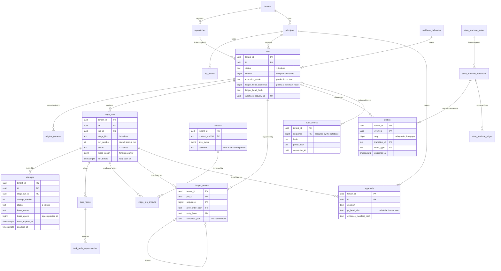

# Data model

- Status: baseline for Slice 0. Written from the migrations in [`migrations/`](../../migrations/) and checked by `scripts/db-test.sh`. Nothing here has run under load.
- Form: explanation and reference. For commands see [running.md](running.md). For the reasoning behind each constraint see [constraints-and-indexes.md](constraints-and-indexes.md).
- Source: ADR [0001](../adr/0001-orchestration-engine.md), [0004](../adr/0004-event-model.md), [0007](../adr/0007-persistence-access-and-tenancy.md), [0008](../adr/0008-artifact-store-and-evidence-ledger.md), [`state-machine.json`](../architecture/state-machine.json).

## What the database is for

PostgreSQL holds the state of every job, stage run, attempt, lease, approval and piece of evidence. The workflow engine reads and writes it through the `Store` port. The database does not trust the engine to get everything right: the rules that keep the state sound are in the schema as well as in the code, so a bug in the engine or in a hand-written query runs into a constraint instead of corrupting a record.

Seventeen of the 21 tables belong to a tenant. Four are shared: `tenants` and the three `state_machine_*` reference tables. Large content (logs, diffs, specifications, plans) is not in the database. It lives behind the artifact store, named by its SHA-256 hash, and the database keeps the hash and the metadata.

## Entity relationship diagram

Only the keys and the columns that carry a rule are drawn. Every table except the four shared ones also has `tenant_id`, which is the first column of its primary key and of every foreign key to another tenant-owned table. The diagram leaves that out to stay readable.

## Tables

### Shared reference data

| Table | Holds | Written by |
|---|---|---|
| `tenants` | One row per customer, plus one `platform` row for audit events that belong to no tenant (a webhook with a bad signature, an unknown installation). | The owner role, during onboarding. The application role can only read, and only its own row (row-level security, see [tenancy.md](tenancy.md)). |
| `state_machine_states` | Every state of the four machines (job, stage run, attempt, task node), with `is_initial` and `is_terminal`. | A migration, from `state-machine.json`. |
| `state_machine_transitions` | Every transition: id (`J01`, `S08`, ...), event name, target state and the event it emits. | A migration. |
| `state_machine_edges` | Which states each transition can start from. | A migration. |

### Identity and access

| Table | Holds | Notes |
|---|---|---|
| `repositories` | A registered GitHub repository: installation id, repository id, protection preflight result and the highest autonomy level allowed. | A repository belongs to one tenant, and the lookup by GitHub repository id is global on purpose (see [tenancy.md](tenancy.md)). |
| `principals` | A person or a service inside a tenant. Humans carry a numeric GitHub user id. | Identity only. What a person may do comes from the named allowlist in protected configuration, which the database does not store. |
| `api_tokens` | The SHA-256 hash of a token, its audience, expiry, revocation time and last use. | The token itself is never stored. `active_api_tokens` is the view that says what counts as usable. |
| `webhook_deliveries` | One row per verified GitHub delivery: delivery id, event, installation, repository, sender, body hash and semantic key. | Unique per tenant on delivery id, on body hash and on semantic key. |

### Work

| Table | Holds | Notes |
|---|---|---|
| `jobs` | One request. Status, version, execution mode, autonomy level, pipeline scope, correlation id, the ledger head pointer, the reference to the normalized request. | `webhook_delivery_id` and `idempotency_key` are unique per tenant, so one delivery or one API retry can create at most one job. |
| `original_requests` | The request text exactly as received, with its SHA-256 hash. One row per revision. | Untrusted text lives only here. The database checks that the hash matches the text. Rows are never updated. |
| `stage_runs` | One execution of one stage kind. Rework adds a new run with the next `run_number`. | Terminal runs are frozen. `lease_epoch` rises by one on every claim. |
| `attempts` | One try at a stage run, with its lease: owner, epoch, expiry, deadline, heartbeat. | At most one live attempt per stage run. |
| `task_nodes`, `task_node_dependencies` | The nodes of the task graph of an implementation run and the edges between them. | The graph is acyclic. Edges stay inside one stage run. |
| `artifacts` | Metadata of a stored blob: hash, size, media type, backend, retention class, the stage run that first stored it. | One row per tenant and hash. |
| `stage_run_artifacts` | Which artifacts a run read (`input`) and wrote (`output`), under which role name. | Answers "which runs consumed this hash", which invalidation needs. |

### Evidence and records

| Table | Holds | Notes |
|---|---|---|
| `ledger_entries` | The evidence ledger: one append-only, hash-chained entry per claim, per job. | See [ledger-and-audit.md](ledger-and-audit.md). Views `ledger_current_claims` and `ledger_assurance_levels` derive what still stands. |
| `audit_events` | The audit log: who did what, what the policy decided. Hash-chained per tenant, with sequence, time and hash assigned by the database. | Append-only. |
| `outbox` | Domain events written in the same transaction as the state change they describe. | Immutable except for the relay's `published_at` and `publish_attempts`. |
| `inbox` | One row per consumer and event, so a consumer can ignore a repeated delivery. | |
| `approvals` | A human decision on a job, bound to the head commit, tree, base, evidence manifest, policy and specification version the human saw. | Never edited. It can be invalidated once. |

## How the pieces work together

### A webhook becomes a job

1. The receiver verifies the signature before it touches the database.
2. It inserts a `webhook_deliveries` row with `ON CONFLICT DO NOTHING`. If nothing was inserted, the delivery is a repeat (same delivery id, same body hash or same semantic key), the receiver acknowledges it and stops.
3. Otherwise, in the same transaction, it inserts the `jobs` row in `RECEIVED` with `webhook_delivery_id` set and the `original_requests` row.

If the second step is skipped by a bug, the unique key on `jobs (tenant_id, webhook_delivery_id)` still refuses a second job from one delivery. The test `webhook_delivery` sends the same delivery 50 times at once and ends with one job.

### One decision is one transaction

A transition (for example the gate passing a stage run) writes four kinds of row in one transaction, in any order:

- the status change on the aggregate, with `version = version + 1` and a `WHERE version = $expected` that makes it a compare and swap;
- the ledger entries that justify it, and the job's head pointer;
- the outbox event, naming the transition and announcing the new aggregate version;
- the audit events, last, because they hold a per-tenant lock until the transaction ends.

Foreign keys and deferred checks mean the order of the statements does not matter, but the transaction must contain all of them. The `outbox` suite injects faults before and after the event insert and confirms that nothing remains.

### A claim

The engine's system pool selects `READY` stage runs of `ACTIVE` jobs whose `not_before` has passed, with `FOR NO KEY UPDATE SKIP LOCKED`, and returns the identifiers. A tenant transaction for the tenant it found then moves the run to `RUNNING` with `lease_epoch + 1`, by compare and swap on `version`, and inserts the attempt at that epoch. A partial unique index allows one live attempt per stage run, and a trigger lets the epoch rise only with that move. The `lease` suite runs 25 rounds of four workers on each of three claim styles, and each round has exactly one winner; the `rls` suite does the same through two real logins, where several workers hold the same candidate.

### A lease is fenced

Every write by a worker names its attempt, its owner and its epoch, and runs only while the attempt is live and `lease_expires_at > now()`, with `now()` read by the database. A worker that lost its lease finds its attempt terminal, and a trigger refuses any later write to a terminal attempt except the sandbox teardown facts.

### Who can see what

Four group roles share the tables ([tenancy.md](tenancy.md)). `factory_app` sees one tenant at a time. `factory_system` reads the few columns the claim, sweep and relay need. `factory_resolver` runs two lookup functions and reads no table. `factory_lookup` owns those functions. The state machine tables are readable by `factory_app` and have no policy.

## What the database does not know

It does not know the transition guards (who may do what, whether budgets allow it), the gate decisions, the pipeline order, or whether an artifact's bytes still match its hash. Those are the domain and the artifact store. The list is in [not-covered.md](not-covered.md).
