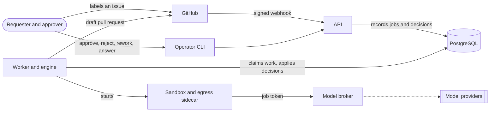

{ .bibo-hero__logo }

# Bibo

**An agentic software factory.** Bibo takes one authorized GitHub issue and turns it into a reviewed draft pull request, with an evidence trail for every step. Agents propose, gates check, and a person approves. Bibo never merges and never deploys.

[Get started](guides/quickstart.md){ .md-button .md-button--primary }
[Core concepts](concepts.md){ .md-button }
[View on GitHub](https://github.com/ortisun/bibo){ .md-button }

## Why Bibo

-   :material-state-machine:{ .lg .middle } **A deterministic shell**

    ---

    Rust code decides every step: which stage runs, which gate must pass, who may approve and what is stored. The agents only propose.

    [:octicons-arrow-right-24: State machine](architecture/state-machine.md)

-   :material-shield-check-outline:{ .lg .middle } **Gates, not trust**

    ---

    Each proposal is checked by code before the job moves on: scope, protected paths, tests, dependencies, documentation and readability.

    [:octicons-arrow-right-24: Policies](reference/policies.md)

-   :material-account-check-outline:{ .lg .middle } **A person has the last word**

    ---

    An approver decides on the specification draft and on the pull request. Rework, rejection and cancellation are decisions too.

    [:octicons-arrow-right-24: Walkthrough](walkthroughs/test-mode-run.md)

-   :material-link-lock:{ .lg .middle } **Evidence you can check**

    ---

    Artifacts are stored by content hash, and claims go into an append-only ledger chained by hash. Every report says what ran and what did not.

    [:octicons-arrow-right-24: Artifacts](reference/artifacts.md)

-   :material-docker:{ .lg .middle } **Isolated agents**

    ---

    Agents run in hardened, short-lived containers behind an egress sidecar. The sandbox never holds a real credential.

    [:octicons-arrow-right-24: Sandbox policy](security/sandbox-policy.md)

-   :material-source-pull:{ .lg .middle } **Fits your project**

    ---

    An installer prepares an existing repository for Claude Code, Codex or both, with labels, issue forms and an optional project board.

    [:octicons-arrow-right-24: Install into a project](guides/onboarding.md)

## How a job flows

A job moves through 13 stages: intake, repository intelligence, specification, domain discovery, architecture, task planning, implementation, validation, review, documenting, documentation review, delivery and approval. The [core concepts](concepts.md) page explains each part of the picture.

## Project status

!!! warning "Built and tested in test mode, not yet proven live"

    The workflow engine, the PostgreSQL store, the API, the operator command line, the worker, the sandbox and the GitHub adapter exist as code with tests. In test mode, the agents are a script and GitHub is a labelled fake, and no model is called.

    Bibo has never run against a real model, a real GitHub App or a protected repository. The [production guide](guides/production.md) lists what a person must supply first, and [the first real run](guides/first-real-run.md) says how to try it.

## Where to go next

| You want to | Read |
|---|---|
| Run a job on your machine in test mode | [Quickstart](guides/quickstart.md) |
| Understand the moving parts | [Core concepts](concepts.md) and the [architecture overview](architecture/overview.md) |
| Prepare an existing project and send it tickets | [Install into a project](guides/onboarding.md) |
| Look up a setting, a command or a policy | [Configuration](reference/configuration.md), [commands](reference/commands.md), [policies](reference/policies.md) |
| Fix a job that is stuck | [Runbooks](runbooks/README.md) |
| Know why it is built this way | [Decision records](adr/README.md) |
| Report a vulnerability | [Security policy](SECURITY.md) |
| Change Bibo itself | [Contributing](CONTRIBUTING.md) |
