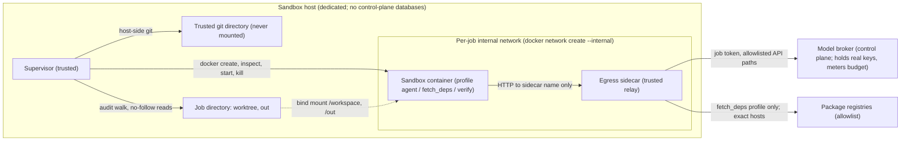

# Sandbox policy

Status: DESIGNED baseline. Nothing in this document is implemented in the product yet.
Date of the Docker experiments: 2026-10-27.
Revised the same day to match ADR 0003, 0005, 0006 and 0009: the agent CLI runs inside the sandbox, so the factory controls the boundaries and not the CLI's individual tool calls (section 2.2); the skill and slash-command flags are per stage (sections 6.3 and 10); every new direct dependency needs a human. Revised again after the agent-runtime spike (`docs/spikes/agent-runtime.md`): the CLI flag table (section 10), the skill mechanisms (section 6.3), the start of the two CLIs under the profile (section 8), the job token path `/run/factory/job-token` and `HOME=/tmp` (sections 3.2 and 7), and the list of what is still not verified (section 13).
Machine-readable form: `policies/security.yaml`, section `sandbox`, `egress`, `path_access`.
Threat IDs (T-nn) and control IDs (C-nn) refer to `docs/security/threat-model.md`.
Tests that prove these rules (NT-*) are in `docs/security/negative-test-catalog.md`.

## 0. How to read the status labels

| Label | Meaning |
| --- | --- |
| REQUIRED | The product must implement this. Not implemented yet. |
| DESIGNED | Specified here, no code and no test exist. |
| VERIFIED | A Docker flag or git behavior was observed on the development machine described in section 12. It proves the flag exists and behaves as described there. It does not prove the factory uses it. |
| UNVERIFIED | Not exercised. Treat as an assumption until a test proves it. |

The sandbox is the primary control for everything the factory runs on behalf of an untrusted request. Allowlists in the policy files are the second layer. Command denylists are a backstop only.

## 1. Policy in one page

1. Generated code, build scripts, tests and agent CLIs run only inside an ephemeral container created by the factory supervisor. There is no host-execution fallback. If the sandbox cannot start or fails verification, the job stops.
2. Every container is non-root, has a read-only root filesystem, no Linux capabilities, `no-new-privileges`, the runtime's default seccomp profile or stricter, a private PID namespace, no SysV IPC, and hard CPU, memory, process and file-size limits.
3. The network is default deny. Containers have either `--network none` or a per-job `--internal` network whose only peer is a factory-run sidecar. The sidecar relays to an exact-host allowlist, or to the model broker.
4. Execution is split into profiles with different network and mount rules: `fetch_deps` (registries, no repository code), `agent` (model broker only) and `verify` (no network, trusted gates).
5. The sandbox never holds a GitHub credential or a real model-provider key. It may hold one opaque, job-scoped, budget-capped, revocable token (`sfjt_...`).
6. The workspace is a plain directory from a git worktree. The `.git` pointer is masked, protected paths are read-only overlays, hidden paths do not exist in the checkout. All git operations run on the host against a trusted git directory the sandbox cannot reach.
7. Everything that leaves the sandbox (files, logs, diffs) is untrusted input to the control plane and is ingested with no-follow, size-capped, audited reads.
8. The created container is inspected and compared with policy before it starts. Any mismatch aborts the job.

## 2. Execution model

### 2.1 Profiles

| Profile | Purpose | Network | Source tree | Secrets | Runs repository code |
| --- | --- | --- | --- | --- | --- |
| `fetch_deps` | Download dependencies with install scripts disabled | Proxied allowlist (registries) | Dependency directories only | None | No |
| `agent` | Agent CLI and the commands it requests | Model broker only | Read-write for task-owned files | One job token | Yes |
| `verify` | Build, test, lint, scan, documentation gates | None | Read-only source, writable build output | None | Yes |

`fetch_deps` runs package-manager download commands only (for example `cargo fetch --locked`, `npm ci --ignore-scripts`). It never runs `build.rs`, `postinstall` or `setup.py`. In Slice 1 the command sets list `cargo fetch` and `cargo metadata` for it, and the class `repository_code_in_fetch_deps` denies a build, a test and an interpreter there; the npm and the other ecosystems' download commands are added with their capability profiles. Dependency changes go through a typed dependency request carried in the agent's structured result. A human decides every new direct dependency (no allowlist or heuristic approves one), and only then does a `fetch_deps` run happen. The builder cannot run `cargo add` or `npm install` itself.

`verify` is a fresh container for each gate run. Gate definitions come from the base commit or from central configuration, never from the builder's workspace. Held-out tests are mounted only here, read-only. The pass or fail result is the supervisor's observation of the exit code and output, not a file the builder could have written.

### 2.2 Where the agent CLI runs

Decided by default, pending human confirmation (ADR 0005 and ADR 0009 item 1): **the agent CLI runs inside the `agent` sandbox in Slice 1** (Model A). A person can reverse it by choosing the host tool bridge (Model B).

* Model A, in force: the agent CLI (Claude Code or Codex CLI) and the commands it runs execute together inside the `agent` container. The container is the security boundary. Vendor flags that disable the CLI's own approval prompts and sandbox (`--dangerously-skip-permissions`, `--dangerously-bypass-approvals-and-sandbox`) are acceptable only here, because the container is the external sandbox the Codex help text describes ("environments that are externally sandboxed"). They are forbidden on the host. For Codex the bypass flag is also required: its own sandbox cannot start under the default seccomp profile and every command fails without the flag (section 8).
* Model B, hardening target, off in Slice 1: the CLI runs outside the sandbox with built-in shell and edit tools disabled, and every action goes through factory-provided typed tools that execute inside the sandbox with `docker exec`. This removes the CLI process from the blast radius, at the cost of re-implementing tools. UNVERIFIED that the installed CLIs expose enough control (`--tools`, `--strict-mcp-config`) to make it practical.

What this means for control and for testing. Under Model A the CLI's own tool calls happen inside the CLI, so **the factory does not mediate them**. It cannot grant or deny an individual shell command or file write. The factory controls the boundaries around the process, and those are where every assertion about an in-sandbox agent must be made:

| Boundary the factory controls | What can be observed there |
| --- | --- |
| Sandbox posture | `docker inspect` of the created container (section 9), the runtime self-check, the environment names in `Config.Env`, the mounts |
| Egress sidecar and broker | Every outbound request and every model request: host, bytes, job token, token and cost counters, the request bodies in test mode against a fake provider |
| Host-computed diff | The tree diff computed on the host after the container stopped (section 6.5), which is the only account of what changed that the factory believes |
| Filesystem audit walk | Symlinks, nested `.git`, special files, files at hidden paths, oversize files |
| Audit log | Posture results, egress requests, gate results, protected-path decisions, approvals, token mint and revoke |
| Supervisor-run commands | Gates, `fetch_deps`, version control. These are typed commands the factory itself starts, so the argv-array, fixed-environment and command-class rules apply to them in full |

The negative test catalog tags each assertion with the boundary it uses. The assertions tagged [C] need what the installed CLIs expose, and the agent-runtime spike (`docs/spikes/agent-runtime.md`) has measured it for Claude Code 2.1.311 and Codex 0.163.0, against a fake provider, in the hardened container profile:

| CLI | What can be observed | Use |
| --- | --- | --- |
| Claude Code | The `skills` and `slash_commands` lists of the `system/init` event, `result.permission_denials` (tool name, input, id), and the text of each `tool_result`. Read `is_error` and `terminal_reason` of the `result` event, not `subtype` (a provider failure has `subtype: "success"`) and not the exit code alone (SIGINT exits 0). | Telemetry for a denial; the visible skill set after the profile is applied. The pass condition stays the container effect. |
| Codex | The `command_execution` items (command, `aggregated_output`, `exit_code`, `status`) and the `mcp_tool_call` items of the `--json` stream, and the prompt listing of `codex debug prompt-input`, which lists the visible skills with no model call. | Same. |

A permission flag is a filter on what the model may ask for, not a boundary (spike 4.8): a nested `sh -c` read a file that a deny rule protected, and a deny rule written with one leading slash matched nothing. What stopped writes outside the workspace and reads of host files was the container.

### 2.3 Topology for a job



The sidecar is a small relay with static configuration generated by the supervisor from the policy: the allowed hosts for this profile, the job token it will accept, the byte quota. It holds no real credentials. The real provider keys live in the model broker, which sits in the control plane, checks the token, enforces the budget, replaces the credentials and forwards only the allowed API paths. One sidecar per job is the default because it removes any cross-job and cross-tenant path through shared proxy state. A shared multi-homed proxy needs a separate security review.

## 3. Container requirements

### 3.1 Required settings and what was observed

Every row marked VERIFIED was run on the machine in section 12. Experiment IDs refer to the table in section 12.

| Requirement | Docker option | Observed result | Status |
| --- | --- | --- | --- |
| Not privileged | no `--privileged` | `docker inspect` shows `Privileged=false` by default. With `--privileged --security-opt seccomp=unconfined` it shows `Privileged=true` and `label=disable` (P3). | VERIFIED |
| Non-root numeric user | `--user 10001:10001` | `id` returned `uid=10001 gid=10001 groups=10001` (E4b). Default is root (E0). | VERIFIED |
| Drop all capabilities | `--cap-drop ALL` | `CapEff`, `CapPrm`, `CapBnd` all zero as root and as non-root; `chown` returned EPERM (E4a, E4b). The default set is `00000000a80425fb` (E0). | VERIFIED |
| No privilege gain | `--security-opt no-new-privileges` | `NoNewPrivs: 1` (E5). | VERIFIED |
| Read-only root filesystem | `--read-only` | `touch /x` and `touch /tmp/x` both returned "Read-only file system" (E2). | VERIFIED |
| Writable scratch only on tmpfs | `--tmpfs /tmp:rw,noexec,nosuid,nodev,size=8m` | Writes work; running a copied binary from it returned "Permission denied" (exit 126); the size cap held (E3). `uid=`, `gid=`, `mode=` options are accepted on `--tmpfs` (U1). | VERIFIED |
| Default seccomp profile on | omit `--security-opt seccomp`; never `unconfined` | `Seccomp: 2` and `unshare -U` returned "Operation not permitted" (E6). With `seccomp=unconfined` it showed `Seccomp: 0` and `unshare` succeeded (E6b). | VERIFIED |
| Custom seccomp profile mechanism | `--security-opt seccomp=FILE` | A test profile denying `uname` changed behavior (S1). A real custom profile must be a complete profile derived from the runtime default, never a short allow-everything file. | VERIFIED (mechanism only) |
| Tool output not writable by a sibling | the agent tools and `timeout` are mode 0711 in the agent image (`lib/harden.sh`) | A process of the sandbox user could open `/proc/<pid>/fd/1` of the tool and write a forged event into the stream the adapters read. The kernel refuses that for a process started from a file nobody can read: `/proc/<pid>/fd` belongs to root ("Permission denied"). Shown with the real Claude Code and Codex in the end-to-end lab on execute-only copies: the forged line arrived with readable binaries, did not with execute-only ones, and arrived again when only `timeout` stayed readable (finding SBX-4). | VERIFIED on copies; the image is not rebuilt yet; `test.sh` rule `TOOLS-EXECUTE-ONLY` checks the built image |
| Private PID namespace | default; never `--pid host` | PID 1 inside was the container's own process (E13). | VERIFIED |
| No SysV IPC | `--ipc none` | `/dev/shm` did not exist (E13). Browser-based tests need `--ipc private` and an explicit `--shm-size`. | VERIFIED |
| Init process | `--init` | PID 1 was `docker-init` (I1). | VERIFIED |
| Process limit | `--pids-limit 256` | With limit 12: `pids.max` was 12, further forks failed with "Resource temporarily unavailable", `pids.events` counted `max 1` (E7). | VERIFIED |
| Memory limit, no swap | `--memory 4g --memory-swap 4g` | 300 MB allocation under a 64 MB limit: exit 137, `OOMKilled=true` (E8). | VERIFIED |
| CPU limit | `--cpus 2` | `cpu.max` showed `50000 100000` for `--cpus 0.5` (E9). | VERIFIED |
| Max single file size | `--ulimit fsize=<bytes>` | Writer was killed with "File size limit exceeded" at the limit (E12). | VERIFIED |
| Open files, core dumps | `--ulimit nofile=4096:4096 --ulimit core=0` | `ulimit -n` returned 64 and `ulimit -c` returned 0 in the test (E12). | VERIFIED |
| Scratch disk cap | `tmpfs size=` | 32 MB write into an 8 MB tmpfs stopped at 8 MB (E3, E10). | VERIFIED |
| Writable-layer quota | `--storage-opt size=` | Accepted silently and NOT enforced: a 128 MiB write succeeded under `size=64m` (E11, E11b). Do not rely on it. | VERIFIED (not enforced here) |
| Wall-clock limit | none in Docker | `docker run --help` has `--stop-timeout` and `--health-timeout` only. The supervisor sends `docker kill` at the deadline; exit code was 137 (E15). | VERIFIED |
| Network off | `--network none` | Only `lo` (plus unconfigured tunnel devices) existed; `wget 1.1.1.1` returned "Network unreachable"; DNS lookups returned "Network unreachable" (E1). | VERIFIED |
| Network restricted | `docker network create --internal` | See section 5. | VERIFIED |
| Kernel paths masked | default | `/proc/kcore` read 0 bytes; writing `/proc/sys/kernel/core_pattern` returned "Read-only file system"; `/sys` mounted read-only (E14). | VERIFIED |
| No Docker socket | no mount of `docker.sock` | The default container had no `/var/run/docker.sock` (E0). The policy check forbids mounting it; the mount itself was deliberately not attempted. | VERIFIED (default); policy check DESIGNED |
| No implicit image pull | `--pull=never` | Unknown image failed with "No such image", exit 125 (X1). | VERIFIED |
| Image pinned by digest | `name@sha256:...` | `docker run python@sha256:2d9a...` ran (E17). | VERIFIED |
| No daemon-side log copy | `--log-driver none` | Attached `docker start -a` / `docker run` still delivered stdout; `docker logs` failed with "configured logging driver does not support reading" (L1, P1). The default driver here was `local` and kept an unredacted copy readable with `docker logs` (L2). | VERIFIED |
| AppArmor profile | `--security-opt apparmor=...` | The daemon on the test machine lists only `seccomp` and `cgroupns` in `SecurityOptions`. No AppArmor, no SELinux, not rootless (E18). | UNVERIFIED on the test machine; REQUIRED on the Linux production host |

Findings that change the design:

* `--cap-drop ALL` does not stop ICMP echo to loopback or binding port 80 as root. Docker sets `net.ipv4.ping_group_range` and `net.ipv4.ip_unprivileged_port_start` so both worked with zero capabilities (E4a). This does not matter under `--network none`. On a job-internal network it means the sandbox can bind low ports and send ICMP echo (only loopback was tested). The network design must not rely on capability removal to prevent either.
* Environment variables are not secret from the Docker daemon. `-e FAKE_TOKEN=...` was readable through `docker inspect` and through `/proc/1/environ` (E16). Secrets go in files on a worker-side tmpfs, not in `--env`.
* `--storage-opt size=` silently does nothing on this storage driver. With a read-only root filesystem the writable layer is not used anyway; the real disk controls are on the mounted directories (section 4).

### 3.2 Canonical command shape

The supervisor builds the container from a typed `SandboxSpec` and passes arguments as an array, never through a shell and never by concatenating strings. A Docker Engine API client may be used instead of the CLI; the fields are the same. The table above is the checklist; this is the same content as one command, with placeholders in `${...}`.

```text
docker create
  --pull=never
  --name sf-${job_short}-${attempt}-${rand}
  --label factory.tenant=${tenant_id} --label factory.job=${job_id} --label factory.stage_run=${stage_run_id}
  --user ${uid}:${gid}                                  # numeric, both >= 10000
  --read-only
  --cap-drop ALL
  --security-opt no-new-privileges
  --init
  --ipc none                                            # "private" plus --shm-size only for browser tests
  --pids-limit ${pids}
  --memory ${mem_mb}m --memory-swap ${mem_mb}m
  --cpus ${cpus}
  --ulimit nofile=${nofile}:${nofile} --ulimit core=0 --ulimit fsize=${max_file_bytes}
  --network ${none | sf-net-${job_id}}
  --log-driver none
  --stop-timeout 10
  --workdir /workspace
  --env HOME=/tmp --env <fixed supervisor-owned variables only>
  --tmpfs /tmp:rw,noexec,nosuid,nodev,size=${tmp_mb}m,mode=1777         # scratch and home: both agent CLIs write their state here
  --mount type=bind,src=${job_root}/worktree,dst=/workspace
  --mount type=bind,src=${job_root}/worktree/${protected_path},dst=/workspace/${protected_path},readonly   # repeated per protected path that exists
  --mount type=bind,src=/dev/null,dst=/workspace/.git,readonly
  --mount type=bind,src=${job_root}/out,dst=/out
  --mount type=bind,src=${job_secret_tmpfs}/token,dst=/run/factory/job-token,readonly    # agent profile only; the path is JOB_TOKEN_TARGET in crates/ports/src/sandbox.rs
  --mount type=bind,src=${tool_cache},dst=/cache,readonly
  ${image}@sha256:${digest}
  ${entrypoint_argv...}
```

Notes:

* Do not pass `--rm`. The supervisor must read `State.ExitCode` and `State.OOMKilled` after exit, then remove the container (E8 relied on this).
* Run `docker create`, then `docker inspect`, then verify (section 9), then `docker start -a`. `docker start -a` returned the container's stdout with `--log-driver none` and exit code 0 in experiment P1.
* There is no `--cap-add`, `--device`, `--privileged`, `--pid host`, `--network host`, `--userns host`, `--sysctl`, `--security-opt seccomp=unconfined`, `--security-opt apparmor=unconfined`, `--security-opt systempaths=unconfined`, `--volumes-from`, `--add-host` pointing at internal addresses, or `--publish`.
* `--tmpfs ...,noexec` breaks toolchains that execute from `/tmp`. A toolchain that truly needs it gets a named exception in its capability profile, reviewed by security. The build output directory is the exec-capable location.
* The home directory is the scratch tmpfs: `HOME` is `/tmp`, so there is no second tmpfs. The agent-runtime spike (`docs/spikes/agent-runtime.md` section 4.2) found that both CLIs start, run a turn and run tool calls with a writable, `noexec` home and nothing pre-seeded. Codex needs the home to be writable: with a read-only home it exits with "failed to initialize in-process app-server client: Read-only file system" (VERIFIED, `codex-ro-home`). Claude Code works either way and writes nothing. Do not bind-mount anything below `~/.codex`: a mount inside the tmpfs creates its parent directories owned by root, which Codex cannot tolerate (VERIFIED, `codex-skills-user-root`).
* The job token is the file `/run/factory/job-token`, the `JOB_TOKEN_TARGET` constant of the sandbox port, mode 0400 on a worker-side tmpfs. It is not delivered as an environment variable (section 7).
* `nosuid` and `nodev` cannot be set on a bind mount through `--mount` in the options exercised here (UNVERIFIED for other versions). The compensating controls are `no-new-privileges` and zero capabilities, which neutralize setuid binaries in the workspace, plus the workspace audit walk that rejects setuid and setgid bits (`policies/security.yaml`, `path_access.workspace_audit`).

### 3.3 Forbidden

The posture verifier (section 9) rejects a container that has any of: privileged mode, added capabilities, a device, a sysctl override, host PID, host IPC, host network, `container:` network mode, host user namespace, an unconfined seccomp or AppArmor option, a mount from `/var/run/docker.sock` or from any path in `sandbox.forbidden_mount_sources`, a mount with a `/dev` source other than the single `/dev/null` mask, an image without a digest, or a running user of 0.

## 4. Resource limits

Defaults are in `policies/security.yaml`, `sandbox.profiles`. Projects may lower them. Raising any limit is an always-human decision.

| Limit | `fetch_deps` | `agent` | `verify` | Enforced by |
| --- | --- | --- | --- | --- |
| CPUs | 1 | 2 | 4 | `--cpus` (VERIFIED) |
| Memory and swap | 1 GiB | 4 GiB | 8 GiB | `--memory`, `--memory-swap` equal (VERIFIED) |
| Processes | 128 | 256 | 512 | `--pids-limit` (VERIFIED) |
| Wall clock | 10 min | 60 min | 30 min | Supervisor timer and `docker kill` (VERIFIED approach) |
| Per-command timeout | 10 min | 10 min | per gate | Typed command wrapper, kills the process group |
| Largest file | 512 MiB | 512 MiB | 1 GiB | `--ulimit fsize` (VERIFIED) |
| tmpfs `/tmp` | 256 MiB | 512 MiB | 512 MiB | `--tmpfs size=` (VERIFIED) |
| Workspace and output disk | 4 GiB | 2 GiB | 4 GiB | See below |
| Output the supervisor keeps (stdout and stderr) | 64 MiB | 64 MiB | 64 MiB | Supervisor log cap, `sandbox.watchdog.max_log_bytes`; the rest is dropped and the log is marked truncated |

Workspace and output disk. The writable-layer quota is not enforced on the test machine, and the workspace is a host directory, so a per-container flag cannot cap it. In order of preference:

1. Place each job root on a filesystem with per-directory quotas (XFS project quotas, or ext4 project quotas). UNVERIFIED; needs a Linux host.
2. Mount a fixed-size loopback image per job. UNVERIFIED; needs a Linux host and privileges for the worker, which is a trade-off to review.
3. Baseline that works everywhere: the supervisor polls the job directory every 5 seconds with a no-follow walk (bytes and inode count). On breach it kills the container and fails the job with an audit event. `--ulimit fsize` bounds individual files. A fast writer can overshoot the cap between polls, so the sandbox host's filesystem must have headroom for `limit + (write rate * 5 s)`.

`RLIMIT_NPROC` (`--ulimit nproc`) is per user across the host and does not bound a single container. Use `--pids-limit`.

## 5. Network

### 5.1 Default and mechanism

Docker's default bridge allows outbound traffic: `wget example.com` succeeded from a default container (N0). The factory must never use the default network.

Docker has no per-domain egress allowlist. The mechanism is topological:

* `--network none` for profiles that need no network (`verify`, and any `agent` run that does not need the model, for example tool-only steps). VERIFIED.
* A per-job network created with `docker network create --internal sf-net-${job_id}` for `agent` and `fetch_deps`. VERIFIED behavior on the test machine:
  * IP egress failed: `wget http://1.1.1.1` returned "Network unreachable"; `wget http://169.254.169.254/` (cloud metadata address) also returned "Network unreachable" (N2).
  * Name resolution of external names failed: `wget example.com` returned "bad address"; `nslookup example.com` against the embedded resolver `127.0.0.11` returned SERVFAIL (N2). The embedded resolver did not forward external queries, so DNS tunneling to an outside resolver was not available from this network.
  * Containers on the same internal network resolved each other by name and could talk (N3).
  * A relay attached to both the internal network and `bridge` reached `example.com` (exit 0) while a client on the internal network only could not (N4). This is the sidecar topology.

### 5.2 Egress sidecar requirements (REQUIRED, DESIGNED)

* Static configuration from the supervisor: allowed hosts and ports from `egress.profiles.<profile>`, accepted job token, byte quota, job ID.
* Exact hostname matching. No wildcards, no suffix matching, no IP literals.
* The sidecar resolves names itself and applies `egress.proxy_rules.reject_resolved_ip_ranges` to the resolved address (loopback, RFC 1918, link-local and metadata, CGNAT, unique-local). It connects to the pinned address, so a rebinding DNS answer cannot redirect the connection.
* HTTPS passthrough (CONNECT) for registries. No TLS interception of package hosts.
* Methods limited to GET and HEAD for registries. The `agent` profile reaches only the model broker over HTTP to the sidecar, which forwards to the broker.
* A per-job transfer cap (default 2 GiB). It limits data volume leaving through any allowed host.
* Every request is logged to the audit stream: job, host, port, bytes, decision.
* The sidecar itself runs with the container requirements in section 3, with its own digest-pinned image built by the factory.

### 5.3 What the allowlist is and is not

`github.com`, `api.github.com`, `gist.github.com`, `raw.githubusercontent.com`, paste sites and file-drop sites are denied from every sandbox profile (`egress.never_allow_from_sandbox`). With a GitHub token an allowlisted `github.com` would be a way to push stolen data to an attacker repository. The sandbox does not need GitHub: the control plane clones and pushes.

An allowlisted package registry is still a very low bandwidth exfiltration channel (request paths and package names). The risk is accepted and bounded by the byte cap and by the fact that the registry operator, not the attacker, sees the requests. The `fetch_deps` profile runs no repository code, so the practical exposure there is the dependency name list itself.

The `agent` profile cannot reach any registry. Package installation is not possible during the agent session, which closes the "install a malicious package at runtime" path.

### 5.4 Network limits that remain

* Lateral movement between jobs is prevented by one internal network per job. Docker's default address pools are finite. Planning for many concurrent jobs means configuring `default-address-pools` with small subnets in the daemon. UNVERIFIED at scale.
* Inside a job network, the sandbox can reach the sidecar. The sidecar is therefore part of the attack surface and must treat all input as hostile.

## 6. Filesystem, worktrees and ingestion

### 6.1 Layout

```text
${job_root}/                 mode 0700, owned by the sandbox host worker user, one per job attempt
  worktree/                  git worktree of the base commit; mounted read-write at /workspace
  out/                       mounted read-write at /out; structured results and logs spill
  .secrets/ (tmpfs on host)  job token file; mounted read-only at /run/factory/job-token; removed at job end
${repo_cache}/${tenant}/${repo}.git   trusted bare repository; NEVER mounted; read and written only by host-side git
```

Rules:

* The job root is created for one job attempt and deleted afterwards. No volume is shared between jobs. No path is shared between tenants. Toolchain and dependency caches are mounted read-only and are written only by `fetch_deps` runs for the same tenant and repository.
* Only `${job_root}/worktree` and `${job_root}/out` are writable from inside. Nothing from the user's home, the factory's configuration, the Docker socket, or any other host path is mounted.
* The worktree is created by the control plane with `git worktree add --detach --no-checkout` followed by a sparse checkout, so held-out evaluation data and secret-bearing files never exist in the checkout. VERIFIED (W1): after `sparse-checkout` with `!/tests/holdout/`, the directory was absent and `git status` was clean.

### 6.2 The `.git` pointer

A linked worktree's `.git` is a file with an absolute path into the main repository's `.git/worktrees/<name>`. Inside the container this path is dangling, which accidentally protects the main repository, but the file also reveals the host path layout (G1). The factory must not "fix" the dangling pointer by mounting the main `.git` directory. A sandbox-writable git directory is host code execution: a `core.fsmonitor` entry in a hostile `.git/config` made a plain `git status` on the host run the attacker's script (G3). Passing `-c core.fsmonitor=false` blocked that one vector. Other config keys can do the same (hooks path, diff and merge drivers, pager, credential helper, SSH command, aliases), so a denylist of `-c` overrides is not a control.

The control is structural:

1. Bind `/dev/null` read-only over `/workspace/.git`. VERIFIED (G2, M1): the container sees an empty file; the host file is unchanged; `rm` and `mv` of the masked entry return "Resource busy".
2. The sandbox contains no `git` binary the agent can use for repository operations. Version-control operations are typed tools executed on the host (`vcs.read`, `vcs.commit`) against the trusted git directory.
3. Host-side git always runs with a fixed environment: `GIT_CONFIG_NOSYSTEM=1`, `GIT_CONFIG_GLOBAL=/dev/null`, `core.hooksPath=/dev/null`, `core.fsmonitor=false`, no submodule recursion, no prompts. The loader must never set `safe.directory=*` to silence an ownership error; that guard is a defense, not an obstacle.
4. A nested `.git` directory created by the builder inside the workspace is rejected by the workspace audit walk. The tree diff alone does not report it (W3).

If the architect decides builders need in-sandbox git (Model A with a full clone), that is a security decision: the clone is then fully untrusted, the control plane never runs git inside it, and results are extracted by recomputing a diff from file contents on the host. It needs its own review.

### 6.3 Protected paths inside the sandbox

Defense in depth. The authoritative check is the host-side tree diff (section 6.5). In addition, the supervisor re-mounts each existing `deny_write` and `append_only` protected path read-only over the writable workspace. VERIFIED (M1):

* Appending to `.github/workflows/ci.yml` returned "Read-only file system"; `rm` of it returned "Read-only file system"; creating a file under a read-only `tests/holdout` returned "Read-only file system"; renaming the overlaid directory returned "Resource busy". An unprotected file (`src/main.rs`) stayed writable. The host files were unchanged afterwards.
* `append_only` groups (fixtures, golden files) cannot be expressed as a read-only overlay without also blocking new files, so the overlay applies to the existing files only and the tree diff enforces "add allowed, modify and delete blocked".
* UNVERIFIED: when a read-only overlay target does not exist in the checkout, Docker is expected to create an empty directory for the mount point on the host side. That would be harmless for git but means the audit walk must ignore empty directories at overlay targets. The supervisor should create overlay targets itself before `docker create`, and only for paths that exist in the base tree.

Skill roots get the same treatment. In every stage except specification, the supervisor mounts read-only empty directories over `.claude/skills`, `.claude/commands` and `.agents/skills`, so no repository-resident skill or command resolves even where a CLI has no flag to disable them. In the specification stage it mounts the same kind of empty overlay over the six denied Spec Kit skill directories (plan, tasks, analyze, implement, converge, taskstoissues) under each host skill root, so the four allowed skills resolve and the six do not. The overlay mechanism is the one verified in M1, and the agent-runtime spike verified it for both CLIs (section 4.6): with six empty overlays over the denied directories Claude Code listed exactly the four allowed skills (`claude-skills-overlay-spec-stage`) and Codex listed exactly four (`codex-skills-overlay-spec-stage`); with an overlay over the whole skill root neither listed a Spec Kit skill. The host's own copy of the files is untouched, so `specify integration status --json` on the host still reports the true state.

Three more facts from the spike change what the supervisor sets up.

* **The CLIs' own bundled skills stay visible.** Claude Code lists 16 bundled skills and Codex four (`imagegen`, `openai-docs`, `skill-creator`, `skill-installer`). Both can be switched off: `CLAUDE_CODE_DISABLE_BUNDLED_SKILLS=1` and `-c skills.bundled.enabled=false`. A test that "the visible set equals the four ids" filters to the `speckit-` names, or switches the bundled ones off. Codex can also hide one skill with `-c skills.config=[{path="...SKILL.md", enabled=false}]`.
* **Claude Code has a second way to expose exactly four skills.** The factory runs it with `--setting-sources user`, so the project skill root is not read at all, and `--bare` resolves no skill either. In the specification stage the supervisor therefore mounts the four pinned, hash-checked skill directories read-only in the user skill root, `~/.claude/skills/speckit-<name>` with `HOME=/tmp`. The model then sees exactly four skills under their normal names and a prompt that starts with `/speckit-specify` expands (`claude-skills-user-root`, `claude-skills-user-root-slash`). The overlays are the tool to use where project skills must stay visible. Repository skill directories are never read in the first case.
* **A mount below the tmpfs home leaves root-owned parent directories.** Claude Code tolerates that, because it only cannot write below `~/.claude`. Codex does not: it exits with "Permission denied" (`codex-skills-user-root`). For Codex use the overlays on `.agents/skills`, and never mount below `~/.codex`.

A `Skill(speckit-plan)` deny rule blocks the model's `Skill` tool call (`permission_denials` lists it) and does not block a prompt that begins with `/speckit-plan` (`claude-skills-slash-rule-denied`). The adapter writes the prompt, so that path is under its control; the rule is a second layer.

### 6.4 Hidden paths

Hidden groups (`evaluation_holdouts`, `secret_bearing_files`) are removed from the checkout with sparse-checkout exclusion, so there is nothing to mount and nothing to read. If the builder creates a file at a hidden path, git silently leaves it out of the staged tree (W3: "paths ... exist outside of your sparse-checkout definition, so will not be updated in the index"). The audit walk therefore fails the job when any file exists under a hidden path. A silent omission would hide the attempt.

### 6.5 Ingestion of sandbox output

The control plane treats everything under `worktree/` and `out/` as hostile input.

1. Stop and remove the container first.
2. Run the workspace audit walk (`path_access.workspace_audit`). The walk uses `lstat` and no-follow opens; it never follows a symlink. A container-created symlink to an absolute host path was followed by a plain host `cat` (B2), so any host reader that opens paths from the workspace without no-follow would read arbitrary host files and could attach them to a pull request or an artifact.
3. Compute the head tree on the host: copy the worktree's index to a temporary index (this keeps skip-worktree bits), run `git add -A`, `git write-tree`, then `git diff-tree -r --raw --find-renames` against the base tree. VERIFIED (W3): the output showed deletes, adds, modifications, a rename (`R100` with both paths), a mode change (`100644` to `100755`) and a new symlink (`120000`).
4. Evaluate the protected path rules on that diff, counting a rename as two paths and a mode or type change as a modification.
5. Reject gitlinks (`160000`), `.gitmodules` changes and symlinks whose target resolves outside the workspace.
6. Run the secret scanner on the diff before anything is committed or sent.
7. Only then commit, using the host-side `vcs.commit` operation.

Artifacts in `out/` are size-capped, count-capped, hashed, and never rendered or executed by the control plane. Archive extraction (if any) rejects absolute paths, `..`, links and device nodes.

## 7. Credentials and environment inside the sandbox

Details are in `docs/security/secrets-and-credentials.md`. The rules the sandbox depends on:

* No GitHub token, no App key, no webhook secret, no database or object-store credential, no real model-provider key ever enters a sandbox.
* The `agent` profile gets one job token (`sfjt_...`), bound to tenant, job and stage, valid only at the model broker, capped by tokens and USD, and revoked at job end. It is delivered as a read-only file on a worker-side tmpfs, at `/run/factory/job-token`. Delivery by `--env` is visible in `docker inspect` and `/proc/1/environ` (E16), and the agent-runtime spike showed that the shell the model drives sees a credential given to the CLI as an environment variable, and so does the parent's `/proc/<pid>/environ` (section 4.5). Both accepted CLIs offer a file-based option (`apiKeyHelper` for Claude Code, a provider `auth` command for Codex), so **an environment variable is forbidden for the credential**. There is no recorded exception.
* Environment variables are set by the supervisor from a fixed list. The agent cannot add variables to a command (`exec.run` has `env: fixed_by_supervisor`). The agent CLI is configured not to inherit the supervisor's environment.
* `--log-driver none` keeps the daemon from storing an unredacted copy of output (L1, L2). The supervisor streams stdout and stderr through the redactor and stores only redacted output. If the supervisor dies mid-run, that output is lost, and the job is retried or failed. This is the trade-off for not leaving a raw copy on the host.

## 8. Kernel isolation stance

| Layer | Stance | Status |
| --- | --- | --- |
| Namespaces and cgroups (runc) | Baseline. Shares the host kernel. | VERIFIED on Docker Desktop |
| Seccomp | Runtime default profile is mandatory. A custom profile may only be stricter and must be a complete profile. It blocks `unshare` of a user namespace, which is intended. | VERIFIED (E6) |
| AppArmor / SELinux | Required on the Linux production host where the distribution provides it. Not active on the Docker Desktop VM used for the experiments. | UNVERIFIED |
| User namespace remapping or rootless daemon | Strongly recommended for the production sandbox host so that "root in the container" is not root on the host. Not exercisable on Docker Desktop. | UNVERIFIED |
| gVisor (`runsc`), Kata Containers, Firecracker | Recommended for multi-tenant production, where a shared kernel is the largest residual risk. Only `runc` is installed on the test machine. | UNVERIFIED |
| Docker daemon access | Only the supervisor talks to the daemon. The daemon socket is never mounted into any container. The supervisor builds requests from a typed spec and checks them before start. | DESIGNED |

The default seccomp profile denies `unshare(CLONE_NEWUSER)`. Agent CLIs that implement their own sandbox with user namespaces (for example a bubblewrap-based or Landlock-based mode) may fail to initialize inside this container. That is acceptable, because the container is the boundary. The agent-runtime spike measured what happens to the two CLIs (VERIFIED, `docs/spikes/agent-runtime.md` sections 4.2 and 4.8, Docker 29.5.2 in a Linux virtual machine with AppArmor and the builtin seccomp profile active):

* Both CLIs start, run a headless turn and run a tool call under the full `agent` profile, with `.git` masked, and finish in under a second against a fake provider. Seccomp is mode 2, `NoNewPrivs` is 1, every capability set is zero and AppArmor `docker-default` is enforced while they run.
* **Codex's own sandbox cannot start.** Every command in `-s read-only`, `-s workspace-write` and the default mode failed with "bwrap: No permissions to create a new namespace". It fails closed and does not fall back to running without its sandbox. Only `--dangerously-bypass-approvals-and-sandbox` ran a command, as uid 10001 with a read-only root. The flag is therefore required for Codex in the `agent` profile and acceptable only here.
* **Claude Code's `CLAUDE_CODE_SUBPROCESS_ENV_SCRUB=1` needs bubblewrap too.** Without it the tool refuses to start and prints a stack dump. The variable must not be set.
* Nothing in the CLIs' behavior changes the stance of this section. The permission flags did not hold either: a chained command after an allowed prefix ran, and a nested `sh -c` read a protected file. The container was what held.

## 9. Supervisor lifecycle and posture verification

1. Authorize: the policy engine confirms the stage, the task, the profile, the mounts and the budget. Missing policy or a failed load stops the job.
2. Prepare: create the job root, the worktree (sparse), the output directory, the secret tmpfs file, and for proxied profiles the job network and sidecar.
3. Create: `docker create` with the typed spec. Not started yet.
4. Verify posture: `docker inspect` the created container and compare these fields with policy. Fields observed on Docker 29.9.2 (P2): `HostConfig.Privileged`, `Config.User`, `HostConfig.ReadonlyRootfs`, `HostConfig.CapAdd`, `HostConfig.CapDrop`, `HostConfig.SecurityOpt`, `HostConfig.PidsLimit`, `HostConfig.Memory`, `HostConfig.MemorySwap`, `HostConfig.NanoCpus`, `HostConfig.NetworkMode`, `HostConfig.IpcMode`, `HostConfig.PidMode`, `HostConfig.UsernsMode`, `HostConfig.Init`, `HostConfig.LogConfig.Type`, `HostConfig.Devices`, `HostConfig.Ulimits`, `HostConfig.Tmpfs`, `Mounts`, `Config.Image`, `HostConfig.RestartPolicy`, `HostConfig.AutoRemove`, `Config.Env` (names must be on the supervisor's allowlist, with none of the forbidden names such as `LD_PRELOAD`, `RUSTFLAGS`, `NODE_OPTIONS`, `GIT_SSH_COMMAND`).
   * Reading the output: `CapAdd` printed `<no value>` when unset. An unset seccomp option is an empty `SecurityOpt` (P2), so the verifier cannot confirm "default seccomp" from the field; it rejects any `seccomp=unconfined` or custom path not on the allowlist, and the runtime self-check below confirms the result. `SecurityOpt` showed `[seccomp=unconfined label=disable]` for the privileged test container (P3). `PidMode` and `UsernsMode` print empty for the private default. Tmpfs mounts appear under `HostConfig.Tmpfs`, not under `Mounts`.
   * Any mismatch: remove the container, fail the job, write an audit event with the diff. No retry with relaxed settings.
5. Start attached (`docker start -a`). The first action of the entrypoint wrapper is a self-check that prints `/proc/self/status` fields `Seccomp`, `NoNewPrivs` and `CapEff`. The supervisor requires `Seccomp: 2`, `NoNewPrivs: 1` and `CapEff` of zero before it releases the workload. This proves the runtime applied what the inspect output promised, including on a daemon whose default seccomp profile has been altered.
6. Run: stream stdout and stderr through the redactor to the log store. Enforce the wall-clock deadline and the disk poll. On breach, `docker kill`, record the exit code and `OOMKilled`.
7. Collect: read `State.ExitCode` and `State.OOMKilled`, then remove the container, the sidecar and the network. Run ingestion (section 6.5).
8. Destroy: delete the job root and revoke the job token. Verify nothing remains with the factory's labels. Experiment T1 confirmed the cleanup approach left no containers or networks behind.

If the Docker daemon is unreachable, the supervisor is down or the image is missing, the job is BLOCKED. It does not run on the host and it does not downgrade to a weaker profile.

## 10. Agent CLI considerations (from the installed binaries)

These flags were first read from `claude --help` (2.1.311) and `codex exec --help` (0.163.0) on 2026-10-27. The agent-runtime spike then ran both tools in the hardened container profile against a labelled fake provider, with a hostile workspace, and measured which of them do what the first reading assumed (`docs/spikes/agent-runtime.md` section 4). Only these two versions are accepted until a probe run proves another. The adapter capability probe and NT-INJ-07 still run before an adapter is enabled, and the probe tests behavior and not flag presence. A real provider has not been called.

| Concern | Claude Code | Codex CLI |
| --- | --- | --- |
| Neutralize repository hooks, MCP servers, the `env` block of a settings file and instruction files | **`--setting-sources user` with `--strict-mcp-config`**, and an empty home (`HOME=/tmp`). In the hostile workspace this ran no hook, no MCP server, sent no traffic to the overridden host and put no `CLAUDE.md` in the prompt. **`--bare` is not enough**: it skipped the hook and the MCP server but still honored the `env` block of `.claude/settings.json`, which sent the model traffic to an attacker host. The policy no longer relies on it. | **`-c project_doc_max_bytes=0`** keeps `AGENTS.md` out of the prompt. `--ignore-user-config` and `--ignore-rules` do **not** stop `AGENTS.md`; they stay as harmless extra layers. A project `.codex/config.toml` was ignored in an untrusted project |
| Control settings sources | `--settings <file or JSON>` adds the factory's own settings; `--setting-sources user` restricts the rest | `-c key=value` for every setting; `--strict-config` |
| MCP servers | `--strict-mcp-config` (with `--mcp-config=<json>` only when the host tool bridge is chosen) | none configured; `--ignore-user-config` |
| Tool restriction | `--tools=`, `--allowedTools=`, `--disallowedTools=`, written with an equals sign (a variadic option swallows the prompt). A filter on what the model asks for, not a boundary (section 2.2) | its own `-s` sandbox modes cannot start in the container (section 8), so they restrict nothing; `--disable shell_tool --disable unified_exec` apply only to the host tool bridge |
| Model | `--model` is always given; the default is the most expensive model | `-m` is always given; the default is the most expensive model |
| Base URL for the broker | `ANTHROPIC_BASE_URL` in the environment, or in the `env` block of the `--settings` JSON | **a custom model provider entry**: `-c model_provider=...` and `-c model_providers.<id>={name=..., base_url="http://<sidecar>/v1", wire_api="responses", supports_websockets=false, ...}`. `OPENAI_BASE_URL` is ignored and the tool goes to `api.openai.com` |
| Authentication | `--settings '{"apiKeyHelper":"cat /run/factory/job-token"}'` works with and without `--bare`. The credential is not in any environment variable. `--bare` never reads OAuth or the keychain | `auth={command="cat", args=["/run/factory/job-token"]}` in the provider entry. `OPENAI_API_KEY` is not read by `codex exec`; `CODEX_API_KEY` and a provider `env_key` put the key in the environment, which is forbidden |
| Skills and slash commands | `--disable-slash-commands` ("Disable all skills and commands"). Applied per stage: on in every stage except specification, off there so the four Spec Kit skills resolve (`agent_stage_profiles`). In the specification stage the four pinned skills are mounted read-only in the user skill root (section 6.3), because `--bare` and `--setting-sources user` both hide project skills. A `Skill(name)` deny rule works for the model's tool call and not for a typed slash command | Skills can be hidden by read-only empty overlays, by `-c skills.config=[{path=..., enabled=false}]` and, for the bundled ones, by `-c skills.bundled.enabled=false` |
| Traffic to other hosts | **`CLAUDE_CODE_DISABLE_NONESSENTIAL_TRAFFIC=1`**, an environment setting. `--bare` and `DISABLE_TELEMETRY`, `DISABLE_ERROR_REPORTING`, `DISABLE_AUTOUPDATER` do not stop the attempts to reach `api.anthropic.com` | **`--disable plugins` and `-c analytics.enabled=false`, both.** Each alone leaves some of `api.github.com`, `chatgpt.com` and `ab.chatgpt.com` |
| Retries | `CLAUDE_CODE_MAX_RETRIES` (default 10; a revoked token is retried for well over a minute) | `--disable unbounded_connection_retries` (otherwise it never gives up); five retries on a refusal, 30 requests on a 500 |
| Per-run caps | `--max-turns` (a hidden flag that works, with `CLAUDE_CODE_MAX_TURNS`; test it by behavior) and `--max-budget-usd`, whose price list means nothing behind a broker. Second lines only | none. The broker and the supervisor are the cap |
| Structured output | `--json-schema` rejects all eleven factory schemas. Not used; the engine validates the final answer | `--output-schema` accepts them; the engine still validates |
| Session persistence | `--no-session-persistence` | `--ephemeral` |
| Bypass flags | `--dangerously-skip-permissions`, `--allow-dangerously-skip-permissions`, `--permission-mode bypassPermissions` | `--dangerously-bypass-approvals-and-sandbox` (required here, section 8), `--dangerously-bypass-hook-trust` |

Rules:

* The bypass flags are allowed only inside a container that passed posture verification and the runtime self-check. The adapter must refuse to add them otherwise. The tool does not check that it runs in a container: `--dangerously-skip-permissions` is accepted for a non-root user anywhere, so the posture check is the only guard.
* The CLI's own budget flag is not the budget control. The broker meters tokens and USD and cuts the job token, so a CLI that ignores or mis-counts its budget still stops. After a revocation the tools keep retrying, so the supervisor kills the container when the broker revokes the token or the deadline passes (NT-BUD-07).
* The adapter must pass the instruction set explicitly. Repository copies of `AGENTS.md`, `CLAUDE.md`, `.claude/settings.json`, `.mcp.json` and `.codex/config.toml` are data, not configuration. A project settings file that sets a model base URL environment variable would otherwise redirect traffic that carries a credential. Because the sandbox only holds a job token and only reaches the broker through the sidecar, such a redirect cannot reach an attacker host, but the adapter must still not honor it, and the flags in the first row make sure it does not.
* Both CLIs accept a base URL for the broker, so the fallback in `secrets-and-credentials.md` section 4.4 is **not needed** for them. The base URL for Claude Code is `ANTHROPIC_BASE_URL`; for Codex it is a model provider entry, never `OPENAI_BASE_URL`. The broker must accept plain HTTP from the sidecar, stream server-sent events, answer `POST /v1/messages` and `POST /v1/responses`, and refuse the Codex WebSocket upgrade at once.
* Standard input of the tool is closed or `/dev/null`. Codex reads it when it is not a terminal and appends it to the prompt.

## 11. Production host guidance

The Docker Desktop VM on a developer laptop is a development convenience. For anything that runs untrusted code for other people:

* Run sandboxes on dedicated Linux hosts or VMs that hold no control-plane database, no secrets and no other workloads.
* Prefer rootless Docker or Podman, or at minimum user-namespace remapping, and enable AppArmor or SELinux.
* For multi-tenant use, run sandboxes under gVisor or Kata Containers, or in microVMs. A shared kernel is the main residual risk of this design.
* Keep the host kernel and runc patched. Container breakouts are kernel and runtime bugs; the controls above reduce what a breakout reaches, they do not prevent one.
* Do not expose the Docker daemon over TCP. The supervisor is the only client.
* Egress from the sandbox host itself should be restricted by the host or network firewall to the model broker, registries and the control plane, as a second layer behind the sidecar.
* Pre-pull and scan images by digest. Rebuild factory-owned images on a fixed schedule (the policy proposes 14 days).

## 12. Verification record

Machine: Apple Silicon Mac, Docker Desktop. `docker version`: client 29.9.2, server 29.9.2, `linux/arm64`. Daemon: kernel `7.0.14-linuxkit`, cgroup v2 with `cgroupfs`, storage driver `overlayfs` (containerd snapshotter), runtime `runc` 1.5.2, 16 CPUs, 8.3 GB memory. `docker info` security options: `name=seccomp,profile=builtin name=cgroupns`. Image: `python:3.13-alpine` (BusyBox 1.37), run with `--pull=never`. Host git: 2.50.1 (Apple Git-155). Scripts ran from the session scratchpad; nothing was pulled and no container was privileged.

`docker run --help` confirmed these options exist: `--network`, `--read-only`, `--cap-drop`, `--cap-add`, `--security-opt`, `--pids-limit`, `--memory`, `--memory-swap`, `--cpus`, `--ulimit`, `--tmpfs`, `--mount`, `--user`, `--userns`, `--ipc`, `--pid`, `--init`, `--log-driver`, `--pull`, `--stop-timeout`, `--storage-opt`, `--cgroupns`, `--oom-kill-disable`, `--annotation`, `--device`, `--sysctl`. It has no `--kernel-memory`, and no run-time or wall-clock limit option (only `--stop-timeout` and `--health-timeout`).

| ID | What was run | Observed result |
| --- | --- | --- |
| E0 | Default container: `id`, `/proc/self/status`, write to `/` | `uid=0`; `CapEff 00000000a80425fb`; `NoNewPrivs 0`; `Seccomp 2`; root filesystem writable; no `/var/run/docker.sock` |
| E1 | `--network none`: interfaces, `wget 1.1.1.1`, `nslookup` | Loopback and unconfigured tunnel devices only; "Network unreachable" for IP and for DNS |
| E2 | `--read-only` | `touch /x` and `touch /tmp/x`: "Read-only file system" |
| E3 | `--read-only --tmpfs /tmp:rw,noexec,nosuid,nodev,size=8m` | tmpfs writable; exec of a copied binary exit 126 "Permission denied"; size capped (100% used) |
| E4a | `--cap-drop ALL` as root | All capability sets zero; `chown` EPERM; ping to 127.0.0.1 worked; `nc -l -p 80` bound without error |
| E4b | `--cap-drop ALL --user 10001:10001` | `uid=10001`; capability sets zero |
| E5 | `--security-opt no-new-privileges` | `NoNewPrivs: 1` |
| E6 / E6b | `unshare -U true` with default seccomp, then with `seccomp=unconfined` | EPERM with `Seccomp: 2`; succeeded with `Seccomp: 0` |
| E7 | `--pids-limit 12`, 40 background sleeps | `pids.max 12`; "can't fork: Resource temporarily unavailable"; `pids.events: max 1` |
| E8 | `--memory 64m --memory-swap 64m`, 300 MB allocation | exit 137; `OOMKilled=true` |
| E9 | `--cpus 0.5` | `cpu.max 50000 100000` |
| E10 | `--tmpfs /scratch:size=8m`, write 32 MB | Stopped at 8 MiB |
| E11 / E11b | `--storage-opt size=64m`, write 128 MiB to `/` | Accepted; the 128 MiB write succeeded. Not enforced. |
| E12 | `--ulimit fsize=1048576 nofile=64:64 core=0`, write 4 MiB | "File size limit exceeded"; limits applied |
| E13 | `--ipc none` | `/dev/shm` absent; PID 1 is the container's own process |
| E14 | Default masked paths | `/proc/kcore` 0 bytes; `core_pattern` write EROFS; `/sys` read-only |
| E15 | Run `sleep 300`, `docker kill` | exit 137, not running |
| E16 | `-e FAKE_TOKEN=...` then `docker inspect` and `/proc/1/environ` | Fake token visible in both |
| E17 | Run by digest | Ran; Python 3.13.16 |
| E18 | `docker info` security options | seccomp and cgroupns only |
| N0 | Default bridge, `wget example.com` | exit 0 (egress open by default) |
| N1 / N2 | `docker network create --internal`; from a container on it: `wget 1.1.1.1`, `wget example.com`, `wget 169.254.169.254`, `nslookup example.com` | `Internal=true`; unreachable; "bad address"; unreachable; SERVFAIL from 127.0.0.11 |
| N3 | Server and client on the same internal network, by name | Worked |
| N4 | Server also attached to `bridge`; relay and client | Relay reached `example.com` (exit 0); client did not |
| B1 | `--mount type=bind,...,readonly` and a read-write bind with `--user 10001` | Read-only write EROFS; read-write write worked; file appeared on the host owned by the host user (Docker Desktop file sharing), not uid 10001 |
| B2 | Container creates a symlink to an absolute host path; host `cat` | Host read the target |
| G1 | `git worktree add`; `.git` file inside container | Absolute host path to `main/.git/worktrees/wt1`; dangling in the container |
| G2 | `/dev/null` bind over `/workspace/.git` | 0 bytes inside; host file unchanged |
| G3 | Hostile `.git/config` with `core.fsmonitor`; host `git status` | Attacker script ran on the host; `-c core.fsmonitor=false` stopped it |
| M1 | Read-only overlays on `.github` and `tests/holdout`; masked `.git`; tamper attempts | EROFS on edit, create, delete; "Resource busy" on rename or remove of mount roots; unprotected file writable; host unchanged |
| S1 | `--security-opt seccomp=FILE` denying `uname` | Behavior changed (kernel string missing) |
| L1 / L2 | `--log-driver none` vs default driver | none: stdout delivered to the attached client, `docker logs` unsupported; default `local`: raw output readable via `docker logs` |
| I1 | `--init` | PID 1 `docker-init` |
| U1 / U2 | Non-root, read-only, `--tmpfs ...,uid=10001,gid=10001,mode=0700`; `--mount type=tmpfs,...,tmpfs-mode=0500` | First worked and `HOME` defaulted to `/`; second created a root-owned directory the user cannot read |
| X1 | Unknown image with `--pull=never` | exit 125 "No such image" |
| R1 | `docker info` runtimes | `runc` and `io.containerd.runc.v2` only |
| P1 | `docker create` then `docker start -a` with `--log-driver none` | Output delivered, exit 0, `State.ExitCode`, `State.OOMKilled` readable afterwards |
| P2 / P3 | `docker inspect` of a hardened created container; of a `--privileged --security-opt seccomp=unconfined` one | Field values as listed in section 9; unconfined shows `[seccomp=unconfined label=disable]` and `Privileged=true` |
| W1 | `git worktree add --no-checkout`, `sparse-checkout` non-cone excluding `tests/holdout` | Directory absent; `git status` clean |
| W3 | Edits, new file, rename, chmod, symlink, file in hidden path, nested `.git`; temp-index diff | Modify, add, delete, `R100` rename, mode change, symlink all reported; hidden-path file silently omitted; nested `.git` ignored |
| T1 | Cleanup | No `sf-sec-exp*` containers or networks left |

## 13. Not verified

* AppArmor and SELinux profiles, user-namespace remapping, rootless Docker, gVisor, Kata, Firecracker: not available or not active on the test machine.
* `--storage-opt size=` enforcement on a Linux host with `overlay2` on XFS with project quotas; project quotas and loopback images for workspace caps.
* Ownership and permission behavior of bind mounts on a Linux host (the test machine remapped ownership through Docker Desktop file sharing, B1). The design needs the job root owned by a UID that matches `--user`, or a remapped range.
* Per-bind-mount `nosuid`, `nodev` flags.
* The egress sidecar and the model broker: no code exists, only the Docker network topology was exercised.
* Docker network address pool exhaustion with many concurrent per-job networks.
* Settled by the agent-runtime spike and no longer listed here: whether the two CLIs start under the hardened profile, accept a broker base URL, neutralize repository configuration with the flags of section 10 and read their credential from a file helper. They do (section 10), for Claude Code 2.1.311 and Codex 0.163.0 against a fake provider.
* Still not verified for the agent CLIs: a live call to a real provider (the requests a real provider accepts or refuses, thinking blocks, parallel tool calls, the refusal statuses 401, 402, 403, 429 and 529), a subscription login, `linux/amd64`, a Linux host without a virtual machine layer, interactive mode (the spike used headless mode only), Codex with trust granted to the project, the signatures of the vendor manifests, and whether a real provider accepts Codex's strict output schema.
* The posture verifier and the self-check: the field names and values were read, but no verifier code was run.
* Behavior of other Docker versions and other git versions than the ones listed.

## 14. Residual risks

| Risk | Why it remains | Owner (proposed) |
| --- | --- | --- |
| Kernel or runtime breakout from a shared-kernel container | runc shares the host kernel | Security and SRE; mitigated by dedicated hosts, rootless mode, and gVisor or Kata for multi-tenant |
| Sidecar or broker compromise from a hostile sandbox | They accept input from the sandbox | Security; small Rust relay, no real credentials in the sidecar, per-job instance |
| Low-bandwidth leakage through an allowlisted registry | Request paths and names leave the sandbox | Accepted; bounded by byte cap and audit |
| Disk overshoot between watchdog polls | No kernel quota in the baseline | SRE; headroom plus project quotas on Linux |
| A host-side tool that forgets no-follow | One missed reader is enough (B2) | Engineering; a single ingestion module and NT-SBX-09 |

These are proposed residual risks. They become accepted risks only when a named human records acceptance with an expiry (`approval.yaml`, `accept_residual_risk`).
