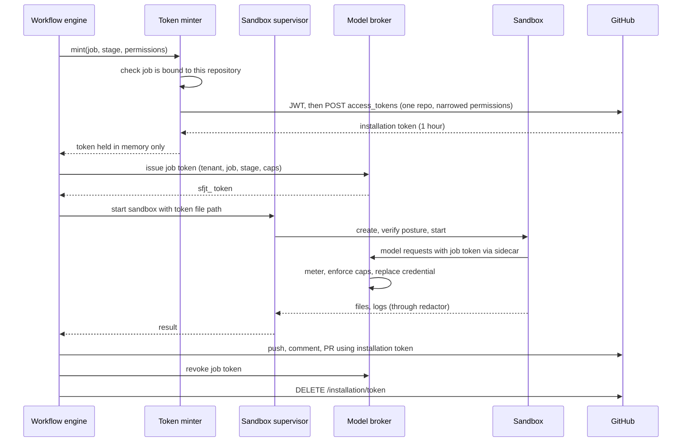

# Secrets and credentials

Status: DESIGNED baseline. Nothing here is implemented. Labels: REQUIRED (the product must do it), DESIGNED (specified, no code), VERIFIED (observed on the development machine or confirmed in vendor documentation during this review, not exercised by the factory), UNVERIFIED (assumption).
Date: 2026-10-27. Revised the same day to match ADR 0005 and ADR 0009: API keys behind a broker are the default and subscription logins are not used (section 4.1), a subscription login on a host needs a signed exception (section 4.5), and authority comes from a named allowlist and not from GitHub roles (section 3.6).
Machine-readable form: `policies/security.yaml` sections `secrets`, `credentials`, `output_hygiene`, `budgets`.
Threat and control IDs refer to `docs/security/threat-model.md`. Test IDs refer to `docs/security/negative-test-catalog.md`.

## 1. Principles

1. **The sandbox holds no real credential.** Not a GitHub token, not the App key, not a provider API key, not a database or object-store credential. It may hold one opaque job token that works only at the model broker.
2. **The control plane holds GitHub credentials, and only one component mints them.** Workers ask the token minter for a token for a specific job. The minter checks that the job is bound to that repository.
3. **Short-lived, narrow, revocable.** Every credential issued per job is scoped to one tenant, one repository and one job, expires with the job, and is revoked when the job ends, fails or is cancelled.
4. **Secrets are never in environment variables of a sandbox, never in command lines, never in logs, events, artifacts, pull request text or model context.** An environment variable is readable through `docker inspect` and `/proc/1/environ` (verified, sandbox-policy.md E16).
5. **Redaction is a second line.** The first line is not having the secret where an agent can touch it.
6. **Revoke first.** A secret that has touched a log, a commit, a chat or an agent's context is treated as compromised. Containment starts with revocation, not cleanup.

## 2. Inventory

| Secret | What it is | Stored in | Read by | Scope and lifetime | Rotation | Reaches the sandbox? |
| --- | --- | --- | --- | --- | --- | --- |
| GitHub App private key | RSA key that signs App JWTs | Secret manager | Token minter only | Authenticates as the App for all installations | Every 90 days; two keys overlap during rotation | Never |
| GitHub installation token | Bearer token for one installation, narrowed per job | Memory of the control plane process | `github` crate for that job | One repository, narrowed permissions, expires one hour after creation (documented), revoked at job end | Per job | Never |
| Webhook secret | HMAC key for `X-Hub-Signature-256` | Secret manager | API webhook receiver | Per App or per webhook | Every 180 days; two secrets overlap | Never |
| Model-provider API keys | Real keys for Anthropic, OpenAI and others | Secret manager | Model broker only | Dedicated to the factory, hard provider-side spend limit | Every 180 days | Never |
| Job token (`sfjt_...`) | Opaque token, 256-bit random | Broker memory and worker tmpfs | Broker (validates), agent CLI (presents) | One tenant, job and stage; allowed models; token and USD caps; expires at job wall clock plus 5 minutes | Per job | Yes, as a read-only file |
| Database, NATS and object-store credentials | Service credentials | Secret manager, injected at service start | Control-plane services | Least privilege per service; audit role has INSERT and SELECT only | Every 180 days; 90 for admin roles | Never |
| Dashboard session and API tokens | User authentication | Cookie or token store | API | Per user, tenant-scoped | Short sessions, step-up for sensitive actions | Never |
| Subscription logins (a claude.ai login for Claude Code, a ChatGPT login for Codex) | A person's interactive login for a vendor CLI | The person's own host (keychain or the tool's own files). Never the factory. | The person | Per the vendor's plan | n/a | Never. Only under a signed exception (section 4.5), and then not into a customer job's sandbox. |
| Spec Kit, package-registry or other tool credentials | Not needed | Not stored | n/a | n/a | n/a | Never. The `fetch_deps` profile uses public, unauthenticated registry reads. Private registry access is a future design with its own review. |

Rotation intervals follow the security specialist's standard: leaked or suspected leaked, revoke immediately (target under one hour from detection); high-privilege long-lived credentials every 90 days; standard service credentials every 180 days. A credential that cannot be rotated without an outage is an architecture defect and gets an issue.

## 3. GitHub App credentials

### 3.1 App registration (REQUIRED)

Permissions requested at registration, from `policies/security.yaml`:

| Permission | Level | Why |
| --- | --- | --- |
| Metadata | read | Mandatory for every App |
| Contents | write | Push factory branches |
| Pull requests | write | Draft pull requests, comments, ready-for-review |
| Issues | write | Read intake issues, comment, manage factory labels |
| Checks | write | Check runs for gate results |
| Commit statuses | write | Statuses where checks are not used |
| Actions | read | Read CI results |

Forbidden permissions, checked at onboarding and on every job start: `administration`, `workflows`, `secrets`, `environments`, `deployments`, `pages`, `packages`, `repository_hooks`, organization administration and members. The `workflows` permission is the one GitHub documents for apps that "access or edit" files in `.github/workflows`. Withholding it is a platform-side backstop for the protected-path rule on CI definitions. The exact refusal behavior of a push that touches workflow files without it was not exercised in this review.

The webhook subscription list is the `webhook.accepted_events` list in the policy.

### 3.2 Authenticating as the App (REQUIRED)

GitHub's documentation, confirmed during this review: the App signs a JWT with `RS256`. Claims: `iss` is the App's client ID (recommended) or App ID, `iat` set 60 seconds in the past to allow for clock drift, `exp` no more than 10 minutes in the future. The factory sets `exp` at most 2 minutes ahead (well under the 10-minute limit), generates a fresh JWT for each minting call, and never stores one. Hosts must have synchronized clocks.

The private key is read from the secret manager into the token minter's memory at start, held in a zeroizing buffer, and never written to disk, logs, traces or events. Only the token minter may hold it. The recommended shape is a small internal service or a module inside the `github` crate that exposes one function: `mint(job_id, stage, permissions) -> installation token`. Workers cannot read the key.

### 3.3 Per-job installation tokens (REQUIRED)

The documented endpoint `POST /app/installations/{installation_id}/access_tokens` accepts a `repositories` (or `repository_ids`) list and a `permissions` object to narrow the token. The token cannot exceed what the installation has. Tokens expire one hour after creation. `DELETE /installation/token` revokes the token used to authenticate the call. All four facts were confirmed in GitHub's documentation during this review.

Rules:

* One token per job, one repository. The request body names exactly one repository.
* Permissions are narrowed per stage. Intake and analysis stages get `contents: read`, `issues: read`, `pull_requests: read`. The delivery stage gets `contents: write`, `pull_requests: write`, `issues: write`, `checks: write`. A token for a stage never carries more than that stage needs.
* The status label and the status comment of a job (ADR 0017) use a token of their own: `issues: write` and `metadata: read` for one repository, and nothing else. It is minted for that purpose and is not a stage token. A stage token is never widened to write issues, and the delivery token is not borrowed. The worker ends that token after each round of writes. This is covered by the tests of the status writer against a fake GitHub server. Against the real GitHub it is unverified.
* The token minter refuses a request when the job's bound repository differs from the requested one, when the job is not in a stage that needs a token, or when the job is cancelled.
* The token lives in memory of the process that performs the GitHub operation. It is never put on a command line, in an environment variable of a child process, in a log, or in a trace. Git pushes use it through an in-process HTTP credential or a `GIT_ASKPASS`-style helper that reads from memory or a short-lived pipe. They never embed it in a remote URL, because URLs end up in process listings and error messages.
* At job end, failure and cancel, the supervisor calls `DELETE /installation/token`. A cleanup sweep also revokes tokens of jobs that ended without a clean shutdown.
* The factory pushes only to branches matching `factory/*`. It enforces that in its own push wrapper, and the repository ruleset enforces it on GitHub's side (section 3.5).

### 3.4 Webhook secret (REQUIRED)

GitHub signs each delivery with `X-Hub-Signature-256` (`sha256=` followed by an HMAC SHA-256 hex digest over the payload, keyed by the secret). The documentation requires a constant-time comparison. The factory computes the HMAC over the raw bytes before any parsing. Deliveries signed only with the legacy SHA-1 header are rejected. During rotation both secrets are accepted for an overlap window, then the old one is dropped. The secret is generated with at least 256 bits of entropy.

The GitHub documentation reviewed does not describe a timestamp or replay protection. Replay defense is the factory's job (`webhook.dedupe` on `X-GitHub-Delivery`, semantic idempotency, and re-fetching state). See T-22.

### 3.5 Repository-side configuration the factory requires

Checked by a preflight at onboarding and at every job start. A repository that fails runs at autonomy level L0 only (no branches, no pull requests):

* Default branch protected; pull request required before merge.
* Required status checks listed with the factory App's ID as the source, so another actor cannot post a status with the same name. (GitHub's branch protection and ruleset settings support pinning a check to an App; not exercised here, UNVERIFIED in detail.)
* The factory App is not in any bypass list; force pushes and branch deletion disabled on the default branch.
* Code owner review required for protected paths, with stale approvals dismissed on new commits.
* A ruleset for `factory/*` that blocks deletion and non-fast-forward updates by anyone other than the factory, if the organization's plan supports it.

### 3.6 Confused-deputy rules

* A job is bound to one repository for its entire life. Work that touches a second repository is a new job with its own authorization (`approval.yaml`, `write_to_additional_repository`).
* The actor who applied the `factory` label is authorized only by membership in the named requester allowlist in protected configuration, matched by the immutable numeric GitHub user ID (a login can be renamed or re-registered by someone else). A GitHub repository role or permission (admin, maintain, write), an organization role and the payload's `author_association` never authorize anything. Removing the entry is the revocation; no GitHub lookup is used to authorize or to revoke. Operators, approvers and security approvers are other designations on the same allowlist (`policies/approval.yaml`, section `authority`).
* Both identities are recorded in audit events: the human who requested or approved, and the App that acted.
* The factory never uses a user's personal token. If a human wants an action, the human performs it, or approves the factory performing it through the App.

## 4. Model-provider credentials

### 4.1 Decision and why

**The default is API keys with a hard provider-side spend limit, held by the model broker. Subscription logins are not used by the factory.** A claude.ai login for Claude Code or a ChatGPT login for Codex cannot be brokered, because the factory cannot put a metering and revoking layer between a person's login and the provider, and it cannot be metered, because the provider's plan and not the factory counts the usage. Whether automated use of a consumer subscription is allowed by the provider's terms is a legal question this document does not answer. ADR 0005 recorded that both tools on the current development machine are logged in by subscription only. Therefore **a real-provider adapter smoke test, and any live end-to-end run with real agents, is BLOCKED until a human supplies API keys with a provider-side spend limit.** Results from the fake runtime in test mode do not substitute for it and must be labelled as fake. This default is decided and pending human confirmation (ADR 0009 item 2); the only way to run a subscription login at all is the documented exception in section 4.5.

REQUIRED: real provider API keys live only in the model broker. The sandbox's agent CLI gets a job token and a base URL that points at the egress sidecar, which relays to the broker. The broker validates the token, meters usage, replaces the credential and forwards only the allowed API paths (`egress.broker_upstreams`).

Why not put the real key in the container with a network allowlist? Because a prompt-injected agent can read its own environment, and an allowlist does not help once the key is inside. A stolen job token is nearly worthless: it works only at the broker, for one job, with a spend cap, and is revoked when the job ends.

The agent-runtime spike tested this design against both tools (`docs/spikes/agent-runtime.md` sections 4.3 and 4.5; Claude Code 2.1.311, Codex 0.163.0; a labelled fake provider, in the hardened `agent` container profile). **Both tools were redirected, and both read the token from a file helper.** (VERIFIED, with the limits of its section 2.2.)

* Claude Code goes to the broker through `ANTHROPIC_BASE_URL` (in the environment or in the `env` block of the `--settings` JSON) and takes its credential from `--settings '{"apiKeyHelper":"cat /run/factory/job-token"}'`. The key reached the provider as `x-api-key`.
* Codex ignores `OPENAI_BASE_URL`. It needs a custom model provider entry (`-c model_provider=...` and `-c model_providers.<id>={..., base_url="http://<sidecar>/v1", wire_api="responses", supports_websockets=false, auth={command="cat", args=["/run/factory/job-token"]}}`). The key reached the provider as `Authorization: Bearer`.
* Neither tool needs the key in an environment variable, and neither strips it from the environment of the commands it runs. The key never appeared in anything a tool printed, including 401 error messages.

NOT verified: a live call to a real provider, which can send headers and events the fake provider does not, and a subscription login (section 4.5). `codex login --with-api-key` and `--bare` authentication play no part in the factory's design: the first writes a key to `~/.codex/auth.json`, and `--bare` reads no OAuth or keychain login and is not used (section 4.5 item 7).

### 4.2 Job token (DESIGNED)

* Format: `sfjt_` followed by 43 or more URL-safe characters carrying at least 256 bits of entropy. The distinctive prefix lets the secret scanner find it (`secrets.patterns`, `factory_job_token`).
* Bound to: tenant, job, stage run. Allowed provider and model list. Per-request and per-token caps. USD cap from `budgets`.
* Lifetime: job wall-clock limit plus 300 seconds. Revoked at job end, on budget exhaustion and on a posture violation.
* Delivery: a read-only file on a worker-side tmpfs, bind-mounted at `/run/factory/job-token` (the constant `JOB_TOKEN_TARGET` of the sandbox port), mode 0400, removed at job end. Claude Code reads it with an `apiKeyHelper` command in the `--settings` JSON, and Codex with the `auth` command of its provider entry. **An environment variable is forbidden for the credential.** It is visible through `docker inspect` and `/proc/1/environ` (E16), and the spike showed that neither tool removes it from the environment of the commands the model runs, so the model's own shell lists it, and the parent's `/proc/<pid>/environ` is readable. With a file helper the variable list holds no credential and the parent's environment holds none (VERIFIED, `claude-toolenv-*`, `codex-toolenv-*`). There is no recorded exception for the two accepted tools. `CLAUDE_CODE_SUBPROCESS_ENV_SCRUB=1` would strip a variable but needs bubblewrap and crashes the tool in this container, so it is not set. The supervisor sets a fixed environment for the commands the agent runs.
* The model can still read the file: `cat /run/factory/job-token` works from a tool call. That is by design and acceptable, because the token works only at the broker, for one job, with a cap, and is revoked when the job ends.
* Revocation does not stop the tools quickly. Claude Code retries a 401 up to ten times with delays that add up to well over a minute (`max_retries: 10`), but it stops at once on a 402 or a 403. Codex retries five times in about six seconds, then fails; it retries a 500 thirty times. So revoking the token ends the spending and not the process. **The supervisor kills the container when the broker revokes the token or the deadline passes**, and the broker answers 402 for a budget stop (NT-BUD-07).
* Storage in the broker: only a hash of the token plus its binding and counters. The broker never logs it.

### 4.3 Real keys

* Dedicated keys for the factory, never reused elsewhere, created with the provider's hard spend or rate limit where offered.
* Stored in the secret manager. Read into the broker at start. Rotated every 180 days or immediately on suspicion.
* Optional per-tenant keys (`tenancy`, and `credentials.model_providers`) when a customer requires that its data not share a provider account with other tenants.
* Provider choice is policy. Sending code to a provider that the tenant has not approved is an org-admin decision (`approval.yaml`, `send_code_to_new_model_provider`).

### 4.4 Fallback if a CLI cannot use the broker (documented residual risk)

**This fallback is not needed for Claude Code 2.1.311 and Codex 0.163.0.** The spike showed that both can be redirected to the broker and both can read the credential from a file (section 4.1). The section stays for a future CLI that cannot, and for no other reason. The factory does not ship an adapter in this mode for the two accepted tools.

If an adapter cannot be pointed at the broker, the only remaining option is to give that agent container a real provider key and a CONNECT-only allowlist to the provider's API host. Then:

* The key can be stolen by a controlled agent and used from anywhere until rotated. Use a dedicated, spend-limited key, one per job where the provider permits, rotated on a short schedule.
* The adapter is labeled `credential_in_sandbox` in its manifest. It cannot run for tenants whose policy forbids it. It always needs a human approval to enable. Its residual risk is High and is recorded in the risk register.
* The agent profile still has no GitHub credential and no other route to the network.

Do not ship an adapter in this mode silently.

### 4.5 Exception: a subscription login on the host (not the default)

ADR 0009 names one way to reverse the default: a human accepts subscription logins on the host for a named demo profile, after the legal question is settled. This section says what that written exception must contain. Nothing here enables it. `credentials.model_providers.subscription_logins.exception.enabled` stays `false` until a signed record exists, and accepting one is an always-human action (`approval.yaml`, `accept_subscription_login_exception`).

The record must state every item below. A missing item makes the exception invalid.

1. **Decision.** Signed by one `org_admin` and one `security_approver`, two different people, both on the allowlist.
2. **Terms determination.** A written statement by a person qualified to read the provider's terms that this use is allowed, with the date and the version of the terms reviewed. This document does not assert what any provider's terms say.
3. **Named demo profile.** One profile name, one purpose (for example recording the Slice 1 end-to-end demonstration), one owner, and an expiry of at most 30 days. Renewal is a new decision.
4. **Scope.** A throwaway fixture repository made for the demonstration. No customer repository, no customer data, no tenant other than the demo tenant, no production credential on the machine.
5. **Host and account.** A dedicated machine or user account that holds no factory secret (no App key, no webhook secret, no provider API key, no database credential), is not the control plane and is not shared. The login belongs to an account made for this purpose, not a person's primary account, with multi-factor authentication on.
6. **Placement.** The record names where the tool runs. Preferred: the host tool bridge from ADR 0005, where the tool stays on the host with its built-in shell and edit tools disabled and every action runs in the hardened sandbox, so the sandbox never holds the login. If the bridge does not exist, the tool runs inside the sandbox with the login file mounted. Then a prompt-injected agent can read the login and take over the account. The record must say so and accept that for the fixture repository only.
7. **Controls that are lost, stated plainly.** `--bare` never reads OAuth or the keychain (stated in `claude --help`), so a subscription login cannot use it. The factory's flags do not rely on `--bare` (the spike showed it does not stop the `env` block of a repository settings file), so nothing is lost on that count: the run keeps `--setting-sources user`, `--strict-mcp-config` and the per-stage skill profile, which neutralized the hostile workspace in the spike. What the exception does lose is the clean home: a login lives in the home directory or the keychain, so the empty `HOME=/tmp` of the normal profile cannot be used. The exception compensates by allowing only a fixture repository written by the factory team. Whether the flags still neutralize the repository once a login file is in the home is UNVERIFIED. There is no broker, so there is no factory-side budget for this profile: NT-BUD-01 and NT-BUD-07 do not apply. The only caps are the plan's own limit and the wall-clock and request counts the supervisor can see. The record names the person who watches usage.
8. **Labelling.** Every result carries `fidelity: host_subscription_demo` in the evidence ledger and in every report. Such a run is a demonstration. It does not count as the real-provider smoke test unless the signed decision says that it does and why.
9. **Revocation and cleanup.** When the exception ends, or earlier, log out of the tool on the demo host, delete the tool's local credential files, and record that in the audit stream. On any suspicion of compromise, revoke the session from the provider's account page first.
10. **Audit.** The decision, the start, every run and the end are audit events that carry the decision ID.

What the exception never changes: a subscription login is never used for any tenant or customer, never stored by the factory, never placed in a customer job's sandbox, and never used by the scheduler on its own.

## 5. Job credential lifecycle

## 6. What must never reach each sink

Rows are sinks. Columns are classes. "Never" means a match is a defect; the sink policy in `secrets.sinks` says whether the product redacts or blocks.

| Sink | GitHub tokens, App key, webhook secret | Real provider keys | Job tokens | Service credentials (DB, NATS, object store) | Secret-bearing repo files (`.env`, keys) | Held-out evaluation data | Other tenants' data |
| --- | --- | --- | --- | --- | --- | --- | --- |
| Logs and traces | Never (redact) | Never (redact) | Never (redact) | Never (redact) | Never (redact) | Never | Never |
| Domain events (outbox, NATS) | Never (block) | Never (block) | Never (block) | Never (block) | Never (block) | Never | Never |
| Artifacts and evidence manifests | Never (block) | Never (block) | Never (block) | Never (block) | Never (block) | Never | Never |
| Pull request title, body, comments, commit messages, branch names, check output | Never (block) | Never (block) | Never (block) | Never (block) | Never (block) | Never | Never |
| Code diff | Never (block) | Never (block) | Never (block) | Never (block) | Never (block) | Never | Never |
| Model context (prompts, tool results, retrieved context) | Never | Never | Never | Never | Never (deny-read; redact) | Never | Never |
| Sandbox environment, files and processes | Never | Never | Only the one job token for the job | Never | Never in the checkout (sparse-excluded) | Only in `verify`, read-only | Never |
| Dashboard and API responses | Never (redact) | Never (redact) | Never (redact) | Never (redact) | Never | Never | Never |
| Process command lines on any host | Never | Never | Never | Never | n/a | n/a | n/a |
| Error messages to clients | Never | Never | Never | Never | Never | Never | Never |

Specific model-context exclusions beyond secrets: held-out evaluation data, builder self-justification when building a reviewer's context, other tenants' memory and retrieval results.

## 7. Redaction architecture (REQUIRED)

One `Redactor` component with one implementation, used by every sink (logging layer, trace exporter, outbox writer, artifact writer, GitHub client, prompt builder, API serializer). A sink that bypasses it is a defect.

Inputs:

1. **Exact-value registry.** The values of every secret the factory loads or issues (job tokens, webhook secret, App key, database and broker credentials, provider keys, installation tokens as they are minted). Entries shorter than 8 characters are not registered. The registry stores values in memory only. Each value is matched in the encodings listed in `secrets.exact_values.encodings`: raw, base64 (standard, URL-safe, no padding), hex (both cases), percent-encoding and JSON-escaped.
2. **Patterns.** The vendor formats in `secrets.patterns` (GitHub token prefixes, fine-grained PATs, PEM private keys, Anthropic and OpenAI keys, AWS, Google, Slack, Stripe, npm, PyPI, JWT, bearer headers, URLs with embedded credentials, the factory's own `sfjt_` token). The patterns compile with the Rust `regex` crate and were checked against positive and negative samples in this review. Two formats (`crates_io_token`, `nats_credentials`) are marked unverified: confirm the vendor format before relying on them.
3. **Heuristics.** A generic `password=` style assignment and a Shannon-entropy check. They flag; they do not block, to keep false positives from stopping real work.

Behavior:

* Streaming: output is processed with a sliding window so a secret split across chunks or interleaved with ANSI escape codes is still caught.
* Per sink: logs, traces, model context and API responses are redacted (`[REDACTED:<id>]`) and a `secret_redacted` audit event is written. Domain events, artifacts, diffs and any text sent to GitHub are blocked, because silent redaction would change what a human reviews. Blocking fails the step with BLOCK.
* Failure: if the redactor errors, content is dropped and the step fails. Raw content is never written because the redactor was unavailable.
* Telemetry: trace and log attributes use an allowlist of names. Prompts and tool arguments are stored as hashes plus an artifact pointer, not inline.
* The `--log-driver none` setting keeps the Docker daemon from keeping a raw copy of sandbox output (verified; the default driver kept a readable copy).

Detection beyond the factory's own output: the `secrets.patterns` are also used by the secret-scan gate on diffs and on target repositories (gitleaks-class scanners remain in the quality gate list). Pre-commit and CI scanning for this repository follow the security specialist's secrets standard: scan full history, pin actions to commit SHAs, justify every allowlist entry.

For this repository, `.gitleaks.toml` carries the `secrets.patterns` whose action is `block` as gitleaks rules (id `policy_` plus the pattern id, regex copied unchanged) next to the tool's default rules, and `scripts/ci.sh` step `secret-scan` runs it over the full history (negative-test-catalog ST-08). The patterns with the action `flag` (`generic_assignment`, the entropy heuristic) are not ported, because gitleaks cannot flag without failing. Two allowlist entries exist, both for made-up values in the observability crate's scrubber tests and doc comment; each needs the file path and the exact text, and each carries a reason and a review-by date in the file. The policy file stays the source of truth: a change to a pattern there needs the matching change in `.gitleaks.toml` in the same pull request. Dependency licenses, advisories and sources are checked by `deny.toml` under the rule in `supply_chain.licenses`.

## 8. Storage and handling in the control plane

* Secrets come from the secret manager at process start, or from short-lived dynamic credentials where the manager supports them (database credentials with a TTL are preferred over static passwords). The choice of manager is an open decision (threat model Q4).
* Local development: `.env` files are for development only, never committed. The repository `.gitignore` already ignores `.env` and `.env.*` and allows `.env.example`, which carries placeholder names and values only. Development uses fake GitHub App credentials against a fake GitHub server, and a fake model adapter. Real keys are never used in automated tests; tests use fake secrets with real formats to exercise the redactor.
* Docker Compose for local development must read credentials from environment substitution, not from literals in the file.
* No secret on a command line, in a URL, or in a process environment of a child process the agent can influence.
* Secrets in memory use zeroizing buffers where the language allows. Crash dumps and core files are disabled for processes holding keys.
* Access to the secret manager is logged. The audit stream records mint, use class and revoke events for credentials, never values.

## 9. Rotation and leak response

Rotation:

| Credential | Interval | Method |
| --- | --- | --- |
| GitHub App private key | 90 days | Generate a second key in the App settings, deploy it, verify mints succeed, delete the old key |
| Webhook secret | 180 days | Add the new secret to the accepted set, change it in GitHub, drop the old one after the overlap |
| Provider API keys | 180 days | Create a new key, switch the broker, revoke the old key |
| Service credentials | 180 days, 90 for admin roles | Dynamic credentials where possible |
| Job tokens, installation tokens | Per job | Automatic |

Leak playbook, revoke first, in order:

1. Revoke or rotate at the provider. Installation tokens: `DELETE /installation/token` or let the one-hour expiry run if the token is already dead. Job tokens: revoke in the broker. App key: delete the key in the App settings and deploy the new one. Webhook secret: change it. Provider keys: revoke in the provider console.
2. Assess the blast radius with the audit stream for the whole exposure window, starting from the time of exposure and not the time of detection.
3. Clean copies (history rewrite, log purge) after revocation. Cleanup does not contain a credential that was already harvested.
4. Record the incident and the decision. Add or fix the pattern or exact-value registration that should have caught it, and add a regression test (NT-SEC-01 variants).

## 10. Tests that prove this document

* NT-SEC-01 to NT-SEC-11: canary sweep across all sinks, redaction evasion, GitHub-bound blocking, markdown exfiltration, diff secrets, redactor failure, context builder, error messages and telemetry, process arguments and environment, token revocation, model-context exclusions.
* NT-SBX-13: the sandbox contains no real credential.
* NT-AUTHZ-06, NT-AUTHZ-07, NT-AUTHZ-09: token narrowing, stage permissions, forbidden App permissions.
* NT-AUTHZ-01, NT-AUTHZ-02, NT-AUTHZ-04: authority comes from the allowlist by numeric user ID, and GitHub roles, `author_association` and a matching login with a different ID grant nothing.
* NT-WH-01 to NT-WH-03, NT-WH-08: webhook signature handling and secret rotation.

## 11. Not verified

* Agent CLI behavior with a real provider. With a broker base URL and a file-based key helper the two accepted CLIs are VERIFIED against a fake provider (sections 4.1, 4.2); what a real provider accepts or refuses (the statuses 401, 402, 403, 429 and 529, thinking blocks, parallel tool calls) is BLOCKED until a human supplies API keys with a spend limit. A subscription login was not used at all.
* GitHub's refusal behavior for workflow-file pushes without the `workflows` permission, and check-source pinning to an App ID.
* The format of crates.io API tokens and NATS credential files used in two redaction patterns.
* Whether issue templates and automation can apply labels on behalf of a low-privilege author, and which GitHub API reports the numeric ID of the person who applied a label, so that the factory can compare it with the allowlist (threat T-23).
* Everything about the secret manager, because none is chosen.
