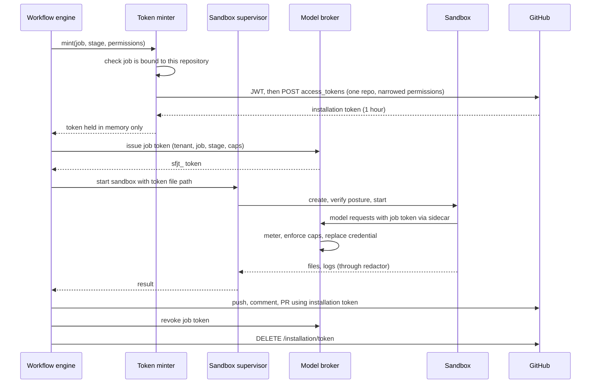

# Secrets and credentials

Status: DESIGNED baseline. Nothing here is implemented. Labels: REQUIRED (the product must do it), DESIGNED (specified, no code), VERIFIED (observed on the development machine or confirmed in vendor documentation during this review, not exercised by the factory), UNVERIFIED (assumption).
Date: 2026-10-27. Revised the same day to match ADR 0005 and ADR 0009, and authority comes from a named allowlist and not from GitHub roles (section 3.6). Revised on 2026-11-12 to match ADR 0020: the factory runs on the owner's Claude subscription by default, with the subscription token held by the broker (sections 4.1 and 4.5); API keys behind the broker are the alternative mode.
Machine-readable form: `policies/security.yaml` sections `secrets`, `credentials`, `output_hygiene`, `budgets`.
Threat and control IDs refer to `docs/security/threat-model.md`. Test IDs refer to `docs/security/negative-test-catalog.md`.

## 1. Principles

1. **The sandbox holds no real credential.** Not a GitHub token, not the App key, not a provider API key or the owner's subscription token, not a database or object-store credential. It may hold one opaque job token that works only at the model broker.
2. **The control plane holds GitHub credentials, and only one component mints them.** Workers ask the token minter for a token for a specific job. The minter checks that the job is bound to that repository.
3. **Short-lived, narrow, revocable.** Every credential issued per job is scoped to one tenant, one repository and one job, expires with the job, and is revoked when the job ends, fails or is cancelled.
4. **Secrets are never in environment variables of a sandbox, never in command lines, never in logs, events, artifacts, pull request text or model context.** An environment variable is readable through `docker inspect` and `/proc/1/environ` (verified, sandbox-policy.md E16).
5. **Redaction is a second line.** The first line is not having the secret where an agent can touch it.
6. **Revoke first.** A secret that has touched a log, a commit, a chat or an agent's context is treated as compromised. Containment starts with revocation, not cleanup.

## 2. Inventory

| Secret | What it is | Stored in | Read by | Scope and lifetime | Rotation | Reaches the sandbox? |
| --- | --- | --- | --- | --- | --- | --- |
| GitHub App private key | RSA key that signs App JWTs | Secret manager | Token minter only | Authenticates as the App for all installations | Every 90 days; two keys overlap during rotation | Never |
| GitHub installation token | Bearer token for one installation, narrowed per job | Memory of the control plane process | `github` crate for that job | One repository, narrowed permissions, expires one hour after creation (documented), revoked at job end | Per job | Never |
| Webhook secret | HMAC key for `X-Hub-Signature-256` | Secret manager | API webhook receiver | Per App or per webhook | Every 180 days; two secrets overlap | Never |
| Claude subscription token (mode `subscription`, the default) | The owner's long-lived token, made with `claude setup-token`, prefix `sk-ant-oat01-`. It is tied to the owner's Claude account | Secret manager, or a file of mode 0600 named by `broker.upstreams[].key_file` (for example `~/claud-oauth-token.txt`) | Model broker only | The owner's plan: no provider-side spend limit; the factory's own ceilings and the plan's limits bound use | Every 180 days, and at once on suspicion (revoke it from the Claude account) | Never |
| Model-provider API keys (mode `api_key`) | Real keys for Anthropic and OpenAI | Secret manager | Model broker only | Dedicated to the factory, hard provider-side spend limit | Every 180 days | Never |
| Job token (`sfjt_...`) | Opaque token, 256-bit random | Broker memory and worker tmpfs | Broker (validates), agent CLI (presents) | One tenant, job and stage; allowed models; token and USD caps; expires at job wall clock plus 5 minutes | Per job | Yes, as a read-only file |
| Database, NATS and object-store credentials | Service credentials | Secret manager, injected at service start | Control-plane services | Least privilege per service; audit role has INSERT and SELECT only | Every 180 days; 90 for admin roles | Never |
| Dashboard session and API tokens | User authentication | Cookie or token store | API | Per user, tenant-scoped | Short sessions, step-up for sensitive actions | Never |
| Interactive logins (a claude.ai login in `~/.claude`, a ChatGPT login in `~/.codex/auth.json`) | A person's own login for a vendor CLI, with refreshing tokens | The person's own host. Never the factory. | The person | Per the vendor's plan | n/a | Never. The factory uses the long-lived subscription token above, not the interactive login, and does not broker Codex's ChatGPT login (section 4.5). |
| Spec Kit, package-registry or other tool credentials | Not needed | Not stored | n/a | n/a | n/a | Never. The `fetch_deps` profile uses public, unauthenticated registry reads. Private registry access is a future design with its own review. |

Rotation intervals follow the security specialist's standard: leaked or suspected leaked, revoke immediately (target under one hour from detection); high-privilege long-lived credentials every 90 days; standard service credentials every 180 days. A credential that cannot be rotated without an outage is an architecture defect and gets an issue.

## 3. GitHub App credentials

### 3.1 App registration (REQUIRED)

Permissions requested at registration, from `policies/security.yaml`:

| Permission | Level | Why |
| --- | --- | --- |
| Metadata | read | Mandatory for every App |
| Contents | write | Push factory branches |
| Pull requests | write | Draft pull requests, comments, ready-for-review |
| Issues | write | Read intake issues, comment, manage factory labels |
| Checks | write | Check runs for gate results |
| Commit statuses | write | Statuses where checks are not used |
| Actions | read | Read CI results |
| Administration | read | Read classic branch protection of the default branch in the protection preflight (owner's decision of 2026-11-12) |

Each required level is also the most the App may hold of that permission: an App that holds a required permission at a higher level (such as `administration: write`) is refused at onboarding and at job start like an App that holds a forbidden permission (`audit_app` in `crates/github/src/permissions.rs`; the policy check refuses a file that lists a permission as both required and forbidden).

Forbidden permissions, checked at onboarding and on every job start: `workflows`, `secrets`, `environments`, `deployments`, `pages`, `packages`, `repository_hooks`, organization administration and members. The `workflows` permission is the one GitHub documents for apps that "access or edit" files in `.github/workflows`. Withholding it is a platform-side backstop for the protected-path rule on CI definitions. The exact refusal behavior of a push that touches workflow files without it was not exercised in this review.

The webhook subscription list is the `webhook.accepted_events` list in the policy.

### 3.2 Authenticating as the App (REQUIRED)

GitHub's documentation, confirmed during this review: the App signs a JWT with `RS256`. Claims: `iss` is the App's client ID (recommended) or App ID, `iat` set 60 seconds in the past to allow for clock drift, `exp` no more than 10 minutes in the future. The factory sets `exp` at most 2 minutes ahead (well under the 10-minute limit), generates a fresh JWT for each minting call, and never stores one. Hosts must have synchronized clocks.

The private key is read from the secret manager into the token minter's memory at start, held in a zeroizing buffer, and never written to disk, logs, traces or events. Only the token minter may hold it. The recommended shape is a small internal service or a module inside the `github` crate that exposes one function: `mint(job_id, stage, permissions) -> installation token`. Workers cannot read the key.

### 3.3 Per-job installation tokens (REQUIRED)

The documented endpoint `POST /app/installations/{installation_id}/access_tokens` accepts a `repositories` (or `repository_ids`) list and a `permissions` object to narrow the token. The token cannot exceed what the installation has. Tokens expire one hour after creation. `DELETE /installation/token` revokes the token used to authenticate the call. All four facts were confirmed in GitHub's documentation during this review.

Rules:

* One token per job, one repository. The request body names exactly one repository.
* Permissions are narrowed per stage. The intake stage gets `issues: read` and `metadata: read` only (LB-03): it reads one issue and its events and has no use for the repository contents or for pull requests. Before a job is admitted, the protection preflight reads the workflow files of the default branch (threat T-48) with a separate token, `contents: read` and `metadata: read` for the one repository, held by the worker and never by a sandbox; the loopback judgment allows it only the repository, branch and contents routes, and only paths under `.github/workflows` (an amendment to LB-03 accepted by the owner on 2026-11-12). The same preflight reads the classic branch protection of the default branch with a fourth token class, `administration: read` and `metadata: read` for the one repository (`PermissionSet::protection_reader`), also held by the worker's deterministic code and never by a sandbox or a stage; the loopback judgment allows it the protection route alone, and refuses that route to every other token (the owner's decision of 2026-11-12). The other analysis stages get `contents: read`, `issues: read`, `pull_requests: read`. The delivery stage gets `contents: write`, `pull_requests: write`, `issues: write`, `checks: write`. A token for a stage never carries more than that stage needs.
* A comment that answers a person (the reply to a label from someone who may not ask, the reply about a refused design, the acknowledgement of a decision) is posted with the token class for a comment (SF-14): `issues: write` and `metadata: read` for the one repository, and nothing else, even when the stage in the scope holds more (the approval stage also reads contents and pull requests, and the delivery stage writes contents, pull requests and checks). A stage that does not hold `issues: write` keeps its own token for the call, so the code host refuses the comment. The search for the marker of a comment that was posted already uses the same token. The test is `sf_14_a_comment_is_posted_with_the_right_to_write_issues_and_the_metadata_only` against the fake code host (`crates/github/tests/negative_tokens.rs`), and the deliberate break that sends a comment back to the token of its stage is in `crates/github/tests/mutations/comment_token_breaks.py`. The test rig of the composed run does not model token classes, so its recording of the reply shows the token of the approval stage; the narrowing is shown by the adapter's test and not by the recording, and against the real GitHub it is unverified.
* The status label and the status comment of a job (ADR 0017) use a token of their own: `issues: write` and `metadata: read` for one repository, and nothing else. It is minted for that purpose and is not a stage token. A stage token is never widened to write issues, and the delivery token is not borrowed. The worker ends that token after each round of writes. This is covered by the tests of the status writer against a fake GitHub server. Against the real GitHub it is unverified.
* The token minter refuses a request when the job's bound repository differs from the requested one, when the job is not in a stage that needs a token, or when the job is cancelled.
* The token lives in memory of the process that performs the GitHub operation. It is never put on a command line, in an environment variable of a child process, in a log, or in a trace. Git pushes use it through an in-process HTTP credential or a `GIT_ASKPASS`-style helper that reads from memory or a short-lived pipe. They never embed it in a remote URL, because URLs end up in process listings and error messages.
* At job end, failure and cancel, the supervisor calls `DELETE /installation/token`. A cleanup sweep also revokes tokens of jobs that ended without a clean shutdown.
* A job that stays `BLOCKED` is not over, so its tokens used to live until GitHub expired them (LB-04). The sweep now also revokes the tokens of a job that has been `BLOCKED` for `credentials.github_app.installation_token.revoke_when_blocked_after_s` (900 seconds; a value under 60 or over 86400 refuses the policy file). It revokes without ending the job: if an operator unblocks or overrides the job, its next call mints a new token. Only `BLOCKED` counts. A job that waits for a person (`WAITING_FOR_HUMAN`), a paused job and an active job keep their tokens, because a person is expected. The count starts at the first pass of the worker that sees the job blocked, so a restart starts it again (and the tokens, which live in the memory of the process, are gone with it). A token lives an hour at most, so a bound at or above an hour only revokes a token minted after the block began; a shorter bound is what shortens the exposure of one minted before it.
* The token minted for a comment that answers a person (a design refusal, an environment notice) is a token of its own for a fresh identifier. It is revoked on every outcome, also when the comment is for later (DG-9); a revocation that fails is kept by the adapter and tried again by the cleanup sweep, which finds the identifier open nowhere.
* The factory pushes only to branches matching `factory/*`. It enforces that in its own push wrapper, and the repository ruleset enforces it on GitHub's side (section 3.5).

### 3.4 Webhook secret (REQUIRED)

GitHub signs each delivery with `X-Hub-Signature-256` (`sha256=` followed by an HMAC SHA-256 hex digest over the payload, keyed by the secret). The documentation requires a constant-time comparison. The factory computes the HMAC over the raw bytes before any parsing. Deliveries signed only with the legacy SHA-1 header are rejected. During rotation both secrets are accepted for an overlap window, then the old one is dropped. The secret is generated with at least 256 bits of entropy.

The GitHub documentation reviewed does not describe a timestamp or replay protection. Replay defense is the factory's job (`webhook.dedupe` on `X-GitHub-Delivery`, semantic idempotency, and re-fetching state). See T-22.

### 3.5 Repository-side configuration the factory requires

Checked by a preflight at onboarding and at every job start. A repository that fails runs at autonomy level L0 only (no branches, no pull requests):

* Default branch protected; pull request required before merge.
* Required status checks listed with the factory App's ID as the source, so another actor cannot post a status with the same name. (GitHub's branch protection and ruleset settings support pinning a check to an App; not exercised here, UNVERIFIED in detail.)
* The factory App is not in any bypass list; force pushes and branch deletion disabled on the default branch.
* Code owner review required for protected paths, with stale approvals dismissed on new commits.
* The ruleset requires at least as many approving reviews as every pull request needs by `policies/approval.yaml` (the smallest `required_approvals` of the risk tiers, 1 today). A count that cannot be read fails the preflight like a count that is too low (SF-07).
* A ruleset for `factory/*` that blocks deletion and non-fast-forward updates by anyone other than the factory, if the organization's plan supports it.

### 3.6 Confused-deputy rules

* A job is bound to one repository for its entire life. Work that touches a second repository is a new job with its own authorization (`approval.yaml`, `write_to_additional_repository`).
* The actor who applied the `factory` label is authorized only by membership in the named requester allowlist in protected configuration, matched by the immutable numeric GitHub user ID (a login can be renamed or re-registered by someone else). A GitHub repository role or permission (admin, maintain, write), an organization role and the payload's `author_association` never authorize anything. Removing the entry is the revocation; no GitHub lookup is used to authorize or to revoke. Operators, approvers and security approvers are other designations on the same allowlist (`policies/approval.yaml`, section `authority`).
* Both identities are recorded in audit events: the human who requested or approved, and the App that acted.
* The factory never uses a user's personal token. If a human wants an action, the human performs it, or approves the factory performing it through the App.

## 4. Model-provider credentials

### 4.1 Decision and why

**The default is the owner's Claude subscription, held by the model broker (mode `subscription`, ADR 0020, the owner's decision of 2026-11-12, which reverses ADR 0009 item 2). The alternative is API keys with a hard provider-side spend limit, held by the broker (mode `api_key`).** The mode is `credentials.model_providers.mode` in `policies/security.yaml`; a file without it means `subscription`. In both modes the broker design is the same: the sandbox holds only a per-job token and a base URL that points at the egress sidecar, which relays to the broker; the broker validates the token, meters usage, puts the real credential on the request and forwards only the allowed API paths (`egress.broker_upstreams`).

In subscription mode:

* **The real credential is the subscription token**, a long-lived token the owner makes with `claude setup-token` (prefix `sk-ant-oat01-`). It is read from the file named by the Anthropic entry of `broker.upstreams` (`key_file`), checked at start-up (mode 0600 or stricter, the prefix, no whitespace inside: a token wrapped when it was copied is refused by name), registered with the redactor as `subscription_token`, and never placed in a sandbox, a command line or a log. The existing `anthropic_api_key` pattern of `secrets.patterns` (`sk-ant-...`) also matches it.
* **The broker sends it as `Authorization: Bearer`** with `anthropic-beta: oauth-2025-04-20` (always added) next to the betas Claude Code sends, and the broker's own user agent. Before it forwards a Messages request it checks that the system prompt opens with a Claude Code identity (section 4.5), and it never rewrites the system prompt.
* **Claude Code gets the job token as its OAuth token**, `CLAUDE_CODE_OAUTH_TOKEN`, set by a fixed launcher line from the token file (section 4.2), not through `apiKeyHelper`.
* **No provider API key and no provider-side spend limit is required.** A subscription has no spend limit the factory can set. Spend is bounded by the factory's own ceilings (the job and day ceilings of `budgets` and `policies/model_routing.yaml`, measured as the list-price equivalent the broker computes from the token counts of every answer) and by the plan's own usage limits. A plan limit reaches the broker as HTTP 429: it is recorded by name (`provider_rate_limited`), charged nothing, and does not revoke the token or fail the job (section 4.5).
* **Codex is unavailable.** Codex is logged in with ChatGPT (`~/.codex/auth.json`, refreshing tokens), which the broker does not relay. A configuration that lists an `openai` upstream in this mode is BLOCKED by name (`agent runtime codex-cli`) and the worker claims nothing; it does not fall back to another tool. The cost: the three review roles whose policy says the reviewer must be of another model family than the author (`policies/model_routing.yaml` section 4) find no independent model and wait for a person.

In API-key mode, everything in this section before 2026-11-12 holds: dedicated keys with a hard provider-side spend limit, one per provider, for both tools.

Why not put the real credential in the container with a network allowlist? Because a prompt-injected agent can read its own environment, and an allowlist does not help once the credential is inside. A stolen job token is nearly worthless: it works only at the broker, for one job, with a spend cap, and is revoked when the job ends. This matters more for the subscription token than for an API key: it is tied to a person's account.

The agent-runtime spike tested the broker design against both tools (`docs/spikes/agent-runtime.md` sections 4.3 and 4.5; Claude Code 2.1.311, Codex 0.163.0; a labelled fake provider, in the hardened `agent` container profile). **Both tools were redirected, and both read the token from a file helper.** (VERIFIED, with the limits of its section 2.2.)

* Claude Code goes to the broker through `ANTHROPIC_BASE_URL` (in the environment or in the `env` block of the `--settings` JSON). In API-key mode it takes its credential from `--settings '{"apiKeyHelper":"cat /run/factory/job-token"}'`, and the key reached the provider as `x-api-key`. In subscription mode it takes `CLAUDE_CODE_OAUTH_TOKEN` and sends it as `Authorization: Bearer` with the OAuth beta (VERIFIED for 2.1.323 by the owner on 2026-11-12, and in the hardened container with 2.1.311 by `negative_nt_inj_07_and_nt_tool_06_hold_in_subscription_mode`).
* Codex ignores `OPENAI_BASE_URL`. It needs a custom model provider entry (`-c model_provider=...` and `-c model_providers.<id>={..., base_url="http://<sidecar>/v1", wire_api="responses", supports_websockets=false, auth={command="cat", args=["/run/factory/job-token"]}}`). The key reached the provider as `Authorization: Bearer`. API-key mode only.
* Neither tool needs the key in an environment variable of the container. The key never appeared in anything a tool printed, including 401 error messages.

The owner's live checks of 2026-11-12 (ADR 0020) are the first calls with a real credential: the subscription token, straight to `api.anthropic.com` and through Claude Code. NOT verified: a call from the real broker to the real provider (the live check of ADR 0020 does it, and the owner runs it), and any call with an API key. `codex login --with-api-key` and `--bare` authentication play no part in the factory's design: the first writes a key to `~/.codex/auth.json`, and `--bare` reads no OAuth or keychain login and is not used.

### 4.2 Job token (DESIGNED)

* Format: `sfjt_` followed by 43 or more URL-safe characters carrying at least 256 bits of entropy. The distinctive prefix lets the secret scanner find it (`secrets.patterns`, `factory_job_token`).
* Bound to: tenant, job, stage run. Allowed provider and model list. Per-request and per-token caps. USD cap from `budgets`.
* Lifetime: job wall-clock limit plus 300 seconds. Revoked at job end, on budget exhaustion and on a posture violation.
* Delivery: a read-only file on a worker-side tmpfs, bind-mounted at `/run/factory/job-token` (the constant `JOB_TOKEN_TARGET` of the sandbox port), mode 0400, removed at job end. In API-key mode Claude Code reads it with an `apiKeyHelper` command in the `--settings` JSON. In subscription mode the adapter starts Claude Code through a fixed launcher line, `/bin/sh -c 'CLAUDE_CODE_OAUTH_TOKEN="$(/usr/bin/cat /run/factory/job-token)" ...; exec "$0" "$@"' <claude> <flags>`, so the job token is in the tool's own process environment but never in the container's configuration (`docker inspect`), the argument vector or a log; Claude Code keeps `CLAUDE_CODE_OAUTH_TOKEN` out of the environment of the commands its shell tool runs (VERIFIED on 2026-11-12: 2.1.323 on the development machine and 2.1.311 in the hardened container, test `negative_nt_inj_07_and_nt_tool_06_hold_in_subscription_mode`). Codex reads the file with the `auth` command of its provider entry. **An environment variable of the container is forbidden for the credential.** It is visible through `docker inspect` and `/proc/1/environ` (E16), and the spike showed that neither tool removes it from the environment of the commands the model runs, so the model's own shell lists it, and the parent's `/proc/<pid>/environ` is readable. With a file helper the variable list holds no credential and the parent's environment holds none (VERIFIED, `claude-toolenv-*`, `codex-toolenv-*`). There is no recorded exception for the two accepted tools. `CLAUDE_CODE_SUBPROCESS_ENV_SCRUB=1` would strip a variable but needs bubblewrap and crashes the tool in this container, so it is not set. The supervisor sets a fixed environment for the commands the agent runs.
* The model can still read the file: `cat /run/factory/job-token` works from a tool call. That is by design and acceptable, because the token works only at the broker, for one job, with a cap, and is revoked when the job ends.
* Revocation does not stop the tools quickly. Claude Code retries a 401 up to ten times with delays that add up to well over a minute (`max_retries: 10`), but it stops at once on a 402 or a 403. Codex retries five times in about six seconds, then fails; it retries a 500 thirty times. So revoking the token ends the spending and not the process. **The supervisor kills the container when the broker revokes the token or the deadline passes**, and the broker answers 402 for a budget stop (NT-BUD-07).
* Storage in the broker: only a hash of the token plus its binding and counters. The broker never logs it.

### 4.3 Real API keys (mode `api_key`)

* Dedicated keys for the factory, never reused elsewhere, created with the provider's hard spend or rate limit where offered.
* Stored in the secret manager. Read into the broker at start. Rotated every 180 days or immediately on suspicion.
* Optional per-tenant keys (`tenancy`, and `credentials.model_providers`) when a customer requires that its data not share a provider account with other tenants.
* Provider choice is policy. Sending code to a provider that the tenant has not approved is an org-admin decision (`approval.yaml`, `send_code_to_new_model_provider`).

### 4.4 Fallback if a CLI cannot use the broker (documented residual risk)

**This fallback is not needed for Claude Code 2.1.311 and Codex 0.163.0.** The spike showed that both can be redirected to the broker and both can read the credential from a file (section 4.1). The section stays for a future CLI that cannot, and for no other reason. The factory does not ship an adapter in this mode for the two accepted tools.

If an adapter cannot be pointed at the broker, the only remaining option is to give that agent container a real provider key and a CONNECT-only allowlist to the provider's API host. Then:

* The key can be stolen by a controlled agent and used from anywhere until rotated. Use a dedicated, spend-limited key, one per job where the provider permits, rotated on a short schedule.
* The adapter is labeled `credential_in_sandbox` in its manifest. It cannot run for tenants whose policy forbids it. It always needs a human approval to enable. Its residual risk is High and is recorded in the risk register.
* The agent profile still has no GitHub credential and no other route to the network.

Do not ship an adapter in this mode silently.

### 4.5 Subscription mode: what the broker checks and what is lost

The signed exception that this section used to describe (a subscription login on a demo host, `subscription_logins`, `accept_subscription_login_exception`) is gone: the owner made the subscription the default (ADR 0020). What replaces it:

1. **Only the broker holds the token.** `credentials.model_providers.subscription_token` says so (`held_by: [model_broker]`, `never_in_sandbox: true`), and the policy loader refuses a file that says otherwise. The interactive login in `~/.claude` is not used: a clean, empty home per run stays, with `--setting-sources user` and `--strict-mcp-config`.
2. **The request is shaped like Claude Code's own.** The provider accepts a subscription token only when the system prompt opens with a Claude Code identity and the OAuth beta is present, and it answers a request without the identity with HTTP 429 `rate_limit_error`, which is indistinguishable from a plan limit (VERIFIED by the owner on 2026-11-12). So the broker refuses such a request itself, with HTTP 400 and the audit detail `subscription_identity_missing`, and a 429 that comes back is a real limit. The identities accepted are "You are Claude Code, Anthropic's official CLI for Claude." and "You are a Claude agent, built on Anthropic's Claude Agent SDK.", as the first system text or the first after Claude Code's billing block (`crates/egress/src/broker/shape/mod.rs`, `SUBSCRIPTION_IDENTITIES`). The system prompt is forwarded unchanged.
3. **A plan limit does not burn the job.** A provider 429 is recorded as `provider_rate_limited` with the delay the provider gave, charged nothing, and the token stays valid. The tool gets a 429 with the broker's fixed body and the delay, and retries (`CLAUDE_CODE_MAX_RETRIES`). If the stage run still fails, its class is `PROVIDER_ERROR`: retried within the attempt limit, then sent to a person (ADR 0010), never failed for that alone.
4. **The prompt cache lifetime is five minutes.** On a subscription Claude Code asks for one-hour cache writes by default; the broker refuses them in both modes (finding RR-2: they cost twice what its price list books). The adapter sets `CLAUDE_CODE_PROMPT_CACHE_TTL=5m` in subscription mode (observed on 2026-11-12: with it, 2.1.323 sends no one-hour write).
5. **Controls that are lost, stated plainly.** There is no provider-side spend limit. The factory's ceilings (list-price equivalent) and the plan's own limits are what bound use. The token is a long-lived credential tied to the owner's personal account: if it leaks, the owner's account is exposed until the owner revokes it. Whether the provider's terms allow this automated use is the owner's responsibility; this document does not assert what any provider's terms say.
6. **Revocation.** On any suspicion of compromise, revoke the token from the Claude account first, then make a new one with `claude setup-token`, replace the file and restart the worker.

## 5. Job credential lifecycle

## 6. What must never reach each sink

Rows are sinks. Columns are classes. "Never" means a match is a defect; the sink policy in `secrets.sinks` says whether the product redacts or blocks.

| Sink | GitHub tokens, App key, webhook secret | Real provider keys | Job tokens | Service credentials (DB, NATS, object store) | Secret-bearing repo files (`.env`, keys) | Held-out evaluation data | Other tenants' data |
| --- | --- | --- | --- | --- | --- | --- | --- |
| Logs and traces | Never (redact) | Never (redact) | Never (redact) | Never (redact) | Never (redact) | Never | Never |
| Domain events (outbox, NATS) | Never (block) | Never (block) | Never (block) | Never (block) | Never (block) | Never | Never |
| Artifacts and evidence manifests | Never (block) | Never (block) | Never (block) | Never (block) | Never (block) | Never | Never |
| Pull request title, body, comments, commit messages, branch names, check output | Never (block) | Never (block) | Never (block) | Never (block) | Never (block) | Never | Never |
| Code diff | Never (block) | Never (block) | Never (block) | Never (block) | Never (block) | Never | Never |
| Model context (prompts, tool results, retrieved context) | Never | Never | Never | Never | Never (deny-read; redact) | Never | Never |
| Sandbox environment, files and processes | Never | Never | Only the one job token for the job | Never | Never in the checkout (sparse-excluded) | Only in `verify`, read-only | Never |
| Dashboard and API responses | Never (redact) | Never (redact) | Never (redact) | Never (redact) | Never | Never | Never |
| Process command lines on any host | Never | Never | Never | Never | n/a | n/a | n/a |
| Error messages to clients | Never | Never | Never | Never | Never | Never | Never |

Specific model-context exclusions beyond secrets: held-out evaluation data, builder self-justification when building a reviewer's context, other tenants' memory and retrieval results.

## 7. Redaction architecture (REQUIRED)

One `Redactor` component with one implementation, used by every sink (logging layer, trace exporter, outbox writer, artifact writer, GitHub client, prompt builder, API serializer). A sink that bypasses it is a defect.

Inputs:

1. **Exact-value registry.** The values of every secret the factory loads or issues (job tokens, webhook secret, App key, database and broker credentials, provider keys, installation tokens as they are minted). Entries shorter than 8 characters are not registered. The registry stores values in memory only. Each value is matched in the encodings listed in `secrets.exact_values.encodings`: raw, base64 (standard, URL-safe, no padding), hex (both cases), percent-encoding and JSON-escaped.
2. **Patterns.** The vendor formats in `secrets.patterns` (GitHub token prefixes, fine-grained PATs, PEM private keys, Anthropic and OpenAI keys, AWS, Google, Slack, Stripe, npm, PyPI, JWT, bearer headers, URLs with embedded credentials, the factory's own `sfjt_` token). The patterns compile with the Rust `regex` crate and were checked against positive and negative samples in this review. Two formats (`crates_io_token`, `nats_credentials`) are marked unverified: confirm the vendor format before relying on them.
3. **Heuristics.** A generic `password=` style assignment and a Shannon-entropy check. They flag; they do not block, to keep false positives from stopping real work.

Behavior:

* Streaming: output is processed with a sliding window so a secret split across chunks or interleaved with ANSI escape codes is still caught.
* Per sink: logs, traces, model context and API responses are redacted (`[REDACTED:<id>]`) and a `secret_redacted` audit event is written. Domain events, artifacts, diffs and any text sent to GitHub are blocked, because silent redaction would change what a human reviews. Blocking fails the step with BLOCK.
* Failure: if the redactor errors, content is dropped and the step fails. Raw content is never written because the redactor was unavailable.
* Telemetry: trace and log attributes use an allowlist of names. Prompts and tool arguments are stored as hashes plus an artifact pointer, not inline.
* The `--log-driver none` setting keeps the Docker daemon from keeping a raw copy of sandbox output (verified; the default driver kept a readable copy).

Detection beyond the factory's own output: the `secrets.patterns` are also used by the secret-scan gate on diffs and on target repositories (gitleaks-class scanners remain in the quality gate list). Pre-commit and CI scanning for this repository follow the security specialist's secrets standard: scan full history, pin actions to commit SHAs, justify every allowlist entry.

For this repository, `.gitleaks.toml` carries the `secrets.patterns` whose action is `block` as gitleaks rules (id `policy_` plus the pattern id, regex copied unchanged) next to the tool's default rules, and `scripts/ci.sh` step `secret-scan` runs it over the full history (negative-test-catalog ST-08). The patterns with the action `flag` (`generic_assignment`, the entropy heuristic) are not ported, because gitleaks cannot flag without failing. Two allowlist entries exist, both for made-up values in the observability crate's scrubber tests and doc comment; each needs the file path and the exact text, and each carries a reason and a review-by date in the file. The policy file stays the source of truth: a change to a pattern there needs the matching change in `.gitleaks.toml` in the same pull request. Dependency licenses, advisories and sources are checked by `deny.toml` under the rule in `supply_chain.licenses`.

## 8. Storage and handling in the control plane

* Secrets come from the secret manager at process start, or from short-lived dynamic credentials where the manager supports them (database credentials with a TTL are preferred over static passwords). The choice of manager is an open decision (threat model Q4).
* Local development: `.env` files are for development only, never committed. The repository `.gitignore` already ignores `.env` and `.env.*` and allows `.env.example`, which carries placeholder names and values only. Development uses fake GitHub App credentials against a fake GitHub server, and a fake model adapter. Real keys are never used in automated tests; tests use fake secrets with real formats to exercise the redactor.
* Docker Compose for local development must read credentials from environment substitution, not from literals in the file.
* No secret on a command line, in a URL, or in a process environment of a child process the agent can influence.
* Secrets in memory use zeroizing buffers where the language allows. Crash dumps and core files are disabled for processes holding keys.
* Access to the secret manager is logged. The audit stream records mint, use class and revoke events for credentials, never values.

## 9. Rotation and leak response

Rotation:

| Credential | Interval | Method |
| --- | --- | --- |
| GitHub App private key | 90 days | Generate a second key in the App settings, deploy it, verify mints succeed, delete the old key |
| Webhook secret | 180 days | Add the new secret to the accepted set, change it in GitHub, drop the old one after the overlap |
| Provider API keys | 180 days | Create a new key, switch the broker, revoke the old key |
| Service credentials | 180 days, 90 for admin roles | Dynamic credentials where possible |
| Job tokens, installation tokens | Per job | Automatic |

Leak playbook, revoke first, in order:

1. Revoke or rotate at the provider. Installation tokens: `DELETE /installation/token` or let the one-hour expiry run if the token is already dead. Job tokens: revoke in the broker. App key: delete the key in the App settings and deploy the new one. Webhook secret: change it. Provider keys: revoke in the provider console.
2. Assess the blast radius with the audit stream for the whole exposure window, starting from the time of exposure and not the time of detection.
3. Clean copies (history rewrite, log purge) after revocation. Cleanup does not contain a credential that was already harvested.
4. Record the incident and the decision. Add or fix the pattern or exact-value registration that should have caught it, and add a regression test (NT-SEC-01 variants).

## 10. Tests that prove this document

* NT-SEC-01 to NT-SEC-11: canary sweep across all sinks, redaction evasion, GitHub-bound blocking, markdown exfiltration, diff secrets, redactor failure, context builder, error messages and telemetry, process arguments and environment, token revocation, model-context exclusions.
* NT-SBX-13: the sandbox contains no real credential.
* NT-AUTHZ-06, NT-AUTHZ-07, NT-AUTHZ-09: token narrowing, stage permissions, forbidden App permissions.
* NT-AUTHZ-01, NT-AUTHZ-02, NT-AUTHZ-04: authority comes from the allowlist by numeric user ID, and GitHub roles, `author_association` and a matching login with a different ID grant nothing.
* NT-WH-01 to NT-WH-03, NT-WH-08: webhook signature handling and secret rotation.

## 11. Not verified

* Agent CLI behavior with a real provider through the real broker. With a broker base URL the two accepted CLIs are VERIFIED against a fake provider (sections 4.1, 4.2), and the owner verified on 2026-11-12 what the provider requires of a subscription request sent straight to it (ADR 0020). A request from the real broker to the real provider has not run: the owner runs the live check of ADR 0020. How the real provider answers the broker's requests in the long run (402, 403, 529, a plan limit reached mid-stream, thinking blocks, parallel tool calls) is UNVERIFIED. API-key mode against a real provider is BLOCKED until a human supplies API keys with a spend limit.
* GitHub's refusal behavior for workflow-file pushes without the `workflows` permission, and check-source pinning to an App ID.
* The format of crates.io API tokens and NATS credential files used in two redaction patterns.
* Whether issue templates and automation can apply labels on behalf of a low-privilege author, and which GitHub API reports the numeric ID of the person who applied a label, so that the factory can compare it with the allowlist (threat T-23).
* Everything about the secret manager, because none is chosen.
